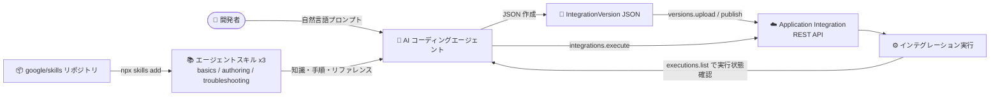

# Application Integration: エージェントスキルが公開 google/skills リポジトリで利用可能に

**リリース日**: 2026-10-28

**サービス**: Application Integration

**機能**: Application Integration エージェントスキル (agent skills)

**ステータス**: Feature

📊 [このアップデートのインフォグラフィックを見る](https://takech9203.github.io/google-cloud-news-summary/20261028-application-integration-agent-skills.html)

## 概要

Application Integration のエージェントスキル (agent skills) が、公開の [google/skills](https://github.com/google/skills) リポジトリで利用可能になりました。提供されるスキルは `application-integration-basics`、`application-integration-authoring`、`application-integration-troubleshooting` の 3 つです。

エージェントスキルは、AI エージェントに特定の知識と手順を再利用可能な形で与えるための標準化された仕組みで、スクリプト、リファレンス資料、テンプレートなどのリソースを含みます。これらのスキルを使う AI コーディングエージェントは、Application Integration のセットアップ、REST API を通じたインテグレーションの構築・公開・実行、失敗した実行のトラブルシューティングを、スキルなしのエージェントよりも高い正確性 (fidelity) で支援できます。

対象ユーザーは、Claude Code などのエージェントスキル対応の AI コーディングエージェントを使って Application Integration のインテグレーションを構築・運用したい開発者です。自然言語でインテグレーションの要件を記述すると、エージェントがインテグレーションバージョンの JSON を作成し、REST API でアップロード・公開・実行し、トラブルシューティングまで支援します。

**アップデート前の課題**

- AI コーディングエージェントは Application Integration 固有の知識 (IntegrationVersion の JSON 構造、REST API の呼び出し方、実行ステートの読み方など) を持たず、タスクの正確性が低かった
- Application Integration のセットアップ (API 有効化、リージョンのプロビジョニング、IAM ロールや run-as サービスアカウントの構成) を手動でドキュメントを参照しながら行う必要があった
- 失敗・スタック・無応答のインテグレーション実行の診断には、実行ステートやログ、Integration Connectors の接続ヘルスなどを自分で調査する必要があった

**アップデート後の改善**

- 公開リポジトリから `npx skills add google/skills --skill <スキル名>` で 3 つのスキルをインストールでき、エージェントが Application Integration のタスクを高い正確性で実行できるようになった
- 自然言語のプロンプトから、エージェントがインテグレーションの JSON 作成 → REST API でのアップロード (`versions.upload`) → 公開 (`versions.publish`) → 実行 (`integrations.execute`) までを支援できるようになった
- 実行レコード (`executions.list`) やログ・メトリクスの確認、サスペンションの解決、IAM・サービスアカウント・クォータエラーの修正といったトラブルシューティングをエージェントに任せられるようになった

## アーキテクチャ図



開発者が自然言語で要件を伝えると、google/skills リポジトリからインストールした 3 つのスキルを使う AI エージェントが、インテグレーションの JSON 作成から REST API 経由のアップロード・公開・実行・トラブルシューティングまでを支援します。

## サービスアップデートの詳細

### 主要機能

1. **application-integration-basics (セットアップ支援)**
   - Application Integration のセットアップ手順を提供: 必要な API の有効化、リージョンのプロビジョニング、IAM ロールと run-as サービスアカウントの構成、インターフェースの選択、クォータと制限の確認
   - リファレンスファイル: Core concepts、IAM and service accounts、Provisioning and Terraform、API access、Limits

2. **application-integration-authoring (構築・公開・実行支援)**
   - REST API を通じたインテグレーションの構築、バージョニング、公開、実行の手順を提供: インテグレーションバージョンの JSON でのダウンロード/アップロード、API トリガーと構成変数の設定、ドラフトの公開、インテグレーションの呼び出し、環境間のバージョン昇格 (プロモーション)
   - リファレンスファイル: IntegrationVersion JSON、REST API cheatsheet、Triggers and execution、Tasks and gotchas、CI/CD promotion

3. **application-integration-troubleshooting (トラブルシューティング支援)**
   - 失敗・スタック・無応答のインテグレーション実行を診断する手順を提供: 実行とタスクのステート確認、ログとメトリクスの読み取り、サスペンションの解決、Integration Connectors の接続ヘルス確認、IAM・run-as サービスアカウント・クォータエラーの修正
   - リファレンスファイル: Execution states、Common errors、Logging and monitoring、Suspensions、Connectors health

4. **安全性への配慮 (スキルに組み込まれた承認フロー)**
   - スキルはエージェントに対し、読み取り専用の確認 (インテグレーションや実行の一覧表示など) は自由に実行してよいが、変更を伴う操作 (API 有効化、IAM ポリシー変更、アップロード・公開・実行) の前には正確なコマンドやリクエストを提示してユーザーの承認を待つよう指示している

## 技術仕様

### 提供スキル一覧

| スキル名 | 対象タスク | 主なリファレンス |
|------|------|------|
| application-integration-basics | セットアップ (API 有効化、リージョンプロビジョニング、IAM、クォータ) | Core concepts、IAM、Terraform、API access、Limits |
| application-integration-authoring | 構築・公開・実行 (JSON 編集、API トリガー、公開、CI/CD 昇格) | IntegrationVersion JSON、REST API cheatsheet、Triggers、Tasks、CI/CD |
| application-integration-troubleshooting | 診断 (実行ステート、ログ、サスペンション、Connectors、IAM/クォータエラー) | Execution states、Common errors、Logging、Suspensions、Connectors health |

### エージェントが使用する主な REST API

| API メソッド | 役割 |
|------|------|
| `versions.upload` | JSON ファイルをインテグレーションの新バージョンとしてアップロード |
| `versions.publish` | バージョンを公開 (ACTIVE 化、旧公開バージョンは非公開に) |
| `integrations.execute` | 公開済みインテグレーションを API トリガー経由で同期実行 |
| `executions.list` | 実行レコードの取得 (SUCCEEDED / FAILED / SUSPENDED などのステート確認) |
| `versions.unpublish` / `versions.delete` | バージョンの非公開化・削除 (クリーンアップ) |

## 設定方法

### 前提条件

1. 安全に実験できる (本番ではない) Google Cloud プロジェクトで、課金が有効であること
2. サポートされているリージョンで [Application Integration をセットアップ](https://docs.cloud.google.com/application-integration/docs/setup-application-integration)済みであること
3. gcloud CLI をインストールし、`gcloud auth login` でサインイン済みであること (クライアントライブラリ使用時は `gcloud auth application-default login` を求められる場合あり)
4. エージェントスキルをサポートする AI コーディングエージェントを使用すること
5. IAM ロール: プロジェクトに対する Application Integration Editor (`roles/integrations.integrationEditor`)。インテグレーションに run-as サービスアカウントがある場合は、そのサービスアカウントに対する Service Account User (`roles/iam.serviceAccountUser`)

### 手順

#### ステップ 1: スキルのインストール

```bash
npx skills add google/skills --skill application-integration-basics
npx skills add google/skills --skill application-integration-authoring
npx skills add google/skills --skill application-integration-troubleshooting
```

プロンプトが表示されたら、構成するエージェントとインストールスコープを選択します。使用中のエージェントがリストにない場合、デフォルトの Universal オプションで `.agents/skills` にインストールされます。`npx` が利用できない場合は Node.js をインストールします。スキルの更新は `npx skills update` で行えます。

#### ステップ 2: エージェントにインテグレーションを依頼

空の作業ディレクトリでエージェントを起動し、トリガー、入出力、ルール、デプロイ先を具体的に記述します。公式ドキュメントの例 (保険金請求の自動判定インテグレーション):

```text
Using the Application Integration skills, build an integration named
claims-adjudication in project PROJECT_ID, region LOCATION.
- Start it with an API trigger named adjudicate_claim.
- Inputs: claimId (string), claimAmount (double), policyActive (boolean).
- Outputs: decision (string) and reason (string).
- Rules: if policyActive is false, return DENY. If claimAmount is 1000 or
  less, return APPROVE. Otherwise, return REVIEW.
- Save the integration version JSON in this directory so I can review it.
- Show me every command before you run it, then upload, publish, and run it
  once with a sample claim.
```

#### ステップ 3: 計画のレビューと承認

エージェントが生成したインテグレーションバージョンの JSON (`triggerConfigs`、`taskConfigs`、`integrationParameters` を含む) をレビューします。たとえば Cloud Logging (`cloudLoggingDetails.enableCloudLogging`) が有効化されているか確認します (コスト増につながるため)。変更を伴う操作はコマンドを確認してから承認します。

#### ステップ 4: 実行確認とトラブルシューティング

承認後、エージェントが `versions.upload` → `versions.publish` → `integrations.execute` を呼び出します。実行後は以下のように依頼して実行結果を検証できます。

```text
Check execution EXECUTION_ID of claims-adjudication. Did every task succeed?
If anything failed, tell me why and propose a fix.
```

## メリット

### ビジネス面

- **開発の高速化**: 自然言語でインテグレーション要件を記述するだけで、構築から公開・実行・検証までをエージェントが支援するため、開発リードタイムを短縮できる
- **学習コストの低減**: Application Integration 固有の JSON 構造や REST API の知識をスキルが補完するため、サービスに不慣れな開発者でも着手しやすい

### 技術面

- **タスクの正確性向上**: スキルにはリファレンスファイル (IntegrationVersion JSON 仕様、REST API チートシート、実行ステート一覧など) が含まれ、エージェントが正確にコマンドや API を実行できる
- **コードとしての管理**: インテグレーションバージョンを JSON ファイルとして作業ディレクトリに保存でき、ソース管理・レビュー・環境間の昇格 (CI/CD) と組み合わせられる
- **組み込みの安全策**: 変更操作の前に正確なコマンドを提示して承認を待つようスキルがエージェントに指示している

## デメリット・制約事項

### 制限事項

- 認証プロファイルはインテグレーションバージョンの JSON ファイルに含まれないため、各プロジェクトで個別に構成する必要がある
- 新バージョンの公開後、旧バージョンは最大 10 分間実行され続ける可能性があるため、修正のテスト前に待機が必要
- 公開 (publish) は旧バージョンのサスペンド中の実行 (承認待ちなど) をキャンセルする
- インテグレーション自体の削除には Application Integration Admin などのロールが必要 (Editor ロールでは不可)

### 考慮すべき点

- 本番プロジェクトではなく、安全に実験できる非本番プロジェクトで構築・テストし、レビュー済みの JSON を昇格させることが推奨されている
- 構成変数 (config variables) は平文で保存・エクスポートされるため、シークレットは認証プロファイルまたは Secret Manager アクセスタスクを使用する
- インテグレーションごとに専用の最小権限の run-as サービスアカウントを使用することが推奨されている
- `integrations.execute` の成功レスポンスは、すべてのタスクが期待どおり動作したことを必ずしも意味しない (リトライ戦略の Ignore / None や `doNotPropagateError` の影響)。実行レコードでタスクごとのステート確認が必要
- エージェントは開発者の gcloud 認証情報 (またはアプリケーションデフォルト認証情報) で REST API を呼び出すため、承認前にコマンド内のプロジェクト・リージョン・インテグレーション名を確認する

## ユースケース

### ユースケース 1: AI エージェントによるインテグレーションの新規構築

**シナリオ**: 保険金請求の自動判定 (claims-adjudication) のような業務ロジックを持つインテグレーションを、Application Integration の JSON 仕様を詳しく知らない開発者が構築したい。

**実装例**:
```bash
# スキルをインストール後、エージェントに要件をプロンプトで伝える
# エージェントが claims-adjudication.json を生成し、承認後に
# versions.upload → versions.publish → integrations.execute を実行

# 公開後は自分でも実行できる
curl -X POST \
  -H "Authorization: Bearer $(gcloud auth print-access-token)" \
  -H "Content-Type: application/json" \
  -d '{
    "triggerId": "api_trigger/adjudicate_claim",
    "inputParameters": {
      "claimId": {"stringValue": "CLM-1001"},
      "claimAmount": {"doubleValue": 2500},
      "policyActive": {"booleanValue": true}
    }
  }' \
  "https://integrations.googleapis.com/v1/projects/PROJECT_ID/locations/LOCATION/integrations/claims-adjudication:execute"
```

**効果**: Application Integration の詳細仕様を学習する前に、レビュー可能な JSON を介してインテグレーションを構築・公開・実行できる。

### ユースケース 2: 失敗した実行のトラブルシューティング

**シナリオ**: インテグレーションの実行が失敗・スタック・無応答になり、原因 (タスクエラー、IAM、サスペンション、Connectors の接続ヘルスなど) を特定したい。

**効果**: troubleshooting スキルを使うエージェントが `executions.list` で実行レコードを取得し、実行・タスクのステートやログを確認して原因と修正案を提示する。修正 (新バージョンのアップロード・公開) は承認後にエージェントが実施できる。

## 料金

エージェントスキル自体は公開 GitHub リポジトリ (google/skills) で提供されています。エージェントが構築・実行するインテグレーションには Application Integration の通常の料金が適用されます。また、インテグレーションで Cloud Logging を有効化 (`cloudLoggingDetails.enableCloudLogging`) するとコストが追加される可能性があります。

詳細は [Application Integration の料金ページ](https://cloud.google.com/application-integration/pricing) を参照してください。

## 利用可能リージョン

スキルは公開 GitHub リポジトリから利用できます。インテグレーション自体は Application Integration の[サポート対象リージョン](https://docs.cloud.google.com/application-integration/docs/locations)でセットアップする必要があります。

## 関連サービス・機能

- **Application Integration REST API**: エージェントがインテグレーションのアップロード・公開・実行・実行レコード取得に使用する API
- **Integration Connectors**: インテグレーションから外部システムへ接続するコネクタ。troubleshooting スキルは接続ヘルスの確認手順を含む
- **IAM / サービスアカウント**: run-as サービスアカウントと `roles/integrations.integrationEditor`、`roles/iam.serviceAccountUser` などのロール構成。basics スキルがセットアップ手順をカバー
- **Secret Manager**: シークレットを構成変数に保存せず、Secret Manager アクセスタスクで扱うことがベストプラクティス
- **Cloud Logging**: インテグレーションの実行ログの出力先 (デフォルトでは無効)
- **Gemini Code Assist**: Google Cloud コンソール内でインテグレーションを構築する別のアプローチ

## 参考リンク

- 📊 [インフォグラフィック](https://takech9203.github.io/google-cloud-news-summary/20261028-application-integration-agent-skills.html)
- [公式リリースノート](https://cloud.google.com/release-notes#October_28_2026)
- [Application Integration agent skills (公式ドキュメント)](https://docs.cloud.google.com/application-integration/docs/agent-skills-overview)
- [Build an integration with an AI agent (公式ドキュメント)](https://docs.cloud.google.com/application-integration/docs/build-integration-ai-agent)
- [google/skills リポジトリ](https://github.com/google/skills)
- [Agent Skills Overview](https://agentskills.io/home)
- [料金ページ](https://cloud.google.com/application-integration/pricing)

## まとめ

Application Integration の 3 つのエージェントスキル (basics / authoring / troubleshooting) が公開 google/skills リポジトリで利用可能になり、AI コーディングエージェントによるインテグレーションのセットアップ・構築・公開・実行・トラブルシューティングを高い正確性で支援できるようになりました。エージェントスキル対応の AI エージェントを利用している場合は、`npx skills add google/skills` でスキルをインストールし、非本番プロジェクトで公式チュートリアルの claims-adjudication の例から試すことを推奨します。

---

**タグ**: #ApplicationIntegration #AgentSkills #AIエージェント #iPaaS #RESTAPI #GoogleCloud
