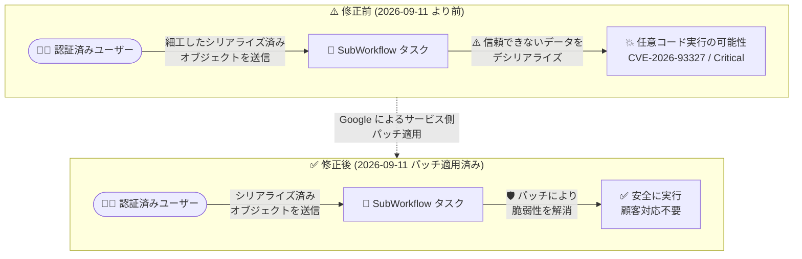

# Application Integration: SubWorkflow タスクにおける信頼できないデータのデシリアライゼーション脆弱性 (修正済み)

**リリース日**: 2026-10-28

**サービス**: Application Integration

**機能**: SubWorkflow タスクの Deserialization of Untrusted Data 脆弱性の修正 (GCP-2026-074 / CVE-2026-93327)

**ステータス**: Security (修正済み・顧客対応不要)

📊 [このアップデートのインフォグラフィックを見る](https://takech9203.github.io/google-cloud-news-summary/20261028-application-integration-subworkflow-deserialization-fix.html)

## 概要

Google Cloud は 2026 年 10 月 28 日、Application Integration の SubWorkflow タスクに存在した「信頼できないデータのデシリアライゼーション (Deserialization of Untrusted Data)」脆弱性に関するセキュリティ情報 GCP-2026-074 を公開しました。この脆弱性は 2026 年 9 月 11 日より前のバージョンの Application Integration に影響し、認証済みユーザーが悪意を持って細工したシリアライズ済みオブジェクトを使用して任意のコードを実行できる可能性があるものでした。重大度 (Severity) は **Critical** と評価され、[CVE-2026-93327](https://cve.mitre.org/cgi-bin/cvename.cgi?name=CVE-2026-93327) が割り当てられています。

本脆弱性は **2026 年 9 月 11 日にすでにパッチが適用されており、顧客側での対応は不要**です。Application Integration はフルマネージドの iPaaS (Integration Platform as a Service) であり、修正はサービス側で完結しています。

Application Integration では 2026 年に入ってから、JavaScript Task のデシリアライゼーション脆弱性 (GCP-2026-065)、タスク構成の認可不備 (GCP-2026-064)、Email Task の Confused Deputy 脆弱性 (GCP-2026-066)、AuthConfig 検証の認可不備 (GCP-2026-068) など、タスク実行基盤に関するセキュリティ修正が継続的に公表されています。今回の公表もその一連の流れに位置付けられ、同サービスを利用する組織はセキュリティ情報ページの継続的な確認が推奨されます。

**アップデート前の課題**

- 2026 年 9 月 11 日より前のバージョンの Application Integration では、SubWorkflow タスクにおいて信頼できないデータのデシリアライゼーション脆弱性が存在していた
- 認証済みユーザーが、悪意を持って細工したシリアライズ済みオブジェクトを使用して任意のコードを実行できる可能性があった
- 重大度は Critical と評価されていた

**アップデート後の改善**

- 2026 年 9 月 11 日にサービス側でパッチが適用され、脆弱性は解消された
- フルマネージドサービスのため、顧客側での対応 (アップグレードや設定変更) は一切不要
- セキュリティ情報 GCP-2026-074 として詳細が公開され、CVE-2026-93327 で追跡可能になった

## アーキテクチャ図

修正前は認証済みユーザーが細工したシリアライズ済みオブジェクトにより任意コードを実行できる可能性がありましたが、2026 年 9 月 11 日のサービス側パッチ適用により解消されています。

## サービスアップデートの詳細

### 脆弱性の内容

1. **脆弱性の種類: Deserialization of Untrusted Data (信頼できないデータのデシリアライゼーション)**
   - Application Integration の SubWorkflow タスクに存在
   - 2026 年 9 月 11 日より前のバージョンの Application Integration が影響対象

2. **攻撃シナリオ**
   - 認証済みユーザーが、悪意を持って細工したシリアライズ済みオブジェクトを使用して任意のコードを実行できる可能性があった

3. **対応状況**
   - 2026 年 9 月 11 日にパッチ適用済み
   - **顧客側での対応は不要** (No customer action is required)

## 技術仕様

### セキュリティ情報の概要

| 項目 | 詳細 |
|------|------|
| セキュリティ情報 ID | GCP-2026-074 |
| 公開日 | 2026-10-28 |
| CVE | [CVE-2026-93327](https://cve.mitre.org/cgi-bin/cvename.cgi?name=CVE-2026-93327) |
| 重大度 | Critical |
| 影響コンポーネント | Application Integration の SubWorkflow タスク |
| 影響バージョン | 2026 年 9 月 11 日より前のバージョン |
| パッチ適用日 | 2026 年 9 月 11 日 |
| 必要な顧客対応 | なし |

## デメリット・制約事項

### 考慮すべき点

- パッチ適用 (2026 年 9 月 11 日) からセキュリティ情報の公開 (2026 年 10 月 28 日) まで期間があるため、組織のセキュリティチームへのインシデント報告・記録の際は両方の日付を区別して扱う必要がある
- Application Integration では 2026 年にタスク実行基盤に関するセキュリティ修正が複数公表されており (GCP-2026-064/065/066/068 など)、同サービスの [セキュリティ情報ページ](https://docs.cloud.google.com/application-integration/docs/security-bulletins) を継続的に確認することが望ましい
- 関連する GCP-2026-068 への対策として、2026 年 10 月 15 日以降、新規インテグレーションでは run-as サービスアカウントに対する `iam.serviceAccounts.actAs` 権限が必要になっている点にも留意が必要

## 関連サービス・機能

- **Cloud IAM**: Application Integration では認可強化の一環として、新規インテグレーションの run-as サービスアカウントに `iam.serviceAccounts.actAs` 権限チェックが導入されている (GCP-2026-068 関連)
- **Google Cloud セキュリティ情報 (Security Bulletins)**: Google Cloud 全体のセキュリティ情報は [セキュリティ情報ページ](https://docs.cloud.google.com/support/bulletins) および RSS フィードで配信されており、継続的なモニタリングに活用できる
- **Call Integration タスク (サブインテグレーション呼び出し)**: Application Integration ではメインのインテグレーションから別のインテグレーションを呼び出すタスクが提供されており、サブワークフロー的な構成で広く利用されている

## 参考リンク

- 📊 [インフォグラフィック](https://takech9203.github.io/google-cloud-news-summary/20261028-application-integration-subworkflow-deserialization-fix.html)
- [公式リリースノート (Application Integration)](https://docs.cloud.google.com/application-integration/docs/release-notes)
- [セキュリティ情報 GCP-2026-074](https://docs.cloud.google.com/application-integration/docs/security-bulletins#gcp-2026-074)
- [CVE-2026-93327](https://cve.mitre.org/cgi-bin/cvename.cgi?name=CVE-2026-93327)
- [Application Integration ドキュメント](https://docs.cloud.google.com/application-integration/docs)
- [Google Cloud セキュリティ情報一覧](https://docs.cloud.google.com/support/bulletins)

## まとめ

Application Integration の SubWorkflow タスクに存在した Critical 評価のデシリアライゼーション脆弱性 (CVE-2026-93327) は、2026 年 9 月 11 日にサービス側で修正済みであり、顧客側での対応は不要です。ただし、同サービスでは 2026 年にタスク実行基盤に関するセキュリティ修正が相次いで公表されているため、セキュリティ情報ページを定期的に確認し、GCP-2026-068 関連の `iam.serviceAccounts.actAs` 権限要件など、対応が必要な変更を見落とさない運用体制を整えることを推奨します。

---

**タグ**: #ApplicationIntegration #セキュリティ #脆弱性 #CVE-2026-93327 #GCP-2026-074 #Deserialization #SubWorkflow
