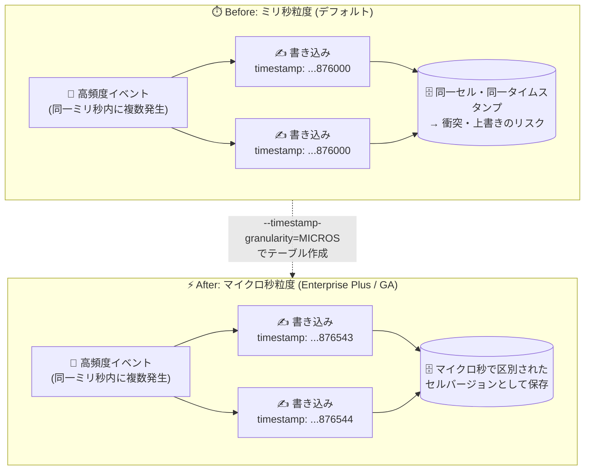

# Bigtable: マイクロ秒タイムスタンプ粒度のテーブルが GA

**リリース日**: 2026-10-28

**サービス**: Bigtable

**機能**: マイクロ秒タイムスタンプ粒度 (Microsecond timestamp granularity)

**ステータス**: GA (Enterprise Plus エディション限定)

📊 [このアップデートのインフォグラフィックを見る](https://takech9203.github.io/google-cloud-news-summary/20261028-bigtable-microsecond-timestamp-granularity.html)

## 概要

Bigtable で、テーブルのセルタイムスタンプにマイクロ秒精度 (microsecond granularity) を設定できる機能が一般提供 (GA) になりました。本機能は Enterprise Plus エディションのインスタンスで利用できます。

Bigtable の各セルは Unix エポック (1970-01-01 00:00:00 UTC) からのマイクロ秒数を表す Int64 のタイムスタンプを持ちますが、従来はミリ秒精度までしか許可されていませんでした。今回のアップデートにより、テーブル作成時に `micros` を指定することで、ユーザー指定・Bigtable 生成のいずれのタイムスタンプも完全なマイクロ秒精度 (例: `3023483279876543`) で受け付けられるようになります。

これにより、金融取引、IoT テレメトリ、広告テクノロジーなど、1 ミリ秒以内に同一セルへ複数イベントが書き込まれる高頻度ワークロードにおいて、タイムスタンプ衝突 (write collision) による意図しないデータ上書き・データ損失を防止できます。

**アップデート前の課題**

- デフォルト (ミリ秒粒度) のテーブルでは、タイムスタンプはマイクロ秒値のうちミリ秒精度まで (例: `3023483279876000`) しか許可されず、マイクロ秒精度のユーザー指定タイムスタンプは拒否されていた
- Bigtable 生成のマイクロ秒精度タイムスタンプはミリ秒精度に切り捨てられていた
- 高イベントレートのワークロードでは、同一ミリ秒内の複数書き込みが同じタイムスタンプを持つことで衝突し、データ損失が発生する可能性があった

**アップデート後の改善**

- テーブル作成時に `--timestamp-granularity=MICROS` を指定することで、完全なマイクロ秒精度のタイムスタンプを格納できるようになった
- ミリ秒あたり最大 1,000 件のイベントをタイムスタンプで区別でき、高頻度データの書き込み衝突によるデータ損失を防止できるようになった
- Enterprise Plus エディションの GA 機能として本番ワークロードで利用可能になった

## アーキテクチャ図



ミリ秒粒度ではタイムスタンプが同値になり衝突していた高頻度書き込みが、マイクロ秒粒度のテーブルでは個別のセルバージョンとして安全に保存されることを示しています。

## サービスアップデートの詳細

### 主要機能

1. **マイクロ秒精度のタイムスタンプ受け入れ**
   - マイクロ秒粒度のテーブルでは、ユーザー指定・Bigtable 生成の両方のタイムスタンプを完全なマイクロ秒精度で受け付ける
   - 例: `3023483279876543` のような値がそのまま格納される (ミリ秒粒度ではこの値は拒否される)

2. **テーブル作成時の粒度指定**
   - タイムスタンプ粒度はテーブル作成時に設定する (デフォルトは `millis`)
   - 粒度はイミュータブルで、テーブル作成後に変更することはできない
   - 指定した粒度に一致しないタイムスタンプは拒否される

3. **書き込み衝突によるデータ損失の防止**
   - 高イベントレートのワークロードで、同一ミリ秒内の複数イベントをタイムスタンプで区別可能
   - セルの複数バージョン管理 (versioning) がマイクロ秒単位で行われる

## 技術仕様

### タイムスタンプ粒度の比較

| 項目 | ミリ秒粒度 (デフォルト) | マイクロ秒粒度 |
|------|------------------------|----------------|
| タイムスタンプ形式 | マイクロ秒値 (ミリ秒精度まで)。例: `3023483279876000` | 完全なマイクロ秒精度。例: `3023483279876543` |
| ユーザー指定のマイクロ秒精度タイムスタンプ | 拒否される | 受け入れられる |
| Bigtable 生成のマイクロ秒精度タイムスタンプ | ミリ秒精度に切り捨て | そのまま保存 |
| 対象エディション | すべて | Enterprise Plus のみ |
| 設定タイミング | テーブル作成時 (変更不可) | テーブル作成時 (変更不可) |

### マイクロ秒粒度テーブルの制限事項

| 制限項目 | 内容 |
|----------|------|
| クライアントライブラリ | Java クライアントライブラリ v2.82.0 以降のみ対応。他のクライアントからの読み取り・書き込みリクエストは失敗する |
| エディション | Enterprise Plus エディションのインスタンスのみ |
| 粒度の変更 | テーブル作成後の変更は不可 |
| 連続マテリアライズドビュー | マイクロ秒粒度のテーブルには作成不可 |
| 論理ビュー | マイクロ秒粒度のテーブルには作成不可 |
| エディションのダウングレード | マイクロ秒粒度のテーブルが存在する場合、Enterprise Plus から Enterprise へのダウングレードは不可 (対象テーブルの削除が必要) |
| バックアップの復元 | マイクロ秒粒度テーブルのバックアップは Enterprise Plus インスタンスにのみ復元可能 |

## 設定方法

### 前提条件

1. Enterprise Plus エディションの Bigtable インスタンスがあること
2. マイクロ秒粒度テーブルへアクセスするアプリケーションは Bigtable Java クライアントライブラリ v2.82.0 以降を使用すること

### 手順

#### ステップ 1: マイクロ秒粒度のテーブルを作成

```bash
gcloud bigtable instances tables create TABLE_ID \
  --instance=INSTANCE_ID \
  --project=PROJECT_ID \
  --column-families=COLUMN_FAMILIES \
  --timestamp-granularity=MICROS
```

`--timestamp-granularity` フラグに `MICROS` を指定します。デフォルトは `MILLIS` (ミリ秒精度) です。粒度はテーブル作成時に固定され、後から変更できません。

#### ステップ 2: マイクロ秒精度タイムスタンプで書き込み

Java クライアントライブラリ (v2.82.0 以降) から、マイクロ秒精度のタイムスタンプを指定して書き込みを行います。書き込みリクエストのミューテーションに含まれるタイムスタンプが、そのままマイクロ秒精度で保存されます。

## メリット

### ビジネス面

- **データ損失リスクの排除**: 高頻度イベントの書き込み衝突による上書き・データ損失を防止し、金融・IoT などデータ完全性が重要なワークロードの信頼性を向上
- **GA による本番適用**: 一般提供となったため、SLA の対象として本番環境で安心して利用可能

### 技術面

- **タイムスタンプ精度の 1,000 倍向上**: ミリ秒 → マイクロ秒により、同一ミリ秒内に発生する最大 1,000 件のイベントを個別のセルバージョンとして区別可能
- **アプリケーション側の回避策が不要**: 人工的なシーケンス番号タイムスタンプなどの回避策を使わず、実時刻ベースのタイムスタンプで高頻度データを扱える

## デメリット・制約事項

### 制限事項

- Enterprise Plus エディションのインスタンスでのみ利用可能
- 対応クライアントは Java クライアントライブラリ v2.82.0 以降のみ。他のクライアントからのリクエストは失敗する
- テーブル作成後にタイムスタンプ粒度を変更できない
- 連続マテリアライズドビューおよび論理ビューをマイクロ秒粒度のテーブルに作成できない
- マイクロ秒粒度のテーブルが存在するインスタンスは Enterprise から Enterprise Plus へのダウングレードができない (テーブル削除が必要)
- バックアップは Enterprise Plus インスタンスにのみ復元可能

### 考慮すべき点

- 既存テーブルの粒度は変更できないため、マイクロ秒精度が必要な場合は新規テーブルを作成してデータを移行する必要がある
- Enterprise Plus エディションは Enterprise エディションよりノード単価が高い (後述の料金参照) ため、コストとのトレードオフを検討する
- Java 以外の言語でアプリケーションを構築している場合は現時点で利用できない

## ユースケース

### ユースケース 1: 金融取引・マーケットデータの記録

**シナリオ**: 証券取引や注文イベントが 1 ミリ秒以内に複数発生するシステムで、各イベントを正確な発生時刻 (マイクロ秒) とともに個別のセルバージョンとして保存したい。

**実装例**:
```bash
gcloud bigtable instances tables create trade-events \
  --instance=trading-instance \
  --project=my-project \
  --column-families=events \
  --timestamp-granularity=MICROS
```

**効果**: 同一ミリ秒内の複数取引イベントがタイムスタンプ衝突で上書きされることなく、すべて保存される。

### ユースケース 2: IoT・テレメトリの高頻度データ収集

**シナリオ**: センサーやデバイスから高頻度で送信されるテレメトリデータを Bigtable に書き込む際、ミリ秒精度では同一タイムスタンプとなる測定値が発生し、データが失われていた。

**効果**: マイクロ秒精度のタイムスタンプで各測定値を区別して保存でき、時系列データの完全性が保たれる。

## 料金

マイクロ秒タイムスタンプ粒度自体の追加料金に関する記載はリリースノートにはありません。本機能は Enterprise Plus エディション限定のため、Enterprise Plus の料金体系が適用されます。

Enterprise エディションと Enterprise Plus エディションはノード時間・ストレージ・ネットワークで同じ課金モデルを使用しますが、Enterprise Plus には専用のノード SKU があります。

### 料金例 (公開されている開始価格)

| 項目 | 料金 (開始価格) |
|--------|-----------------|
| Enterprise エディション ノード | $0.65 / ノード / 時間〜 |
| Enterprise Plus エディション ノード | $0.85 / ノード / 時間〜 |
| SSD ストレージ | $0.17 / GB / 月〜 |

詳細は [Bigtable 料金ページ](https://cloud.google.com/bigtable/pricing) を参照してください。

## 利用可能リージョン

リージョン別の提供状況はリリースノートに記載がありません。Enterprise Plus エディションのインスタンスで利用可能です。詳細は [Bigtable のドキュメント](https://docs.cloud.google.com/bigtable/docs/data-types) を参照してください。

## 関連サービス・機能

- **Bigtable Enterprise Plus エディション**: 本機能の前提となるエディション。インメモリティア、拡張ティアードストレージ (最大 64 TB/ノード)、最大 365 日のバックアップ保持などの高度な機能も提供
- **Bigtable Java クライアントライブラリ**: v2.82.0 以降がマイクロ秒粒度テーブルへの読み書きに必要
- **連続マテリアライズドビュー / 論理ビュー**: マイクロ秒粒度テーブルでは利用不可のため、これらの機能と併用する場合は粒度の選択に注意が必要
- **ガベージコレクション**: セルのバージョン管理・有効期限管理はタイムスタンプに基づいて行われるため、粒度の選択と関係する

## 参考リンク

- 📊 [インフォグラフィック](https://takech9203.github.io/google-cloud-news-summary/20261028-bigtable-microsecond-timestamp-granularity.html)
- [公式リリースノート](https://cloud.google.com/bigtable/docs/release-notes#October_28_2026)
- [ドキュメント: Data type enforcement in Bigtable (タイムスタンプ粒度)](https://docs.cloud.google.com/bigtable/docs/data-types#timestamp_granularity)
- [ドキュメント: テーブルの作成と管理](https://docs.cloud.google.com/bigtable/docs/managing-tables#create-table)
- [ドキュメント: エディションの概要](https://docs.cloud.google.com/bigtable/docs/editions-overview)
- [gcloud リファレンス: bigtable instances tables create](https://docs.cloud.google.com/sdk/gcloud/reference/bigtable/tables/create)
- [料金ページ](https://cloud.google.com/bigtable/pricing)

## まとめ

Bigtable のマイクロ秒タイムスタンプ粒度が GA となり、Enterprise Plus エディションで高頻度イベントの書き込み衝突によるデータ損失を防げるようになりました。金融・IoT・AdTech などミリ秒以内に複数イベントが発生するワークロードを運用している場合は、新規テーブルで `--timestamp-granularity=MICROS` の採用を検討してください。ただし、Java クライアント v2.82.0 以降限定、マテリアライズドビュー非対応、粒度変更不可などの制約があるため、設計段階での確認が重要です。

---

**タグ**: #Bigtable #Timestamp #Microsecond #EnterprisePlus #GA #NoSQL #TimeSeries #HighFrequencyData
