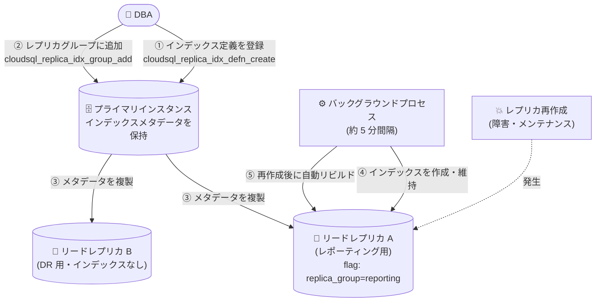

# Cloud SQL for MySQL: マネージドレプリカインデックスが一般提供 (GA) 開始

**リリース日**: 2026-10-28

**サービス**: Cloud SQL for MySQL

**機能**: マネージドレプリカインデックス (Managed replica indexes)

**ステータス**: GA (一般提供)

📊 [このアップデートのインフォグラフィックを見る](https://takech9203.github.io/google-cloud-news-summary/20261028-cloud-sql-mysql-managed-replica-indexes-ga.html)

## 概要

Cloud SQL for MySQL のマネージドレプリカインデックスが一般提供 (GA) になりました。この機能により、Cloud SQL がリードレプリカを再作成した際に、レプリカ上のセカンダリインデックスを自動的に保持・復元できるようになります。

MySQL のリードレプリカは通常読み取り専用ですが、レポーティングや分析目的でレプリカ上にのみセカンダリインデックスを作成できます。しかし従来は、プライマリのバックアップにレプリカ専用のインデックス定義が含まれないため、レプリカが再作成されるとカスタムのセカンダリインデックスが削除されていました。マネージドレプリカインデックスでは、Cloud SQL がプライマリインスタンス上でセカンダリインデックスのメタデータを追跡し、そのメタデータをリードレプリカに複製して、レプリカ再作成後にセカンダリインデックスを自動的に再構築します。

レプリカを使ったレポーティング・分析ワークロードを運用するデータベース管理者や SRE にとって、レプリカ障害・メンテナンス後のインデックス手動復旧という運用負荷を解消する重要なアップデートです。Google はセルフマネージドインデックスよりマネージドレプリカインデックスの使用を推奨しています。

**アップデート前の課題**

- Cloud SQL がリードレプリカを再作成 (インスタンス復旧、メンテナンス、ハードウェア障害時など) すると、レプリカ上に作成したカスタムのセカンダリインデックスがすべて削除されていた
- 削除されたインデックスは自動復元されず、`mysql.addSecondaryIdxOnReplica` ストアドプロシージャを手動で再実行するか、外部のスキーマ追跡スクリプトを維持する必要があった
- インデックスを再構築するまでの間、インデックスなしのクエリにより読み取りクエリのパフォーマンス低下 (レイテンシ急増、CPU 使用率上昇) が発生するリスクがあった
- 複数のレプリカに同じインデックス群を適用するには、レプリカごとに個別のストアドプロシージャを実行する必要があった

**アップデート後の改善**

- レプリカ再作成後、Cloud SQL がレプリカに割り当てられたセカンダリインデックスを自動的に再構築するようになり、手動復旧作業が不要になった
- インデックス定義をプライマリインスタンス上で一元管理し、名前付きレプリカグループに編成できるようになった。データベースフラグ `cloudsql_index_recreate_replica_group` を 1 つ設定するだけで、数百のインデックスを含むグループをレプリカに割り当てられる
- レポーティング用レプリカにのみインデックスグループを割り当て、DR 用レプリカはプライマリと同一スキーマのまま維持するといった、レプリカの役割に応じた選択的なインデックス適用が可能になった
- 専用ストアドプロシージャにより、インデックス作成の進捗、実行時間、エラーログを監視できるようになった

## アーキテクチャ図



プライマリインスタンス上でインデックス定義を一元管理し、レプリカグループに割り当てます。レプリカ側のバックグラウンドプロセスが約 5 分間隔でインデックスを作成・維持し、レプリカ再作成後も自動的に再構築します。

## サービスアップデートの詳細

### 主要機能

1. **インデックスの自動保持・復元**
   - Cloud SQL がプライマリインスタンス上でセカンダリインデックスのメタデータを追跡し、リードレプリカに複製する
   - レプリカのクラッシュや再作成後、レプリカにマッピングされたセカンダリインデックスを自動的に再構築する
   - インデックスの自動再構築によりクエリスループットを維持し、インデックスなしクエリによるレイテンシ急増や CPU 使用率上昇を防ぐ

2. **レプリカグループによる一元管理**
   - プライマリインスタンス上でインデックス定義を一度作成し、名前付きレプリカグループに編成する
   - リードレプリカ側はデータベースフラグ `cloudsql_index_recreate_replica_group` を設定するだけでグループ内のインデックスが適用される
   - レポーティング用レプリカにはインデックスグループを割り当て、DR 用レプリカはインデックスなしでプライマリと同一スキーマのまま維持する、といった役割別の設定が可能

3. **バックグラウンドによるバッチ実行とガードレール**
   - レプリカ上のバックグラウンドプロセスが約 5 分間隔でインデックスの作成・削除をバッチ処理する。1 つのインデックスの失敗が後続のインデックス実行をブロックしない
   - レプリケーションラグが 20 分を超えると、インデックス作成オペレーションを自動的に一時停止する (削除オペレーションは停止しない)
   - 作成されたマネージドインデックスのコメントには内部管理用の `[SIC_X_Y]` タグが付与される (機能への影響なし)

4. **可観測性とセルフマネージドインデックスとの共存**
   - `mysql.cloudsql_replica_idx_show_status()`、`mysql.cloudsql_replica_idx_show_errors()`、`mysql.cloudsql_replica_idx_show_all()` で進捗・エラー・実行時間を確認できる
   - 既存のセルフマネージドインデックスと同一インスタンス・同一テーブル上で共存でき、ダウンタイムなしで段階的に移行できる

## 技術仕様

### サポート要件

| 項目 | 詳細 |
|------|------|
| データベースバージョン | Cloud SQL for MySQL 8.0 以降 |
| エディション | Cloud SQL Enterprise edition / Enterprise Plus edition |
| メンテナンスバージョン | R20260726.00_05 以降 |
| 必要なロール | ストアドプロシージャの実行に `cloudsqlsuperuser` ロールが必要 |
| 外部サーバーレプリカ | 非サポート (セルフマネージドインデックスのみサポート) |
| デフォルト有効化 | マネージドレプリカインデックスはデフォルトで有効 (`cloudsql_index_recreate_enable` フラグ) |

### マネージド vs セルフマネージドの比較

| 項目 | マネージドレプリカインデックス | セルフマネージドレプリカインデックス |
|------|------|------|
| レプリカ再作成時の永続性 | 自動再構築 | 削除される (手動再構築が必要) |
| 設定モデル | プライマリ上のメタデータで一元管理 | レプリカ上で直接 DDL 実行 |
| 実行メカニズム | 定期バックグラウンドプロセス (約 5 分間隔) | 即時実行 |
| レプリケーションラグのガードレール | ラグ 20 分超で作成を自動一時停止 | なし (ユーザー管理) |
| 対応バージョン | メンテナンスバージョン R20260726.00_05 以降 | すべてのサポート対象バージョン |
| 外部サーバーレプリカ | 非サポート | サポート |

### 主要ストアドプロシージャ

| ストアドプロシージャ | 実行場所 | 役割 |
|------|------|------|
| `mysql.cloudsql_replica_idx_defn_create(IDXNAME, CREATESTMT)` | プライマリ | インデックス定義を作成 (一意の `IDXID` を返す) |
| `mysql.cloudsql_replica_idx_defn_drop(IDXID)` | プライマリ | インデックス定義を削除 |
| `mysql.cloudsql_replica_idx_group_add(IDXID, GRPNAME)` | プライマリ | 定義をレプリカグループに追加 (グループがなければ新規作成) |
| `mysql.cloudsql_replica_idx_group_drop(IDXID, GRPNAME)` | プライマリ | グループから定義を削除 |
| `mysql.cloudsql_replica_idx_show_status()` | レプリカ | 作成・削除オペレーションの状況・進捗を表示 |
| `mysql.cloudsql_replica_idx_show_errors()` | レプリカ | 失敗したインデックス再作成とエラーメッセージ・リトライ回数を表示 |
| `mysql.cloudsql_replica_idx_show_all()` | レプリカ | 全レコードのステータス・リトライ回数・実行時間・エラーを表示 |

## 設定方法

### 前提条件

1. Cloud SQL for MySQL 8.0 以降、Enterprise edition または Enterprise Plus edition のインスタンスであること
2. メンテナンスバージョンが R20260726.00_05 以降であること
3. ストアドプロシージャを実行するデータベースユーザーに `cloudsqlsuperuser` ロールが付与されていること

### 手順

#### ステップ 1: プライマリインスタンスでインデックス定義を作成

```sql
CALL mysql.cloudsql_replica_idx_defn_create(
  'INDEX_DEFINITION_NAME',
  'CREATE INDEX INDEX_NAME ON DATABASE.TABLE (COLUMNS)'
);
```

DDL 文はスキーマ修飾 (`schema_name.table_name`) が必要です。返される一意の整数 ID (`INDEX_DEFINITION_ID`) を控えておきます。

#### ステップ 2: インデックス定義をレプリカグループにマッピング

```sql
CALL mysql.cloudsql_replica_idx_group_add(INDEX_DEFINITION_ID, 'REPLICA_GROUP');
```

指定したグループが存在しない場合、Cloud SQL が新規作成します。

#### ステップ 3: リードレプリカにレプリカグループを割り当て

```bash
gcloud sql instances patch REPLICA_INSTANCE_NAME \
  --database-flags=EXISTING_FLAGS,cloudsql_index_recreate_replica_group=REPLICA_GROUP
```

データベースフラグのグループ名は、ステップ 2 で指定したグループ名と完全に一致させる必要があります。

#### ステップ 4: リードレプリカでステータスを確認

```sql
-- 進捗・ステータスの確認
CALL mysql.cloudsql_replica_idx_show_status();

-- エラーの監査
CALL mysql.cloudsql_replica_idx_show_errors();
```

バックグラウンドプロセスは約 5 分間隔で動作するため、設定後すぐに反映されない場合があります。詳細な進捗レポートには MySQL Performance Schema のステージインストルメント・コンシューマの有効化が必要です。

## メリット

### ビジネス面

- **運用負荷の削減**: レプリカ再作成のたびに必要だった手動のインデックス復旧作業や外部スキーマ追跡スクリプトの保守が不要になり、運用コストを削減できる
- **サービス品質の安定化**: レプリカ復旧後もクエリパフォーマンスが自動的に維持されるため、レポーティング・分析系サービスの品質劣化を防げる

### 技術面

- **一元管理とスケール**: インデックス定義をプライマリで一元管理し、フラグ 1 つで数百のインデックスを含むグループをレプリカに適用できる
- **プライマリの性能分離**: セカンダリインデックスはレプリカ上にのみ作成されるため、プライマリのストレージ消費や書き込みレイテンシに影響しない
- **安全なガードレール**: レプリケーションラグが 20 分を超えるとインデックス作成を自動停止し、レプリケーションへの悪影響を抑制する
- **段階的移行**: セルフマネージドインデックスと共存可能で、ダウンタイムやアクティブな読み取りワークロードの中断なしに移行できる

## デメリット・制約事項

### 制限事項

- Cloud SQL for MySQL 8.0 以降、Enterprise edition / Enterprise Plus edition、メンテナンスバージョン R20260726.00_05 以降のインスタンスでのみサポートされる
- 外部サーバーレプリカではマネージドレプリカインデックスはサポートされない (セルフマネージドのみ)
- 既存のインデックスメタデータの更新・変更はサポートされない。変更するには既存定義を削除 (またはグループから除外) して新しい定義を作成する必要がある
- 各ストアドプロシージャ呼び出しは COMMIT を実行するため、トランザクション内でロールバックできない

### 考慮すべき点

- インデックスの作成・削除は約 5 分間隔のバックグラウンドバッチで実行されるため、即時反映されない。即時実行が必要な場合はセルフマネージドインデックス (`mysql.addSecondaryIdxOnReplica`) が引き続き利用できる
- レプリカをプライマリに昇格すると、マネージドレプリカインデックスとして作成されたセカンダリインデックスは自動的に削除される (削除実行まで約 5 分の遅延が発生し得る)。プライマリ側のインデックス定義とグループマッピングは保持される
- DR 切り替え時、旧プライマリがレプリカになっても自動的にはインデックスが作成されない。必要な場合は旧プライマリに `cloudsql_index_recreate_replica_group` フラグを設定する
- セルフマネージドインデックスと同名のマネージド定義を登録すると `FAILED` ステータスが記録される (既存インデックスやトラフィックへの影響はなく、レプリカ再作成時に自動解決される)

## ユースケース

### ユースケース 1: レポーティング用レプリカのインデックスを障害後も自動維持

**シナリオ**: BI ツールからの分析クエリを専用のリードレプリカにオフロードしており、分析クエリ向けのセカンダリインデックスをレプリカにのみ作成している。レプリカがハードウェア障害で再作成されるたびにインデックスが消え、手動復旧までダッシュボードの表示が極端に遅くなっていた。

**実装例**:
```sql
-- プライマリで定義を登録
CALL mysql.cloudsql_replica_idx_defn_create(
  'orders_report_idx',
  'CREATE INDEX idx_orders_created ON sales.orders (created_at, status)'
);
-- 返された IDXID をレポーティンググループに追加
CALL mysql.cloudsql_replica_idx_group_add(1, 'reporting');
```
```bash
# レポーティング用レプリカにグループを割り当て
gcloud sql instances patch reporting-replica \
  --database-flags=cloudsql_index_recreate_replica_group=reporting
```

**効果**: レプリカ再作成後もインデックスが自動再構築され、手動復旧なしで分析クエリのパフォーマンスが維持される。

### ユースケース 2: 役割別レプリカ構成 (レポーティング用と DR 用の分離)

**シナリオ**: 同一プライマリ配下にレポーティング用レプリカと DR 用レプリカを運用している。DR レプリカには書き込みオーバーヘッドやレプリケーションラグの要因となる余分なインデックスを持たせたくない。

**効果**: インデックスグループをレポーティング用レプリカにのみ割り当てることで、DR レプリカはプライマリと同一スキーマのまま維持でき、DR インスタンスへの書き込みトランザクションオーバーヘッドとレプリケーションラグを防げる。

### ユースケース 3: セルフマネージドインデックスからの無停止移行

**シナリオ**: 既に `mysql.addSecondaryIdxOnReplica` でレプリカにインデックスを作成しているが、再作成時の消失リスクを解消したい。

**効果**: 既存のセルフマネージドインデックスと共存しながら、プライマリに定義を登録してグループに追加するだけで移行できる。次回のレプリカ再作成時に Cloud SQL が自動的にマネージドインデックスとして再作成する (即時移行したい場合はセルフマネージドインデックスを削除すれば約 5 分以内にマネージド側が作成される)。

## 料金

マネージドレプリカインデックス機能自体の追加料金に関する公式情報は確認できませんでした。リードレプリカは通常の Cloud SQL インスタンスとして課金されます。詳細は料金ページを参照してください。

- [Cloud SQL の料金](https://cloud.google.com/sql/pricing)

## 利用可能リージョン

リージョン固有の制限に関する公式情報は確認できませんでした。詳細は公式ドキュメントを参照してください。

## 関連サービス・機能

- **Cloud SQL リードレプリカ**: 本機能の対象。読み取りワークロードのオフロードや DR に利用されるレプリカ上のインデックスを管理する
- **Cloud SQL Advanced Disaster Recovery (DR)**: DR 切り替え時のインデックス挙動 (DR レプリカ昇格時のインデックス自動削除、旧プライマリへのフラグ再設定) に関連する
- **データベースフラグ**: レプリカグループの割り当て (`cloudsql_index_recreate_replica_group`) や機能の有効化 (`cloudsql_index_recreate_enable`) に使用する
- **MySQL Performance Schema**: インデックス作成の詳細な進捗レポートの取得に使用する

## 参考リンク

- 📊 [インフォグラフィック](https://takech9203.github.io/google-cloud-news-summary/20261028-cloud-sql-mysql-managed-replica-indexes-ga.html)
- [公式リリースノート](https://cloud.google.com/sql/docs/mysql/release-notes)
- [Read replica indexes overview (ドキュメント)](https://docs.cloud.google.com/sql/docs/mysql/replication/read-replica-indexes)
- [Create and manage read replica indexes (ドキュメント)](https://docs.cloud.google.com/sql/docs/mysql/replication/create-manage-read-replica-indexes)
- [Cloud SQL for MySQL ストアドプロシージャ](https://docs.cloud.google.com/sql/docs/mysql/stored-procedures)
- [料金ページ](https://cloud.google.com/sql/pricing)

## まとめ

Cloud SQL for MySQL のマネージドレプリカインデックスの GA により、レプリカ再作成時のセカンダリインデックス消失という長年の運用課題が解消されました。レプリカ上にカスタムインデックスを作成してレポーティング・分析ワークロードを運用しているチームは、メンテナンスバージョン R20260726.00_05 以降への更新を確認のうえ、セルフマネージドインデックスからマネージドレプリカインデックスへの移行を検討することを推奨します。

---

**タグ**: Cloud SQL, MySQL, リードレプリカ, セカンダリインデックス, GA, データベース, レプリケーション
