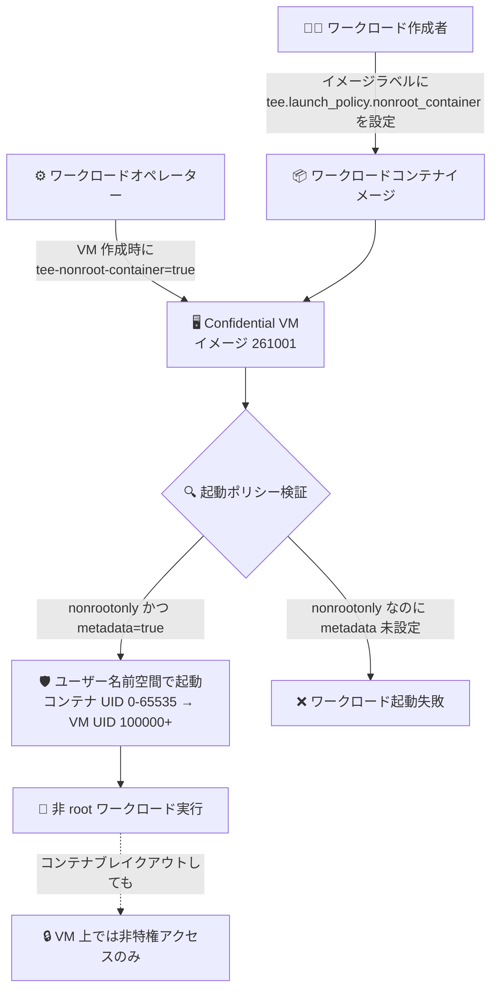

# Confidential Space: 新イメージ 261001 リリース (侵害された CA 証明書の削除と非 root コンテナ実行のサポート)

**リリース日**: 2026-10-28

**サービス**: Confidential Space

**機能**: Confidential Space イメージ 261001 (CA 証明書削除 / 非 root コンテナ実行)

**ステータス**: Announcement

📊 [このアップデートのインフォグラフィックを見る](https://takech9203.github.io/google-cloud-news-summary/20261028-confidential-space-image-261001.html)

## 概要

Confidential Space の新しいイメージ (バージョン 261001) が利用可能になりました。今回のイメージには、セキュリティ修正と新機能の 2 つの重要な変更が含まれています。

1 つ目は、**侵害された CA 証明書の OS トラストストアからの削除**です。セキュリティ速報 GCP-2026-071 (CVE-2026-111943) で公表されたとおり、サードパーティの eMudhra (emSign) 下位認証局 (CA) 証明書に関連する秘密鍵の侵害が報告されました。これらの CA 証明書は Confidential Space のベース OS である Container-Optimized OS (COS) を含む OS 証明書ストアに含まれていたため、イメージ 261001 ではこれらの証明書がトラストストアから削除されています。Google は旧イメージへのアテステーショントークン発行を段階的に停止する予定のため、**すべての Confidential Space ユーザーに早急なイメージ更新が推奨されます**。

2 つ目は、**ワークロードコンテナを非 root ユーザーとして実行する機能のサポート**です。ワークロード作成者は `tee.launch_policy.nonroot_container` 起動ポリシーで非 root 実行を必須化でき、ワークロードオペレーターは `tee-nonroot-container` メタデータ変数で有効化できます。コンテナブレイクアウト (コンテナからの脱出) が発生した場合の影響を低減でき、機密データを扱うマルチパーティコラボレーションにおける多層防御が強化されます。

**アップデート前の課題**

- 旧イメージ (261000 以前) の OS トラストストアには、秘密鍵の侵害が報告された eMudhra (emSign) 下位 CA 証明書が含まれており、未更新の TLS クライアントは外部 TLS 接続に対する中間者 (MitM) 攻撃や通信の偽装のリスクにさらされていた
- ワークロードコンテナは root として実行されており、コンテナブレイクアウトが発生した場合に Confidential VM 上で特権的なアクセスを許してしまう可能性があった
- ワークロード作成者が、オペレーターに対してコンテナの実行権限の制限を強制する手段がなかった

**アップデート後の改善**

- イメージ 261001 では侵害された CA 証明書が OS トラストストアから削除され、偽造された TLS 証明書を信頼するリスクが解消された
- 非 root コンテナ実行を有効にすると、Linux ユーザー名前空間とネットワーク名前空間が構成され、コンテナ内の UID/GID 0〜65535 が VM 上の非特権 ID (100000 以降) にマッピングされる。コンテナ内で root として動作するプロセスやコンテナから脱出したプロセスは、VM 上では非特権アクセスしか持たない
- ワークロード作成者は起動ポリシー `nonrootonly` により非 root 実行を必須化でき、オペレーターが有効にしない場合はワークロードの起動自体が失敗する (フェイルセーフ)

## アーキテクチャ図



ワークロード作成者が起動ポリシーで非 root 実行を要求し、オペレーターがメタデータ変数で有効化するフローを示しています。両者の設定が揃って初めてワークロードが起動し、コンテナから脱出しても VM 上では非特権アクセスに制限されます。

## サービスアップデートの詳細

### 主要機能

1. **侵害された CA 証明書の削除 (セキュリティ修正)**
   - eMudhra (emSign) 下位 CA 証明書 8 件の秘密鍵が、不十分な暗号論的乱数 (弱いエントロピー) により再構築可能であることが判明 (CVE-2026-111943)
   - イメージ 261001 では、これらの CA 証明書を OS トラストストアから削除
   - セキュリティ速報 GCP-2026-071 として公開され、重要度は Medium

2. **非 root コンテナ実行のサポート**
   - 有効化すると、Confidential Space がワークロード用に Linux ユーザー名前空間とネットワーク名前空間を構成
   - コンテナ内の UID/GID 0〜65535 は、Confidential VM 上の 100000 以降の非特権 ID にマッピングされる
   - Dockerfile に `USER` 命令を追加する必要はない
   - イメージ `confidential-space-261001` 以降が必要。それより古いイメージで設定した場合、ポリシー/メタデータは無視され、コンテナは root として実行される

3. **旧イメージへのアテステーション停止スケジュール**
   - **2026 年 11 月 9 日**: Google Cloud Attestation がバージョン 260701 より古いイメージへのアテステーショントークン送信を停止。Intel Trust Authority (ITA) は 261001 より古いイメージへのトークン送信を停止
   - **2027 年 1 月 11 日**: イメージバージョン 260701〜261000 から STABLE サポート属性を削除

## 技術仕様

### 非 root コンテナ実行の設定項目

| 項目 | 設定者 | 値 | 説明 |
|------|--------|-----|------|
| `tee.launch_policy.nonroot_container` | ワークロード作成者 (イメージラベル) | `unrestricted` (デフォルト) | root / 非 root のどちらで実行するかをオペレーターが選択できる |
| 同上 | 同上 | `nonrootonly` | 非 root 実行を必須化。オペレーターが `tee-nonroot-container=true` を設定しない場合、VM はワークロードの起動に失敗する |
| `tee-nonroot-container` | ワークロードオペレーター (VM メタデータ) | `true` / `false` (デフォルト: `false`) | `true` に設定すると、コンテナが隔離されたユーザー名前空間内で非 root ユーザーとして実行される |

### ユーザー名前空間のマッピング

| コンテナ内 | Confidential VM 上 |
|------|------|
| UID/GID 0 (root) | UID/GID 100000 (非特権) |
| UID/GID 1〜65535 | UID/GID 100001〜165535 (非特権) |

### セキュリティ速報 GCP-2026-071 の概要

| 項目 | 詳細 |
|------|------|
| 公開日 | 2026-10-28 |
| 重要度 | Medium |
| CVE | CVE-2026-111943 |
| 内容 | eMudhra (emSign) 下位 CA 証明書の秘密鍵侵害。偽造 TLS 証明書による MitM 攻撃のリスク |
| 対処 | イメージ 261001 への即時更新 |

## 設定方法

### 前提条件

1. Confidential Space イメージ 261001 以降を使用すること (非 root 実行は 261001 以降でのみ有効)
2. ワークロード作成者とオペレーターの間で、非 root 実行の要否について合意していること

### 手順

#### ステップ 1: 現在使用中のイメージバージョンを確認

```bash
gcloud compute disks list \
  --filter="sourceImage ~ 'confidential-space'" \
  --format="table(name, users[0], sourceImage)"
```

プロジェクト内の VM インスタンスが使用している Confidential Space イメージのバージョンを特定します。

#### ステップ 2: ワークロード作成者: 起動ポリシーの設定 (非 root 実行を必須化する場合)

```dockerfile
# Dockerfile でイメージラベルとして起動ポリシーを設定
LABEL "tee.launch_policy.nonroot_container"="nonrootonly"
```

`nonrootonly` を設定すると、オペレーターに非 root 実行を強制できます。USER 命令の追加は不要です。

#### ステップ 3: ワークロードオペレーター: 最新イメージで VM を作成し非 root 実行を有効化

```bash
gcloud compute instances create cs-workload-vm \
  --machine-type=n2d-standard-4 \
  --confidential-compute \
  --shielded-secure-boot \
  --image-project=confidential-space-images \
  --image-family=confidential-space \
  --service-account=WORKLOAD_SA@PROJECT_ID.iam.gserviceaccount.com \
  --scopes=cloud-platform \
  --metadata="^~^tee-image-reference=LOCATION-docker.pkg.dev/PROJECT_ID/REPO/workload:latest~tee-nonroot-container=true"
```

`--image-family=confidential-space` により最新イメージ (261001) が使用され、`tee-nonroot-container=true` で非 root 実行が有効になります。

#### ステップ 4: データコラボレーター: アテステーションポリシーでイメージバージョンを確認

```
int(assertion.swversion[0]) >= 260701
```

セキュリティ速報では、リライングパーティ (検証側) のアクセスポリシーに上記の条件を追加し、新しいバージョンの Confidential Space イメージであることを確認することが推奨されています。

## メリット

### ビジネス面

- **セキュリティインシデントへの迅速な対応**: 侵害された CA を信頼し続けることによる MitM 攻撃・通信偽装のリスクを排除し、機密データコラボレーションの信頼性を維持できる
- **コンプライアンス強化**: 最小権限の原則に基づくコンテナ実行により、規制要件やセキュリティ監査への対応力が向上する

### 技術面

- **コンテナブレイクアウトの影響低減**: ユーザー名前空間の隔離により、コンテナから脱出したプロセスも VM 上では非特権アクセスに制限される
- **フェイルセーフな権限制御**: ワークロード作成者が `nonrootonly` を設定すれば、オペレーター側の設定漏れがあってもワークロードは起動せず、root での意図しない実行を防げる
- **アプリケーション変更不要**: Dockerfile への `USER` 命令の追加が不要で、既存のコンテナイメージをそのまま非 root 実行に移行できる

## デメリット・制約事項

### 制限事項

- 非 root コンテナ実行はイメージ `confidential-space-261001` 以降でのみサポートされる。古いイメージで `tee.launch_policy.nonroot_container` や `tee-nonroot-container` を設定しても無視され、コンテナは root として実行される
- `tee.launch_policy.nonroot_container` のデフォルトは `unrestricted`、`tee-nonroot-container` のデフォルトは `false` のため、明示的に設定しない限り従来どおり root で実行される

### 考慮すべき点

- **2026 年 11 月 9 日以降**、Google Cloud Attestation は 260701 より古いイメージへ、Intel Trust Authority は 261001 より古いイメージへアテステーショントークンを送信しなくなる。該当環境では期日までのイメージ更新が必須
- **2027 年 1 月 11 日**にはイメージ 260701〜261000 から STABLE 属性が削除されるため、STABLE ベースのアテステーションポリシーを使用している環境も影響を受ける
- イメージの更新には VM の再作成が必要。本番ワークロードの無停止移行にはマネージドインスタンスグループ (MIG) の活用が推奨される
- 非 root 実行を必須化 (`nonrootonly`) する場合、ワークロードオペレーター全員が `tee-nonroot-container=true` とイメージ 261001 以降を使用するよう、事前の調整が必要

## ユースケース

### ユースケース 1: セキュリティ速報対応としての即時イメージ更新

**シナリオ**: 複数の金融機関が Confidential Space で共同のデータ分析基盤を運用している。GCP-2026-071 を受けて、侵害された CA 証明書を含む旧イメージからの移行が必要になった。

**実装例**:
```bash
# MIG を利用したゼロダウンタイム更新 (推奨)
# インスタンステンプレートを最新イメージで作成し、ローリング更新を実行

# 手動再作成の場合
gcloud compute instances delete OLD_VM --zone=ZONE
gcloud compute instances create NEW_VM \
  --image-family=confidential-space \
  --image-project=confidential-space-images \
  ... (その他のオプション)
```

**効果**: アテステーショントークン発行停止 (2026 年 11 月 9 日) 前に移行を完了し、ワークロードの中断と MitM リスクの両方を回避できる。

### ユースケース 2: マルチパーティ計算での非 root 実行の必須化

**シナリオ**: ワークロード作成者 (分析アルゴリズム提供者) が、データ保有者の懸念に応えるため、ワークロードコンテナの実行権限を最小化したい。オペレーター (インフラ運用者) の設定ミスで root 実行されることも防ぎたい。

**実装例**:
```dockerfile
LABEL "tee.launch_policy.nonroot_container"="nonrootonly"
```

**効果**: オペレーターが `tee-nonroot-container=true` を設定しない限りワークロードが起動しないため、常に非 root での実行が保証される。コンテナブレイクアウトが発生しても VM 上では非特権アクセスに制限され、機密データの保護レベルが向上する。

## 料金

Confidential Space 自体に追加料金はなく、基盤となる Confidential VM (Compute Engine) の料金が適用されます。イメージ 261001 への更新や非 root コンテナ実行の有効化による追加費用はありません。

- [Confidential VM の料金](https://cloud.google.com/compute/confidential-vm/pricing)

## 関連サービス・機能

- **Confidential VM**: Confidential Space イメージが動作する基盤。AMD SEV、Intel TDX、H100 GPU (a3-highgpu-1g) などに対応
- **Google Cloud Attestation / Intel Trust Authority (ITA)**: アテステーショントークンの発行元。今回のセキュリティ速報に伴い、旧イメージへのトークン発行停止スケジュールが設定された
- **Container-Optimized OS (COS)**: Confidential Space イメージのベース OS。今回の CA 証明書侵害の影響を受けたコンポーネント
- **マネージドインスタンスグループ (MIG)**: 本番ワークロードのゼロダウンタイムでのイメージ更新に推奨
- **GKE**: 同じ CVE-2026-111943 への対応として、COS / Ubuntu ノードイメージのパッチバージョンが提供されている (GKE セキュリティ速報 GCP-2026-071 参照)

## 参考リンク

- 📊 [インフォグラフィック](https://takech9203.github.io/google-cloud-news-summary/20261028-confidential-space-image-261001.html)
- [公式リリースノート](https://docs.cloud.google.com/release-notes#October_28_2026)
- [Confidential Space セキュリティ速報 (GCP-2026-071)](https://docs.cloud.google.com/confidential-computing/confidential-space/docs/security-bulletins#gcp-2026-071)
- [非 root コンテナ実行 (Non-root container execution)](https://docs.cloud.google.com/confidential-computing/confidential-space/docs/create-customize-workloads#non-root-container-execution)
- [起動ポリシー リファレンス](https://docs.cloud.google.com/confidential-computing/confidential-space/docs/reference/launch-policies)
- [メタデータ変数 リファレンス](https://docs.cloud.google.com/confidential-computing/confidential-space/docs/reference/metadata-variables)
- [Confidential Space イメージ (ライフサイクル・サポート属性)](https://docs.cloud.google.com/confidential-computing/confidential-space/docs/confidential-space-images)

## まとめ

Confidential Space イメージ 261001 は、eMudhra (emSign) CA 証明書侵害 (CVE-2026-111943) に対応するセキュリティ修正と、非 root コンテナ実行という防御強化機能を含む重要なリリースです。2026 年 11 月 9 日以降は旧イメージへのアテステーショントークン発行が順次停止されるため、すべての Confidential Space 環境で期日前のイメージ更新 (VM 再作成) を実施してください。あわせて、アテステーションポリシーへのバージョン条件 (`int(assertion.swversion[0]) >= 260701`) の追加と、非 root コンテナ実行の採用を検討することを推奨します。

---

**タグ**: #ConfidentialSpace #ConfidentialComputing #セキュリティ #CVE #非rootコンテナ #アテステーション
