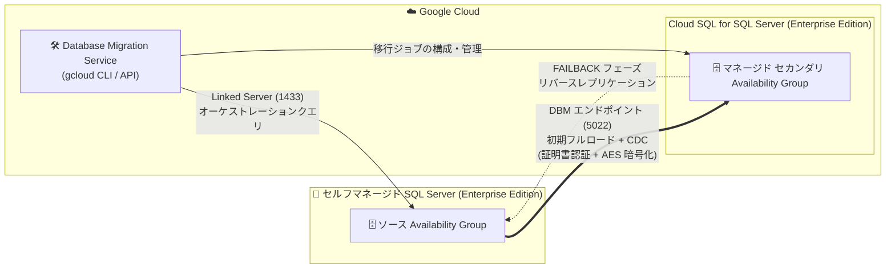

# Database Migration Service: SQL Server Distributed Availability Group (DAG) 移行が GA

**リリース日**: 2026-10-28

**サービス**: Cloud Database Migration Service

**機能**: Homogeneous SQL Server 移行における Distributed Availability Group (DAG) 移行の一般提供 (GA)

**ステータス**: GA (一般提供)

📊 [このアップデートのインフォグラフィックを見る](https://takech9203.github.io/google-cloud-news-summary/20261028-database-migration-service-sql-server-dag-ga.html)

## 概要

Database Migration Service (DMS) の同種 (homogeneous) SQL Server 移行において、Distributed Availability Group (DAG) を使用した移行が一般提供 (GA) になりました。DAG 移行では、gcloud CLI および Database Migration Service API を使用して、セルフマネージドの SQL Server Enterprise Edition インスタンスから Cloud SQL for SQL Server へ、プライベートネットワーク接続経由で直接データベースを移行できます。

DAG 移行の最大の特徴は、バックアップファイルやトランザクションログファイルを Cloud Storage にエクスポートする必要がない点です。DMS がソースの Availability Group と移行先 Cloud SQL for SQL Server 上のマネージドなセカンダリ Availability Group の間に Distributed Availability Group を構成し、初期フルロードと継続的な変更の両方をプライベートネットワーク経由で直接ストリーミングします。さらに、プロモーション後のリバースレプリケーション (FAILBACK フェーズ) をサポートしており、ゼロデータロスでのフェイルバックが可能です。

オンプレミスや他クラウドで SQL Server Enterprise Edition を Always On Availability Group 構成で運用しており、Cloud SQL for SQL Server への移行時にダウンタイムとデータロスのリスクを最小化したいエンタープライズユーザーに特に有用なアップデートです。

**アップデート前の課題**

従来の標準的なバックアップ / リストア方式の移行には、以下の課題がありました。

- フルバックアップ (.bak)、差分バックアップ (.diff)、トランザクションログ (.trn) ファイルを Cloud Storage バケットにエクスポート・アップロードする運用が必要だった
- 移行中、移行先のデータベースはプロモーションまで RESTORING モードとなり、クエリによる事前検証ができなかった
- プロモーションは一方向であり、カットオーバー後に問題が発生した場合にソースへ戻すリバースレプリケーション (フェイルバック) がサポートされていなかった

**アップデート後の改善**

- Distributed Availability Group により、初期フルロード (FULL_DUMP) と継続的レプリケーション (CDC) をプライベートネットワーク経由で直接ストリーミングできるようになり、バックアップファイルや Cloud Storage バケットが不要になった
- CDC フェーズ中は移行先データベースに読み取り専用モードでアクセスでき、カットオーバー前に検証クエリを実行できるようになった
- プロモーション後に Cloud SQL for SQL Server からソース SQL Server への組み込みリバースレプリケーション (FAILBACK フェーズ) が利用可能になり、ゼロデータロスのフェイルバック切り替えでカットオーバーを巻き戻せるようになった

## アーキテクチャ図



DMS がソースと移行先の間に Distributed Availability Group を構成し、Database Mirroring (DBM) エンドポイント経由でデータを直接ストリーミングします。プロモーション後は役割が反転し、Cloud SQL からソースへのリバースレプリケーションによるフェイルバックが可能です。

## サービスアップデートの詳細

### 主要機能

1. **バックアップファイル不要のダイレクトネットワーク移行**
   - ソースの Availability Group と移行先 Cloud SQL for SQL Server 上のマネージドなセカンダリ Availability Group の間に Distributed Availability Group を構成
   - 初期フルロードと継続的な変更の両方を SQL Server Database Mirroring (DBM) エンドポイント経由で直接ストリーミング (Cloud Storage へのバックアップファイルのステージングが不要)

2. **2 つのプライベートネットワーク通信チャネル**
   - **SQL Server Linked Server (デフォルト 1433 番ポート)**: 移行先 Cloud SQL 上に構成した Linked Server を使い、DMS がソースに対して管理・オーケストレーションクエリを実行
   - **Database Mirroring (DBM) エンドポイント (デフォルト 5022 番ポート)**: 証明書による相互認証と AES 暗号化で、初期フルロードデータと継続的な変更を直接交換

3. **4 つの移行ライフサイクルフェーズ**
   - **FULL_DUMP (初期フルロード)**: ソース Availability Group 内の全データベースの初期フルコピーをネットワーク経由でストリーミング
   - **CDC (継続的レプリケーション)**: 変更を継続的にレプリケーションし、移行先に読み取り専用の検証クエリを実行可能
   - **FAILBACK (プロモーションとリバースレプリケーション)**: プロモーションで役割を反転し、Cloud SQL が読み書き可能な Primary に、ソースが Secondary になり、新規書き込みをソースへ逆方向レプリケーション
   - **フェイルバック切り替え・完了**: `promote --failback` によるゼロデータロスのフェイルバック切り替え、または `delete` による移行完了とクリーンアップ

4. **CDC フェーズ中のデータベース動的追加・削除**
   - 移行ジョブの実行中にソース Availability Group へデータベースを追加すると、DMS が自動検出・検証し、初期フルロードを実行
   - データベースを削除すると、そのデータベースのレプリケーションが停止し、追跡対象から除外される

## 技術仕様

### DAG 移行の仕様

| 項目 | 詳細 |
|------|------|
| ソース | セルフマネージド SQL Server Enterprise Edition (2017 / 2019 / 2022 / 2025、Windows または Linux)。Always On Availability Group が有効であること |
| 移行先 | Cloud SQL for SQL Server Enterprise Edition (2017 / 2019 / 2022 / 2025) |
| 操作インターフェース | 接続プロファイルと移行ジョブの作成・検証・開始・プロモート・削除は gcloud CLI / DMS API のみ。進捗・データベースごとのステータス・メトリクスの監視は Google Cloud コンソールで可能 |
| データ移動方式 | DBM エンドポイント経由の直接ネットワークストリーミング (バックアップファイル・Cloud Storage 不要) |
| ネットワーク要件 | SQL Server データベースポート (デフォルト 1433) と Database Mirroring ポート (デフォルト 5022) での双方向プライベート IP 接続 (Private Services Access または Private Service Connect) |
| 移行対象 | 1 つの移行ジョブで単一ソース Availability Group 内の全データベースを移行 (DAG あたり最大 100 データベース) |
| セキュリティ | DBM エンドポイントは証明書ベースの相互認証と AES 暗号化が必須 |
| フェイルバック | プロモーション後の FAILBACK フェーズで Cloud SQL → ソースへのリバースレプリケーション。ゼロデータロスのフェイルバック切り替えに対応 |

### 標準移行 (バックアップ / リストア) との比較

| 項目 | 標準移行 (バックアップ / リストア) | DAG 移行 |
|------|-----------------------------------|----------|
| サポートされるソース | セルフマネージド SQL Server、Amazon RDS、Cloud SQL for SQL Server | セルフマネージド SQL Server (Enterprise Edition、Always On AG 必須) |
| データ移動 | .bak / .diff / .trn ファイルを Cloud Storage にステージング | DBM エンドポイント経由の直接ストリーミング |
| ソース ⇔ 移行先の接続 | 不要 | 双方向プライベート IP 接続が必須 (1433 / 5022) |
| 移行中の移行先アクセス | RESTORING モード (クエリ不可) | CDC フェーズ中は読み取り専用でアクセス可能 |
| プロモーション後のフェイルバック | 非対応 (一方向) | 組み込みリバースレプリケーション (ゼロデータロス切り替え対応) |

## 設定方法

### 前提条件

1. ソースと移行先の両方が SQL Server Enterprise Edition であること (Amazon RDS / Cloud SQL for SQL Server はソースとして非対応)
2. ソース SQL Server で Always On Availability Groups が有効で、全データベースのデータファイル (.mdf / .ndf) がデフォルトのデータディレクトリに格納されていること
3. ソースデータベースの所有者が `sa` ログインでないこと (移行前に別の SQL ログインまたは Windows ユーザーに変更)
4. Private Services Access または Private Service Connect による双方向プライベート IP 接続 (両方を同時に有効化しないこと)
5. 移行先 Cloud SQL インスタンスで `cloudsql enable linked servers` データベースフラグを有効化し、PITR は無効のまま、リードレプリカは追加しないこと
6. 必要な IAM ロール: 実行ユーザーに `roles/datamigration.admin` と `roles/cloudsql.editor`、DMS サービスアカウントに `roles/datamigration.serviceAgent`、`roles/cloudsql.editor`、`roles/cloudsql.studioUser`
7. Database Migration Service / Compute Engine / Cloud SQL Admin API の有効化 (DMS はリージョナルプロダクトのため、関連リソースはすべて同一リージョンに配置)

### 手順

#### ステップ 1: ソースに Database Mirroring エンドポイントと証明書を作成

```sql
USE [master];
GO
CREATE MASTER KEY ENCRYPTION BY PASSWORD = 'MASTER_KEY_PASSWORD';
GO
CREATE CERTIFICATE [dbmCertificate]
  WITH SUBJECT = 'AlwaysOn AG Certificate', EXPIRY_DATE = 'CERT_EXPIRY_DATE';
GO
CREATE ENDPOINT [HADR_ENDPOINT_NAME] STATE = STARTED
  AS TCP (LISTENER_PORT = 5022)
  FOR DATABASE_MIRRORING (
    ROLE = ALL,
    AUTHENTICATION = CERTIFICATE [dbmCertificate],
    ENCRYPTION = REQUIRED ALGORITHM AES
  );
GO
```

移行先側の DBM エンドポイントと証明書は、移行ジョブ開始時に DMS が自動構成し、Linked Server 経由で公開鍵を交換します。移行ジョブ削除時には両インスタンスからインポート済み証明書が自動削除されます。

#### ステップ 2: 移行先の接続プロファイルを作成 (gcloud CLI)

```bash
gcloud database-migration connection-profiles create sqlserver DESTINATION_CONNECTION_PROFILE_ID \
  --no-async \
  --display-name=DESTINATION_CONNECTION_PROFILE_NAME \
  --region=REGION \
  --role=DESTINATION \
  --cloudsql-instance=CLOUDSQL_INSTANCE_ID \
  --host=DESTINATION_HOST_IP_ADDRESS \
  --port=1433 \
  --dbm-port=5022 \
  --username=sqlserver \
  --password=CLOUD_SQL_DB_USER_PASSWORD
```

`--dbm-port` で移行先の Database Mirroring ポートを指定します。ソース側の接続プロファイルも同様に作成します。

#### ステップ 3: DAG 移行ジョブを作成・開始

```bash
gcloud database-migration migration-jobs create MIGRATION_JOB_ID \
  --no-async \
  --display-name=MIGRATION_JOB_NAME \
  --region=REGION \
  --type=CONTINUOUS \
  --source=SOURCE_CONNECTION_PROFILE_ID \
  --destination=DESTINATION_CONNECTION_PROFILE_ID \
  --sqlserver-dag-source-ag=SOURCE_AVAILABILITY_GROUP_NAME \
  --sqlserver-dag-linked-server=LINKED_SERVER_NAME
```

`--sqlserver-dag-source-ag` でソースの Availability Group 名、`--sqlserver-dag-linked-server` で移行先 Cloud SQL に構成した Linked Server 名を指定します。作成後、移行ジョブを開始すると FULL_DUMP → CDC と進行し、検証完了後にプロモートします。カットオーバーが確定したら `delete` で移行を完了し、DAG と証明書がクリーンアップされます。

## メリット

### ビジネス面

- **ダウンタイムとリスクの最小化**: CDC フェーズ中に移行先へ読み取り専用クエリで事前検証でき、プロモーション後も FAILBACK フェーズでソースへの逆同期が継続するため、問題発生時にゼロデータロスで元の環境に戻せる
- **運用負荷の削減**: バックアップ / トランザクションログファイルのエクスポート・Cloud Storage へのアップロードという継続的な運用作業が不要になる
- **追加費用なし**: Cloud SQL への同種移行における Database Migration Service の利用は無料 (Cloud SQL とネットワークの標準料金は別途発生)

### 技術面

- **ネイティブなレプリケーション技術の活用**: SQL Server 標準の Distributed Availability Group と Database Mirroring エンドポイントを使用し、証明書相互認証 + AES 暗号化で安全にストリーミング
- **自動オーケストレーション**: 移行先側の DBM エンドポイント・証明書・DAG 構成や、プロモーション時の役割反転を DMS が自動で実行
- **柔軟な移行ジョブ管理**: CDC フェーズ中のデータベース動的追加・削除の自動検出、stop / resume / restart によるジョブ制御に対応

## デメリット・制約事項

### 制限事項

- ソース・移行先ともに Enterprise Edition が必須 (Amazon RDS、Cloud SQL for SQL Server はソースとして非対応)
- DAG 移行ジョブの作成・検証・開始・プロモート・削除は gcloud CLI / API のみ (コンソールでは監視のみ可能)
- 1 つの DAG あたり最大 100 データベース。システムデータベース (master、model、msdb、tempdb) と DMS ヘルパーデータベース (gcp_dms_db) は移行対象外
- 全データベースのデータファイル (.mdf / .ndf) はデフォルトの SQL Server データディレクトリに格納されている必要がある
- パブリック IP 接続は非対応。Private Services Access または Private Service Connect によるプライベート IP 接続が必須
- ソースデータベースの所有者を `sa` にできない。Windows AD ユーザーが所有者の場合は SQL ログインへの変更、または移行先の Active Directory 統合が必要

### 考慮すべき点

- 移行ジョブが存在する間 (FAILBACK フェーズ含む)、移行先 Cloud SQL では PITR の無効化が必須で、リードレプリカ / リードプール、ニアゼロダウンタイム計画メンテナンスも利用できない
- 移行ジョブの `stop` 中はトランザクションログに更新が蓄積し続けるため、短期間に限定しないとログディスクが満杯になるおそれがある
- `restart` を実行すると移行先の移行済みデータベースが削除され、初期フルロードがネットワーク経由で再実行される
- FAILBACK フェーズ中に移行先 Cloud SQL 側で新規作成したデータベースは、ソース側の Availability Group には反映されない
- `cloud sql enable dag support` フラグは DMS が自動管理するため、手動で変更しないこと

## ユースケース

### ユースケース 1: オンプレミス SQL Server Always On 環境のゼロデータロス移行

**シナリオ**: オンプレミスで SQL Server 2019 Enterprise Edition を Always On Availability Group 構成で運用している基幹システムを、Cloud Interconnect / VPN 経由のプライベート接続で Cloud SQL for SQL Server に移行したい。カットオーバー後に問題が見つかった場合に備え、確実に元の環境へ戻せる手段が必要。

**実装例**:
```bash
# CDC フェーズで移行先を読み取り専用検証した後、プロモート (FAILBACK フェーズへ移行)
gcloud database-migration migration-jobs promote MIGRATION_JOB_ID --region=REGION

# 問題発生時: ゼロデータロスでソースを Primary に戻す (CDC フェーズへ復帰)
gcloud database-migration migration-jobs promote MIGRATION_JOB_ID --region=REGION --failback

# カットオーバー確定後: 移行を完了し DAG と証明書をクリーンアップ
gcloud database-migration migration-jobs delete MIGRATION_JOB_ID --region=REGION
```

**効果**: プロモーション後もソースへの逆同期が継続するため、万一の切り戻しでもデータロスなしで復旧できる。バックアップファイル運用が不要になり、移行作業全体が簡素化される。

### ユースケース 2: Cloud Storage を経由できない規制要件下での移行

**シナリオ**: セキュリティポリシー上、データベースのバックアップファイルを Cloud Storage などのオブジェクトストレージに書き出すことが許可されていない環境で、SQL Server を Cloud SQL に移行したい。

**効果**: DAG 移行はバックアップファイルのエクスポートを一切必要とせず、証明書相互認証 + AES 暗号化されたプライベートネットワーク接続上でのみデータが流れるため、中間ストレージを経由しない移行経路を実現できる。

## 料金

Cloud SQL への同種 (homogeneous) 移行において、Database Migration Service は追加料金なしで利用できます。ただし、移行先の Cloud SQL for SQL Server (Enterprise Edition) とネットワークの標準料金は別途適用されます。使用量の見積もりには料金計算ツールが利用できます。

- [Database Migration Service の料金](https://cloud.google.com/database-migration/pricing)
- [Cloud SQL の料金](https://cloud.google.com/sql/pricing)

## 利用可能リージョン

Database Migration Service はフルリージョナルなプロダクトであり、移行に関連するすべてのエンティティ (ソース / 移行先の接続プロファイル、移行ジョブ、移行先 Cloud SQL インスタンス) は同一リージョンに配置する必要があります。対応リージョンの詳細は[公式ドキュメント](https://cloud.google.com/database-migration/docs)を参照してください。

## 関連サービス・機能

- **Cloud SQL for SQL Server**: DAG 移行の移行先。Enterprise Edition (2017〜2025) が必要で、Linked Server 用のデータベースフラグ設定や Active Directory 統合 (Windows 認証の所有者がいる場合) と連携する
- **Private Services Access / Private Service Connect**: ソースと移行先の双方向プライベート IP 接続を実現するネットワークオプション (同一インスタンスで両方の併用は不可)
- **Managed Microsoft AD**: ソースデータベースの所有者が Windows AD ユーザーの場合に、移行先 Cloud SQL を AD 統合して対応するログインを自動作成するために使用
- **Cloud Monitoring / Google Cloud コンソール**: DAG 移行ジョブの進捗、データベースごとのステータス、メトリクスの監視に使用

## 参考リンク

- 📊 [インフォグラフィック](https://takech9203.github.io/google-cloud-news-summary/20261028-database-migration-service-sql-server-dag-ga.html)
- [公式リリースノート](https://cloud.google.com/release-notes#October_28_2026)
- [About Distributed Availability Group (DAG) migrations](https://docs.cloud.google.com/database-migration/docs/sqlserver/dag-migration-overview)
- [Migrate from self-managed SQL Server using Distributed Availability Groups](https://docs.cloud.google.com/database-migration/docs/sqlserver/dag-migration-guide)
- [Database Migration Service の料金](https://cloud.google.com/database-migration/pricing)

## まとめ

SQL Server の DAG 移行が GA となり、バックアップファイルや Cloud Storage を介さずにプライベートネットワーク経由で Cloud SQL for SQL Server へ直接移行し、プロモーション後もゼロデータロスでフェイルバックできる経路が正式に利用可能になりました。Always On Availability Group を運用する Enterprise Edition 環境の移行を計画している場合は、標準のバックアップ / リストア方式との比較表をもとに、ネットワーク要件 (双方向プライベート IP 接続) と Enterprise Edition 要件を確認した上で DAG 移行の採用を検討することを推奨します。

---

**タグ**: Database Migration Service, Cloud SQL for SQL Server, SQL Server, Distributed Availability Group, DAG, データベース移行, GA, フェイルバック
