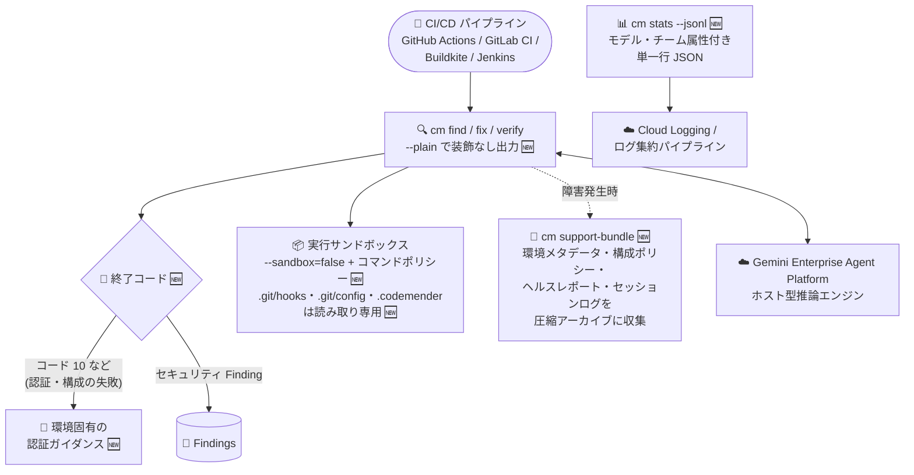

# Gemini Enterprise Agent Platform: CodeMender v0.17.0 アップデート

**リリース日**: 2026-10-28

**サービス**: Gemini Enterprise Agent Platform (CodeMender)

**機能**: CodeMender v0.17.0 (`cm support-bundle` 診断・`--plain` 出力・CI/CD 向け専用終了コード・サンドボックス/ポリシーフラグの分離)

**ステータス**: Fixed (CodeMender 自体は Preview)

📊 [このアップデートのインフォグラフィックを見る](https://takech9203.github.io/google-cloud-news-summary/20261028-gemini-enterprise-agent-platform-codemender-v0-17-0.html)

## 概要

Gemini Enterprise Agent Platform 上で提供される AI コードセキュリティエージェント「CodeMender」が v0.17.0 にアップデートされた。CodeMender は、コードベースの脆弱性をスキャン (`cm find`)、検証 (`cm verify`)、修正 (`cm fix`) する自律型エージェントで、推論は Google Cloud 側のホスト型エージェントが担い、コードの読み取り・ビルド・PoC (概念実証) エクスプロイトの実行はローカルの `cm` CLI サンドボックス内で行われる。

v0.17.0 は「運用性 (operability) と CI/CD 統合の強化」が中心のリリースである。トラブルシューティング用に環境メタデータ・構成ポリシー・ヘルスレポート・セッションログを圧縮アーカイブに収集する新コマンド `cm support-bundle`、スクリーンリーダーや CI/CD ログパイプライン向けに装飾を抑止する永続フラグ `--plain`、認証・構成の失敗をセキュリティ Finding と区別するための専用終了コード (認証情報の問題はコード 10 など)、`cm stats --jsonl` による Cloud Logging 連携向けの単一行 JSON 出力が追加された。また、GitHub Actions・GitLab CI・Buildkite・Jenkins といった CI/CD 環境では、対話型ログインプロンプトの代わりに環境に応じた認証ガイダンスが表示されるようになった。

セキュリティ面でも、多義的だった `--unrestricted` フラグが直交する `--sandbox=false` フラグと構成可能なコマンドポリシーに置き換えられ、コンテナサンドボックスと実行安全性コントロールが分離された。さらに `cm fix` / `cm verify` の実行中は、書き込み可能なサンドボックス内でも `.git/hooks`・`.git/config`・`.codemender` が読み取り専用でマウントされ、リポジトリのセキュリティポリシー改変が防止される。CodeMender を CI/CD パイプラインに組み込んで運用しているチームにとって、自動化の信頼性と安全性を底上げするアップデートである。

**アップデート前の課題**

- 環境メタデータ・構成ポリシー・ヘルスレポート・セッションログを個別に収集する必要があり、トラブルシューティング時のサポート情報収集に手間がかかっていた
- CLI 出力に絵文字・ANSI エスケープシーケンス・Unicode 罫線が含まれ、スクリーンリーダーや CI/CD ログパイプラインとの互換性に問題があった
- 構成・認証の失敗に専用の終了コードがなく、CI/CD パイプラインが環境セットアップの問題をセキュリティ Finding と混同する可能性があった
- GitHub Actions などの自動化された CI/CD 環境でも対話型ログインプロンプトが表示され、環境に応じた認証ガイダンスが得られなかった
- `cm stats` の出力を Cloud Logging やログ集約パイプラインに取り込むための単一行 JSON 形式がなかった
- `--unrestricted` フラグが「コンテナサンドボックスの無効化」と「実行安全性コントロールの無効化」を兼ねており、機能が多義的 (overloaded) だった
- 書き込み可能な実行サンドボックス内で `.git/hooks`・`.git/config`・`.codemender` が変更可能で、リポジトリのセキュリティポリシーが改変されるリスクがあった

**アップデート後の改善**

- 新コマンド `cm support-bundle` により、環境メタデータ・構成ポリシー・ヘルスレポート・セッションログを圧縮アーカイブとして一括収集でき、トラブルシューティングが効率化された
- 永続フラグ `--plain` (環境変数 `CM_PLAIN`、または `config.yaml` の `output.plain` でも設定可) で、絵文字・ANSI エスケープ・Unicode 罫線を抑止し、スクリーンリーダーや CI/CD ログとの互換性を確保できるようになった
- 構成・認証の失敗に専用の終了コード (認証情報の問題はコード 10 など) が割り当てられ、CI/CD パイプラインが環境セットアップの問題とセキュリティ Finding を区別できるようになった
- GitHub Actions・GitLab CI・Buildkite・Jenkins などの CI/CD 環境では、対話型ログインの代わりに環境固有の認証ガイダンスが表示されるようになった
- `cm stats --jsonl` で、モデル・チーム属性付きの単一行 JSON レコードを出力でき、Cloud Logging やログ集約パイプラインへシームレスに統合できるようになった
- `--unrestricted` が直交フラグ (`--sandbox=false`) と構成可能なコマンドポリシーに置き換えられ、コンテナサンドボックスと実行安全性コントロールを個別に制御できるようになった
- `cm fix` / `cm verify` 実行中は `.git/hooks`・`.git/config`・`.codemender` が読み取り専用でマウントされ、リポジトリセキュリティポリシーの改変が防止されるようになった

## アーキテクチャ図



v0.17.0 では、CI/CD パイプラインを起点とした自動実行の信頼性 (専用終了コード・プレーン出力・認証ガイダンス)、サンドボックスの安全性 (フラグ分離・読み取り専用マウント)、運用の可観測性 (`cm support-bundle`・`cm stats --jsonl`) が一体的に強化された。

## サービスアップデートの詳細

### 主要機能

1. **サポートバンドル診断 (`cm support-bundle`)**
   - 環境メタデータ、構成ポリシー、ヘルスレポート、セッションログを 1 つの圧縮アーカイブとして収集する新コマンド
   - トラブルシューティングに必要な情報収集を一括化し、サポートへの連携や障害解析を効率化する

2. **プレーン出力モード (`--plain`)**
   - 永続フラグ `--plain` により、装飾的な絵文字・ANSI エスケープシーケンス・Unicode 罫線の出力を抑止する
   - 環境変数 `CM_PLAIN`、または `config.yaml` の `output.plain` でも設定可能
   - スクリーンリーダー (アクセシビリティ) や CI/CD ログパイプラインとの互換性を確保する

3. **セットアップ失敗の専用終了コード**
   - 構成・認証の失敗に対して固有の終了コード (認証情報の問題はコード 10 など) を割り当て
   - CI/CD パイプラインが「環境セットアップの問題」と「セキュリティ Finding の検出」を終了コードで区別できるようになった

4. **CI/CD 向け認証ガイダンス**
   - GitHub Actions、GitLab CI、Buildkite、Jenkins などの自動化された CI/CD システム内で実行されている場合、対話型ログインプロンプトの代わりに環境固有の認証ガイダンスを表示する

5. **単一行 JSONL 統計 (`cm stats --jsonl`)**
   - `cm stats` に `--jsonl` フラグが追加され、モデル・チーム属性付きの単一行 JSON レコードを出力できる
   - Cloud Logging やログ集約パイプラインへのシームレスな統合が可能になった

6. **サンドボックス/ポリシーフラグの分離**
   - 多義的だった `--unrestricted` フラグを、直交するフラグ (`--sandbox=false`) と構成可能なコマンドポリシーに置き換え
   - コンテナサンドボックス (OS レベル分離) と実行安全性コントロール (コマンドポリシー) を個別に制御できるようになった

7. **サンドボックス構成の保護**
   - `cm fix` / `cm verify` の実行中、書き込み可能な実行サンドボックス内でも `.git/hooks`・`.git/config`・`.codemender` を読み取り専用でマウント
   - エージェントや実行されるツールによるリポジトリセキュリティポリシーの改変を防止する

8. **バグ修正**
   - サンドボックス分離の無効化と対話型承認のスキップが同時に行われた状態でコマンドを実行する際、セキュリティ警告を表示するようにした
   - ホスト側のファイル検出および修復ファイル操作全体で `allowedRoots` のパス境界を強制し、宙に浮いたシンボリックリンク (dangling symlink) 経由のパストラバーサルを防止した
   - `cm fix` 実行時に Finding の正確な行範囲を修復エージェントに供給し、手動でのファイルスキャンのオーバーヘッドを排除した
   - `cm report import` で位置情報のない Finding を先頭行デフォルトではなくファイルレベルの Finding として扱うようにした
   - `cm session cancel` が、ローカル環境のオーバーライドに関係なくセッションの元のリージョンへリクエストをルーティングするようにした
   - `cm verify` の Finding ステータス追跡を修正し、「悪用不可 (unexploitable)」の判定がローカル状態データベースに反映されるようにした (従来は Finding がオープンのまま残っていた)

## 技術仕様

### CodeMender の基本アーキテクチャ

| 項目 | 詳細 |
|------|------|
| 実行モデル | ローカルファースト (推論は Google Cloud 側、コード読み取り・ビルド・PoC 実行はローカルサンドボックス) |
| 構成要素 | Agent (ホスト型マルチエージェントシステム) + Client (CLI 兼デーモン) |
| サンドボックス | OS レベルのプロセスサンドボックス (Linux: namespaces/seccomp、macOS: sandbox-exec、Windows: AppContainer (Experimental)) |
| デフォルトモデル | Gemini 3.8 Flash (`--model` で Gemini 3.8 Flash Cyber、Gemini 4 Argon などに変更可) |
| 必要な API | Agent Platform API (`aiplatform.googleapis.com`)、Cloud Resource Manager API (`cloudresourcemanager.googleapis.com`) |
| 推奨 IAM ロール | Agent Platform User (`roles/aiplatform.user`) |

### v0.17.0 の新しい運用系オプション

| 項目 | 設定方法 | 説明 |
|------|----------|------|
| プレーン出力 | `--plain` フラグ / 環境変数 `CM_PLAIN` / `config.yaml` の `output.plain` | 絵文字・ANSI エスケープ・Unicode 罫線を抑止 |
| JSONL 統計 | `cm stats --jsonl` | モデル・チーム属性付きの単一行 JSON レコードを出力 |
| サンドボックス制御 | `--sandbox=false` (従来の `--unrestricted` を置換) | コンテナサンドボックスの有効/無効を単独で制御 |
| コマンドポリシー | 構成可能なコマンドポリシー | 実行安全性コントロールをサンドボックスと独立して構成 |
| セットアップ失敗の終了コード | 専用コード (例: 認証情報の問題 = 10) | CI/CD で環境問題と Finding を区別 |

### サンドボックス内で読み取り専用になるパス (cm fix / cm verify 実行中)

| パス | 保護の目的 |
|------|-----------|
| `.git/hooks` | Git フック経由の任意コード実行の仕込みを防止 |
| `.git/config` | リポジトリ設定 (フックパス・エイリアス等) の改変を防止 |
| `.codemender` | CodeMender 自身のポリシー・構成の改変を防止 |

## 設定方法

### 前提条件

1. Google Cloud プロジェクトのセットアップ (Agent Platform API と Cloud Resource Manager API の有効化、`roles/aiplatform.user` の付与)
2. CodeMender CLI のダウンロード・インストールと Google Cloud 認証情報 (ADC) の構成
3. CodeMender は Public Preview のため、利用には対象顧客としてのアクセスが必要

### 手順

#### ステップ 1: CLI を v0.17.0 に更新

```bash
# 最新バージョンへ即時更新 (24 時間スロットルを無視、非対話で適用)
cm update
```

#### ステップ 2: CI/CD 向けのプレーン出力と統計出力を構成

```bash
# CI/CD ログパイプライン向けに装飾なし出力を有効化
export CM_PLAIN=1
cm find . --plain

# モデル・チーム属性付きの単一行 JSON 統計を出力 (Cloud Logging 連携向け)
cm stats --jsonl
```

`config.yaml` で永続化する場合:

```yaml
output:
  plain: true
```

#### ステップ 3: 終了コードで環境問題と Finding を区別

```bash
cm find .
status=$?

# 例: 認証情報の問題は専用終了コード (コード 10) で判別
if [ "$status" -eq 10 ]; then
  echo "credential issue: check CI/CD authentication setup"
  exit 1
fi
```

構成・認証の失敗が専用終了コードで返るため、CI/CD パイプラインで「セットアップ失敗」と「セキュリティ Finding」を分岐処理できる。

#### ステップ 4: トラブルシューティング時のサポートバンドル収集

```bash
# 環境メタデータ・構成ポリシー・ヘルスレポート・セッションログを
# 圧縮アーカイブとして一括収集
cm support-bundle
```

## メリット

### ビジネス面

- **CI/CD 運用の信頼性向上**: 専用終了コードにより、環境セットアップの問題がセキュリティ Finding として誤検知されることがなくなり、パイプラインの分岐処理やアラートの精度が上がる。CI/CD 環境では環境固有の認証ガイダンスが表示されるため、自動化環境での認証トラブルの解決も速くなる
- **トラブルシューティングの効率化**: `cm support-bundle` により、障害解析やサポート連携に必要な情報を 1 コマンドで収集でき、問題解決までの時間を短縮できる
- **アクセシビリティの向上**: `--plain` モードはスクリーンリーダー利用者への配慮であり、組織のアクセシビリティ要件にも対応しやすくなる

### 技術面

- **ログ基盤との統合**: `cm stats --jsonl` の単一行 JSON レコード (モデル・チーム属性付き) を Cloud Logging やログ集約パイプラインに直接取り込め、チーム別・モデル別の利用状況を既存の可観測性基盤で分析できる
- **セキュリティ制御の明確化**: `--unrestricted` の廃止により、「サンドボックスを無効化するが、コマンドポリシーは維持する」といった粒度の細かい制御が可能になった
- **リポジトリポリシーの保護**: `.git/hooks`・`.git/config`・`.codemender` の読み取り専用マウントにより、`cm fix` / `cm verify` 中にエージェントや実行ツールがリポジトリのセキュリティポリシーを改変するリスクが排除された
- **パストラバーサル対策**: `allowedRoots` 境界の強制により、宙に浮いたシンボリックリンク経由でスキャン対象外のホストパスへアクセスされるリスクが低減した

## デメリット・制約事項

### 制限事項

- CodeMender は Preview (Pre-GA) であり、限定された顧客向けの提供。商用・本番目的での利用は不可で、テスト・評価目的に限定される
- 解析対象は、自身が所有または利用を許可されたコード、もしくは OSI 承認ライセンスで配布される OSS に限られる

### 考慮すべき点

- **`--unrestricted` フラグの置き換えに注意**: v0.17.0 で `--unrestricted` は直交フラグ (`--sandbox=false`) と構成可能なコマンドポリシーに置き換えられた。既存のスクリプトや CI/CD 設定で `--unrestricted` を使用している場合は、新しいフラグ体系への移行が必要
- **終了コードに依存するパイプラインの確認**: セットアップ失敗に専用終了コードが割り当てられたため、終了コードを判定している既存の CI/CD パイプラインは、新しいコード体系 (認証情報の問題 = コード 10 など) に合わせた分岐の見直しを推奨
- サンドボックスを無効化し、かつ対話型承認をスキップした状態での実行にはセキュリティ警告が表示される。この組み合わせで実行する場合は、隔離された VM やコンテナ内での実行が推奨される

## ユースケース

### ユースケース 1: GitHub Actions でのスキャン自動化の堅牢化

**シナリオ**: GitHub Actions 上で `cm find` を定期実行しているが、認証情報の期限切れによる失敗が「スキャン失敗」として扱われ、原因の切り分けに時間がかかっていた。また、ログに ANSI エスケープや絵文字が混ざり可読性が低かった。

**実装例**:
```yaml
# GitHub Actions ステップの例
- name: CodeMender scan
  env:
    CM_PLAIN: "1"   # 装飾なし出力で CI ログを読みやすく
  run: |
    cm find . || status=$?
    if [ "${status:-0}" -eq 10 ]; then
      echo "::error::CodeMender credential issue (exit code 10)"
      exit 1
    fi
```

**効果**: 専用終了コードにより環境起因の失敗を Finding と区別して fail-fast でき、CI/CD 環境では環境固有の認証ガイダンスが表示されるため復旧も速い。`CM_PLAIN` によりログの可読性と後処理の安定性が向上する。

### ユースケース 2: Cloud Logging でのチーム別利用状況の可視化

**シナリオ**: 複数チームで CodeMender を共用しており、モデル別・チーム別のトークン利用状況をログ基盤で横断的に把握したい。

**実装例**:
```bash
# 単一行 JSON レコードをログパイプラインへ送出
cm stats --jsonl >> /var/log/codemender/stats.jsonl
```

**効果**: モデル・チーム属性付きの単一行 JSONL は Cloud Logging やログ集約パイプラインでそのまま構造化ログとして取り込めるため、チーム別のコスト配賦や利用傾向のダッシュボード化が容易になる。

### ユースケース 3: 障害発生時のサポートバンドル収集

**シナリオ**: `cm fix` が特定リポジトリで失敗するが、原因が構成・認証・セッションのいずれにあるか切り分けられない。

**実装例**:
```bash
# 環境メタデータ・構成ポリシー・ヘルスレポート・セッションログを一括収集
cm support-bundle
```

**効果**: トラブルシューティングに必要な情報が 1 つの圧縮アーカイブにまとまるため、個別のログ収集作業が不要になり、障害解析やサポートへの情報提供が迅速化する。

## 関連サービス・機能

- **Gemini Enterprise Agent Platform**: CodeMender のホスト型推論エンジンが稼働する基盤。CLI は Interactions API 経由でこのバックエンドと通信する
- **Cloud Logging**: `cm stats --jsonl` の単一行 JSON レコードの取り込み先として想定されるログ基盤
- **Cloud Billing**: CodeMender のトークン使用量に基づく課金レポートの確認に使用
- **GitHub Actions / GitLab CI / Buildkite / Jenkins**: v0.17.0 で環境固有の認証ガイダンスが提供される CI/CD システム。専用終了コードや `--plain` 出力と組み合わせて堅牢なパイプラインを構成できる

## 参考リンク

- 📊 [インフォグラフィック](https://takech9203.github.io/google-cloud-news-summary/20261028-gemini-enterprise-agent-platform-codemender-v0-17-0.html)
- [公式リリースノート](https://docs.cloud.google.com/release-notes#October_28_2026)
- [CodeMender ドキュメント](https://docs.cloud.google.com/gemini-enterprise-agent-platform/agents/codemender)
- [環境のセットアップ](https://docs.cloud.google.com/gemini-enterprise-agent-platform/agents/codemender/set-up-environment)

## まとめ

CodeMender v0.17.0 は、`cm support-bundle` による診断情報の一括収集、`--plain` 出力、専用終了コード、`cm stats --jsonl` といった CI/CD・運用統合の強化と、`--unrestricted` の分離 (`--sandbox=false` + コマンドポリシー) や `.git/hooks` 等の読み取り専用マウントによるサンドボックスの安全性強化を同時に実現するアップデートである。既存ユーザーは、`--unrestricted` を使用しているスクリプトの移行と、終了コードを判定する CI/CD パイプラインの分岐見直しを行いつつ、`CM_PLAIN` と `--jsonl` を活用したログ基盤統合を進めることを推奨する。

---

**タグ**: #GeminiEnterpriseAgentPlatform #CodeMender #セキュリティ #AIエージェント #CICD #脆弱性スキャン #DevSecOps
