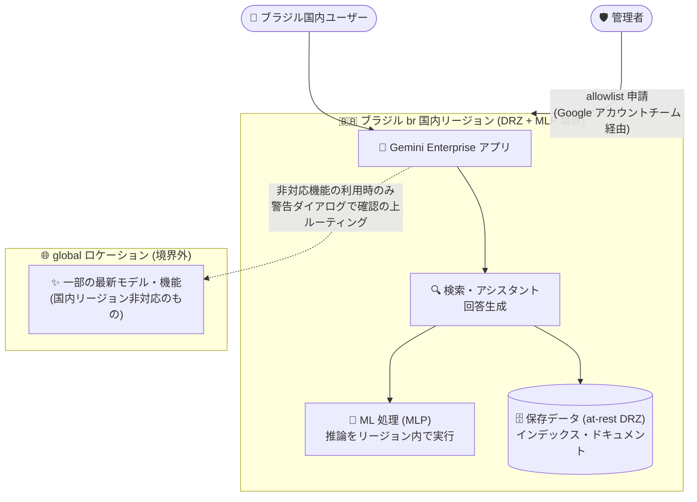

# Gemini Enterprise: ブラジル (br) 国内リージョンのサポート (GA with allowlist)

**リリース日**: 2026-10-28

**サービス**: Gemini Enterprise

**機能**: ブラジル (br) 国内リージョンのサポート (データレジデンシーと ML 処理のリージョン内実行)

**ステータス**: GA (allowlist 制)

📊 [このアップデートのインフォグラフィックを見る](https://takech9203.github.io/google-cloud-news-summary/20261028-gemini-enterprise-brazil-region-ga.html)

## 概要

Gemini Enterprise アプリがブラジル (br) 国内リージョン (in-country region) で利用可能になりました。このリージョンでは、保存データのデータレジデンシー (at-rest DRZ: Data Residency Zone) と機械学習処理 (MLP: Machine Learning Processing) の両方がリージョン内で完結します。本ロケーションは GA (一般提供) ですが allowlist 制となっており、利用するには Google アカウントチームへの連絡が必要です。

これにより、Gemini Enterprise の国内リージョンは、カナダ (ca)、インド (in)、日本 (asia-northeast1)、シンガポール (sg)、英国 (europe-west2) に続き、ブラジル (br) が加わりました。ブラジルには LGPD (Lei Geral de Proteção de Dados: ブラジル一般データ保護法) というデータ保護法制があり、金融・公共・医療などの規制業種ではデータの国内保管や処理が求められるケースがあります。今回のアップデートは、こうした規制要件やコンプライアンス要件を持つブラジル国内の組織が、エンタープライズ AI プラットフォームである Gemini Enterprise を採用する際の大きな障壁を取り除くものです。

対象ユーザーは、データレジデンシー要件を持つブラジル国内の企業・組織、および LATAM (中南米) 地域でコンプライアンス対応の AI 導入を進めるグローバル企業です。

**アップデート前の課題**

- 以前は、Gemini Enterprise の国内リージョンはカナダ、インド、日本、シンガポール、英国などに限られており、ブラジル国内にデータを保持したまま Gemini Enterprise を利用することができなかった
- ブラジルのユーザーは global ロケーションまたは us / eu マルチリージョンを選択する必要があり、保存データや ML 処理がブラジル国外で行われるため、LGPD などの規制・社内コンプライアンス要件を満たしにくかった
- データレジデンシー要件を理由に、規制業種 (金融、公共など) では Gemini Enterprise の採用自体が困難だった

**アップデート後の改善**

- ブラジル (br) 国内リージョンで Gemini Enterprise アプリを利用できるようになり、保存データのデータレジデンシー (at-rest DRZ) がブラジル国内で保証されるようになった
- 機械学習処理 (MLP) もリージョン内で実行されるため、推論・回答生成などの処理データもブラジル国内に留まる
- GA ステータスでの提供のため、本番ワークロードでの利用が可能になった (ただし allowlist 制のため、Google アカウントチームを通じたアクセス申請が必要)

## アーキテクチャ図

ブラジル (br) 国内リージョンでは、保存データ (at-rest DRZ) と機械学習処理 (MLP) の両方がリージョン境界内で完結します。国内リージョンで提供されない一部モデル・機能を利用する場合のみ、警告ダイアログでの確認を経て global エンドポイントにルーティングされます。

## サービスアップデートの詳細

### 主要機能

1. **ブラジル (br) 国内リージョンでの Gemini Enterprise 提供**
   - Gemini Enterprise の基本機能 (アクセス制御付きデータ検索、ブレンド検索、Workspace 検索、回答生成、コネクタ、ドキュメント理解、Canvas、Agent Registry など) が br リージョンで利用可能
   - GA (一般提供) ステータスだが allowlist 制であり、利用には Google アカウントチームへの連絡が必要

2. **保存データのデータレジデンシー (at-rest DRZ)**
   - インデックスやドキュメントなどの保存データがブラジル国内に保持される
   - LGPD などのデータ保護規制やコンプライアンス要件への対応が容易になる

3. **リージョン内での機械学習処理 (MLP)**
   - 推論などの ML 処理がブラジル国内リージョンで実行される
   - 保存データだけでなく処理中のデータフローについても国内完結が可能

### 国内リージョンのラインアップ (2026 年 10 月時点)

| 国・地域 | リージョン名 |
|---------|-------------|
| ブラジル | br (今回追加) |
| カナダ | ca |
| インド | in |
| 日本 | asia-northeast1 |
| シンガポール | sg |
| 英国 | europe-west2 |

## 技術仕様

### データレジデンシーのコミットメント

| 項目 | 詳細 |
|------|------|
| ロケーション種別 | 国内リージョン (in-country region) |
| リージョン名 | br |
| at-rest DRZ | サポート (保存データをブラジル国内に保持) |
| MLP | サポート (ML 処理をリージョン内で実行) |
| 提供ステータス | GA with allowlist (アクセス申請が必要) |
| Gemini Notebook Enterprise | br では利用不可 |

### ライセンスとロケーションの関係

- Gemini Enterprise のライセンスは Google Cloud プロジェクトとロケーションの組み合わせごとに割り当てられる
- 例えば、同一プロジェクトで us マルチリージョンと br 国内リージョンの両方のアプリを使う場合、ロケーションごとに別のライセンスが必要

## 設定方法

### 前提条件

1. Gemini Enterprise のサブスクリプション (エディション) を保有していること
2. br ロケーションは allowlist 制のため、Google アカウントチームに連絡してアクセス権を取得すること

### 手順

#### ステップ 1: allowlist への登録申請

Google アカウントチーム (営業担当) に連絡し、br ロケーションの利用申請を行います。

#### ステップ 2: br ロケーションでのアプリ作成とライセンス配布

allowlist 承認後、対象の Google Cloud プロジェクトで br ロケーションを選択して Gemini Enterprise アプリをセットアップし、br ロケーション用のライセンスをユーザーに割り当てます。詳細は [Gemini Enterprise のライセンス取得ドキュメント](https://docs.cloud.google.com/gemini/enterprise/docs/licenses)を参照してください。

## メリット

### ビジネス面

- **規制・コンプライアンス対応**: LGPD をはじめとするブラジルのデータ保護要件や、金融・公共などの業界規制に対応した形でエンタープライズ AI を導入できる
- **LATAM 市場での AI 活用加速**: データレジデンシーを理由に導入を見送っていたブラジル国内の組織が、Gemini Enterprise の採用を検討できるようになる

### 技術面

- **保存と処理の両方が国内完結**: at-rest DRZ に加えて MLP もリージョン内で実行されるため、データフロー全体の統制がしやすい
- **GA ステータス**: 一般提供のため、SLA を前提とした本番環境での利用を計画できる

## デメリット・制約事項

### 制限事項

- allowlist 制のため、即座に利用開始できない (Google アカウントチームを通じた申請が必要)
- Gemini Notebook Enterprise はブラジル (br) リージョンでは利用できない
- 公式ドキュメントによると、国内リージョンは global ロケーションと比べて機能が制約される場合がある。たとえば他の国内リージョンでは、Web Grounding for Enterprise が非対応、一部の最新モデルは global リージョン経由でのみ利用可能 (利用時は警告ダイアログの確認が必要)、CMEK は us / eu マルチリージョン限定、といった制限がある。br リージョンの機能ごとの対応状況は[ロケーションドキュメント](https://docs.cloud.google.com/gemini/enterprise/docs/locations)で確認が必要

### 考慮すべき点

- セキュリティや規制上の理由がない場合、Google は global ロケーションの利用を推奨している。global はレスポンスタイム、最新モデル、最新機能の面で優位
- 国内リージョン非対応のモデル・機能を利用すると、トラフィックが global エンドポイントにルーティングされるため、厳格なデータレジデンシー要件がある場合は利用機能の精査が必要
- ライセンスはプロジェクト + ロケーション単位のため、既存の global / us / eu ロケーションから br に移行する場合はライセンス設計の見直しが必要

## ユースケース

### ユースケース 1: ブラジルの金融機関での社内ナレッジ検索・AI アシスタント導入

**シナリオ**: ブラジルの銀行が、社内規程や顧客対応ナレッジを対象とした AI アシスタントを導入したい。ただし、規制当局の要件と社内ポリシーにより、データの保管と処理をブラジル国内で完結させる必要がある。

**実装例**:

1. Google アカウントチームに br ロケーションの allowlist 申請
2. br ロケーションで Gemini Enterprise アプリを作成し、社内データソースをコネクタで接続
3. br ロケーション用ライセンスを行員に割り当て

**効果**: 保存データ (at-rest DRZ) と ML 処理 (MLP) の双方がブラジル国内で完結するため、規制要件を満たしながら全社的な AI 活用を推進できる。

### ユースケース 2: グローバル企業の LATAM 拠点への AI 展開

**シナリオ**: 米国本社のグローバル企業が、各国のデータレジデンシー要件に合わせて Gemini Enterprise を地域ごとに展開している。ブラジル拠点では LGPD 対応のため国内リージョンが必須要件だった。

**効果**: us / eu / 日本 / 英国などと同様に、ブラジル拠点にも国内データレジデンシー付きで Gemini Enterprise を展開でき、グローバルで一貫した AI プラットフォーム戦略を実現できる。

## 料金

Gemini Enterprise はエディション (Standard、Plus、Pay-as-you-go、Business、Frontline など) ごとのサブスクリプション型ライセンスで提供されます。br リージョン固有の料金情報は公式発表では確認できなかったため、詳細は料金ページおよび Google アカウントチームへ確認してください。

- [Gemini Enterprise エディション比較](https://docs.cloud.google.com/gemini/enterprise/docs/editions)
- [Gemini Enterprise の料金](https://cloud.google.com/gemini-enterprise/pricing)

## 利用可能リージョン

- **今回追加**: ブラジル (br) 国内リージョン - GA with allowlist
- **既存の国内リージョン**: カナダ (ca)、インド (in)、日本 (asia-northeast1)、シンガポール (sg)、英国 (europe-west2)
- **マルチリージョン**: us、eu
- **その他**: global ロケーション (データレジデンシー要件がない場合の推奨)

## 関連サービス・機能

- **Gemini Notebook Enterprise**: Gemini Enterprise と同様に国内リージョンでのデータレジデンシーをサポートするが、br リージョンでは利用不可
- **Model Armor**: プロンプト・レスポンスの保護機能。国内リージョンでは at-rest DRZ / MLP 対応で利用可能 (global リージョンでは利用不可)
- **CMEK (顧客管理の暗号鍵)**: Gemini Enterprise で利用する場合は us / eu マルチリージョンの選択が必要であり、国内リージョンとの併用には制約がある
- **Assured Workloads / データレジデンシー関連機能**: Google Cloud 全体でのデータレジデンシー統制と組み合わせることで、組織全体のコンプライアンス体制を強化できる

## 参考リンク

- 📊 [インフォグラフィック](https://takech9203.github.io/google-cloud-news-summary/20261028-gemini-enterprise-brazil-region-ga.html)
- [公式リリースノート](https://docs.cloud.google.com/release-notes#October_28_2026)
- [Gemini Enterprise のロケーションとデータレジデンシー](https://docs.cloud.google.com/gemini/enterprise/docs/locations)
- [Gemini Enterprise のライセンス取得](https://docs.cloud.google.com/gemini/enterprise/docs/licenses)
- [料金ページ](https://cloud.google.com/gemini-enterprise/pricing)

## まとめ

Gemini Enterprise がブラジル (br) 国内リージョンに対応し、保存データのデータレジデンシー (at-rest DRZ) と機械学習処理 (MLP) の双方を国内で完結できるようになりました。LGPD などの規制要件を持つブラジル国内の組織や LATAM 展開を進めるグローバル企業は、Google アカウントチームへの allowlist 申請を検討してください。あわせて、利用予定の機能・モデルが国内リージョンで提供されるかを[ロケーションドキュメント](https://docs.cloud.google.com/gemini/enterprise/docs/locations)で事前に確認することを推奨します。

---

**タグ**: #GeminiEnterprise #DataResidency #DRZ #MLP #Brazil #GA #Compliance #LGPD
