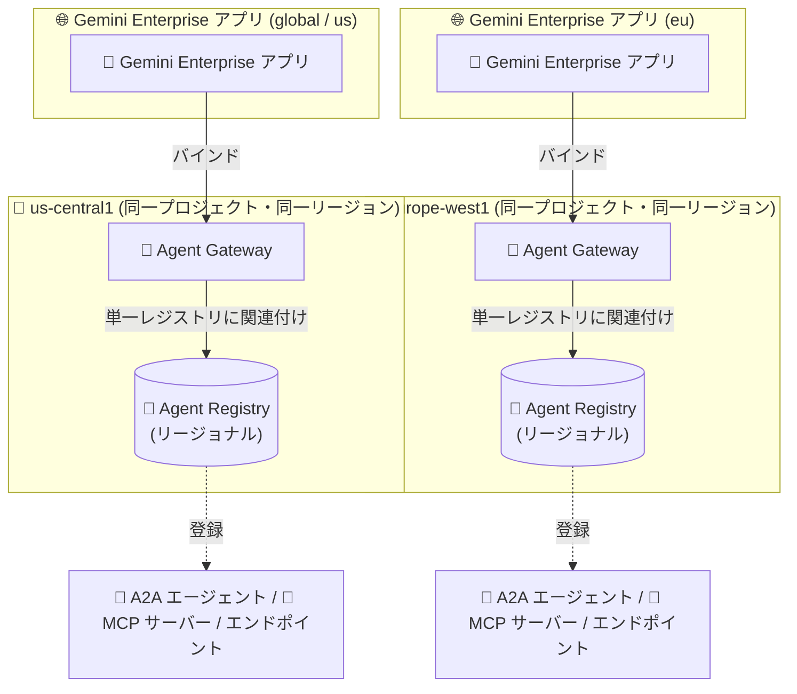

# Gemini Enterprise Agent Platform: Gemini Enterprise アプリ向けに単一のリージョナル Agent Registry インスタンスの使用を推奨

**リリース日**: 2026-10-28

**サービス**: Gemini Enterprise Agent Platform (Agent Gateway / Agent Registry)

**機能**: Gemini Enterprise アプリにおける Agent Gateway と Agent Registry の推奨構成の変更

**ステータス**: Changed (推奨構成の変更)

📊 [このアップデートのインフォグラフィックを見る](https://takech9203.github.io/google-cloud-news-summary/20261028-gemini-enterprise-regional-agent-registry.html)

## 概要

Google Cloud は、Gemini Enterprise アプリにおける Agent Gateway と Agent Registry の推奨構成を更新しました。今回の変更では、各 Agent Gateway を、ゲートウェイと**同一プロジェクト・同一リージョンにある単一のリージョナル Agent Registry インスタンス**に関連付けることが推奨されています。具体的には、`global` および `us` ロケーションの Gemini Enterprise アプリには `us-central1` のレジストリを、`eu` ロケーションのアプリには `europe-west1` のレジストリを使用します。

この更新は 2026 年 9 月 9 日のリリースノートエントリを更新するものです。Agent Registry は A2A エージェント、エンドポイント、MCP サーバーを発見・追跡・管理するための一元的なカタログであり、Agent Gateway はエージェントのトラフィックを制御・統制するリージョナルなネットワーキングコンポーネントです。Gemini Enterprise アプリにエージェントや MCP サーバーを関連付けるには、アプリ・ゲートウェイ・レジストリの 3 つのコンポーネントがリージョン的に整合している必要があり、今回の推奨事項はその構成指針をシンプルにするものです。

Gemini Enterprise Agent Platform でエージェントのガバナンスを設計・運用している管理者やアーキテクトにとって、レジストリの配置方針を見直すべき重要なアップデートです。

**アップデート前の課題**

- Agent Gateway には最大 2 つのレジストリ (グローバル 1 つ + リージョナルまたはマルチリージョナル 1 つ) を関連付けられるため、Gemini Enterprise アプリ向けにどのレジストリ構成を選択すべきか判断が複雑だった
- リージョナル・マルチリージョナル・グローバルの各レジストリに同一のインターフェース URL を持つエントリが存在する場合、宛先 URL の解決時に優先順位 (リージョナル/マルチリージョナルがグローバルより優先) を考慮する必要があった
- マルチリージョン (`us`、`eu`) のレジストリはエージェント、エンドポイント、MCP サーバーの手動登録をサポートしておらず、登録先の選択で混乱が生じやすかった

**アップデート後の改善**

- Gemini Enterprise アプリでは「ゲートウェイと同一プロジェクト・同一リージョンの単一リージョナルレジストリ」というシンプルで明確な構成指針が示された
- `global` / `us` アプリは `us-central1` レジストリ、`eu` アプリは `europe-west1` レジストリという具体的なマッピングが明示された
- 単一レジストリ構成により、複数レジストリ間でのエントリ解決の競合や登録先の迷いを回避できる

## アーキテクチャ図



Gemini Enterprise アプリのロケーションごとに、ゲートウェイと同一プロジェクト・同一リージョンの単一リージョナル Agent Registry を関連付ける推奨構成を示しています。

## サービスアップデートの詳細

### 主要機能

1. **単一リージョナルレジストリの推奨**
   - Gemini Enterprise アプリでは、各 Agent Gateway をゲートウェイと同一プロジェクト・同一リージョンにある単一のリージョナル Agent Registry インスタンスに関連付けることが推奨される
   - エージェント、エンドポイント、MCP サーバーは、ゲートウェイに関連付けられたレジストリに登録する必要がある

2. **アプリロケーションとレジストリリージョンの明確なマッピング**
   - `global` および `us` ロケーションのアプリ: `us-central1` のレジストリを使用
   - `eu` ロケーションのアプリ: `europe-west1` のレジストリを使用

3. **データレジデンシー整合の強制**
   - Agent Registry と Agent Gateway はいずれもプロジェクト・リージョン固有のリソースであり、Gemini Enterprise アプリの運用リージョンと互換性のあるリージョンで整合させる必要がある
   - アプリ、ゲートウェイ、レジストリの 3 コンポーネントのリージョン整合は、バインドプロセスを通じて厳密に強制される

## 技術仕様

### ロケーションマッピング

| Gemini Enterprise アプリのロケーション | Agent Gateway のリージョン | 推奨される Agent Registry |
|------|------|------|
| `global` | `us-central1` | `us-central1` (リージョナル) |
| `us` | `us-central1` | `us-central1` (リージョナル) |
| `eu` | `europe-west1` | `europe-west1` (リージョナル) |

### レジストリ関連付けの仕様

| 項目 | 詳細 |
|------|------|
| ゲートウェイあたりのレジストリ数 | 最大 2 つ (グローバル 1 つ + リージョナルまたはマルチリージョナル 1 つ) まで関連付け可能。ただし Gemini Enterprise アプリでは単一のリージョナルレジストリを推奨 |
| リージョナルレジストリの URI 形式 | `//agentregistry.googleapis.com/projects/PROJECT_ID/locations/REGION` |
| エントリ解決の優先順位 | リージョナル / マルチリージョナルのエントリがグローバルのエントリより優先される |
| マルチリージョン (`us`, `eu`) レジストリの制約 | エージェント、エンドポイント、MCP サーバーの手動登録をサポートしない |
| Gemini Enterprise での Agent Gateway モード | Agent-to-Anywhere (Egress) のみサポート (Ingress は非サポート) |

### Agent Gateway の定義例 (gcloud / YAML)

```yaml
name: AGENT_GATEWAY_NAME
protocols:
  - MCP
googleManaged:
  governedAccessPath: AGENT_TO_ANYWHERE
  registries:
    - //agentregistry.googleapis.com/projects/PROJECT_ID/locations/us-central1
```

```bash
gcloud network-services agent-gateways import AGENT_GATEWAY_NAME \
  --source="my-agent-gateway-egress.yaml" \
  --location=us-central1
```

## 設定方法

### 前提条件

1. Gemini Enterprise アプリ (エンジン) がデプロイ済みであること
2. Agent Gateway の概念と Agent-to-Anywhere (Egress) モードを理解していること

### 手順

#### ステップ 1: ロケーションとレジストリのマッピングを計画する

Gemini Enterprise アプリのロケーション (`global` / `us` / `eu`) に対応する Agent Gateway のリージョン (`us-central1` または `europe-west1`) を確認し、同一プロジェクト・同一リージョンのリージョナル Agent Registry を使用するように計画します。

#### ステップ 2: Agent Gateway を作成し、単一のリージョナルレジストリを関連付ける

```bash
# YAML でゲートウェイを定義し、リージョナルレジストリを 1 つ指定してインポート
gcloud network-services agent-gateways import my-ge-gateway \
  --source="my-agent-gateway-egress.yaml" \
  --location=us-central1
```

#### ステップ 3: エージェントと宛先リソースを登録する

ゲートウェイに関連付けたリージョナル Agent Registry に、A2A エージェント、MCP サーバー、エンドポイントを登録します。エージェントがアクセスする宛先には、エージェント ID に対して `iap.resources.egressViaIAP` 権限を付与する IAM アクセスポリシーが必要です。

## メリット

### ビジネス面

- **データレジデンシー遵守**: アプリ・ゲートウェイ・レジストリをリージョン的に整合させることで、データ所在地要件への準拠を確保できる
- **運用の簡素化**: 単一レジストリという明確な指針により、構成判断にかかる時間とミスのリスクを削減できる

### 技術面

- **エントリ解決の競合回避**: 複数レジストリ間で同一インターフェース URL のエントリが競合する問題を単一レジストリ構成で回避できる
- **手動登録の確実性**: マルチリージョン (`us`, `eu`) レジストリでは手動登録がサポートされないのに対し、リージョナルレジストリでは手動登録が可能

## デメリット・制約事項

### 制限事項

- Gemini Enterprise では Agent Gateway は Agent-to-Anywhere (Egress) モードのみサポートし、Ingress トラフィックはサポートされない
- Gemini Enterprise アプリ向けの Agent Gateway は、アプリのロケーションに対応する特定リージョン (`us-central1` または `europe-west1`) にデプロイする必要がある
- クロスプロジェクトガバナンスは Runtime エージェント (Agent-to-Anywhere モード) のみサポートされ、Gemini Enterprise はサポート対象外

### 考慮すべき点

- 既存環境でグローバルレジストリやマルチリージョナルレジストリを Gemini Enterprise アプリ向けゲートウェイに関連付けている場合は、今回の推奨構成への移行を検討する必要がある
- 識別されないエージェントからのトラフィックはデフォルトでブロックされるため、各エージェントに一意の Agent Identity (SPIFFE ID) が必要

## ユースケース

### ユースケース 1: グローバル展開の Gemini Enterprise アプリのガバナンス

**シナリオ**: `global` ロケーションに Gemini Enterprise アプリをデプロイし、社内のカスタム A2A エージェントと MCP サーバーをアプリに関連付けて利用させたい。

**実装例**:
```
1. us-central1 に Agent Gateway を作成
2. 同一プロジェクトの us-central1 リージョナル Agent Registry をゲートウェイに関連付け
3. A2A エージェント、MCP サーバー、エンドポイントを us-central1 レジストリに登録
4. Gemini Enterprise アプリをゲートウェイにバインド
```

**効果**: 推奨構成に沿った単一レジストリ運用により、エントリ解決の競合なく一貫したエージェントガバナンスを実現できる。

### ユースケース 2: EU データレジデンシー要件下でのエージェント統制

**シナリオ**: EU のデータ所在地要件により、`eu` ロケーションに Gemini Enterprise アプリをデプロイしている企業が、エージェントと MCP サーバーへのアクセスを統制したい。

**効果**: `europe-west1` のゲートウェイとリージョナルレジストリを使用することで、アプリ・ゲートウェイ・レジストリの 3 コンポーネントが EU 域内で整合し、データレジデンシー規約違反を防止できる。

## 料金

今回のアップデートは推奨構成の変更であり、料金に直接の変更はありません。Gemini Enterprise の料金は以下を参照してください。

- [Gemini Enterprise の料金](https://cloud.google.com/gemini/enterprise/pricing)

## 利用可能リージョン

Gemini Enterprise アプリ向けの Agent Gateway / Agent Registry 構成:

- `global` / `us` ロケーションのアプリ: `us-central1`
- `eu` ロケーションのアプリ: `europe-west1`

Agent Registry 自体はグローバル、マルチリージョン (`us`, `eu`)、および多数のリージョン (東京 `asia-northeast1`、大阪 `asia-northeast2` を含む) で利用可能です。詳細は [Agent Registry のロケーション](https://docs.cloud.google.com/agent-registry/locations) を参照してください。

## 関連サービス・機能

- **Agent Registry**: A2A エージェント、エンドポイント、MCP サーバーを発見・追跡・管理する一元的なカタログ。今回の推奨構成の中核となるリソース
- **Agent Gateway**: エージェントトラフィックの制御とランタイムポリシー適用を行うリージョナルなマネージドネットワーキングコンポーネント
- **Agent Runtime**: エージェントのデプロイ先ランタイム。リージョナルリソースであり、デプロイリージョンに対応するリージョナルレジストリに登録される
- **Identity-Aware Proxy (IAP)**: エージェントから宛先へのアクセスには `iap.resources.egressViaIAP` 権限を付与する IAM アクセスポリシーが必要
- **Model Armor**: Agent Gateway と組み合わせて AI モデルとのやり取りを保護するテンプレートを適用可能

## 参考リンク

- 📊 [インフォグラフィック](https://takech9203.github.io/google-cloud-news-summary/20261028-gemini-enterprise-regional-agent-registry.html)
- [公式リリースノート](https://cloud.google.com/release-notes#October_28_2026)
- [Register your agents and destination resources (Agent Gateway のセットアップ)](https://docs.cloud.google.com/gemini-enterprise-agent-platform/govern/gateways/set-up-agent-gateway)
- [Route Gemini Enterprise traffic through Agent Gateway](https://docs.cloud.google.com/gemini-enterprise-agent-platform/govern/gateways/agent-gateway-ge-deploy)
- [Agent Registry から A2A エージェントを追加する](https://docs.cloud.google.com/gemini/enterprise/docs/import-govern-agent-registry)
- [Agent Registry のロケーション](https://docs.cloud.google.com/agent-registry/locations)
- [料金ページ](https://cloud.google.com/gemini/enterprise/pricing)

## まとめ

Gemini Enterprise アプリにおける Agent Gateway の推奨構成が「同一プロジェクト・同一リージョンの単一リージョナル Agent Registry」に明確化されました (`global`/`us` アプリは `us-central1`、`eu` アプリは `europe-west1`)。これは 2026 年 9 月 9 日のエントリを更新するものであり、既にグローバルやマルチリージョナルのレジストリを Gemini Enterprise アプリ向けゲートウェイに関連付けている場合は、推奨構成への見直しを検討してください。

---

**タグ**: Gemini Enterprise, Agent Gateway, Agent Registry, Agent Platform, ガバナンス, データレジデンシー, A2A, MCP
