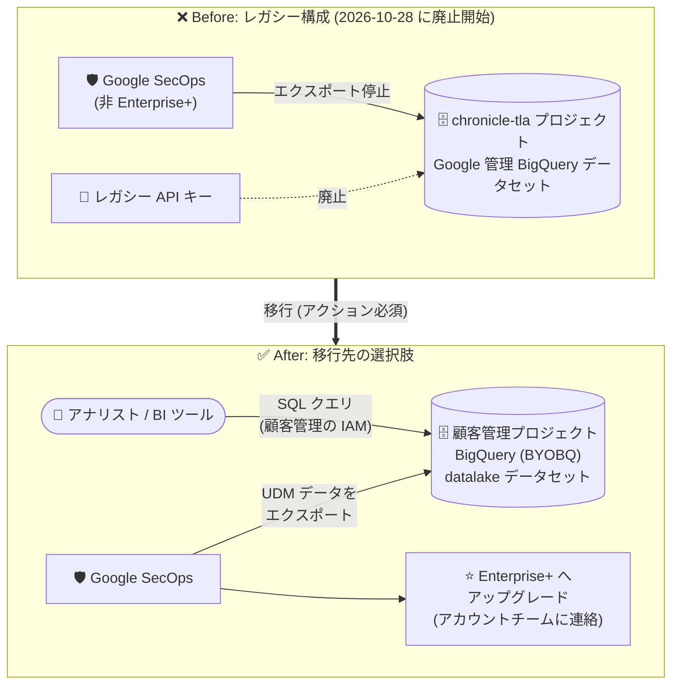

# Google SecOps: レガシー Google 管理 BigQuery エクスポートデータセット (chronicle-tla) の最終シャットダウン

**リリース日**: 2026-10-28

**サービス**: Google SecOps / Google SecOps SIEM

**機能**: レガシー Google 管理 BigQuery エクスポートデータセット (chronicle-tla プロジェクト) の廃止

**ステータス**: Announcement (廃止 / シャットダウン)

📊 [このアップデートのインフォグラフィックを見る](https://takech9203.github.io/google-cloud-news-summary/20261028-google-secops-chronicle-tla-shutdown.html)

## 概要

Google SecOps は、2025 年 3 月 26 日の廃止 (deprecation) 発表に続き、`chronicle-tla` Google Cloud プロジェクトに関連付けられたレガシーの Google 管理 BigQuery データセットおよび API キーの最終シャットダウンを完了します。レガシー Google 管理 BigQuery データセットへのデータエクスポートは恒久的に停止され、関連するマネージドデータセットと API キーは廃止 (decommission) されます。廃止処理は **2026 年 10 月 28 日** から開始されます。

このシャットダウンの影響を受けるのは、レガシーの `chronicle-tla` Google 管理 BigQuery データセットにプロビジョニングされたままの **非 Enterprise+ 顧客のみ** です (2025 年 9 月に一時的な移行例外期間が終了したテナントを含む)。Enterprise+ 顧客、および顧客管理の Google Cloud プロジェクトへの Bring Your Own BigQuery (BYOBQ) エクスポートを使用している顧客は影響を受けません。

Google SecOps データへの BigQuery アクセスを維持するには、顧客管理の BigQuery プロジェクトへのエクスポート (BYOBQ) を構成するか、アカウントチームに連絡して Enterprise+ へアップグレードする必要があります。本アナウンスは「Google SecOps」と「Google SecOps SIEM」の両リリースノートで同一内容として公開されています。

**アップデート前の課題**

- 非 Enterprise+ 顧客の一部は、廃止予定が告知済みのレガシー `chronicle-tla` Google 管理 BigQuery データセットと API キーに依存したままデータエクスポートを継続していた
- 2024 年 12 月 31 日の廃止開始以降も一時的な移行例外が設けられていたが、その例外も 2025 年 9 月に期限切れとなっていた
- Google 管理プロジェクト上のデータセットでは、IAM 権限を顧客が独立して管理できず、Google 管理側の設定に依存していた

**アップデート後の改善 (変更内容)**

- 2026 年 10 月 28 日より、`chronicle-tla` プロジェクト配下のレガシー Google 管理 BigQuery データセットへのエクスポートが恒久的に停止され、マネージドデータセットと API キーが廃止される
- BigQuery アクセスを維持する顧客は、顧客管理プロジェクトへの BYOBQ エクスポートに移行することで、自組織の Google Cloud プロジェクト内で IAM 権限を独立して管理できるようになる
- Enterprise+ へのアップグレードという選択肢も提供され、ティアに応じた明確なエクスポートモデルに整理される

## アーキテクチャ図



レガシーの `chronicle-tla` Google 管理データセットへのエクスポート (上) は 2026 年 10 月 28 日から恒久停止されるため、非 Enterprise+ 顧客は顧客管理 BigQuery プロジェクトへの BYOBQ エクスポート構成、または Enterprise+ へのアップグレード (下) への移行が必要です。

## サービスアップデートの詳細

### 主要なポイント

1. **変更内容: レガシーエクスポートの恒久停止**
   - `chronicle-tla` Google Cloud プロジェクト配下のレガシー Google 管理 BigQuery データセットへのデータエクスポートが恒久的に停止される
   - 関連するマネージドデータセットおよび API キーが廃止される
   - 廃止処理は 2026 年 10 月 28 日に開始

2. **影響範囲: 非 Enterprise+ 顧客のみ**
   - 対象: レガシー `chronicle-tla` Google 管理 BigQuery データセットにプロビジョニングされたままの非 Enterprise+ 顧客 (2025 年 9 月に一時的な移行例外が期限切れとなったテナントを含む)
   - 対象外: Enterprise+ 顧客、および顧客管理 Google Cloud プロジェクトへの BYOBQ エクスポートを既に使用している顧客

3. **必要なアクション**
   - Google SecOps データへの BigQuery アクセスを維持するには、顧客管理 BigQuery プロジェクトへのエクスポート (BYOBQ) を構成する
   - または、アカウントチームに連絡して Enterprise+ へアップグレードする

### 移行先: BYOBQ (Bring Your Own BigQuery)

BYOBQ では、自組織が所有・管理する Google Cloud プロジェクトを Google SecOps インスタンスにリンクし、Unified Data Model (UDM) データをエクスポートできます。Google 管理側の設定に依存せず、IAM 権限を独立して管理できます。エクスポートされるデータカテゴリは以下のとおりです。

- `udm_events`: UDM スキーマに正規化されたログデータ
- `udm_events_aggregates`: 正規化イベントを 1 時間ごとに集計したデータ
- `entity_graph`: エンティティグラフ (コンテキストデータ、派生データ、グローバルコンテキスト)
- `rule_detections`: Google SecOps のルールが返した検出結果
- `ioc_matches`: UDM イベントに対する IOC マッチ
- `ingestion_metrics`: 取り込み・正規化パイプラインに関するメトリクス (デフォルトでエクスポート)
- `udm_enum_value_to_name_mapping` / `entity_enum_value_to_name_mapping`: 列挙値と UDM / エンティティフィールド名のマッピング (デフォルトでエクスポート)

### これまでの経緯

| 時期 | 内容 |
|------|------|
| 2024-12-31 | 非 Enterprise Plus 顧客はマネージド BigQuery データレイクにアクセス不可に (廃止開始) |
| 2025-03-26 | 廃止 (deprecation) 発表 (本リリースノートが参照する発表) |
| 2025-04-30 | `chronicle-tla` のマネージド BigQuery リソースと API キーのシャットダウン期限 (当初 2025-03-31 から延長) |
| 2025-09 | 一時的な移行例外 (transition exception) が期限切れ |
| **2026-10-28** | **レガシーデータセット・API キーの最終廃止処理が開始 (本アナウンス)** |

## 技術仕様

### 対象者と必要な対応の整理

| 顧客区分 | 影響 | 必要な対応 |
|------|------|------|
| 非 Enterprise+ で `chronicle-tla` レガシーデータセットを利用中 | **影響あり** (エクスポート恒久停止、データセット・API キー廃止) | BYOBQ の構成、または Enterprise+ へのアップグレード |
| BYOBQ (顧客管理プロジェクト) を利用中 | 影響なし | 不要 |
| Enterprise+ 顧客 | 影響なし | 不要 (BYOBQ は Enterprise Plus では利用不可。Advanced BigQuery Export が提供される) |

### BYOBQ の主な仕様

| 項目 | 詳細 |
|------|------|
| 有効化方法 | SIEM Settings > Data Export から BYOBQ を有効化・構成 |
| 前提 | 自己管理プロジェクトを Google SecOps インスタンスにリンク (BYOP)。有効化後は Google 管理プロジェクトに戻せない |
| エクスポート先 | 自己管理プロジェクト内の `datalake` データセット配下のテーブル |
| リージョン | エクスポート用に作成されるリソース (Cloud Storage バケット、BigQuery テーブル) は Google SecOps と同一リージョン |
| 既存データの移行 | Google 管理プロジェクトから自己管理プロジェクトへデータは移行されない (有効化日をまたぐクエリは両プロジェクトの結合または個別クエリが必要) |
| コスト | BYOBQ の有効化により、顧客プロジェクト側で追加のストレージ・コンピューティングコストが発生し得る |
| 対象ティア | Standard / Enterprise (Enterprise Plus は BYOBQ 対象外で、Advanced BigQuery Export を利用) |

### データアクセスに必要な IAM ロール

BYOBQ 移行後、BigQuery データにアクセスするユーザーには以下のロールを割り当てます。

| ロール | 用途 |
|------|------|
| `roles/bigquery.dataViewer` | BigQuery データの参照 |
| `roles/bigquery.jobUser` | クエリジョブの実行 |
| `roles/storage.objectViewer` | 関連する Cloud Storage オブジェクトの参照 |

## 設定方法 (BYOBQ への移行)

### 前提条件

1. エクスポート先となる自組織所有の Google Cloud プロジェクトを用意していること
2. 対象プロジェクトを Google SecOps インスタンスにリンクできる権限があること

### 手順

#### ステップ 1: エクスポート先の Google Cloud プロジェクトを作成・構成

Google SecOps 用に Google Cloud プロジェクトを構成します (公式ドキュメント「[Configure a Google Cloud project for Google SecOps](https://docs.cloud.google.com/chronicle/docs/onboard/configure-cloud-project)」参照)。

#### ステップ 2: 自己管理プロジェクトを Google SecOps インスタンスにリンク

Google SecOps と自己管理プロジェクト間の接続を確立します (公式ドキュメント「[Link Google Security Operations to Google Cloud services](https://docs.cloud.google.com/chronicle/docs/onboard/link-chronicle-cloud)」参照)。一度この機能を有効化すると、Google 管理プロジェクトには戻せない点に注意してください。

#### ステップ 3: BYOBQ を有効化

Google SecOps コンソールで **SIEM Settings > Data Export** を選択し、BYOBQ 機能を有効化・構成します。データタイプごとに保持期間 (Retention Period) を設定でき、`Unlimited` も選択可能です。

#### ステップ 4: エクスポートの検証とアクセス権の付与

```sql
-- 自己管理プロジェクトの datalake データセットにテーブルが作成されたことを確認
SELECT table_name
FROM `PROJECT_ID.datalake.INFORMATION_SCHEMA.TABLES`;
```

データが自己管理プロジェクトにエクスポートされていることを `datalake` データセット配下のテーブルで確認し、クエリを実行するユーザーに `roles/bigquery.dataViewer`、`roles/bigquery.jobUser`、`roles/storage.objectViewer` を付与します。

## メリット

### ビジネス面

- **BigQuery アクセスの継続**: 期限 (2026-10-28) 前に BYOBQ へ移行することで、ダッシュボードやアドホック分析など BigQuery ベースのワークフローを中断なく継続できる
- **選択肢の明確化**: BYOBQ (自己管理・自己負担) と Enterprise+ (Advanced BigQuery Export) という、ティアに応じた明確なエクスポートモデルに整理される

### 技術面

- **IAM の独立管理**: 顧客管理プロジェクトでは、Google 管理側の設定に依存せず IAM 権限を独立して管理できる
- **BigQuery エコシステムの活用**: 自己管理プロジェクト上のデータに対し、アドホック SQL クエリや BigQuery と統合するサードパーティ BI ツールによる高度な分析が可能

## デメリット・制約事項

### 制限事項

- レガシー `chronicle-tla` データセットから自己管理プロジェクトへ既存データは移行されない (移行前後のデータは別プロジェクトに分かれる)
- BYOBQ を有効化すると Google 管理プロジェクトには戻せない
- BYOBQ は Enterprise Plus では利用できない (Enterprise Plus は Advanced BigQuery Export を利用)
- エクスポート用リソースは Google SecOps インスタンスと同一リージョンに作成される

### 考慮すべき点

- **2026 年 10 月 28 日から廃止処理が開始されるため、未対応の非 Enterprise+ 顧客は即時の対応が必要**
- BYOBQ では顧客プロジェクト側で BigQuery のストレージ・コンピューティングコストを負担する
- レガシー API キーも廃止されるため、`chronicle-tla` 向けの API キーに依存する自動化・連携処理は BYOBQ 前提の構成に見直しが必要
- 有効化日をまたぐ期間のクエリは、両プロジェクトを結合する単一クエリか、プロジェクトごとの個別クエリで対応する必要がある

## ユースケース

### ユースケース 1: レガシーデータセット利用中の Standard / Enterprise 顧客の緊急移行

**シナリオ**: 非 Enterprise+ の SOC チームが、`chronicle-tla` の Google 管理データセットに対するスケジュールクエリで日次のセキュリティレポートを生成している。

**実装例**:
```
1. エクスポート先の Google Cloud プロジェクトを作成し SecOps インスタンスにリンク
2. SIEM Settings > Data Export で BYOBQ を有効化
3. スケジュールクエリの参照先を自己管理プロジェクトの datalake データセットに変更
4. アナリストに bigquery.dataViewer / bigquery.jobUser を付与
```

**効果**: エクスポート停止によるレポート断絶を回避し、以後は自組織の IAM で権限を一元管理できる。

### ユースケース 2: 大規模環境での Enterprise+ アップグレード

**シナリオ**: BigQuery のストレージ・コンピューティングコストの自己負担を避けたい、またはニアリアルタイムのデータ利用を求める大規模組織。

**効果**: アカウントチーム経由で Enterprise+ にアップグレードすることで本シャットダウンの影響対象外となる。Enterprise Plus 向けには、ストレージ・ストリーミングコストを Google SecOps 側が負担する Advanced BigQuery Export (Preview) が提供されている。

## 料金

本アナウンス自体に新たな料金は発生しませんが、移行先の BYOBQ では顧客管理プロジェクト側で BigQuery のストレージおよびコンピューティング (クエリ) コストが発生し得ます。Enterprise Plus の Advanced BigQuery Export では、バックエンドのストレージ・ストリーミング挿入・DML コンピューティングコストは Google SecOps 側が負担し、顧客は自ら実行するクエリの料金のみを支払います。

詳細は [BigQuery の料金ページ](https://cloud.google.com/bigquery/pricing) を参照してください。

## 関連サービス・機能

- **BigQuery**: エクスポート先のデータウェアハウス。BYOBQ では顧客管理プロジェクトの `datalake` データセットに UDM データが格納される
- **Cloud Storage**: エクスポートに伴い自己管理プロジェクト内に作成されるリソースの 1 つ。オブジェクトライフサイクルルールで保持管理が可能
- **IAM**: BYOBQ 移行後のデータアクセス制御 (`bigquery.dataViewer`、`bigquery.jobUser`、`storage.objectViewer`)
- **Advanced BigQuery Export (Preview)**: Enterprise Plus 顧客向けのフルマネージド・ストリーミングエクスポート。レガシーエクスポートのスキーマと互換のビューを提供

## 参考リンク

- 📊 [インフォグラフィック](https://takech9203.github.io/google-cloud-news-summary/20261028-google-secops-chronicle-tla-shutdown.html)
- [公式リリースノート (Google SecOps)](https://docs.cloud.google.com/chronicle/docs/release-notes)
- [Export to a self-managed BigQuery project (BYOBQ)](https://docs.cloud.google.com/chronicle/docs/reports/export-to-customer-managed-project)
- [Google SecOps deprecations (廃止スケジュール一覧)](https://docs.cloud.google.com/chronicle/docs/deprecations)
- [Stream data with advanced BigQuery export (Enterprise Plus 向け)](https://docs.cloud.google.com/chronicle/docs/reports/bigquery-export)
- [BigQuery 料金ページ](https://cloud.google.com/bigquery/pricing)

## まとめ

2026 年 10 月 28 日より、`chronicle-tla` プロジェクト配下のレガシー Google 管理 BigQuery データセットと API キーの最終廃止処理が開始され、非 Enterprise+ 顧客のエクスポートは恒久的に停止されます。2025 年 3 月の廃止発表と 2025 年 9 月の移行例外期限を経た最終段階であり、該当する顧客は BigQuery アクセスを維持するために、顧客管理プロジェクトへの BYOBQ エクスポートの構成、またはアカウントチーム経由での Enterprise+ へのアップグレードを直ちに実施する必要があります。既存データはレガシーデータセットから移行されない点にも留意し、必要なデータの参照戦略を含めて移行計画を確定してください。

---

**タグ**: #GoogleSecOps #SIEM #BigQuery #BYOBQ #廃止 #chronicle-tla #データエクスポート #EnterprisePlus #セキュリティ運用
