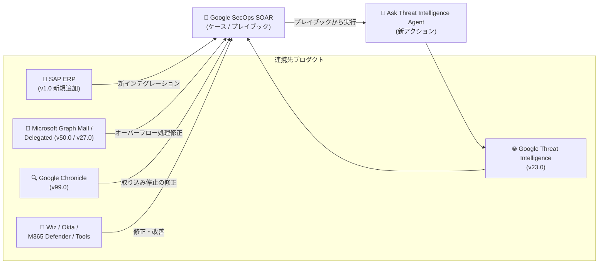

# Google SecOps Marketplace: インテグレーション更新 (SAP ERP v1.0 新規追加 / Google Threat Intelligence v23.0 ほか計 9 件)

**リリース日**: 2026-10-28

**サービス**: Google SecOps Marketplace

**機能**: インテグレーション更新 (SAP ERP インテグレーション新規追加、GTI「Ask Threat Intelligence Agent」アクション追加、コネクタ安定性修正など)

**ステータス**: Feature / Changed

📊 [このアップデートのインフォグラフィックを見る](https://takech9203.github.io/google-cloud-news-summary/20261028-google-secops-marketplace-integration-updates.html)

## 概要

Google SecOps Marketplace のレスポンスインテグレーションに 9 件の更新が公開されました。新機能 (Feature) は 2 件で、**SAP ERP インテグレーション (Version 1.0) の新規追加**と、**Google Threat Intelligence (Version 23.0) への新アクション「Ask Threat Intelligence Agent」の追加**です。残り 7 件は既存インテグレーションの修正・改善 (Changed) です。

SAP ERP インテグレーションの追加により、Google SecOps SOAR から SAP ERP を対象としたオーケストレーションが可能になります。基幹業務システムである SAP をセキュリティ運用の対応 (レスポンス) 対象に組み込めるようになる点で、SAP を利用する企業の SOC チームにとって重要な一歩です。Google Threat Intelligence には「Ask Threat Intelligence Agent」アクションが追加され、プレイブックやケース対応の中から Threat Intelligence エージェントへの問い合わせを実行できるようになります。

修正系の更新では、Microsoft Graph Mail / Microsoft Graph Mail Delegated の両コネクタにおける「オーバーフローしたアラートが ID 未保存・未読のままスキップされ、無限再処理ループや状態喪失を引き起こす」問題の修正、Google Chronicle - Chronicle Alerts Connector の取り込み停止問題の修正など、アラート取り込みの信頼性に直結する改善が含まれています。該当インテグレーションを運用中の組織はバージョン更新を推奨します。

**アップデート前の課題**

- Google SecOps Marketplace に SAP ERP 向けのレスポンスインテグレーションが存在せず、SAP を対象とした SOAR のオーケストレーションができなかった
- Google Threat Intelligence インテグレーションには、Threat Intelligence エージェントに問い合わせるアクションがなかった
- Microsoft Graph Mail / Microsoft Graph Mail Delegated コネクタでは、オーバーフローしたアラートが ID を保存せず・メールを既読にせずスキップされ、無限再処理ループや状態喪失が発生し得た
- Google Chronicle - Chronicle Alerts Connector では、複合検出 (composite detections) の読み込み失敗やページネーションが進まない場合に、アラート取り込みが停止することがあった
- Tools インテグレーションの「Get Integration Instances」アクションで、アンパサンド (`&`) を含む環境名が正しくフィルタリングされなかった
- Wiz の双方向同期ジョブで、クローズ理由のマッピング (インバウンド/アウトバウンド) に不具合があった
- Microsoft 365 Defender の「Execute Custom Query」アクションには、時間範囲でクエリを絞り込むパラメータがなかった

**アップデート後の改善**

- SAP ERP インテグレーション (v1.0) が新規追加され、Google SecOps SOAR から SAP ERP を連携対象にできるようになった
- Google Threat Intelligence (v23.0) に「Ask Threat Intelligence Agent」アクションが追加された
- Microsoft Graph Mail (v50.0) / Microsoft Graph Mail Delegated (v27.0) で、オーバーフローアラートの ID 保存・既読化が行われるようになり、無限再処理ループと状態喪失が防止された
- Google Chronicle (v99.0) で、複合検出の読み込み失敗やページネーション停滞時にもアラート取り込みが止まらないよう修正された
- Okta (v19.0) で OAuth 認証スコープが更新され、ユーザー管理系アクションがサポートされた
- Microsoft 365 Defender (v34.0) の「Execute Custom Query」に Time Frame / Start Time / End Time パラメータが追加され、時間ベースのクエリフィルタリングが可能になった

## アーキテクチャ図



Google SecOps Marketplace の各インテグレーションが SecOps SOAR に接続する全体像です。SAP ERP が新たに連携先に加わり、GTI には SOAR 側から Threat Intelligence エージェントへ問い合わせる新アクションが追加されました。メール系・Chronicle 系コネクタはアラート取り込みの信頼性が改善されています。

## サービスアップデートの詳細

### 更新一覧

| インテグレーション | バージョン | 種別 | 更新内容 |
|---|---|---|---|
| SAP ERP | 1.0 | Feature | 新規インテグレーションの追加 |
| Google Threat Intelligence | 23.0 | Feature | 新アクション「Ask Threat Intelligence Agent」の追加 |
| Microsoft Graph Mail Delegated | 27.0 | Change | Microsoft Graph Mail Delegated Connector で、オーバーフローアラートが ID 未保存・未読のままスキップされる問題を修正 (無限再処理ループ・状態喪失を防止) |
| Tools | 85.0 | Change | 「Get Integration Instances」アクションで、アンパサンド (`&`) を含む環境名が正しくフィルタリングされない問題を修正 |
| Wiz | 11.0 | Change | 双方向同期ジョブのクローズ理由マッピング (インバウンド/アウトバウンド) を修正。7 つのアクションの定義済みウィジェットを更新 |
| Microsoft Graph Mail | 50.0 | Change | Microsoft Graph Mail Connector で、オーバーフローアラートのスキップ問題を修正 (Delegated 版と同内容) |
| Google Chronicle | 99.0 | Change | Chronicle Alerts Connector で、複合検出の読み込み失敗やページネーション停滞時に取り込みが停止し得る問題を修正 |
| Okta | 19.0 | Change | OAuth 認証スコープを更新し、ユーザー管理アクションをサポート |
| Microsoft 365 Defender | 34.0 | Change | 「Execute Custom Query」アクションに Time Frame / Start Time / End Time パラメータを追加 |

### 主要機能

1. **SAP ERP インテグレーション v1.0 の新規追加 (Feature)**
   - Google SecOps Marketplace に SAP ERP 向けインテグレーションが Version 1.0 として登場
   - SAP を利用する組織が、Google SecOps SOAR のプレイブックから SAP ERP を連携対象にできるようになる
   - なお、SIEM 側では「Google SecOps for SAP」(Preview) として SAP ログ (Security Audit Log、Change Documents、SAP HANA Audit など) の取り込み・検出も提供されており、今回の SOAR インテグレーション追加により SAP 環境の「検出から対応まで」をカバーする構成に近づく
   - 本レポート作成時点では、SAP ERP インテグレーションの個別ドキュメント (アクション一覧・設定パラメータ) は未公開

2. **Google Threat Intelligence v23.0: 「Ask Threat Intelligence Agent」アクションの追加 (Feature)**
   - Google Threat Intelligence インテグレーションに新アクション「Ask Threat Intelligence Agent」が追加された
   - プレイブックや手動アクションから Threat Intelligence エージェントへの問い合わせを組み込めるようになる
   - 本レポート作成時点では、本アクションの詳細パラメータは公式ドキュメントに未反映

3. **Microsoft Graph Mail / Microsoft Graph Mail Delegated: オーバーフローアラート処理の修正 (Changed)**
   - 両コネクタ (v50.0 / v27.0) で、オーバーフローしたアラートが ID を保存せず・メールを既読にせずスキップされる問題を修正
   - 修正により、同じメールが繰り返し再処理される無限ループや、コネクタの状態 (処理済み ID) の喪失が防止される

4. **Google Chronicle v99.0: Chronicle Alerts Connector の取り込み停止問題の修正 (Changed)**
   - 複合検出 (composite detections) の読み込みに失敗した場合や、ページネーションが進行しない場合に、コネクタがアラート取り込みを停止し得る問題を修正
   - Google SecOps SIEM のアラートを SOAR ケースへ取り込む基幹コネクタであるため、取り込み欠落リスクの低減に直結する

5. **その他の改善 (Changed)**
   - **Tools v85.0**: 「Get Integration Instances」でアンパサンド (`&`) を含む環境名のフィルタリングを修正。MSSP などで記号を含む環境名を使用している場合に影響
   - **Wiz v11.0**: Wiz と Google SecOps の双方向同期ジョブにおけるクローズ理由のマッピングを修正し、Add Comment To Issue、Get Blue Agent Analysis、Get Issue Details、Ignore Issue、List Resource Vulnerability Findings、Reopen Issue、Resolve Issue の定義済みウィジェットを更新
   - **Okta v19.0**: OAuth 認証スコープを更新し、ユーザー管理アクションに対応
   - **Microsoft 365 Defender v34.0**: 「Execute Custom Query」に Time Frame / Start Time / End Time パラメータを追加し、時間ベースのクエリフィルタリングに対応

## 技術仕様

### 信頼性修正の対象コネクタ

| コネクタ | 修正前の問題 | 修正後の動作 |
|------|------|------|
| Microsoft Graph Mail Connector (v50.0) | オーバーフローアラートを ID 未保存・未読のままスキップ | ID 保存・既読化により無限再処理ループと状態喪失を防止 |
| Microsoft Graph Mail Delegated Connector (v27.0) | 同上 | 同上 |
| Google Chronicle - Chronicle Alerts Connector (v99.0) | 複合検出の読み込み失敗やページネーション停滞で取り込みが停止 | 該当条件下でも取り込みを継続 |

### Microsoft 365 Defender: Execute Custom Query の追加パラメータ

| パラメータ | 説明 |
|------|------|
| Time Frame | クエリ対象の時間範囲 |
| Start Time | 開始時刻 |
| End Time | 終了時刻 |

時間ベースのフィルタリングに対応したことで、ハンティングクエリの対象期間をアクション側で制御できるようになります。

## 設定方法

### 前提条件

1. Google SecOps SOAR 環境を利用していること
2. 対象インテグレーションを Content Hub (Marketplace) から構成していること
3. SAP ERP インテグレーションを使用する場合は、接続先の SAP ERP 環境と認証情報が必要

### 手順

#### ステップ 1: インテグレーションの更新

```text
Content Hub (Marketplace) > 対象インテグレーションを検索 > Update (最新バージョンへ更新)
```

既存の各インテグレーション (Google Threat Intelligence、Microsoft Graph Mail など) を今回のバージョンに更新します。コネクタの修正はインテグレーション更新後に有効になります。

#### ステップ 2: SAP ERP インテグレーションの新規構成

```text
Content Hub (Marketplace) > SAP ERP > Install > Configure Integration
```

新規追加された SAP ERP インテグレーションをインストールし、インスタンスを構成します。設定パラメータの詳細は公式ドキュメントの公開をご確認ください。

## メリット

### ビジネス面

- **SAP 環境のセキュリティ対応を SOC に統合**: SAP ERP インテグレーションの追加により、基幹システムである SAP を SOAR のプレイブックに組み込めるようになり、SAP 固有の運用チームに依存しないインシデント対応が可能になる
- **アラート欠落・重複対応の削減**: メール系コネクタと Chronicle Alerts Connector の修正により、アラートの取りこぼしや同一メールの重複処理が防止され、SOC 運用の信頼性が向上する

### 技術面

- **エージェントへの問い合わせをプレイブックに組み込み可能**: 「Ask Threat Intelligence Agent」アクションにより、GTI のエージェントへの問い合わせを自動化フローの一部として実行できる
- **コネクタ状態管理の堅牢化**: オーバーフローアラートの ID 保存・既読化により、コネクタ再起動や高負荷時でも処理状態が維持される
- **時間指定クエリ**: Microsoft 365 Defender の Execute Custom Query で対象期間を明示的に指定でき、クエリ結果の再現性とパフォーマンスが向上する

## デメリット・制約事項

### 制限事項

- SAP ERP インテグレーション (v1.0) の個別ドキュメント (アクション一覧・パラメータ) は本レポート作成時点で未公開
- 「Ask Threat Intelligence Agent」アクションの詳細パラメータも本レポート作成時点でドキュメント未反映
- 修正・新機能を利用するには、各インテグレーションを今回のバージョンへ更新する必要がある

### 考慮すべき点

- Okta v19.0 では OAuth 認証スコープが更新されているため、OAuth 認証を使用している場合はスコープ設定 (Okta 側のアプリケーション設定) の見直しが必要になる可能性がある
- Wiz v11.0 ではクローズ理由マッピングの挙動が修正されているため、双方向同期ジョブを運用している場合はクローズ理由の同期結果を確認することを推奨
- メール系コネクタの修正は「オーバーフロー時」の挙動変更であり、オーバーフローが頻発している場合は Max Emails/Alerts 系パラメータの設定自体の見直しも検討する

## ユースケース

### ユースケース 1: SAP を含むインシデント対応プレイブックの構築

**シナリオ**: SAP ERP を基幹システムとして運用する企業の SOC が、SAP に関連する不審なアクティビティの検出後、SOAR プレイブックで SAP 側の情報確認や対応を自動化したい。

**実装例**:
```text
1. Content Hub から SAP ERP インテグレーション (v1.0) をインストール
2. SAP ERP インスタンスを構成
3. 既存のインシデント対応プレイブックに SAP ERP のアクションを追加
```

**効果**: SAP 環境をセキュリティ対応フローに直接組み込めるようになり、SAP チームへの手動エスカレーションに依存した対応時間を短縮できる。

### ユースケース 2: プレイブックからの脅威インテリジェンス問い合わせ

**シナリオ**: アナリストがケース調査の過程で、Google Threat Intelligence のエージェントに追加の調査質問を行いたい。従来は GTI のコンソールに切り替えて調査していた。

**実装例**:
```text
Google Threat Intelligence インテグレーションを v23.0 に更新し、
プレイブックまたは手動アクションとして「Ask Threat Intelligence Agent」を実行
```

**効果**: ケース対応の文脈から離れずに Threat Intelligence エージェントへの問い合わせを実行でき、調査のコンテキストスイッチを削減できる。

### ユースケース 3: メールアラート取り込みの安定化

**シナリオ**: Microsoft Graph Mail Connector でフィッシング報告メールボックスを監視しているが、高負荷時にオーバーフローしたアラートが再処理ループに陥り、同じメールが繰り返し処理されていた。

**効果**: v50.0 (Delegated は v27.0) への更新により、オーバーフローアラートの ID が保存され、メールが既読化されるため、無限再処理ループと状態喪失が防止される。

## 料金

Marketplace インテグレーションの更新自体に伴う追加料金の記載はリリースノートにありません。Google SecOps の料金は公式ページを参照してください。

- [Google SecOps の料金](https://cloud.google.com/security/products/security-operations#pricing)

## 関連サービス・機能

- **Google SecOps for SAP (SIEM 側、Preview)**: SAP の Security Audit Log や Change Documents などを Google SecOps SIEM に取り込み、キュレーション済み YARA-L ルールで検出する機能。今回の SOAR 向け SAP ERP インテグレーションと組み合わせることで、SAP 環境の検出から対応までをカバーできる
- **Google Threat Intelligence**: 「Ask Threat Intelligence Agent」が追加されたインテリジェンスソース。エンティティエンリッチメントや IOC 調査、ダークウェブアラートの取り込み (GTI Alerts Connector) などを提供
- **Google Chronicle - Chronicle Alerts Connector**: Google SecOps SIEM のアラートを SOAR ケースに取り込む基幹コネクタ。今回の修正で複合検出関連の取り込み停止リスクが低減された

## 参考リンク

- 📊 [インフォグラフィック](https://takech9203.github.io/google-cloud-news-summary/20261028-google-secops-marketplace-integration-updates.html)
- [公式リリースノート (Google Cloud Release Notes)](https://docs.cloud.google.com/release-notes#October_28_2026)
- [Google SecOps Response Integrations リリースノート](https://docs.cloud.google.com/chronicle/docs/soar/marketplace-integrations/release-notes)
- [Google Threat Intelligence インテグレーション](https://docs.cloud.google.com/chronicle/docs/soar/marketplace-integrations/google-threat-intelligence)
- [Google Chronicle インテグレーション](https://docs.cloud.google.com/chronicle/docs/soar/marketplace-integrations/google-chronicle)
- [Google SecOps for SAP の概要](https://docs.cloud.google.com/sap/docs/secops/overview)
- [インテグレーションの構成方法](https://docs.cloud.google.com/chronicle/docs/soar/respond/integrations-setup/configure-integrations)

## まとめ

Google SecOps Marketplace の 9 インテグレーションが更新され、特に SAP ERP インテグレーション (v1.0) の新規追加により、基幹システムである SAP を SOAR のオーケストレーション対象に組み込めるようになりました。GTI の「Ask Threat Intelligence Agent」アクションはエージェントベースの調査をプレイブックに統合する動きとして注目されます。メール系・Chronicle 系コネクタの信頼性修正はアラートの取りこぼし防止に直結するため、該当インテグレーションを利用中の環境では最新バージョンへの更新を推奨します。

---

**タグ**: Google SecOps, SOAR, Marketplace, SAP ERP, Google Threat Intelligence, Microsoft Graph Mail, Google Chronicle, Okta, Wiz, Microsoft 365 Defender, コネクタ, セキュリティ
