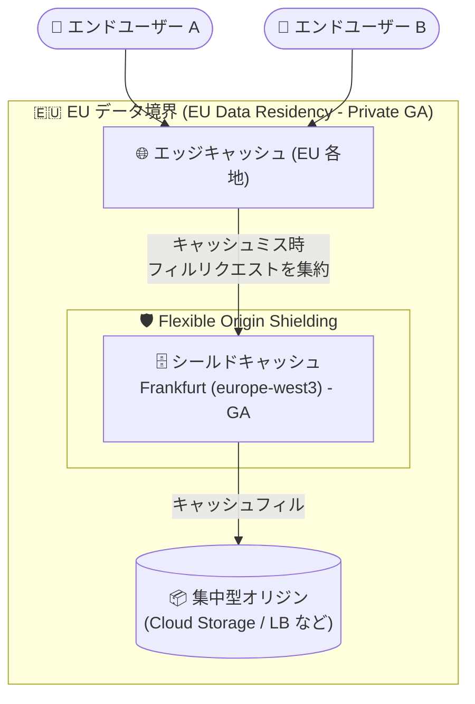

# Media CDN: EU データレジデンシー (Private GA) とヨーロッパ Flexible Origin Shielding リージョンの追加

**リリース日**: 2026-10-28

**サービス**: Media CDN

**機能**: EU データレジデンシー (Private GA) / Flexible Origin Shielding の Frankfurt (europe-west3) リージョン対応 (GA)

**ステータス**: EU データレジデンシー: Private GA (サポート経由の許可リスト制) / Flexible Shielding (europe-west3): GA (一般提供)

📊 [このアップデートのインフォグラフィックを見る](https://takech9203.github.io/google-cloud-news-summary/20261028-media-cdn-eu-data-residency.html)

## 概要

Google Cloud のメディア配信ソリューションである Media CDN に、EU (欧州連合) 域内でのデータ処理を保証する **EU データレジデンシー** 機能が Private GA として追加されました。この機能により、顧客コンテンツとエンドユーザーデータが EU 域内で処理されることが保証されます。利用にはサポート経由の許可リスト (allowlist) への登録が必要です。

あわせて、**Flexible Origin Shielding (フレキシブルオリジンシールディング)** のシールドリージョンとして **Frankfurt (europe-west3)** が追加され、一般提供 (GA) となりました。これまでフレキシブルシールディングの選択肢にヨーロッパのリージョンは含まれていなかったため、ヨーロッパにオリジンを集中配置しているストリーミング事業者やコンテンツ配信事業者にとって重要なアップデートです。

GDPR をはじめとする EU のデータ保護規制への準拠が求められるメディア企業・放送事業者が、Media CDN を利用した大規模な動画配信やラージファイル配信を EU 域内のデータ処理要件を満たしながら実現できるようになります。

**アップデート前の課題**

- Media CDN には顧客コンテンツとエンドユーザーデータの処理を EU 域内に限定する仕組みがなく、EU のデータレジデンシー要件が厳しいワークロードでの採用が難しかった
- Flexible Origin Shielding で選択できるリージョンにヨーロッパが含まれておらず、ヨーロッパに集中配置したオリジンの近くにシールドキャッシュを構成できなかった
- オリジンがヨーロッパにある場合、デフォルトのオリジンシールディング (エンドユーザーの位置ベース) ではキャッシュミス時のレイテンシ増加やオリジンオフロードの低下が発生する可能性があった

**アップデート後の改善**

- EU データレジデンシー (Private GA) により、顧客コンテンツとエンドユーザーデータが EU 域内で処理されることが保証されるようになった (サポート許可リスト経由で利用可能)
- Flexible Origin Shielding のリージョンとして Frankfurt (europe-west3) が GA で利用可能になり、ヨーロッパのオリジンに近い場所へキャッシュフィルリクエストを集約できるようになった
- ヨーロッパ集中型オリジン構成において、シールド層でのキャッシュヒット率、オリジンオフロード、キャッシュミス時のレイテンシ、パフォーマンスの安定性を最適化できるようになった

## アーキテクチャ図



EU データレジデンシーにより顧客コンテンツとエンドユーザーデータの処理が EU 域内に収まり、Frankfurt (europe-west3) のフレキシブルシールディングがエッジキャッシュからのキャッシュフィルリクエストを集約してオリジン負荷を低減します。

## サービスアップデートの詳細

### 主要機能

1. **EU データレジデンシー (Private GA)**
   - 顧客コンテンツ (customer content) とエンドユーザーデータ (end-user data) が EU 域内で処理されることを保証
   - サポート経由の許可リスト (support allowlist) に登録することで利用可能
   - GDPR 等の EU データ保護要件への準拠が求められるメディア配信ワークロードに対応

2. **Flexible Origin Shielding の Frankfurt (europe-west3) 対応 (GA)**
   - オリジンシールディングに使用する地理的リージョンとして Frankfurt (europe-west3) を明示的に指定可能
   - すべてのキャッシュフィルリクエストを指定リージョン内またはその近傍のシールドキャッシュ経由にルーティング
   - Media CDN で構成可能なあらゆるオリジンタイプ (Cloud Storage、外部アプリケーションロードバランサ、外部 HTTP エンドポイントなど) と互換

### オリジンシールディングのおさらい

Media CDN は 3 層のキャッシュインフラストラクチャ (ディープエッジキャッシュ、ピアリングエッジ、ロングテールキャッシュ = オリジンシールド) を持ち、デフォルトではエンドユーザーの位置に基づいてシールドロケーションが決まります。オリジンが 1 つのリージョンに集中していてユーザーがグローバルに分散している場合、デフォルト動作では以下の課題が生じ得ます。

- デフォルトのシールドロケーションがオリジンから地理的に遠い場合、キャッシュミス時のレイテンシが増加する
- キャッシュフィルリクエストが複数のグローバルシールドロケーションに分散し、オリジンオフロードが低下する

Flexible Shielding はシールドリージョンを 1 つ明示的に指定することで、この課題を解消します。

## 技術仕様

### Flexible Shielding の対応リージョン

| リージョン | ロケーション | 備考 |
|------|------|------|
| `europe-west3` | Frankfurt (ドイツ) | **今回 GA で追加** |
| `africa-south1` | Johannesburg (南アフリカ) | 既存 |
| `me-central1` | Doha (カタール) | 既存 |
| `us-east5` | Columbus (米国) | 既存 |

### EU データレジデンシー

| 項目 | 詳細 |
|------|------|
| 提供ステータス | Private GA |
| 利用条件 | サポート経由の許可リスト (support allowlist) への登録 |
| 保証内容 | 顧客コンテンツとエンドユーザーデータの処理が EU 域内で行われる |

## 設定方法

### 前提条件

1. Media CDN が有効化されたプロジェクトがあること (Media CDN 自体も利用申請が必要なサービス)
2. EU データレジデンシーを利用する場合は、Google Cloud サポート経由で許可リストへの登録を申請すること
3. Flexible Shielding は高度な構成であり、集中型オリジン + グローバル分散ユーザーというユースケース以外ではデフォルトのオリジンシールディングが推奨されること

### 手順

#### ステップ 1: 新規オリジン作成時に Flexible Shielding リージョンを指定

```bash
gcloud edge-cache origins create MY_ORIGIN \
  --origin-address=origin.example.com \
  --flex-shielding=europe-west3
```

`--flex-shielding` に `europe-west3` を指定することで、キャッシュフィルリクエストが Frankfurt のシールドキャッシュ経由に集約されます。

#### ステップ 2: 既存オリジンの更新

```bash
gcloud edge-cache origins update MY_ORIGIN \
  --origin-address=origin.example.com \
  --flex-shielding=europe-west3
```

デフォルトのオリジンシールディングに戻す場合は、`--flex-shielding` オプションを空に設定して同じコマンドを実行します。

#### ステップ 3: YAML で構成する場合

```yaml
name: MY_ORIGIN
originAddress: origin.example.com
flexShielding:
  flexShieldingRegions:
    - europe-west3
```

`EdgeCacheOrigin` リソースに `flexShielding` セクションを追加します。デフォルトに戻すには `flexShielding` セクションを削除します。

なお、Google Cloud コンソールからも設定可能です (オリジンの編集画面で「Origin shielding」から「Flexible shielding (custom)」を選択)。Cloud Storage バケットをオリジンとする場合、バケットのリージョンがサポート対象であれば自動的に選択されます。

## メリット

### ビジネス面

- **EU 規制への準拠**: 顧客コンテンツとエンドユーザーデータの EU 域内処理が保証されるため、GDPR 等のデータ保護要件が厳しい EU 市場向けメディア配信ビジネスで Media CDN を採用しやすくなる
- **オリジンコストの削減**: シールドキャッシュへのフィル集約によりオリジンへのリクエストと Egress 帯域が削減され、オリジンインフラのコストを抑制できる

### 技術面

- **キャッシュヒット率とオリジンオフロードの向上**: ヨーロッパの集中型オリジンに対し、Frankfurt のシールド層にキャッシュフィルを集約することでシールド層のキャッシュヒット率とオリジンオフロードが向上する
- **キャッシュミス時のレイテンシ低減**: オリジンに近いシールドリージョンを指定することで、キャッシュミスやキャッシュ不可コンテンツのレイテンシとパフォーマンスの安定性が改善する
- **全オリジンタイプとの互換性**: Flexible Shielding は Media CDN で構成可能なあらゆるオリジンタイプと互換性がある

## デメリット・制約事項

### 制限事項

- EU データレジデンシーは Private GA であり、サポート経由の許可リスト登録が必要 (セルフサービスでは有効化できない)
- Flexible Shielding で選択できるリージョンは `africa-south1`、`europe-west3`、`me-central1`、`us-east5` の 4 つに限られる

### 考慮すべき点

- Flexible Shielding は高度な構成であり、不適切なシールドリージョンを選択するとデフォルト動作よりレイテンシが増加するなどパフォーマンスに悪影響を与える可能性がある。集中型オリジン + グローバル分散ユーザーというユースケース以外では、デフォルトのオリジンシールディングが強く推奨される
- Cloud Storage オリジンで Flexible Shielding を有効にした場合、バケットのリージョンに基づいてリージョンが自動選択される。バケットのリージョンがサポート対象外、または FQDN/IP アドレスをオリジンに使用している場合はリージョン選択がクリアされるため、明示的な指定が必要

## ユースケース

### ユースケース 1: EU 域内限定のデータ処理が必要な放送事業者の VOD 配信

**シナリオ**: EU の放送事業者が、GDPR および社内データガバナンスポリシーにより「視聴者データとコンテンツの処理を EU 域内に限定する」要件を持ちながら、大規模な VOD (ビデオオンデマンド) 配信基盤を構築したい。

**実装例**:
```
1. Google Cloud サポート経由で Media CDN EU データレジデンシーの許可リスト登録を申請
2. EU リージョンの Cloud Storage バケットにコンテンツを配置
3. EdgeCacheOrigin で flexShielding に europe-west3 を指定
4. EdgeCacheService でルーティングとキャッシュポリシーを構成
```

**効果**: 顧客コンテンツとエンドユーザーデータの処理が EU 域内で行われることが保証され、コンプライアンス要件を満たしつつ Google のグローバルエッジインフラによる高品質な配信を実現できる。

### ユースケース 2: ヨーロッパ集中型オリジンからのグローバル配信の最適化

**シナリオ**: ドイツのメディア企業が、Frankfurt 近郊のオリジン (オンプレミスまたは Cloud Storage) から世界中のユーザーに大容量ファイルやライブストリーミングを配信している。デフォルトのシールディングではユーザー位置ベースでシールドが分散し、オリジンへのキャッシュフィルが世界各地から発生していた。

**効果**: Flexible Shielding で `europe-west3` を指定することで、全世界のエッジからのキャッシュフィルリクエストが Frankfurt のシールドキャッシュに集約される。オリジンへの接続はオリジン近傍からのみとなり、オリジンオフロードの向上、キャッシュミス時のレイテンシ低減、オリジン側の帯域コスト削減が期待できる。

## 料金

今回のリリースノートでは、EU データレジデンシーおよび Flexible Shielding の追加料金に関する記載はありません。Media CDN の料金 (キャッシュ Egress、キャッシュフィル、リクエスト数など) の詳細は料金ページを参照してください。

- [Media CDN 料金ページ](https://cloud.google.com/media-cdn/pricing)

## 利用可能リージョン

- **EU データレジデンシー**: EU 域内でのデータ処理を保証 (Private GA、サポート許可リスト制)
- **Flexible Shielding**: `africa-south1`、`europe-west3` (今回追加)、`me-central1`、`us-east5`

## 関連サービス・機能

- **Cloud CDN**: Google Cloud の Web アクセラレーション向け CDN。Media CDN は高スループットの Egress ワークロード (ストリーミング動画、大容量ファイルダウンロード) に最適化されており、両者は補完関係にある
- **Cloud Storage**: Media CDN のオリジンとして利用可能。Flexible Shielding 有効化時はバケットのリージョンに基づきシールドリージョンが自動選択される
- **外部アプリケーションロードバランサ**: Google Cloud 内やオンプレミスのプライベートなリソースを Media CDN のオリジンとして公開する際に利用
- **Assured Workloads (EU Data Boundary)**: Google Cloud 全体で EU データ境界の統制を適用するためのサービス。EU のデータレジデンシー要件を持つ組織が併せて検討することが多い

## 参考リンク

- 📊 [インフォグラフィック](https://takech9203.github.io/google-cloud-news-summary/20261028-media-cdn-eu-data-residency.html)
- [公式リリースノート (Media CDN)](https://docs.cloud.google.com/media-cdn/docs/release-notes)
- [Media CDN オリジンの概要 (Flexible Shielding)](https://docs.cloud.google.com/media-cdn/docs/origins#flex-shielding)
- [Flexible Shielding リージョンの構成方法](https://docs.cloud.google.com/media-cdn/docs/configure-origin#configure-flex-shielding-region)
- [Media CDN 概要](https://docs.cloud.google.com/media-cdn/docs/overview)
- [料金ページ](https://cloud.google.com/media-cdn/pricing)

## まとめ

Media CDN の EU データレジデンシー (Private GA) により、EU のデータ保護要件が厳しいメディア配信ワークロードでも Media CDN を採用できる道が開かれました。あわせて Flexible Shielding の Frankfurt (europe-west3) リージョンが GA となり、ヨーロッパ集中型オリジン構成でのオリジンオフロードとレイテンシの最適化が可能になっています。EU 市場向けの配信基盤を運用している場合は、サポート経由での EU データレジデンシー許可リスト登録と、オリジン配置に応じた Flexible Shielding の活用を検討することを推奨します。

---

**タグ**: #MediaCDN #CDN #DataResidency #EU #GDPR #OriginShielding #FlexibleShielding #europe-west3 #Frankfurt #PrivateGA #GA
