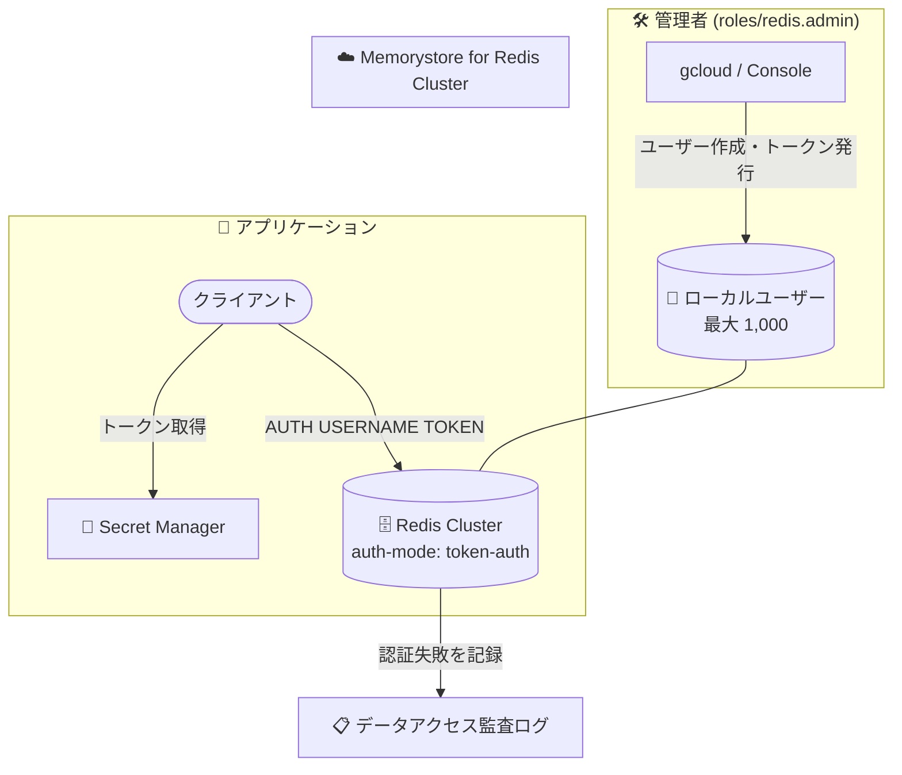

# Memorystore for Redis Cluster: 基本トークンベース認証が GA

**リリース日**: 2026-10-28

**サービス**: Memorystore for Redis Cluster

**機能**: 基本トークンベース認証 (Basic token-based authentication)

**ステータス**: GA (Generally Available)

📊 [このアップデートのインフォグラフィックを見る](https://takech9203.github.io/google-cloud-news-summary/20261028-memorystore-redis-cluster-token-based-auth-ga.html)

## 概要

Memorystore for Redis Cluster の基本トークンベース認証 (Basic token-based authentication) 機能が一般提供 (GA) になりました。この機能は、IAM 認証に加えて利用できる軽量な認証方式で、クライアントがユーザー名と認証トークンを使用してクラスタへのアクセスを検証できるようにします。リソース要件が最小限でオーバーヘッドが低いことが特徴です。

標準の Redis `AUTH` コマンドと互換性があるため、既存の Redis クライアントライブラリをそのまま利用できます。デフォルトユーザーはトークンのみで認証し (`AUTH TOKEN`)、それ以外のユーザーはユーザー名とトークンで認証します (`AUTH USERNAME TOKEN`)。Memorystore for Redis (非クラスタ版) やオンプレミス環境で既に基本トークンベース認証を使用しているワークロードにとっては、Memorystore for Redis Cluster への移行をスムーズにする機能です。

対象ユーザーは、IAM 認証を利用できない (または利用したくない) クライアント環境を持つチームや、既存のパスワード/トークンベースの認証フローを維持したまま Memorystore for Redis Cluster に移行したいチームです。

**アップデート前の課題**

- Memorystore for Redis (非クラスタ版) やオンプレミスの Redis で `AUTH` コマンドによる認証を使用していたワークロードを Memorystore for Redis Cluster に移行する際、認証方式の変更が必要だった
- IAM 認証ではアクセストークンの有効期限 (デフォルト 1 時間) があり、アプリケーション側でトークン取得の自動化が必要だった

**アップデート後の改善**

- 標準の Redis `AUTH` コマンドによるユーザー名 + トークン認証が GA として利用可能になり、本番環境で安心して採用できるようになった
- 新規・既存どちらのクラスタでも、任意のタイミングで基本トークンベース認証を有効化できる
- ユーザーごとに最大 2 つのトークンを保持でき、アプリケーションを停止することなくトークンをローテーションできる (ゼロダウンタイムローテーション)
- デフォルトのスーパーユーザーは従来と同じ権限を維持するため、Memorystore for Redis からの移行時の後方互換性が確保される

## アーキテクチャ図



管理者が gcloud CLI や Google Cloud コンソールでローカルユーザーと認証トークンを管理し、クライアントは Secret Manager から取得したトークンを使って `AUTH` コマンドでクラスタに認証します。不正なトークンによる接続試行はデータアクセス監査ログに記録されます。

## サービスアップデートの詳細

### 主要機能

1. **クラスタ単位の基本トークンベース認証**
   - クラスタ作成時 (`--auth-mode=token-auth`) または既存クラスタの更新で有効化できる
   - 有効化すると、デフォルトユーザーと認証トークンが自動的に作成される
   - 有効化後は新規接続に認証が必須になる (既存の接続には影響しない)

2. **マルチユーザー管理**
   - クラスタごとに最大 1,000 のローカルユーザーを管理できる
   - ユーザーの作成・一覧・詳細表示・削除を Console / gcloud CLI で実行できる
   - デフォルトユーザーは削除不可で、トークンのみで認証する

3. **ゼロダウンタイムのトークンローテーション**
   - 各ユーザーは最大 2 つの認証トークンを保持できる
   - 新しいトークンを追加発行してアプリケーション側を切り替えた後、古いトークンを削除することで、ダウンタイムなしにローテーションできる

4. **監査ログ連携**
   - 不正または無効なトークンでの接続試行はデータアクセス監査ログに記録され、セキュリティ脅威の検出や接続トラブルシューティングに利用できる

## 技術仕様

### 基本トークンベース認証の仕様

| 項目 | 詳細 |
|------|------|
| 認証モード | シンプル認証 (デフォルトユーザー: `AUTH TOKEN`) / マルチユーザー認証 (`AUTH USERNAME TOKEN`) |
| ローカルユーザー数の上限 | クラスタあたり 1,000 ユーザー |
| ユーザーあたりのトークン数 | 最大 2 (ゼロダウンタイムローテーション用) |
| デフォルトユーザー | 有効化時に自動作成。削除不可。従来のスーパーユーザーと同じ権限を維持 |
| 有効化後の制約 | 認証モードの無効化・変更は不可 |
| 既存接続への影響 | 有効化しても既存接続は維持される。新規接続のみ認証が必要 |
| 管理に必要な IAM ロール | Redis 管理者 (`roles/redis.admin`) |
| 必要な gcloud CLI バージョン | 489.0.0 以上 |

### 推奨されるベストプラクティス (公式ドキュメントより)

- **トークンのローテーション**: ローテーションポリシーを設けて定期的にトークンを更新する
- **Secret Manager の利用**: 認証情報をアプリケーションコードにハードコードせず、Secret Manager に保存してランタイムで取得する
- **TLS との併用**: ユーザー名とトークンが平文でネットワークに流れないよう、転送中の暗号化 (in-transit encryption) を有効にする

## 設定方法

### 前提条件

1. Memorystore for Redis Cluster API、Network Connectivity API、Service Consumer Management API が有効であること
2. gcloud CLI バージョン 489.0.0 以上がインストールされていること
3. 設定を行うアカウントに `roles/redis.admin` ロールが付与されていること
4. クライアントアプリケーションが Redis の `AUTH` コマンドをサポートしていること

### 手順

#### ステップ 1: 基本トークンベース認証を有効化してクラスタを作成

```bash
gcloud beta redis clusters create CLUSTER_ID \
  --region=REGION \
  --auth-mode=token-auth
```

既存クラスタの場合は `gcloud beta redis clusters update CLUSTER_ID --region=REGION --auth-mode=token-auth` で有効化します。有効化するとデフォルトユーザーとトークンが自動作成されます。

#### ステップ 2: ユーザーを作成する (マルチユーザー認証の場合)

```bash
gcloud beta redis clusters create-token-auth-user CLUSTER_ID \
  --region=REGION \
  --token-auth-user=USERNAME
```

ユーザー作成時に認証トークンが自動的に発行されます。追加トークンは `gcloud beta redis clusters token-auth-users create-auth-token` で発行できます。

#### ステップ 3: クライアントから接続する

```bash
# URI 文字列を使用する場合
redis-cli -c -u redis://USERNAME:TOKEN@IP_ADDRESS:PORT

# 転送中の暗号化が有効な場合
redis-cli -c -u rediss://USERNAME:TOKEN@IP_ADDRESS:PORT --cacert /tmp/server_ca.pem
```

フラグ形式 (`redis-cli -c --user USERNAME -a TOKEN -h IP_ADDRESS -p PORT`) でも接続できます。

## メリット

### ビジネス面

- **移行の容易さ**: Memorystore for Redis (非クラスタ版) やオンプレミスで基本認証を使用している既存ワークロードを、認証フローを大きく変えずに Memorystore for Redis Cluster へ移行できる
- **GA による本番適用**: 一般提供となったことで、本番環境での採用判断がしやすくなった

### 技術面

- **軽量な認証**: リソース要件が最小限で、オーバーヘッドが低い
- **ゼロダウンタイムローテーション**: ユーザーあたり 2 トークンの仕組みにより、アプリケーションを止めずに認証情報を更新できる
- **幅広いクライアント互換性**: 標準の Redis `AUTH` コマンドを使用するため、既存のクライアントライブラリで動作する
- **監査可能性**: 認証失敗がデータアクセス監査ログに記録される

## デメリット・制約事項

### 制限事項

- 一度基本トークンベース認証を有効化すると、この認証モードを無効化・変更できない
- デフォルトユーザーは削除できない
- ローカルユーザーはクラスタあたり最大 1,000、トークンはユーザーあたり最大 2 まで
- トークンの一覧・詳細表示など一部の操作は gcloud CLI のみで提供される (ドキュメント上のコマンドは `gcloud beta` 系)

### 考慮すべき点

- 有効化後は新規接続に認証が必須となるため、アプリケーションを更新していないと新規接続の確立に失敗する可能性がある (既存接続は影響を受けない)
- `AUTH` コマンドは暗号化されずに送信されるため、転送中の暗号化 (TLS) との併用が推奨される
- ユーザーを削除しても既存接続は切断されないため、必要に応じて各ノードで `CLIENT KILL USER USERNAME` を実行する必要がある
- IAM による集中的なアクセス管理 (ポリシー、条件付きアクセスなど) が必要な場合は、IAM 認証の方が適している

## ユースケース

### ユースケース 1: Memorystore for Redis からクラスタ版への移行

**シナリオ**: Memorystore for Redis (非クラスタ版) で AUTH 文字列による認証を使用しているアプリケーションを、スケーラビリティ向上のために Memorystore for Redis Cluster へ移行したい。

**実装例**:
```bash
# トークン認証を有効にしたクラスタを作成
gcloud beta redis clusters create my-cluster \
  --region=asia-northeast1 \
  --auth-mode=token-auth
```

**効果**: デフォルトユーザーが従来のスーパーユーザーと同じ権限を維持するため、アプリケーションの認証ロジックを大きく変更せずに移行できる。

### ユースケース 2: ダウンタイムなしの認証情報ローテーション

**シナリオ**: セキュリティポリシーに従い、Redis への接続認証情報を定期的にローテーションする必要があるが、サービス停止は許容できない。

**実装例**:
```bash
# 1. 新しいトークンを追加発行 (ユーザーは 2 トークンを保持)
gcloud beta redis clusters token-auth-users create-auth-token app-user \
  --cluster=my-cluster --region=asia-northeast1

# 2. アプリケーション (Secret Manager 経由) を新トークンに切り替え
# 3. 古いトークンを削除
```

**効果**: 2 トークン方式により、アプリケーションのダウンタイムなしで認証情報をローテーションできる。

## 料金

基本トークンベース認証機能自体に関する追加料金の記載は、リリースノートおよびドキュメントでは確認できませんでした。Memorystore for Redis Cluster の料金詳細は料金ページを参照してください。

- [Memorystore 料金ページ](https://cloud.google.com/memorystore/docs/cluster/pricing)

## 利用可能リージョン

リリースノートにリージョン固有の記載はありません。Memorystore for Redis Cluster の利用可能リージョンは公式ドキュメントを参照してください。

- [Memorystore for Redis Cluster のロケーション](https://docs.cloud.google.com/memorystore/docs/cluster/locations)

## 関連サービス・機能

- **IAM 認証 (Memorystore for Redis Cluster)**: 基本トークンベース認証と並ぶもう 1 つの認証方式。IAM ポリシーによる集中的なアクセス管理と短命トークンによる認証を提供する
- **Secret Manager**: トークンをハードコードせずに安全に保管・取得するために推奨される。IAM によるアクセス制御と監査ログも提供
- **転送中の暗号化 (In-transit encryption)**: ユーザー名とトークンが平文で送信されないよう、基本トークンベース認証との併用が推奨される
- **Cloud Audit Logs (データアクセス監査ログ)**: 無効なトークンによる接続試行が記録され、セキュリティ脅威の検出に利用できる

## 参考リンク

- 📊 [インフォグラフィック](https://takech9203.github.io/google-cloud-news-summary/20261028-memorystore-redis-cluster-token-based-auth-ga.html)
- [公式リリースノート](https://cloud.google.com/release-notes#October_28_2026)
- [ドキュメント: Manage basic token-based authentication](https://docs.cloud.google.com/memorystore/docs/cluster/manage-basic-auth)
- [ドキュメント: About IAM authentication](https://docs.cloud.google.com/memorystore/docs/cluster/about-iam-auth)
- [料金ページ](https://cloud.google.com/memorystore/docs/cluster/pricing)

## まとめ

Memorystore for Redis Cluster の基本トークンベース認証が GA となり、標準の Redis `AUTH` コマンドによる軽量な認証を本番環境で利用できるようになりました。特に Memorystore for Redis (非クラスタ版) やオンプレミスからの移行で認証方式の互換性を維持したいチームにとって有力な選択肢です。採用する際は、Secret Manager によるトークン管理、TLS との併用、2 トークンを活用したローテーションポリシーの整備を推奨します。

---

**タグ**: Memorystore, Redis Cluster, 認証, セキュリティ, GA, トークン認証
