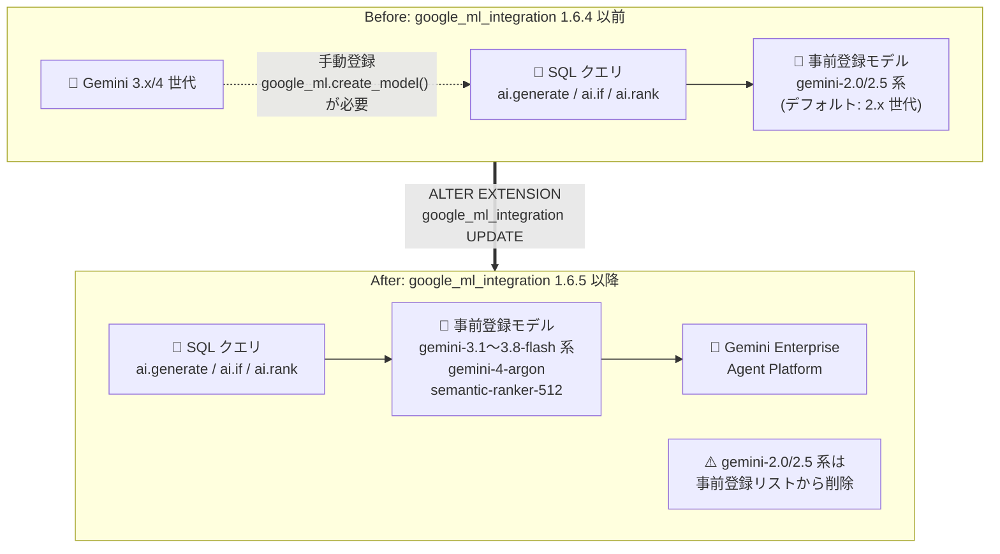

# AlloyDB for PostgreSQL: AlloyDB AI の事前登録 Gemini モデル刷新 (google_ml_integration 1.6.5)

**リリース日**: 2026-10-29

**サービス**: AlloyDB for PostgreSQL

**機能**: AlloyDB AI 事前登録モデルの更新 (Gemini 3.x / 4 世代への移行、semantic-ranker-512 追加)

**ステータス**: Feature (GA)

📊 [このアップデートのインフォグラフィックを見る](https://takech9203.github.io/google-cloud-news-summary/20261029-alloydb-ai-gemini-model-updates.html)

## 概要

AlloyDB AI は、`google_ml_integration` 拡張機能のバージョン 1.6.5 以降で、事前登録 (pre-registered) される Gemini モデルのラインナップを刷新しました。新たに `gemini-3.1-flash-lite`、`gemini-3.5-flash`、`gemini-3.5-flash-lite`、`gemini-3.6-flash`、`gemini-3.7-flash`、`gemini-3.8-flash`、`gemini-4-argon` の 7 モデルが事前登録モデルとして追加され、手動登録なしで SQL から直接呼び出せるようになりました。

バージョン 1.6.5 では、デフォルトの Gemini モデルが `gemini-3.5-flash-lite` に設定されると同時に、旧世代の `gemini-2.0-flash`、`gemini-2.0-flash-lite`、`gemini-2.5-flash`、`gemini-2.5-flash-lite`、`gemini-2.5-pro` が事前登録モデルのリストから削除されました。さらに、リランキング (再ランク付け) 用のモデルとして `semantic-ranker-512` の事前登録サポートも追加されています。

このアップデートは、`ai.generate()`、`ai.if()`、`ai.rank()` などの AlloyDB AI 関数を使ってデータベース内で LLM を活用しているユーザーが対象です。最新世代の Gemini モデルを登録作業なしで利用できる一方、旧 2.x 系モデルの ID をクエリにハードコードしている場合は移行対応が必要になります。

**アップデート前の課題**

- 事前登録されている Gemini モデルは 2.0 / 2.5 世代が中心で、Gemini 3.x / 4 世代のモデルを使うには `google_ml.create_model()` による手動のモデルエンドポイント登録が必要だった
- 新しい世代のモデルを試すたびに、登録・権限設定などの運用作業が発生していた
- リランキング用の事前登録モデルの選択肢が限られており、`semantic-ranker-512` を使うには個別の対応が必要だった

**アップデート後の改善**

- Gemini 3.1 〜 3.8 Flash 系および `gemini-4-argon` の計 7 モデルが事前登録され、モデル ID を指定するだけで `ai.generate()` などから即座に呼び出せるようになった
- デフォルトの Gemini モデルが `gemini-3.5-flash-lite` となり、モデル ID を明示しない場合も新世代モデルが使われるようになった
- リランキングモデル `semantic-ranker-512` が事前登録され、`ai.rank()` による検索結果の再ランク付けで追加の登録作業なしに利用できるようになった

## アーキテクチャ図



拡張機能を 1.6.5 に更新すると、SQL から登録作業なしで呼び出せる事前登録モデルが Gemini 3.x / 4 世代に入れ替わり、デフォルトモデルも `gemini-3.5-flash-lite` に変わります。

## サービスアップデートの詳細

### 主要機能

1. **Gemini 3.x / 4 世代モデルの事前登録サポート**
   - `gemini-3.1-flash-lite`、`gemini-3.5-flash`、`gemini-3.5-flash-lite`、`gemini-3.6-flash`、`gemini-3.7-flash`、`gemini-3.8-flash`、`gemini-4-argon` の 7 モデルが追加
   - モデルエンドポイントの手動登録ステップが不要で、修飾モデル名 (qualified name) を `model_id` に指定するだけで呼び出せる

2. **デフォルト Gemini モデルの変更**
   - バージョン 1.6.5 でデフォルトの Gemini モデルが `gemini-3.5-flash-lite` に設定された
   - モデル ID を明示しない AI 関数呼び出しは、この新しいデフォルトモデルで実行される

3. **旧世代モデルの事前登録リストからの削除**
   - `gemini-2.0-flash`、`gemini-2.0-flash-lite`、`gemini-2.5-flash`、`gemini-2.5-flash-lite`、`gemini-2.5-pro` が事前登録モデルから削除
   - これらのモデル ID をハードコードしているクエリは、拡張機能更新後に新世代モデルへの移行が必要

4. **リランキングモデル semantic-ranker-512 の事前登録サポート**
   - `ai.rank()` 関数の `model_id` に `semantic-ranker-512` を直接指定して、検索結果の再ランク付けが可能
   - ベクトル検索結果の並び替え精度を向上させる RAG (Retrieval-Augmented Generation) 用途に有効

## 技術仕様

### 事前登録 Agent Platform モデル一覧 (更新後)

| モデルタイプ | モデル ID |
|------|------|
| text-embedding | text-embedding-005, gemini-embedding-001, text-multilingual-embedding-002 |
| multimodal-embedding | multimodalembedding, multimodalembedding@001 |
| reranking | **semantic-ranker-512 (新規)**, semantic-ranker-default-002/003/004, semantic-ranker-fast-004 |
| llm | **gemini-3.1-flash-lite, gemini-3.5-flash, gemini-3.5-flash-lite (デフォルト), gemini-3.6-flash, gemini-3.7-flash, gemini-3.8-flash, gemini-4-argon (いずれも新規)** |

### 前提となる拡張機能と主な AI 関数

| 項目 | 詳細 |
|------|------|
| 必要な拡張機能バージョン | `google_ml_integration` 1.6.5 以降 |
| 必要なフラグ | `google_ml_integration.enable_model_support = on` |
| テキスト生成 | `ai.generate()` — Gemini によるテキスト生成・要約・変換 |
| インテリジェントフィルタリング | `ai.if()` — 自然言語条件による true/false 判定 |
| セマンティックランキング | `ai.rank()` — 検索結果の再ランク付け |
| 埋め込み生成 | `google_ml.embedding()` — ベクトル埋め込みの生成 |
| 汎用予測 | `google_ml.predict_row()` — 登録モデルの呼び出し |

## 設定方法

### 前提条件

1. AlloyDB for PostgreSQL クラスタで Agent Platform (Vertex AI) 連携が構成済みであること
2. インスタンスのデータベースフラグ `google_ml_integration.enable_model_support` が `on` に設定されていること
3. リランキングモデルを使う場合は Discovery Engine API を有効化し、AlloyDB サービスエージェントに `roles/discoveryengine.viewer` を付与すること

### 手順

#### ステップ 1: 拡張機能のバージョン確認と更新

```sql
-- 現在のバージョンを確認
SELECT extversion FROM pg_extension WHERE extname = 'google_ml_integration';

-- 1.6.5 未満の場合は更新
CREATE EXTENSION IF NOT EXISTS google_ml_integration;
ALTER EXTENSION google_ml_integration UPDATE;
```

拡張機能を 1.6.5 以降に更新すると、新しい事前登録モデルが利用可能になります。

#### ステップ 2: 新しい Gemini モデルを SQL から呼び出す

```sql
-- 事前登録済みの Gemini 3.5 Flash でテキスト生成
SELECT ai.generate(
  model_id => 'gemini-3.5-flash',
  prompt   => 'この製品レビューを 1 文で要約してください: ...');
```

手動のモデル登録は不要で、修飾モデル名を指定するだけで呼び出せます。

#### ステップ 3: semantic-ranker-512 で検索結果を再ランク付けする

```sql
SELECT index, score
FROM ai.rank(
  model_id      => 'semantic-ranker-512',
  search_string => 'おすすめのデザート',
  documents     => ARRAY['レビュー 1', 'レビュー 2', 'レビュー 3'],
  top_n         => 2);
```

ベクトル検索の初期結果を `ai.rank()` で再ランク付けすることで、RAG の検索品質を向上できます。

## メリット

### ビジネス面

- **最新モデルへの即時アクセス**: Gemini 3.x / 4 世代の性能・コスト効率の改善を、追加の運用作業なしにデータベース内 AI 処理へ反映できる
- **運用負荷の削減**: モデルエンドポイントの手動登録・管理が不要になり、開発チームはアプリケーションロジックに集中できる

### 技術面

- **デフォルトモデルの近代化**: モデル ID を指定しないワークロードも自動的に `gemini-3.5-flash-lite` を利用し、旧世代モデルへの依存を解消できる
- **RAG パイプラインの強化**: `semantic-ranker-512` が事前登録されたことで、ベクトル検索 + 再ランク付けの 2 段階検索を SQL だけで完結できる

## デメリット・制約事項

### 制限事項

- 新しい事前登録モデルの利用には `google_ml_integration` 拡張機能 1.6.5 以降が必要
- `gemini-2.0-flash`、`gemini-2.0-flash-lite`、`gemini-2.5-flash`、`gemini-2.5-flash-lite`、`gemini-2.5-pro` は事前登録リストから削除されるため、これらの ID を直接指定しているクエリは 1.6.5 への更新後に動作しなくなる可能性がある
- Agent Platform モデルのサポートは、Agent Platform のモデルバージョニングとライフサイクルのガイドラインに従う (モデルの提供終了スケジュールに注意)

### 考慮すべき点

- 拡張機能の更新前に、既存のクエリ・ストアドプロシージャ・アプリケーションコードで旧 2.x 系モデル ID をハードコードしている箇所を洗い出し、新モデルへの置き換え計画を立てる
- デフォルトモデルの変更 (`gemini-3.5-flash-lite`) により、モデル ID を省略している処理の出力品質・レイテンシ・コストが変わる可能性があるため、更新後に動作検証を行う
- リランキングモデルの利用には Discovery Engine API の有効化と IAM 権限の付与が別途必要

## ユースケース

### ユースケース 1: 旧世代 Gemini モデルからの移行

**シナリオ**: `ai.generate()` で `gemini-2.5-flash` をハードコードしてレビュー要約を行っているシステムを、拡張機能 1.6.5 への更新に合わせて新世代モデルへ移行する。

**実装例**:
```sql
-- Before (1.6.5 更新後は事前登録リストに存在しない)
SELECT ai.generate(model_id => 'gemini-2.5-flash', prompt => '...');

-- After (事前登録済みの新モデルに置き換え)
SELECT ai.generate(model_id => 'gemini-3.5-flash', prompt => '...');
```

**効果**: 事前登録リスト変更によるクエリ失敗を回避しつつ、新世代モデルの性能向上を享受できる。

### ユースケース 2: semantic-ranker-512 による RAG 検索品質の向上

**シナリオ**: pgvector によるベクトル検索の上位 10 件を `semantic-ranker-512` で再ランク付けし、関連度の高い上位 5 件をアプリケーションに返す。

**実装例**:
```sql
WITH initial_ranking AS (
  SELECT id, description, ROW_NUMBER() OVER () AS ref_number
  FROM product
  ORDER BY embedding <=> google_ml.embedding(
    'gemini-embedding-001', 'フィットネス機器')::vector
  LIMIT 10
),
reranked_results AS (
  SELECT index, score
  FROM ai.rank(
    model_id      => 'semantic-ranker-512',
    search_string => 'フィットネス機器',
    documents     => (SELECT ARRAY_AGG(description ORDER BY ref_number)
                      FROM initial_ranking),
    top_n         => 5)
)
SELECT id, description
FROM initial_ranking, reranked_results
WHERE initial_ranking.ref_number = reranked_results.index
ORDER BY reranked_results.score DESC;
```

**効果**: ベクトル検索単独よりも検索クエリとの意味的な関連度が高い順序で結果を返せる。

## 料金

AlloyDB 自体は AI 関数の呼び出しに対して課金しません。ただし、Gemini Enterprise Agent Platform のモデル (Gemini モデルやランキングモデル) を呼び出した分は、モデル提供側 (Agent Platform) の料金が直接発生します。モデルごとの単価は Agent Platform の料金ページを参照してください。

- [AlloyDB for PostgreSQL の料金](https://cloud.google.com/alloydb/pricing)
- [Gemini Enterprise Agent Platform の料金](https://cloud.google.com/products/gemini-enterprise-agent-platform/pricing)

## 関連サービス・機能

- **Gemini Enterprise Agent Platform (Vertex AI)**: 事前登録モデルの実体を提供するプラットフォーム。モデルバージョニングとライフサイクル管理もここに準拠する
- **Discovery Engine API**: `ai.rank()` でランキングモデルを利用する際に有効化が必要な API
- **pgvector / AlloyDB ベクトル検索**: `google_ml.embedding()` で生成した埋め込みの格納・検索に使用し、`ai.rank()` との組み合わせで RAG の検索品質を高められる
- **AlloyDB Omni**: セルフマネージド版 AlloyDB でも `google_ml_integration` 拡張機能によるモデルエンドポイント管理が利用可能

## 参考リンク

- 📊 [インフォグラフィック](https://takech9203.github.io/google-cloud-news-summary/20261029-alloydb-ai-gemini-model-updates.html)
- [公式リリースノート (AlloyDB for PostgreSQL)](https://docs.cloud.google.com/alloydb/docs/release-notes)
- [サポートされる AI モデル (事前登録モデル一覧)](https://docs.cloud.google.com/alloydb/docs/reference/supported-ai-models#pre-registered-models)
- [AlloyDB AI 関数の概要](https://docs.cloud.google.com/alloydb/docs/ai/ai-query-engine-landing)
- [ai.rank() による検索結果のランク付け](https://docs.cloud.google.com/alloydb/docs/ai/rank-rerank-search-results-rag)
- [モデルエンドポイントの登録](https://docs.cloud.google.com/alloydb/docs/ai/register-model-endpoint)
- [料金ページ (AlloyDB)](https://cloud.google.com/alloydb/pricing)

## まとめ

AlloyDB AI の事前登録モデルが Gemini 3.x / 4 世代へ一新され、`semantic-ranker-512` も追加されたことで、最新の生成 AI 機能を SQL から登録作業なしに利用できるようになりました。一方で旧 2.x 系モデルは事前登録リストから削除されるため、`google_ml_integration` を 1.6.5 へ更新する前に、既存クエリのモデル ID を棚卸しして新モデルへの移行計画を立てることを推奨します。

---

**タグ**: AlloyDB, AlloyDB AI, Gemini, google_ml_integration, 生成AI, リランキング, RAG, PostgreSQL
