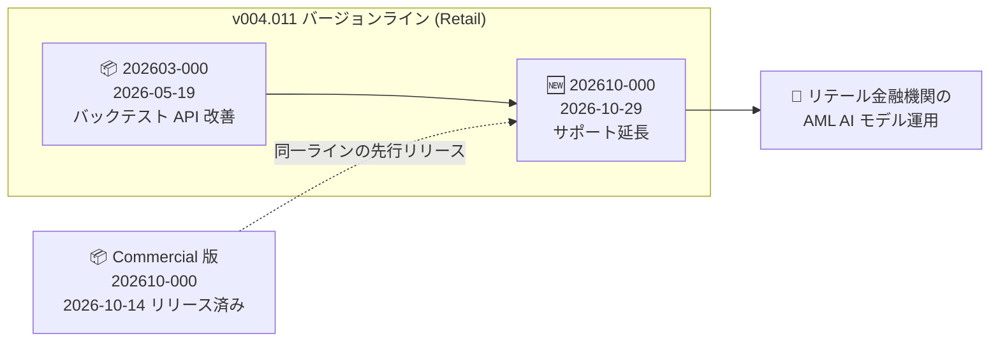

# Anti Money Laundering AI: リテール向け v004.011 系の新マイナーエンジンバージョン (202610-000) リリース

**リリース日**: 2026-10-29

**サービス**: Anti Money Laundering AI (AML AI)

**機能**: リテール (Retail) 向け新マイナーエンジンバージョン `aml-retail.default.v004.011.202610-000`

**ステータス**: Announcement (メンテナンスリリース)

📊 [このアップデートのインフォグラフィックを見る](https://takech9203.github.io/google-cloud-news-summary/20261029-aml-ai-retail-v004-011-minor-engine-version.html)

## 概要

Anti Money Laundering AI (AML AI) において、リテール (Retail) ライン・オブ・ビジネス向けの新しいマイナーエンジンバージョン `aml-retail.default.v004.011.202610-000` が v004.011 バージョンラインでリリースされました。

本バージョンはメジャーエンジンバージョン v004.011 のサポート期間を延長するメンテナンスリリースであり、前のマイナーバージョン (`aml-retail.default.v004.011.202603-000`、2026 年 5 月 19 日リリース) と比較して機能面での大きな変更は含まれていません。

v004.011 ラインは 2026 年 5 月 19 日に導入されたバージョンで、バックテスト API の改善 (しきい値超過パーティ数による Performance Targeting のサポート) と簡素化されたリコールメトリクス計算を特長としています。なお、商用 (Commercial) 向けには同じ v004.011 系のマイナーバージョン `202610-000` が 2026 年 10 月 14 日に先行リリースされており、今回のリリースでリテール向けも追随した形です。

**アップデート前の状況**

- リテール向け v004.011 ラインのマイナーバージョンは、ライン導入時の `202603-000` (2026 年 5 月 19 日リリース) のみだった
- マイナーバージョンにはサポート期限があり、継続利用にはサポートを延長する新しいマイナーバージョンの提供が必要だった

**アップデート後の改善**

- 新マイナーバージョン `202610-000` により、リテール向け v004.011 メジャーバージョンのサポートが延長された
- 既存の v004.011 利用者は、機能面の差異を気にせず最新マイナーバージョンに移行できる (前バージョンからの重要な変更なし)

## アーキテクチャ図

リテール向け v004.011 バージョンライン内のマイナーバージョンの変遷と、今回リリースされた `202610-000` の位置付けを示しています。

## サービスアップデートの詳細

### 主要ポイント

1. **新マイナーエンジンバージョンのリリース**
   - バージョン ID: `aml-retail.default.v004.011.202610-000`
   - 対象: リテール (Retail) ライン・オブ・ビジネス
   - v004 チューニングバージョン配下のメジャーバージョン 011 に属し、ライフサイクルは ACTIVE

2. **メンテナンスリリースとしての性質**
   - メジャーエンジンバージョン v004.011 のサポートを延長
   - 前マイナーバージョン (`202603-000`) と比較して重要な変更は含まれない

3. **v004.011 ラインの特長 (参考)**
   - バックテスト API の改善 (しきい値を超えるパーティ数による Performance Targeting のサポート)
   - 簡素化されたリコールメトリクス計算

## 技術仕様

### エンジンバージョンの命名規則

| 要素 | 値 | 説明 |
|------|-----|------|
| ライン・オブ・ビジネス | `aml-retail` | リテール (個人) 顧客向けモデル |
| チューニングバージョン | `v004` | チューニング方式の世代 |
| メジャーバージョン | `011` | 機能セット・モデル挙動の世代 |
| マイナーバージョン | `202610-000` | メンテナンス更新 (2026 年 10 月) |

### バージョン採用時のポイント

- 新しいエンジンバージョンの採用時は、既存のエンジン設定からハイパーパラメータを継承 (inherit) することで、再チューニングのコストと時間を削減可能
- エンジンバージョンにはライフサイクル (ACTIVE / DEPRECATED / DECOMMISSIONED) があり、最新のマイナーバージョンを利用することでサポートを維持できる

## メリット

### ビジネス面

- **サポート継続性の確保**: リテール向け v004.011 系を利用する金融機関は、サポートが延長された最新マイナーバージョンへ移行することで、安定した AML モデル運用を継続できる
- **移行リスクの低さ**: 前バージョンからの重要な変更がないため、モデル挙動の変化を懸念せずにバージョン更新が可能

### 技術面

- **再チューニング不要の移行**: ハイパーパラメータ継承機能により、既存エンジン設定を活用して低コストで新バージョンに移行できる

## 考慮すべき点

- 本リリースは機能追加ではなくメンテナンスリリースのため、新機能を期待したバージョン更新は不要
- 旧マイナーバージョンにはサポート期限があるため、v004.011 系を利用中の場合は計画的に最新マイナーバージョンへの更新を検討することが推奨される
- チェック取引サポートの改善 (unusual_check_activity 機能ファミリー) などを含むより新しいメジャーバージョン v004.012 (2026 年 7 月 16 日リリース) もリテール向けに利用可能であり、機能面の改善を求める場合はメジャーバージョンの更新も選択肢となる

## 料金

AML AI の料金は従来から変更ありません。詳細は[料金ページ](https://cloud.google.com/financial-services/anti-money-laundering/pricing)を参照してください。

## 関連サービス・機能

- **AML AI エンジンバージョン管理**: エンジンバージョンの一覧とライフサイクルは[エンジンバージョンのリファレンス](https://docs.cloud.google.com/financial-services/anti-money-laundering/docs/reference/engine-versions)で確認可能
- **エンジン設定 (Engine Config)**: 新バージョン採用時にハイパーパラメータの継承が可能で、再チューニングのコストを削減できる
- **商用 (Commercial) 向け v004.011 系**: 同一バージョンラインの商用向けマイナーバージョン `aml-commercial.default.v004.011.202610-000` が 2026 年 10 月 14 日にリリース済み

## 参考リンク

- 📊 [インフォグラフィック](https://takech9203.github.io/google-cloud-news-summary/20261029-aml-ai-retail-v004-011-minor-engine-version.html)
- [公式リリースノート](https://docs.cloud.google.com/release-notes#October_29_2026)
- [AML AI リリースノート](https://docs.cloud.google.com/financial-services/anti-money-laundering/docs/release-notes)
- [エンジンバージョン リファレンス](https://docs.cloud.google.com/financial-services/anti-money-laundering/docs/reference/engine-versions)
- [料金ページ](https://cloud.google.com/financial-services/anti-money-laundering/pricing)

## まとめ

今回のリリースは、リテール向け v004.011 エンジンバージョンラインのサポートを延長するメンテナンスリリースです。v004.011 系を利用しているリテール金融機関は、重要な変更がないことを確認した上で、最新マイナーバージョン `202610-000` への計画的な更新を検討してください。

---

**タグ**: #AMLAI #AntiMoneyLaundering #FinancialServices #EngineVersion #MaintenanceRelease
