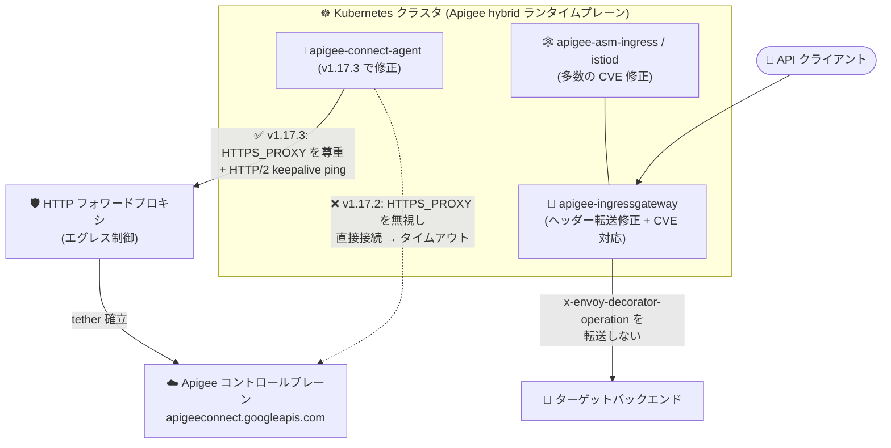

# Apigee hybrid: v1.17.3 パッチリリース (重要なバグ修正とセキュリティ修正)

**リリース日**: 2026-10-29

**サービス**: Apigee hybrid

**機能**: v1.17.3 パッチリリース (apigee-connect-agent のリグレッション修正、トラストストア更新、多数の CVE 対応)

**ステータス**: リリース済み (パッチリリース)

📊 [このアップデートのインフォグラフィックを見る](https://takech9203.github.io/google-cloud-news-summary/20261029-apigee-hybrid-v1-17-3.html)

## 概要

2026 年 10 月 29 日、Apigee hybrid ソフトウェアの更新バージョン v1.17.3 がリリースされました。本リリースはパッチリリースであり、コンテナイメージは Apigee hybrid の Helm チャートに統合されています。Helm チャート経由でパッチにアップグレードするとイメージも自動的に更新されるため、通常は手動でのイメージ変更は不要です。

**特に重要な注意点として、v1.17.2 は apigee-connect-agent に潜在的なリグレッション (既知の問題 578314600) があるため使用しないよう明記されています。** v1.17.2 の利用を検討していた、またはすでに利用している環境は、v1.17.3 を使用する必要があります。このリグレッションは、エグレスに HTTP フォワードプロキシを必須とするクラスタで apigee-connect-agent が `HTTPS_PROXY` を無視し、コントロールプレーンへの tether (接続) を確立できなくなるというもので、管理プレーン操作が `no connections available from the Apigee connect agent(s)` エラーで失敗します。

本リリースには、このリグレッション修正に加えて、侵害された emSign ルート証明書のトラストストアからの削除、`x-envoy-decorator-operation` ヘッダーの上流転送の修正、圧縮された `text/event-stream` レスポンスの破損修正などのバグ修正と、`apigee-asm-ingress`、`apigee-asm-istiod` をはじめとする多数のコンポーネントに対する大量の CVE 対応 (CVE-2026-56857、CVE-2026-56866、CVE-2026-63209 ほか多数) が含まれています。本番環境で Apigee hybrid を運用するプラットフォームチーム、API 管理者にとって、優先的に適用すべきリリースです。

**アップデート前の課題**

- v1.17.2 以前の影響バージョン (hybrid 1.14.9、1.15.8、1.15.9、1.16.11、1.17.1、1.17.2) では、`overrides.yaml` で `httpProxy` を設定していても apigee-connect-agent が `HTTPS_PROXY` を無視し、`apigeeconnect.googleapis.com:443` に直接接続しようとするため、アウトバウンド通信がフォワードプロキシに制限されたクラスタでは接続がタイムアウトし、管理プレーン操作が失敗していた (既知の問題 578314600)
- 侵害された emSign ルート証明書およびクロス署名用の Comodo AAA Services ルート証明書が、コンテナのシステム / Java (cacerts) トラストストアに残存していた (576707253)
- apigee-ingressgateway が Envoy 内部ヘッダーである `x-envoy-decorator-operation` を上流のランタイムやターゲットバックエンドにそのまま転送していた (573622417)
- EventFlow を持つプロキシで、圧縮された `text/event-stream` ボディのレスポンスが破損して返されていた (572025634)
- `apigee-asm-ingress`、`apigee-asm-istiod` などのコンポーネントに多数の未修正 CVE が存在していた

**アップデート後の改善**

- apigee-connect-agent が `HTTPS_PROXY` (プロキシ認証情報を含む) を尊重しつつ、コントロールプレーン接続で HTTP/2 keepalive ping を使用するようになり、HTTP フォワードプロキシ経由の環境でも tether を確立できるようになった
- 侵害された emSign ルートとクロス署名 Comodo AAA Services ルートがトラストストアから削除され、サプライチェーン上のリスクが低減された
- `x-envoy-decorator-operation` ヘッダーが上流に転送されなくなり、内部実装情報の漏えいが防止された
- 圧縮された `text/event-stream` レスポンスは EventFlow 処理をスキップしてそのまま通過するようになり、ボディが破損しなくなった
- `apigee-asm-ingress` / `apigee-asm-istiod` を含む各コンポーネントで多数の CVE が修正され、セキュリティ態勢が改善された

## アーキテクチャ図



v1.17.2 では apigee-connect-agent がフォワードプロキシ設定を無視してコントロールプレーンへ直接接続を試み失敗していましたが (点線)、v1.17.3 では `HTTPS_PROXY` を尊重してプロキシ経由で tether を確立できるようになりました (実線)。

## サービスアップデートの詳細

### 主要機能

1. **v1.17.3 パッチリリースの提供 (v1.17.2 は使用禁止)**
   - 2026 年 10 月 29 日にリリース。コンテナイメージは Helm チャートに統合されており、Helm チャートでのアップグレードによりイメージも自動更新される
   - **v1.17.2 は apigee-connect-agent の潜在的なリグレッション (既知の問題 578314600) のため使用せず、v1.17.3 を使用すること**
   - 既知の問題 578314600 は hybrid 1.14.9 / 1.15.8 / 1.15.9 / 1.16.11 / 1.17.1 / 1.17.2 に影響し、v1.17.3 で修正済み (ワークアラウンドは v1.17.3 へのアップグレード)

2. **主要なバグ修正**
   - **578314600**: apigee-connect-agent が `HTTPS_PROXY` を無視し、エグレスに HTTP フォワードプロキシが必要なクラスタで tether を確立できない問題を修正。エージェントは `HTTPS_PROXY` (プロキシ認証情報を含む) を尊重しつつ、コントロールプレーン接続で HTTP/2 keepalive ping を使用するようになった
   - **576707253**: 侵害された emSign ルートとクロス署名 Comodo AAA Services ルートを、各コンテナのシステムおよび Java (cacerts) トラストストアから削除
   - **573622417**: apigee-ingressgateway が `x-envoy-decorator-operation` ヘッダーを上流のランタイムおよびターゲットバックエンドに転送していた問題を修正
   - **572025634**: EventFlow を持つプロキシで圧縮された `text/event-stream` ボディのレスポンスが破損する問題を修正。圧縮された `text/event-stream` レスポンスは EventFlow 処理をスキップしてそのまま通過する

3. **コンポーネント全体にわたるセキュリティ修正 (CVE 対応)**
   - `apigee-asm-ingress`: CVE-2026-56857、CVE-2026-56866、CVE-2026-63209、CVE-2026-78659/78660/78663/78667/78669、CVE-2026-81870、CVE-2026-84303/84304/84445、CVE-2026-94439/94440/94444/94447/94448、CVE-2026-97030/97031/97032 を修正
   - `apigee-asm-istiod`: 上記に加えて CVE-2026-40179、CVE-2026-42151、CVE-2026-42154、CVE-2026-44903、GHSA-gcjh-h69q-9w9g を修正
   - このほか `apigee-connect-agent`、`apigee-envoy`、`apigee-fluent-bit`、`apigee-hybrid-cassandra`、`apigee-kube-rbac-proxy`、`apigee-mart-server`、`apigee-operators`、`apigee-prom-prometheus` など、多数のコンポーネントでもセキュリティ修正が実施されている

## 技術仕様

### 本リリースで修正された主なバグ

| Bug ID | 対象コンポーネント | 修正内容 |
|--------|--------------------|----------|
| 578314600 | apigee-connect-agent | `HTTPS_PROXY` を無視して tether 確立に失敗する問題を修正。プロキシ認証情報を含む `HTTPS_PROXY` を尊重し、HTTP/2 keepalive ping を使用 |
| 576707253 | 全コンテナのトラストストア | 侵害された emSign ルートとクロス署名 Comodo AAA Services ルートをシステム / Java (cacerts) トラストストアから削除 |
| 573622417 | apigee-ingressgateway | `x-envoy-decorator-operation` ヘッダーの上流 (ランタイム / ターゲットバックエンド) への転送を停止 |
| 572025634 | ランタイム (EventFlow) | 圧縮された `text/event-stream` レスポンスの破損を修正。EventFlow 処理をスキップしてそのまま通過 |

### 既知の問題 578314600 の影響範囲

| 項目 | 詳細 |
|------|------|
| 影響バージョン | hybrid 1.14.9、1.15.8、1.15.9、1.16.11、1.17.1、1.17.2 |
| ステータス | hybrid 1.17.3 で修正済み (FIXED) |
| 発生条件 | `overrides.yaml` で `httpProxy` を設定 (apigee-connect-agent Pod に `HTTPS_PROXY` が設定される) し、アウトバウンド通信がフォワードプロキシに制限されたクラスタ |
| 原因 | bug 513032450 で導入されたカスタム TCP keep-alive ダイヤラーが gRPC 組み込みの HTTP CONNECT プロキシ処理をバイパスし、`apigeeconnect.googleapis.com:443` へ直接接続を試みるため |
| 症状 | 接続タイムアウトにより管理プレーン操作が `no connections available from the Apigee connect agent(s)` で失敗 |
| 対処 | Apigee hybrid 1.17.3 へのアップグレード (1.17.2 は使用しない) |

## 設定方法

### 前提条件

1. Apigee hybrid v1.16.x または v1.17.x が稼働していること (新規インストールの場合は「The big picture」ドキュメントを参照)
2. アップグレード前に Helm チャートディレクトリと Cassandra データベースのバックアップを取得していること
3. Kubernetes プラットフォームが hybrid 1.16 と 1.17 の両方でサポートされるバージョンであること

### 手順

#### ステップ 1: v1.17.3 の Helm チャートを取得

```bash
export CHART_REPO=oci://us-docker.pkg.dev/apigee-release/apigee-hybrid-helm-charts
export CHART_VERSION=1.17.3

helm pull $CHART_REPO/apigee-operator --version $CHART_VERSION --untar
helm pull $CHART_REPO/apigee-datastore --version $CHART_VERSION --untar
helm pull $CHART_REPO/apigee-env --version $CHART_VERSION --untar
helm pull $CHART_REPO/apigee-ingress-manager --version $CHART_VERSION --untar
helm pull $CHART_REPO/apigee-org --version $CHART_VERSION --untar
helm pull $CHART_REPO/apigee-redis --version $CHART_VERSION --untar
helm pull $CHART_REPO/apigee-telemetry --version $CHART_VERSION --untar
helm pull $CHART_REPO/apigee-virtualhost --version $CHART_VERSION --untar
```

Google Artifact Registry から v1.17.3 の Apigee hybrid Helm チャート一式をローカルに取得します。パッチリリースのため、コンテナイメージはチャートに統合されており手動でのイメージ指定は不要です。

#### ステップ 2: CRD を更新し、各チャートをアップグレード

```bash
# CRD の更新 (まず dry-run で検証)
kubectl apply -k apigee-operator/etc/crds/default/ \
  --server-side --force-conflicts --validate=false --dry-run=server

kubectl apply -k apigee-operator/etc/crds/default/ \
  --server-side --force-conflicts --validate=false

# 各チャートを順にアップグレード (例: 環境のアップグレード)
helm upgrade ENV_RELEASE_NAME apigee-env/ \
  --install \
  --namespace APIGEE_NAMESPACE \
  --set env=ENV_NAME \
  -f OVERRIDES_FILE
```

operator、datastore、telemetry、redis、ingress-manager、org、env、virtualhost の順に各チャートをアップグレードします。各 `helm upgrade` の前に `--dry-run=server` での検証が推奨されています。環境と環境グループは 1 つずつアップグレードします。詳細な手順と順序は[公式アップグレードガイド](https://docs.cloud.google.com/apigee/docs/hybrid/v1.17/upgrade)を参照してください。

## メリット

### ビジネス面

- **サービス継続性の確保**: フォワードプロキシ必須のエンタープライズ環境で管理プレーン操作 (プロキシのデプロイなど) が失敗する重大な問題が解消され、運用停止リスクが低減される
- **コンプライアンス / セキュリティ態勢の改善**: 侵害された CA ルートの削除と多数の CVE 修正により、脆弱性管理・監査対応の負担が軽減される

### 技術面

- **プロキシ環境での確実な tether 確立**: `HTTPS_PROXY` (認証情報付きプロキシを含む) が正しく機能し、HTTP/2 keepalive ping により接続の健全性も維持される
- **情報漏えいの防止**: Envoy 内部ヘッダー (`x-envoy-decorator-operation`) がバックエンドに転送されなくなり、内部実装の露出が防止される
- **SSE / ストリーミングの信頼性向上**: 圧縮された `text/event-stream` レスポンスが破損せずに通過するようになり、LLM 系ワークロードなどのストリーミング利用が安定する
- **適用の容易さ**: パッチリリースのためコンテナイメージは Helm チャートに統合されており、チャートのアップグレードのみで適用できる

## デメリット・制約事項

### 制限事項

- v1.17.2 は既知の問題 578314600 のため使用禁止。すでに v1.17.2 を適用済みの場合は速やかに v1.17.3 へアップグレードする必要がある
- 既知の問題 578314600 は v1.17 系だけでなく hybrid 1.14.9、1.15.8、1.15.9、1.16.11 にも影響するため、これらのバージョンでフォワードプロキシを使用している場合も対処が必要

### 考慮すべき点

- アップグレード前に Helm チャートディレクトリと Cassandra のバックアップ取得が推奨されている
- アップグレード中は新しい環境を作成しないこと (公式ドキュメントの注意事項)
- 各 Helm コマンド実行前に `--dry-run` での検証が推奨されている
- 問題発生時は旧バージョンのチャートを使用して逆順 (apigee-virtualhost → apigee-operator → CRD) でロールバックできる

## ユースケース

### ユースケース 1: フォワードプロキシ必須の規制産業環境での復旧

**シナリオ**: 金融機関などで、Kubernetes クラスタからのアウトバウンド通信がすべて HTTP フォワードプロキシ経由に制限されている。影響バージョン (例: 1.16.11 や 1.17.2) で apigee-connect-agent が tether を確立できず、API プロキシのデプロイなど管理プレーン操作が `no connections available from the Apigee connect agent(s)` で失敗している。

**実装例**:
```yaml
# overrides.yaml (フォワードプロキシ設定の例)
httpProxy:
  scheme: HTTP
  host: 10.12.0.47
  port: 3128
```

v1.17.3 の Helm チャートでアップグレードすることで、apigee-connect-agent が `HTTPS_PROXY` を尊重してプロキシ経由で tether を確立する。

**効果**: フォワードプロキシ経由の環境で管理プレーン操作が正常化し、プロキシ認証情報を使用する構成にも対応する。

### ユースケース 2: 定期的な脆弱性対応としてのパッチ適用

**シナリオ**: セキュリティチームのコンテナイメージスキャンで、`apigee-asm-ingress` や `apigee-asm-istiod` などの Apigee hybrid コンポーネントに多数の CVE が検出され、SLA 内での修正が求められている。

**効果**: v1.17.3 への Helm チャートアップグレードのみで、対象コンポーネントの CVE 修正済みイメージが自動適用され、侵害された CA ルートの削除も同時に反映される。脆弱性スキャンの指摘事項を一括で解消できる。

## 料金

本アップデートはパッチリリースであり、料金体系の変更はありません。Apigee の料金はサブスクリプション (Standard / Enterprise / Enterprise Plus) または従量課金 (Pay-as-you-go) で提供されます。詳細は[料金ページ](https://cloud.google.com/apigee/pricing)を参照してください。

## 利用可能リージョン

Apigee hybrid のランタイムプレーンはユーザー管理の Kubernetes クラスタ (オンプレミスまたは任意のクラウド) で動作するため、本リリース自体に固有のリージョン制約はありません。サポートされるプラットフォームは[サポート対象バージョン](https://docs.cloud.google.com/apigee/docs/hybrid/supported-platforms)を参照してください。

## 関連サービス・機能

- **Google Kubernetes Engine (GKE) / Anthos (OpenShift 等)**: Apigee hybrid ランタイムプレーンの実行基盤。パッチ適用は Helm チャートによるアップグレードで行う
- **Apigee Connect (apigeeconnect.googleapis.com)**: ランタイムプレーンとコントロールプレーンを tether で接続するサービス。本リリースの最重要修正 (578314600) の対象
- **Anthos Service Mesh (ASM) ベースコンポーネント**: `apigee-asm-ingress` / `apigee-asm-istiod` として組み込まれており、本リリースで多数の CVE が修正された
- **Cloud Logging / Cloud Monitoring**: `apigee-fluent-bit` や `apigee-prom-prometheus` などのテレメトリーコンポーネントも本リリースでセキュリティ修正の対象

## 参考リンク

- 📊 [インフォグラフィック](https://takech9203.github.io/google-cloud-news-summary/20261029-apigee-hybrid-v1-17-3.html)
- [公式リリースノート (Apigee hybrid)](https://docs.cloud.google.com/apigee/docs/hybrid/release-notes)
- [Apigee hybrid v1.17.3 へのアップグレード手順](https://docs.cloud.google.com/apigee/docs/hybrid/v1.17/upgrade)
- [既知の問題 578314600](https://docs.cloud.google.com/apigee/docs/release/known-issues#578314600)
- [新規インストール (The big picture)](https://docs.cloud.google.com/apigee/docs/hybrid/v1.17/big-picture)
- [Apigee リリースプロセス (コンテナイメージサポート)](https://docs.cloud.google.com/apigee/docs/release/apigee-release-process#apigee-hybrid-container-images)
- [フォワードプロキシの構成](https://docs.cloud.google.com/apigee/docs/hybrid/v1.17/forward-proxy)
- [料金ページ](https://cloud.google.com/apigee/pricing)

## まとめ

Apigee hybrid v1.17.3 は、v1.17.2 の apigee-connect-agent リグレッション (既知の問題 578314600) を修正し、侵害された CA ルートの削除と多数の CVE 対応を含む、適用優先度の高いパッチリリースです。v1.17.2 は使用禁止とされているため、v1.17 系を利用中・導入予定の環境は必ず v1.17.3 を使用してください。特に HTTP フォワードプロキシ経由でエグレスを制御している環境 (影響バージョン: 1.14.9 / 1.15.8 / 1.15.9 / 1.16.11 / 1.17.1 / 1.17.2) は、速やかに Helm チャートによるアップグレードを計画することを推奨します。

---

**タグ**: Apigee hybrid, パッチリリース, v1.17.3, セキュリティ, CVE, apigee-connect-agent, フォワードプロキシ, Helm, バグ修正
