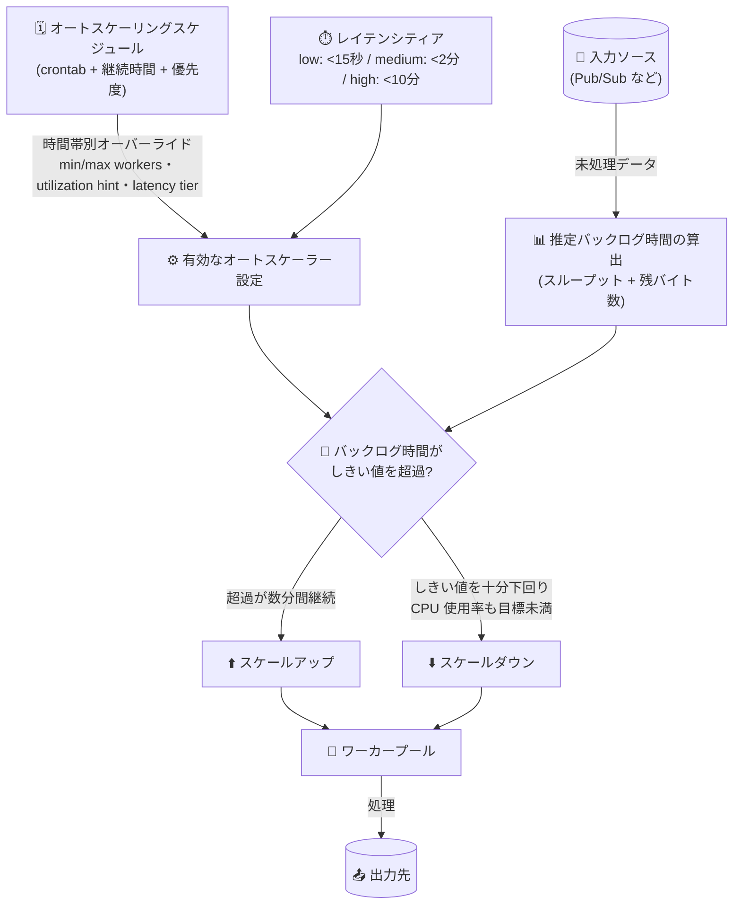

# Dataflow: Streaming Engine 水平オートスケーリングのレイテンシティアとオートスケーリングスケジュール

**リリース日**: 2026-10-29

**サービス**: Dataflow

**機能**: Streaming Engine ジョブの水平オートスケーリングチューニング (レイテンシティア / オートスケーリングスケジュール)

**ステータス**: GA (一般提供)

📊 [このアップデートのインフォグラフィックを見る](https://takech9203.github.io/google-cloud-news-summary/20261029-dataflow-streaming-autoscaling-latency-tiers-schedules.html)

## 概要

Dataflow は、Streaming Engine を使用するストリーミングジョブの水平オートスケーリング (Horizontal Autoscaling) をチューニングするための 2 つの新機能を追加しました。1 つ目は **レイテンシティア (Latency tiers)** で、オートスケーラーがスケーリング判断に使用するバックログ時間のしきい値を `low_latency`、`medium_latency`、`high_latency` の 3 段階から選択できます。これにより、レイテンシ要件とリソースコストのバランスをワークロードごとに調整できます。2 つ目は **オートスケーリングスケジュール (Autoscaling schedules)** で、crontab 形式の定期スケジュールに基づき、最小/最大ワーカー数、ワーカー使用率ヒント、レイテンシティアなどのパラメータオーバーライドを特定の時間帯に自動適用できます。

これらの機能はジョブ作成時に設定できるほか、実行中のジョブに対してもインフライト更新 (in-flight update) で変更可能です。つまり、ジョブを停止・再起動することなくオートスケーリングの挙動を調整できます。

対象ユーザーは、Pub/Sub などからの変動するストリーミングデータを処理しており、「ピーク時間帯は低レイテンシを維持したいが、夜間はコストを抑えたい」といった時間帯や要件に応じたきめ細かなリソース制御を求めるデータエンジニアリングチームです。

**アップデート前の課題**

- オートスケーラーのバックログしきい値は約 15 秒に固定されており、リアルタイム性が不要なラグ許容ワークロードでも低レイテンシ基準でスケールアップが行われ、リソースコストが高くなりがちだった
- 業務時間帯のピークや夜間のオフピークなど、予測可能な負荷変動に合わせてオートスケーリング設定を変えるには、その都度手動でジョブを更新する必要があった
- レイテンシ要件とコストのトレードオフを宣言的に指定する手段がなく、最小/最大ワーカー数の調整などで間接的に制御するしかなかった

**アップデート後の改善**

- レイテンシティアの選択により、許容バックログ時間 (15 秒未満 / 2 分未満 / 10 分未満) を宣言的に指定でき、ラグ許容ワークロードではバックログを蓄積させてコストを削減できるようになった
- 最大 10 件のオートスケーリングスケジュールをジョブごとに定義でき、ピーク時間帯のスケールアップやオフピーク時間帯の縮小が自動化され、手動更新が不要になった
- ジョブ作成時だけでなく、実行中のジョブに対しても `gcloud dataflow jobs update-options` によるインフライト更新で設定変更が可能になった

## アーキテクチャ図



オートスケーラーは入力ソースの推定バックログ時間を、選択したレイテンシティアのしきい値と比較してスケーリングを判断します。スケジュールが有効な時間帯には、ワーカー数範囲・使用率ヒント・レイテンシティアのオーバーライドが自動適用され、ウィンドウ終了後はジョブのデフォルト設定に自動で戻ります。

## サービスアップデートの詳細

### 主要機能

1. **レイテンシティア (Latency tiers)**
   - バックログしきい値を 3 段階のティアで指定し、オートスケーラーのバックログ時間への感度を設定できる
   - バックログ時間が選択したティアのしきい値を数分間超え続けた場合にのみスケーリング判断がトリガーされる
   - ティアを指定しない場合はデフォルトで `low_latency` (従来どおり 15 秒未満を目標) が適用される
   - スケールダウン判断でもティアに基づく目標バックログが最優先の要素として使用される

2. **オートスケーリングスケジュール (Autoscaling schedules)**
   - crontab 式で開始タイミングを指定し、指定した継続時間 (最低 5 分) の間だけパラメータオーバーライドを適用する
   - オーバーライド可能なパラメータ: 最小ワーカー数、最大ワーカー数、CPU 使用率目標 (0.1〜0.9)、レイテンシティア
   - タイムゾーン (tz database 形式、デフォルト UTC) と優先度 (大きい値が優先) を指定可能
   - 1 ジョブあたり最大 10 件のスケジュールを定義でき、ウィンドウ終了後は自動的にデフォルト設定へ復帰する

3. **ジョブ作成時・実行中どちらでも設定可能**
   - ジョブ作成時はパイプラインオプション (`--experiments=...`) で指定
   - 実行中のジョブにはインフライト更新 (`gcloud dataflow jobs update-options`) で適用でき、ジョブの再起動が不要

## 技術仕様

### レイテンシティア

| レイテンシティア | 許容推定バックログ時間 | 想定ユースケース |
|------|------|------|
| `low_latency` | 15 秒未満 | バックログを最小に保つため迅速なスケールアップを優先。未指定時のデフォルト |
| `medium_latency` | 2 分未満 | レイテンシとリソースコストのバランスを取る中間設定 |
| `high_latency` | 10 分未満 | バックログの蓄積を許容してコスト削減を優先。ラグ許容ワークロード向け |

### オートスケーリングスケジュールの属性

| 属性 | 必須/任意 | 説明 |
|------|------|------|
| `name` | 必須 | スケジュールの一意な識別子 |
| `crontab` | 必須 | スケジュールのトリガータイミングを指定する crontab 式 |
| `duration` | 必須 | オーバーライドを適用する継続時間 (秒)。最低 300 秒 (5 分) |
| `timezone` | 任意 | tz database のタイムゾーン名 (例: `Asia/Tokyo`)。デフォルトは UTC |
| `min_workers` / `max_workers` | 任意 | スケジュール有効中の最小/最大ワーカー数 (`max_workers` >= `min_workers`) |
| `cpu_utilization_target` | 任意 | ワーカー CPU 使用率目標。範囲は [0.1, 0.9] |
| `latency_tier` | 任意 | スケジュール有効中のレイテンシティア |
| `priority` | 任意 | 重複時に適用するスケジュールの優先度。値が大きいほど優先 |

### スケジュールの競合解決ルール

- 同時に有効なスケジュールは常に 1 件のみ
- 時間帯が重複する場合は `priority` の値が大きいスケジュールが適用される
- 優先度が同じ場合は、最後に更新されたスケジュールが適用される
- 有効なスケジュールの継続時間が終了すると、他に有効なスケジュールがあればそれを適用し、なければジョブのデフォルト設定に復帰する

## 設定方法

### 前提条件

1. ストリーミングジョブが [Streaming Engine](https://docs.cloud.google.com/dataflow/docs/streaming-engine) を使用していること (両機能とも Streaming Engine ジョブが対象)
2. 水平オートスケーリングが有効であること (Streaming Engine ジョブではデフォルトで有効)

### 手順

#### ステップ 1: ジョブ作成時にレイテンシティアを設定する

```bash
# パイプラインオプションでレイテンシティアを指定 (Java/Python/Go 共通)
--experiments=enable_latency_tier_lightweight_update=medium_latency
```

`low_latency`、`medium_latency`、`high_latency` のいずれかを指定します。

#### ステップ 2: 実行中のジョブのレイテンシティアを更新する

```bash
gcloud dataflow jobs update-options \
  --region=REGION \
  --latency-tier=high_latency \
  JOB_ID

# デフォルト (低レイテンシ) の挙動に戻す場合
gcloud dataflow jobs update-options \
  --unset-latency-tier \
  --region=REGION \
  JOB_ID
```

インフライト更新のため、ジョブを停止せずにティアを変更できます。

#### ステップ 3: ジョブ作成時にオートスケーリングスケジュールを設定する

```bash
# 平日 9 時 (東京時間) から 8 時間、ピーク向け設定を適用する例
--experiments=autoscaling_schedule="name=business-hours;crontab=0 9 * * 1-5;duration=28800;timezone=Asia/Tokyo;min_workers=10;max_workers=50;cpu_utilization_target=0.7;latency_tier=low_latency;priority=10"
```

セミコロン区切りの key:value 形式で指定します。REST API の場合は `runtimeUpdatableParams.schedules` フィールドで指定します。

**注意**: ジョブ起動時に `--experiments` で指定する crontab 式にはカンマを含められません (例: `1,15 * * * *` は不可)。カンマが必要な場合は複数のスケジュールに分割するか、起動後にインフライト更新で設定します。

## メリット

### ビジネス面

- **コスト最適化**: ラグ許容ワークロードで `high_latency` ティアを選択すれば、バックログの蓄積を許容する分だけワーカー数が抑えられ、コンピュートコストを削減できる
- **運用負荷の削減**: ピーク/オフピークに合わせた設定変更が自動化され、手動でのジョブ更新作業やその運用ミスのリスクがなくなる

### 技術面

- **宣言的なレイテンシ/コスト制御**: 「許容バックログ時間」という SLO に近い概念でオートスケーラーの挙動を直接指定できる
- **無停止での調整**: レイテンシティアもスケジュールもインフライト更新に対応しており、ジョブの再起動やドレインが不要
- **柔軟なスケジューリング**: crontab + タイムゾーン + 優先度により、平日/週末、月初バッチ流入など複雑な負荷パターンに対応できる

## デメリット・制約事項

### 制限事項

- 両機能とも **Streaming Engine を使用するストリーミングジョブのみ** が対象 (Streaming Engine を使用しないジョブやバッチジョブでは利用不可)
- オートスケーリングスケジュールは 1 ジョブあたり最大 10 件まで
- スケジュールの継続時間は最低 5 分 (300 秒)
- `cpu_utilization_target` は [0.1, 0.9] の範囲、`max_workers` >= `min_workers` の制約がある
- ジョブ起動時の `--experiments` で指定する crontab 式にカンマを含められない (パイプラインオプションの区切り文字と競合するため)

### 考慮すべき点

- `high_latency` ティアでは推定バックログが最大 10 分近くまで蓄積し得るため、下流システムの鮮度要件 (ダッシュボード更新頻度、SLA など) を確認してから選択する
- スケジュールのデフォルトタイムゾーンは UTC のため、日本時間で運用する場合は `timezone=Asia/Tokyo` を明示し、サマータイムの影響有無も確認する
- 複数スケジュールの時間帯が重複する場合は優先度ルールにより 1 件のみ適用されるため、意図した設定が有効かを Google Cloud コンソールのジョブ詳細ページ「Autoscaling」タブや `gcloud dataflow jobs describe` で確認する

## ユースケース

### ユースケース 1: ラグ許容な分析パイプラインのコスト削減

**シナリオ**: Pub/Sub から収集したログを集計して BigQuery に書き込むパイプラインで、集計結果の利用は 1 時間ごとのレポートのみ。秒単位のリアルタイム性は不要だが、デフォルト設定では流量スパイクのたびにスケールアップが発生しコストが膨らんでいる。

**実装例**:
```bash
gcloud dataflow jobs update-options \
  --region=asia-northeast1 \
  --latency-tier=high_latency \
  JOB_ID
```

**効果**: バックログを最大 10 分まで許容することで一時的なスパイクでのスケールアップが抑制され、ワーカー数が平準化されてコンピュートコストを削減できる。

### ユースケース 2: 業務時間帯と夜間で挙動を切り替える EC サイトのイベント処理

**シナリオ**: EC サイトのクリックストリームを処理するパイプラインで、日中 (9:00〜21:00 JST) はレコメンドの鮮度のため低レイテンシが必須だが、深夜帯はトラフィックが少なくコスト優先で運用したい。

**実装例**:
```bash
# 日中はピーク対応 (低レイテンシ + 広いワーカーレンジ) のスケジュールを設定
--experiments=autoscaling_schedule="name=daytime-peak;crontab=0 9 * * *;duration=43200;timezone=Asia/Tokyo;min_workers=20;max_workers=100;latency_tier=low_latency;priority=10"
```

**効果**: 日中は 12 時間 (43200 秒) にわたり低レイテンシ設定が自動適用され、ウィンドウ終了後はジョブのデフォルト設定 (コスト優先) に自動復帰する。手動でのジョブ更新作業が不要になる。

## 料金

レイテンシティアおよびオートスケーリングスケジュール自体に追加料金はありません (リリースノート・ドキュメントに追加課金の記載なし)。Dataflow の料金は従来どおり、ジョブが消費するワーカーの vCPU・メモリ・ストレージおよび Streaming Engine の処理データ量 (または Streaming Engine Compute Unit) に基づいて課金されます。

本機能はワーカー数の推移に直接影響するため、設定次第で月額コストが変動します。`high_latency` ティアやオフピークのワーカー縮小スケジュールを活用することで、コンピュート課金の削減が期待できます。

詳細は [Dataflow 料金ページ](https://cloud.google.com/dataflow/pricing) を参照してください。

## 利用可能リージョン

リリースノートにリージョン制限の記載はありません。Streaming Engine が利用可能なリージョンで使用できます。詳細は [Dataflow のリージョンエンドポイント](https://docs.cloud.google.com/dataflow/docs/concepts/regional-endpoints) および [Streaming Engine のドキュメント](https://docs.cloud.google.com/dataflow/docs/streaming-engine) を参照してください。

## 関連サービス・機能

- **Streaming Engine**: 本機能の前提となる Dataflow のバックエンド。ワーカー VM からステート管理をオフロードし、柔軟なオートスケーリングを実現する
- **Pub/Sub**: ストリーミングパイプラインの代表的な入力ソース。バックログ (未 ACK メッセージ) の推定時間がスケーリング判断の主要素となる
- **Cloud Monitoring / オートスケーリング指標**: ジョブ詳細ページの「Autoscaling」タブで、スケーリング判断の要因や有効なスケジュールを確認できる
- **gcloud CLI (`dataflow jobs update-options`)**: 実行中ジョブへのインフライト更新 (レイテンシティア、ワーカー数範囲など) に使用する

## 参考リンク

- 📊 [インフォグラフィック](https://takech9203.github.io/google-cloud-news-summary/20261029-dataflow-streaming-autoscaling-latency-tiers-schedules.html)
- [公式リリースノート](https://docs.cloud.google.com/release-notes#October_29_2026)
- [ドキュメント: Tune Horizontal Autoscaling (Set the latency tier / Schedule autoscaling changes)](https://docs.cloud.google.com/dataflow/docs/guides/tune-horizontal-autoscaling)
- [ドキュメント: Horizontal Autoscaling](https://docs.cloud.google.com/dataflow/docs/horizontal-autoscaling)
- [ドキュメント: パイプラインのインフライト更新](https://docs.cloud.google.com/dataflow/docs/guides/updating-a-pipeline#in-flight-updates)
- [料金ページ](https://cloud.google.com/dataflow/pricing)

## まとめ

今回のアップデートにより、Dataflow Streaming Engine ジョブのオートスケーリングを「許容バックログ時間」と「時間帯別スケジュール」という 2 つの軸で宣言的に制御できるようになり、レイテンシ要件とコストのトレードオフをワークロードごとに最適化できます。リアルタイム性が必須でないストリーミングジョブを運用しているチームは、まず `medium_latency` / `high_latency` ティアのインフライト適用から試し、負荷パターンが予測可能なジョブにはオートスケーリングスケジュールの導入を検討することを推奨します。

---

**タグ**: Dataflow, Streaming Engine, Horizontal Autoscaling, Latency Tier, Autoscaling Schedule, コスト最適化, ストリーミング処理
