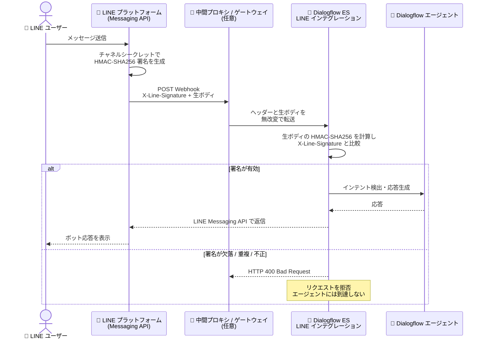

# Dialogflow ES: LINE インテグレーションの Webhook 署名検証 (X-Line-Signature)

**リリース日**: 2026-10-29

**サービス**: Dialogflow ES

**機能**: LINE インテグレーションにおける Webhook 署名検証 (X-Line-Signature ヘッダー検証)

**ステータス**: 一般提供 (セキュリティアップデート)

📊 [このアップデートのインフォグラフィックを見る](https://takech9203.github.io/google-cloud-news-summary/20261029-dialogflow-es-line-webhook-signature-validation.html)

## 概要

Dialogflow ES の LINE インテグレーションにおいて、受信する Webhook リクエストの `X-Line-Signature` HTTP ヘッダーが LINE チャネルシークレットを用いて検証されるようになりました。Dialogflow ES は、HTTP POST リクエストの生のボディ (raw body) に対してチャネルシークレットをキーとする HMAC-SHA256 ダイジェストを計算し、Base64 エンコードした値を `X-Line-Signature` ヘッダーの値と比較することで、リクエストが正当な LINE プラットフォームから送信されたものであることを確認します。

署名が欠落している、重複している、または不正な Webhook リクエストは、HTTP 400 Bad Request エラーで拒否されます。これにより、公開されている Webhook URL に対するなりすましリクエストや改ざんされたリクエストが Dialogflow エージェントに到達することを防ぎます。

LINE インテグレーションを利用しているユーザーは、Dialogflow ES コンソールに設定したチャネルシークレットが LINE Messaging API チャネルの有効なチャネルシークレットと一致していること、および中間プロキシを経由する構成では `X-Line-Signature` ヘッダーと生のリクエストボディが改変されずに転送されることを確認する必要があります。

**アップデート前の課題**

- Dialogflow ES の LINE Webhook URL は公開エンドポイントであり、LINE プラットフォーム以外の第三者が署名のないリクエストを直接送信した場合に、送信元の正当性を Dialogflow 側で保証する仕組みが利用者に明示されていなかった
- チャネルシークレットの不一致やプロキシによるリクエストボディの改変が、明確なエラーとして顕在化しにくかった

**アップデート後の改善**

- すべての受信 Webhook リクエストに対して `X-Line-Signature` ヘッダーの HMAC-SHA256 署名検証が実施され、なりすまし・改ざんリクエストが HTTP 400 Bad Request で確実に拒否されるようになった
- 署名の欠落・重複・不正という拒否条件とエラーコード (400) が明確に定義され、障害時の切り分けが容易になった
- 署名検証を維持するための運用要件 (チャネルシークレットの一致、プロキシでのヘッダー/生ボディの無改変転送) が公式ドキュメントに明記された

## アーキテクチャ図



LINE プラットフォームが署名した Webhook リクエストを Dialogflow ES が受信時に検証し、署名が有効な場合のみエージェント処理に進むフローです。署名が欠落・重複・不正な場合は HTTP 400 で即座に拒否されます。

## サービスアップデートの詳細

### 主要機能

1. **X-Line-Signature ヘッダーの署名検証**
   - すべての受信 Webhook リクエストに対して、チャネルシークレットをキーとした生リクエストボディの HMAC-SHA256 ダイジェスト (Base64 エンコード) を計算し、`X-Line-Signature` ヘッダーの値と比較
   - LINE プラットフォームの署名仕様 ([LINE signature validation](https://developers.line.biz/en/reference/messaging-api/#signature-validation)) に準拠

2. **不正リクエストの拒否**
   - `X-Line-Signature` ヘッダーが欠落、重複、または署名値が不正なリクエストを HTTP 400 Bad Request で拒否
   - なりすましリクエストが Dialogflow エージェントに到達する前にブロックされる

3. **署名検証を維持するための運用要件の明確化**
   - Dialogflow ES コンソールに設定するチャネルシークレットは、LINE Messaging API チャネル設定の有効なチャネルシークレットと一致させる必要がある
   - チャネルシークレットをローテーション (再発行) した場合は、Dialogflow ES コンソールで値を更新し、インテグレーションを再起動する必要がある
   - プロキシ・API ゲートウェイ・ミドルウェアを経由する場合、`X-Line-Signature` ヘッダーを無改変で転送し、リクエストボディを再シリアライズや空白の変更なしに正確な生バイト列のまま送信する必要がある

## 技術仕様

### 署名検証の仕様

| 項目 | 詳細 |
|------|------|
| 検証対象ヘッダー | `X-Line-Signature` |
| 署名アルゴリズム | HMAC-SHA256 (Base64 エンコード) |
| 署名キー | LINE チャネルシークレット |
| 署名対象 | HTTP POST リクエストの生ボディ (raw body) |
| 拒否条件 | ヘッダーの欠落・重複・署名値の不一致 |
| 拒否時のレスポンス | HTTP 400 Bad Request |

### 署名検証のロジック (参考)

```
expected_signature = Base64( HMAC-SHA256( key = channel_secret,
                                          message = raw_request_body ) )

if X-Line-Signature が欠落 or 重複 or expected_signature と不一致:
    return HTTP 400 Bad Request
else:
    リクエストを処理
```

## 設定方法

### 前提条件

1. LINE Developers Console で Messaging API チャネルを作成済みであること
2. Dialogflow ES コンソールで LINE インテグレーションを構成済みであること (チャネル ID、チャネルシークレット、チャネルアクセストークン)

### 手順

#### ステップ 1: チャネルシークレットの一致を確認する

1. [LINE Developers Console](https://developers.line.biz/console/) で対象チャネルの現在のチャネルシークレットを確認する
2. [Dialogflow ES コンソール](https://dialogflow.cloud.google.com) の **Integrations** > **LINE** を開き、設定されているチャネルシークレットが一致しているか確認する

#### ステップ 2: シークレットをローテーションした場合は更新して再起動する

1. LINE 側でチャネルシークレットを再発行した場合、Dialogflow ES コンソールの LINE インテグレーション設定で新しい値に更新する
2. インテグレーションを再起動 (STOP → START) して新しいシークレットを反映する

#### ステップ 3: 中間プロキシの構成を確認する

Webhook トラフィックをプロキシや API ゲートウェイ経由で Dialogflow ES に転送している場合、以下を確認する。

- `X-Line-Signature` ヘッダーを削除・改変せずに転送していること
- リクエストボディを再シリアライズ (JSON の整形・空白変更など) せず、生のバイト列のまま転送していること

## メリット

### ビジネス面

- **なりすまし対策の強化**: 第三者が偽の Webhook リクエストを送信してボットの会話フローを悪用・撹乱するリスクを低減し、エンドユーザーとの会話チャネルの信頼性を向上
- **コンプライアンス対応**: 外部チャネル連携における送信元認証がプラットフォーム側で保証されるため、セキュリティ監査での説明が容易になる

### 技術面

- **追加実装不要の署名検証**: Dialogflow ES 側で署名検証がマネージドに実行されるため、利用者が検証ロジックを自前で実装する必要がない
- **明確なエラーセマンティクス**: 拒否条件 (欠落・重複・不正) とレスポンスコード (400) が定義されており、障害発生時の切り分けが容易

## デメリット・制約事項

### 制限事項

- Dialogflow ES コンソールのチャネルシークレットと LINE 側の有効なシークレットが一致しない場合、正当な Webhook リクエストも HTTP 400 で拒否される
- 中間プロキシがリクエストボディを再シリアライズしたり `X-Line-Signature` ヘッダーを欠落させたりする構成では、署名検証に失敗しメッセージが処理されなくなる
- LINE インテグレーション自体の制限として、エージェントのデフォルト言語のみがサポートされる

### 考慮すべき点

- チャネルシークレットのローテーション時は、Dialogflow ES コンソールでの更新とインテグレーションの再起動を忘れると、メッセージ受信が停止する
- Webhook URL に対して署名のないリクエストを直接送信するテストや監視 (死活監視など) は 400 エラーになるため、テスト方法は LINE アプリ経由の実メッセージ送信に切り替える
- サードパーティインテグレーションの性質上、リクエストとエンドユーザーデータは Google と LINE の双方に送信される点に留意する

## ユースケース

### ユースケース 1: カスタマーサポートボットのなりすまし防止

**シナリオ**: 小売企業が Dialogflow ES の LINE インテグレーションでカスタマーサポートボットを運用している。Webhook URL は公開エンドポイントであるため、第三者による偽リクエストで会話ログの汚染や不正な処理のトリガーが懸念されていた。

**効果**: LINE プラットフォーム以外から送信された署名のないリクエストや改ざんされたリクエストは HTTP 400 で自動的に拒否されるため、正当な LINE 経由のメッセージのみがエージェントに到達し、追加の防御実装なしで送信元認証が担保される。

### ユースケース 2: API ゲートウェイ経由の Webhook 構成の健全性確認

**シナリオ**: 企業のセキュリティポリシーにより、LINE からの Webhook トラフィックを社内の API ゲートウェイ経由で Dialogflow ES に転送している。ゲートウェイが JSON ボディを整形 (re-serialize) していたため、署名検証の導入後にメッセージが処理されなくなる可能性がある。

**実装例**:
```
# ゲートウェイでの確認ポイント
1. X-Line-Signature ヘッダーをパススルー設定にする
2. ボディ変換 (JSON 整形、文字コード変換、空白除去) を無効化する
3. 400 エラー率をモニタリングし、署名検証失敗を早期検知する
```

**効果**: ヘッダーと生ボディを無改変で転送するようゲートウェイを構成することで、セキュリティ要件 (経路制御) と署名検証を両立できる。

## 料金

この署名検証機能自体に追加料金は発生しません。LINE インテグレーションの利用には、エージェントのエディションに応じた Dialogflow ES の通常料金が適用されます。詳細は [Dialogflow 料金ページ](https://cloud.google.com/dialogflow/pricing) を参照してください。

## 関連サービス・機能

- **Dialogflow CX LINE インテグレーション**: Dialogflow CX にも LINE インテグレーション (Preview) があり、同様にチャネルシークレットを用いた連携を行う
- **LINE Messaging API**: 署名の生成元となる LINE 側のプラットフォーム。Webhook 署名仕様 (HMAC-SHA256) は LINE Messaging API のリファレンスに定義されている
- **Cloud Logging / Cloud Monitoring**: Webhook 処理のエラー (400 応答) の監視・アラートに活用でき、シークレット不一致やプロキシ改変の早期検知に役立つ

## 参考リンク

- 📊 [インフォグラフィック](https://takech9203.github.io/google-cloud-news-summary/20261029-dialogflow-es-line-webhook-signature-validation.html)
- [公式リリースノート (Dialogflow)](https://docs.cloud.google.com/dialogflow/docs/release-notes)
- [ドキュメント: LINE インテグレーション - Webhook signature verification](https://docs.cloud.google.com/dialogflow/es/docs/integrations/line#signature-verification)
- [LINE Messaging API: Signature validation](https://developers.line.biz/en/reference/messaging-api/#signature-validation)
- [料金ページ](https://cloud.google.com/dialogflow/pricing)

## まとめ

Dialogflow ES の LINE インテグレーションで Webhook 署名検証が実施され、なりすまし・改ざんリクエストが HTTP 400 で拒否されるようになりました。LINE インテグレーションの利用者は、Dialogflow ES コンソールのチャネルシークレットが LINE 側の有効な値と一致していること、および中間プロキシが `X-Line-Signature` ヘッダーと生リクエストボディを無改変で転送していることを直ちに確認してください。シークレットをローテーションした際は、コンソールでの更新とインテグレーションの再起動を運用手順に組み込むことを推奨します。

---

**タグ**: #DialogflowES #LINE #Webhook #セキュリティ #署名検証 #HMAC #会話型AI
