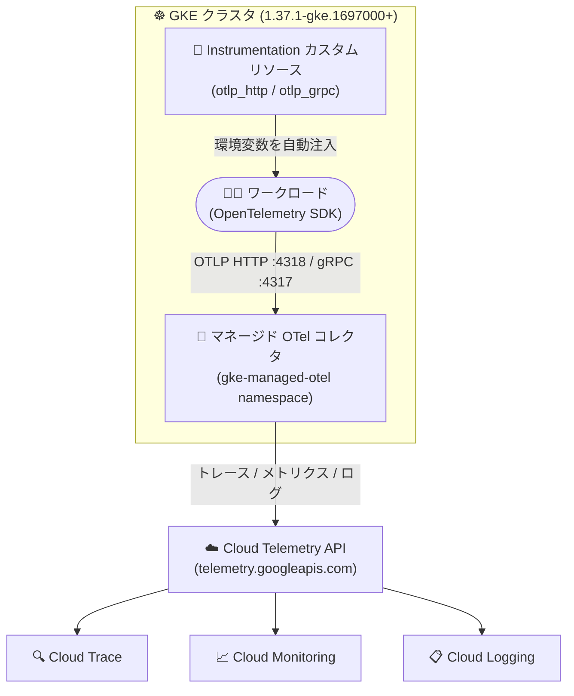

# Google Kubernetes Engine: Managed OpenTelemetry for GKE が一般提供 (GA) に

**リリース日**: 2026-10-29

**サービス**: Google Kubernetes Engine (GKE)

**機能**: Managed OpenTelemetry for GKE (マネージド OpenTelemetry コレクタ)

**ステータス**: GA (一般提供)

📊 [このアップデートのインフォグラフィックを見る](https://takech9203.github.io/google-cloud-news-summary/20261029-gke-managed-opentelemetry-ga.html)

## 概要

Managed OpenTelemetry for GKE が、GKE バージョン 1.37.1-gke.1697000 以降のクラスタで一般提供 (GA) になりました。ワークロードが生成する OpenTelemetry Protocol (OTLP) 形式のトレース・メトリクス・ログを、セルフマネージドの OpenTelemetry Collector をデプロイすることなく、Google 管理のクラスタ内コレクタで収集し、Google Cloud Observability (Cloud Trace / Cloud Monitoring / Cloud Logging) に送信できます。Managed OpenTelemetry は、GKE 上のトレースデータ収集において Google Cloud が提供する唯一のマネージドソリューションです。

GA に伴い、Instrumentation カスタムリソースでの `otlp_grpc` 設定 (gRPC エクスポート) に対応し、クラスタ内コレクタの gRPC エンドポイント (ポート 4317) が HTTP (ポート 4318) に加えて利用可能になりました。マネージドコレクタはログをトレース・メトリクスとともに Cloud Telemetry API (`telemetry.googleapis.com`) 経由でルーティングし、シグナル (信号種別) ごとのキューイングとオートスケーリングが改善され、高スループットのクラスタに対応します。なお、`telemetry.googleapis.com` 経由で取り込まれたログのログ名は、従来の `gke-managed-otel-collector` ではなく `otlp` がデフォルトになります。

また、LangGraph ReAct エージェントと Agent Development Kit (ADK) エージェントのマルチモーダルなプロンプト・レスポンス収集、gcloud CLI の `--managed-otel-scope` フラグ (バージョン 576.0.0 以降)、terraform-provider-google の `managed_opentelemetry_config` (v8.8.0 以降) も GA になりました。アプリケーションの可観測性を OpenTelemetry 標準で実現したいプラットフォームチームや、AI エージェントワークロードを運用する開発者が主な対象です。

**アップデート前の課題**

- GKE 上で OTLP テレメトリを収集するには、OpenTelemetry Collector を自前でデプロイ・運用する必要があり、認証設定、構成管理、アップグレード、コレクタ自体の監視といった運用オーバーヘッドが発生していた
- Managed OpenTelemetry は Preview として提供されており、本番環境での利用には SLA 面の懸念があった
- Instrumentation カスタムリソースによる自動構成では OTLP エクスポートプロトコルとして HTTP のみがサポートされ、gRPC でのエクスポートを構成できなかった

**アップデート後の改善**

- Google 管理のクラスタ内コレクタが GA となり、コレクタの運用 (認証・構成・アップグレード・監視) が不要になった
- Instrumentation カスタムリソースで `otlp_grpc` を設定するか、クラスタ内コレクタの gRPC エンドポイント (ポート 4317) に直接送信することで、gRPC によるテレメトリ送信が可能になった
- ログがトレース・メトリクスと同様に Cloud Telemetry API (`telemetry.googleapis.com`) 経由でルーティングされ、シグナルごとのキューイングとオートスケーリングの改善により高スループットクラスタでの安定性が向上した
- gcloud CLI (`--managed-otel-scope`) と Terraform (`managed_opentelemetry_config`) による有効化が GA となり、IaC での管理が可能になった

## アーキテクチャ図



Instrumentation カスタムリソースがワークロードに OpenTelemetry 環境変数を自動注入し、ワークロードはクラスタ内のマネージドコレクタに OTLP (HTTP または gRPC) でテレメトリを送信します。コレクタは 3 種類のシグナルすべてを Cloud Telemetry API 経由で Google Cloud Observability にルーティングします。

## サービスアップデートの詳細

### 主要機能

1. **マネージドコレクション (Managed collection)**
   - Google 管理の OpenTelemetry コレクタが `gke-managed-otel` namespace にデプロイされ、クラスタ内 OTLP エンドポイントを提供
   - HTTP エンドポイント: `http://opentelemetry-collector.gke-managed-otel.svc.cluster.local:4318`
   - gRPC エンドポイント: `http://opentelemetry-collector.gke-managed-otel.svc.cluster.local:4317` (今回新たに利用可能)
   - 収集したデータは Cloud Telemetry API 経由で Cloud Trace / Cloud Monitoring / Cloud Logging に送信される
   - シグナルごとのキューイングとオートスケーリングが改善され、高スループットクラスタに対応

2. **自動構成 (Automatic configuration)**
   - Instrumentation カスタムリソース (`instrumentations.telemetry.googleapis.com`) により、GKE がワークロードのコンテナに OpenTelemetry 環境変数 (`OTEL_EXPORTER_OTLP_ENDPOINT`、`OTEL_EXPORTER_OTLP_PROTOCOL` など) を自動注入
   - 対象 Pod の選択 (ラベルセレクタまたは namespace 全体)、収集するシグナル種別、メトリクスのエクスポート間隔、トレースのサンプリングレート、OTLP トランスポートプロトコル (HTTP / gRPC) を制御可能
   - GKE バージョン 1.37.1-gke.1697000 以降で、エクスポータに `otlp_grpc: {}` を指定することで gRPC エクスポートを構成可能

3. **AI エージェントのマルチモーダルプロンプト・レスポンス収集**
   - LangGraph ReAct エージェントと Agent Development Kit (ADK) エージェントのマルチモーダルなプロンプト・レスポンスの収集が GA
   - プロンプト・レスポンスデータはトレーススパンに埋め込まれず Cloud Storage にアップロードされ、ログエントリに参照が記録される

4. **IaC / CLI サポートの GA**
   - gcloud CLI の `--managed-otel-scope` フラグ (バージョン 576.0.0 以降)
   - terraform-provider-google の `managed_opentelemetry_config` ブロック (v8.8.0 以降)

## 技術仕様

### 要件と主要パラメータ

| 項目 | 詳細 |
|------|------|
| GKE バージョン (機能利用) | 1.34.1-gke.2178000 以降 |
| GKE バージョン (GA コレクタ / gRPC 構成) | 1.37.1-gke.1697000 以降 |
| gcloud CLI | 576.0.0 以降 |
| terraform-provider-google | v8.8.0 以降 |
| OTLP エンドポイント (HTTP) | `opentelemetry-collector.gke-managed-otel.svc.cluster.local:4318` |
| OTLP エンドポイント (gRPC) | `opentelemetry-collector.gke-managed-otel.svc.cluster.local:4317` |
| ログのルーティング | Cloud Telemetry API (`telemetry.googleapis.com`)、デフォルトログ名は `otlp` |
| メトリクスエクスポート間隔 | 5,000〜300,000 ms (デフォルト 30,000 ms、5,000 ms の倍数) |
| トレースサンプリング比率 | 0.0〜1.0 (デフォルト 1.0) |
| クラスタモード | Autopilot / Standard の両方に対応 |

### 必要な IAM ロール

| ロール | 用途 |
|------|------|
| `roles/container.clusterAdmin` | クラスタでの機能の有効化 |
| `roles/monitoring.viewer` | メトリクスの閲覧 |
| `roles/logging.viewer` | ログの閲覧 |
| `roles/cloudtrace.user` | トレースの閲覧 |

### gRPC エクスポートを構成する Instrumentation マニフェスト例

```yaml
apiVersion: telemetry.googleapis.com/v1alpha1
kind: Instrumentation
metadata:
  namespace: NAMESPACE
  name: NAME
spec:
  selector:
    matchLabels:
      KEY: VALUE
  autoInstrumentationConfig:
    configInjection:
      enabled: true
    otelSDKConfig:
      tracer_provider:
        sampler:
          parent_based:
            root:
              trace_id_ratio_based:
                ratio: "1.0"
        processors:
          - batch:
              exporter:
                otlp_grpc: {}
      meter_provider:
        readers:
          - periodic:
              interval: 30000
              exporter:
                otlp_grpc: {}
      logger_provider:
        processors:
          - batch:
              exporter:
                otlp_grpc: {}
```

Instrumentation カスタムリソースはすべてのプロバイダで単一のプロトコルのみをサポートします。使用しないプロバイダは `null` に設定します (例: メトリクスを無効化する場合は `meter_provider: null`)。

## 設定方法

### 前提条件

1. GKE クラスタが 1.37.1-gke.1697000 以降であること (Preview 版から利用している場合は、このバージョン以降へのアップグレードが必要)
2. gcloud CLI 576.0.0 以降 (Terraform の場合は terraform-provider-google v8.8.0 以降)
3. アプリケーションが OpenTelemetry SDK でインストルメント済みで、標準の OpenTelemetry 環境変数で構成可能であること
4. 必要な IAM ロール (前述) が付与されていること

### 手順

#### ステップ 1: クラスタで Managed OpenTelemetry を有効化

```bash
# 既存クラスタで有効化
gcloud container clusters update CLUSTER_NAME \
  --project=PROJECT_ID \
  --managed-otel-scope=COLLECTION_AND_INSTRUMENTATION_COMPONENTS \
  --location=LOCATION

# 新規 Autopilot クラスタで有効化
gcloud container clusters create-auto CLUSTER_NAME \
  --project=PROJECT_ID \
  --managed-otel-scope=COLLECTION_AND_INSTRUMENTATION_COMPONENTS \
  --location=LOCATION \
  --cluster-version=VERSION
```

有効化すると、`gke-managed-otel` namespace にマネージドコレクタの Deployment と、Instrumentation カスタムリソース定義 (`instrumentations.telemetry.googleapis.com`) がクラスタにデプロイされます。無効化する場合は `--managed-otel-scope=NONE` を指定します。

#### ステップ 2: Instrumentation カスタムリソースで自動構成を設定

```bash
# Instrumentation マニフェスト (前述の例) を適用
kubectl apply -f instrumentation.yaml
```

適用後にデプロイされたワークロードには環境変数が自動注入されます。Instrumentation オブジェクトの作成前にデプロイしたアプリケーションがある場合は、Pod を再起動して環境変数の注入をトリガーします。

#### ステップ 3: (手動構成の場合) gRPC エンドポイントに直接送信

```bash
# ワークロードの環境変数例 (手動構成)
OTEL_EXPORTER_OTLP_ENDPOINT=http://opentelemetry-collector.gke-managed-otel.svc.cluster.local:4317
OTEL_EXPORTER_OTLP_PROTOCOL=grpc
```

自動構成と手動構成を同一ワークロードで併用することは推奨されません (自動構成が手動の変更を上書きする可能性があるため)。

## メリット

### ビジネス面

- **運用コストの削減**: セルフマネージドのコレクタ運用 (認証・構成・アップグレード・監視) が不要になり、可観測性基盤の TCO を削減できる
- **本番利用への適合**: GA となったことで本番ワークロードに安心して採用でき、gcloud / Terraform による IaC 管理で組織的な展開が容易になる
- **ベンダーニュートラルな標準への準拠**: OpenTelemetry 標準に準拠したインストルメンテーションをそのまま活用でき、アプリケーションコードのポータビリティを維持できる

### 技術面

- **gRPC 対応による効率化**: HTTP (ポート 4318) に加えて gRPC (ポート 4317) でのエクスポートに対応し、OpenTelemetry SDK の標準的な gRPC エクスポータをそのまま利用できる
- **3 シグナルの統合ルーティング**: トレース・メトリクス・ログがすべて Cloud Telemetry API 経由で一貫してルーティングされ、シグナルごとのキューイングとオートスケーリングにより高スループット環境でも安定動作する
- **自動構成による導入の容易さ**: Instrumentation カスタムリソースにより、環境変数の注入からサンプリングレート・エクスポート間隔の制御までを宣言的に管理できる
- **AI エージェントの可観測性**: ADK や LangGraph ReAct エージェントのマルチモーダルプロンプト・レスポンス収集が GA となり、生成 AI ワークロードのデバッグ・監査に活用できる

## デメリット・制約事項

### 制限事項

- GA のコレクタと新機能 (gRPC 構成など) を使用するには、GKE 1.37.1-gke.1697000 以降が必要 (Preview 版を使用中のクラスタはアップグレードが必要)
- Instrumentation カスタムリソースは、すべてのプロバイダで単一の OTLP トランスポートプロトコル (HTTP または gRPC のいずれか) のみをサポート
- 自動構成は OpenTelemetry SDK を使用し標準の OpenTelemetry 環境変数で構成可能なワークロードのみが対象
- GKE Autopilot パートナーの特権ワークロードに対する OpenTelemetry 構成の注入はサポートされない
- コレクタレベルでのフィルタリングや細かい制御が必要な場合は、マネージドサービスではなく Google-Built OpenTelemetry Collector (セルフデプロイ) の利用が推奨される

### 考慮すべき点

- `telemetry.googleapis.com` 経由で取り込まれるログのデフォルトログ名が従来の `gke-managed-otel-collector` から `otlp` に変わるため、ログベースの指標・シンク・クエリを使用している場合は参照先の確認が必要
- 自動構成と手動構成を同一ワークロードで併用すると、自動構成が手動変更を上書きし構成変更の追跡が困難になるため、どちらか一方に統一する
- トレースサンプリング比率はデフォルト 1.0 (全量収集) のため、トラフィックの多い環境では取り込みコストを考慮してサンプリングレートの調整を検討する

## ユースケース

### ユースケース 1: マイクロサービスの分散トレーシング基盤をマネージド化

**シナリオ**: GKE 上で数十のマイクロサービスを運用しており、各チームが OpenTelemetry SDK でアプリケーションをインストルメント済み。これまで共通基盤チームが OpenTelemetry Collector の Deployment を自前で運用していたが、アップグレードやスケーリングの管理負荷が課題だった。

**実装例**:
```bash
gcloud container clusters update prod-cluster \
  --project=my-project \
  --managed-otel-scope=COLLECTION_AND_INSTRUMENTATION_COMPONENTS \
  --location=asia-northeast1
```
その後、各 namespace に Instrumentation カスタムリソースを適用し、ワークロードの環境変数注入を自動化する。

**効果**: コレクタの運用が Google 管理となり、共通基盤チームはコレクタのアップグレード・スケーリング・監視から解放される。シグナルごとのオートスケーリングにより、トラフィック増加時もテレメトリ収集が安定する。

### ユースケース 2: ADK ベースの AI エージェントのプロンプト監査

**シナリオ**: GKE 上で Agent Development Kit (ADK) を使った AI エージェントを運用しており、マルチモーダルなプロンプトとレスポンスを含むエージェントの挙動をトレースと関連付けて記録・監査したい。

**効果**: Instrumentation カスタムリソースによる自動構成でプロンプト・レスポンスデータが Cloud Storage にアップロードされ、参照がログエントリに記録される。トレース・ログと関連付けてエージェントの応答品質のデバッグやコンプライアンス監査が可能になる。

## 料金

Managed OpenTelemetry for GKE 自体の利用に伴うテレメトリデータの送信は、取り込み量 (ingestion volume) ベースで課金されます。

| シグナル | 適用される料金体系 |
|--------|-----------------|
| メトリクス | Google Cloud Managed Service for Prometheus の料金 |
| ログ | Cloud Logging の料金 |
| トレース | Cloud Trace の料金 |

詳細は [Google Cloud Observability の料金ページ](https://cloud.google.com/stackdriver/pricing) を参照してください。また、Cloud Logging / Cloud Monitoring / Cloud Trace の各クォータが適用されます。

## 利用可能リージョン

リージョン固有の制限は Release Notes およびドキュメントに記載されていません。GKE バージョン 1.37.1-gke.1697000 以降のクラスタ (Autopilot / Standard) で利用できます。

## 関連サービス・機能

- **Cloud Trace**: 収集した OTLP トレースの保存・可視化先。Managed OpenTelemetry は GKE 上のトレース収集における唯一のマネージドソリューション
- **Cloud Monitoring / Google Cloud Managed Service for Prometheus**: OTLP メトリクスの保存・可視化先。メトリクスは GMP の料金体系で課金される
- **Cloud Logging**: OTLP ログの保存先。`telemetry.googleapis.com` 経由で取り込まれたログは `otlp` ログ名で記録される
- **Google-Built OpenTelemetry Collector**: コレクタレベルのフィルタリングや細かい制御が必要な場合のセルフデプロイ型の代替手段
- **Agent Development Kit (ADK)**: OpenTelemetry をネイティブサポートする AI エージェント開発フレームワーク。マルチモーダルプロンプト・レスポンス収集に対応

## 参考リンク

- 📊 [インフォグラフィック](https://takech9203.github.io/google-cloud-news-summary/20261029-gke-managed-opentelemetry-ga.html)
- [公式リリースノート](https://cloud.google.com/release-notes#October_29_2026)
- [Managed OpenTelemetry for GKE (コンセプト)](https://docs.cloud.google.com/kubernetes-engine/docs/concepts/managed-otel-gke)
- [Deploy Managed OpenTelemetry for GKE (設定手順)](https://docs.cloud.google.com/kubernetes-engine/docs/how-to/managed-otel-gke)
- [マルチモーダルプロンプト・レスポンスの収集](https://docs.cloud.google.com/kubernetes-engine/docs/how-to/managed-otel-gke#multimodal-prompts-responses)
- [料金ページ (Google Cloud Observability)](https://cloud.google.com/stackdriver/pricing)

## まとめ

Managed OpenTelemetry for GKE の GA により、GKE 上の OTLP テレメトリ収集がコレクタ運用レスで実現でき、gRPC 対応・シグナルごとのオートスケーリング改善により本番の高スループット環境にも適用しやすくなりました。セルフマネージドの OpenTelemetry Collector を運用しているチームは、GKE 1.37.1-gke.1697000 以降へのアップグレードとあわせてマネージドコレクタへの移行を検討することを推奨します。Preview 版を利用中のクラスタは、GA コレクタを利用するためにバージョンアップグレードが必要です。

---

**タグ**: #GKE #OpenTelemetry #Observability #CloudTrace #CloudMonitoring #CloudLogging #OTLP #GA
