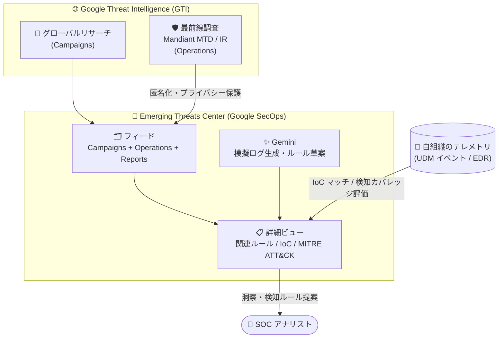

# Google SecOps: Emerging Threats Center の Operations 機能が GA に

**リリース日**: 2026-10-29

**サービス**: Google SecOps (Google Security Operations)

**機能**: Emerging Threats Center の Operations

**ステータス**: GA (General Availability)

📊 [このアップデートのインフォグラフィックを見る](https://takech9203.github.io/google-cloud-news-summary/20261029-google-secops-emerging-threats-center-operations-ga.html)

## 概要

Google SecOps の Emerging Threats Center フィードにおける **Operations 機能が一般提供 (GA) になりました**。Emerging Threats Center は、Google Threat Intelligence (GTI) と Gemini モデルを活用した AI ベースの脅威インテリジェンス機能で、現在進行中および新たに出現する脅威キャンペーンが自組織にどのような影響を与えるかを把握できます。

従来の Campaign (キャンペーン) が「複数の組織・業界・地域を標的とする大規模な協調攻撃」をグローバル視点で追跡するのに対し、**Operation (オペレーション) は単一組織を標的とする、より焦点を絞った攻撃活動**を追跡します。Operations は Mandiant Threat Defense (Managed Threat Defense: MTD) エンゲージメントなどの最前線のインシデント調査から得られる粒度の高い脅威インテリジェンスであり、被害組織の匿名性を保護する仕組みを備えたうえで、実際の攻撃事例に基づくパーソナライズされた脅威の手がかりとローカライズされた防御戦略を提供します。

Operations は 2026 年 8 月 24 日にスポットライト機能として Emerging Threats Center フィードに追加されており、今回の GA により本番環境での本格利用が可能になりました。SOC アナリスト、脅威ハンター、検知エンジニアリングチームが主な対象ユーザーです。

**アップデート前の課題**

- Emerging Threats Center で追跡できる脅威コレクションは、グローバルな Campaign とレポートが中心であり、単一組織を狙う標的型の攻撃活動 (ミッション単位の敵対者活動) を体系的に追跡する手段が限られていた
- Mandiant のインシデントレスポンスや Managed Threat Defense などの最前線調査で得られる粒度の高いインテリジェンスを、自組織のテレメトリと突き合わせて活用するには手動の分析作業が必要だった
- Operations 機能は GA 前の段階であり、SLA や本番運用の観点で採用をためらうケースがあった

**アップデート後の改善**

- **Focused threat insights**: 特定のミッションに固有の、ローカライズされた敵対者活動とパーソナライズされた攻撃ベクトルに焦点を絞った洞察が得られるようになった
- **Holistic threat mapping**: Operations をグローバルな Campaigns と並べて表示し、敵対者の戦術・技術・手順 (TTPs) の全体像を把握できるようになった
- GA への昇格により、本番の SOC ワークフロー (検知カバレッジ検証、IoC マッチング、ルール管理) に Operations を安心して組み込めるようになった

## アーキテクチャ図



GTI のグローバルリサーチ由来の Campaigns に加え、Mandiant の最前線調査由来の Operations がフィードに統合され、自組織のテレメトリと突き合わせて IoC マッチや検知カバレッジを評価できます。

## サービスアップデートの詳細

### 主要機能

1. **単一組織を標的とする攻撃活動 (Operation) の追跡**
   - Campaign の「縮小版」ではなく、単一組織に対する特定のミッションに焦点を当てた脅威コレクション
   - Mandiant Threat Defense チームなどによる実際のインシデント調査 (frontline investigations) から導出される
   - 実在の被害組織が関わるため、組織の身元を隠すプライバシー保護が組み込まれている

2. **Campaigns と Operations の統合ビュー**
   - Emerging Threats Center フィードで Campaigns・Operations・Reports を横断的に閲覧可能
   - フィルタの「Object types」で Campaigns / Operations / Reports を切り替えて調査の焦点に合わせた表示が可能
   - 関連マルウェア、ツール、脅威アクター、標的業界・地域、「Has IoC matches」などの条件でフィルタリング可能

3. **自組織環境との自動相関**
   - 脅威カードの IOCs バッジで、Operation に含まれる IoC が自組織環境のデータとマッチするかを即座に確認
   - Rules バッジで、その Operation に関連する検知ルールのうち有効化済みの数を表示 (例: 1/2 rules)
   - 詳細ビューでは Associated Rules、Disabled Rules、Recent Associated Entities、IOCs の各パネルを利用可能

4. **Gemini による検知カバレッジ評価とルール生成支援**
   - Gemini が実際の敵対者挙動を模した匿名化済みの高忠実度な模擬ログイベントを生成
   - 模擬ログを GCTI キュレーション検知ルールに対して実行し、検知済み領域とギャップをレポート
   - ギャップに対して Gemini が新規検知ルールの草案を自動作成 (本番反映には人間によるレビューと承認が必要)

## 技術仕様

| 項目 | 詳細 |
|------|------|
| 必要ライセンス | Google SecOps Enterprise Plus |
| 基盤技術 | Applied Threat Intelligence (ATI)、Google Threat Intelligence (GTI)、Gemini モデル |
| Operations の情報源 | Mandiant インシデントレスポンス、Managed Threat Defense (MTD) テレメトリなどの最前線調査 |
| フィード表示対象 | 過去 1 年以内に更新された脅威コレクションのみ |
| 検知カバレッジ分析 | EDR (Endpoint Detection and Response) データソースのみ対象 |
| アクセス制御 | Emerging Threats ページには threatCollections / iocAssociations に関する IAM 権限が必要 |
| プライバシー | Operations は被害組織の身元を保護する仕組みを内蔵 |

## 設定方法

### 前提条件

1. Google SecOps Enterprise Plus ライセンスを保有していること
2. Emerging Threats ページへのアクセスに必要な IAM 権限 (threatCollections、iocAssociations) が付与されていること

### 手順

#### ステップ 1: Emerging Threats Center フィードを開く

Google SecOps コンソールで Emerging Threats Center フィードに移動します。Campaigns・Operations・Reports がカード形式で表示されます。

#### ステップ 2: Operations でフィルタリングする

1. フィードの **Filter** アイコンをクリック
2. 論理演算子 (OR / AND) を選択
3. フィルタカテゴリ **Object types** で **Operations** を選択
4. 必要に応じて Associated malware、Associated threat actors、Has IoC matches などを組み合わせる

#### ステップ 3: 詳細ビューで影響を分析する

脅威カードをクリックして詳細ビューを開き、以下を確認します。

- **Associated Rules**: 関連検知ルールの有効状態、過去 4 週間のアクティビティ、MITRE ATT&CK マトリクスによるカバレッジ
- **IOCs**: 自組織環境とマッチする IoC の有無
- **Recent Associated Entities**: 影響を受けた可能性のあるエンティティ

## メリット

### ビジネス面

- **標的型攻撃への先回り対応**: グローバルな流行だけでなく、実際の被害事例に基づく単一組織狙いの攻撃パターンを把握でき、自組織が同様に狙われた場合の備えができる
- **運用負荷の削減**: 脅威レポートの手動解析が不要になり、エンリッチ済みのコンテキスト付き情報を直接ワークフローで活用できる
- **GA による本番採用の安心感**: 本番 SOC 運用に組み込む際の信頼性が向上

### 技術面

- **最前線インテリジェンスの活用**: Mandiant MTD エンゲージメント由来の粒度の高い TTPs 情報を、匿名化された形で自組織の防御に反映できる
- **検知カバレッジの自動検証**: Gemini が生成する模擬ログにより、Operation に対応する検知ルールの有無とギャップを自動で可視化
- **TTPs の全体像把握**: Operations と Campaigns を並べて見ることで、敵対者の戦術・技術・手順を局所と全体の両面から分析できる

## デメリット・制約事項

### 制限事項

- Emerging Threats Center は Google SecOps **Enterprise Plus ライセンスでのみ利用可能**
- フィードに表示されるのは過去 1 年以内に更新された脅威コレクションのみ
- 検知カバレッジ分析 (MITRE ATT&CK マトリクス) は EDR データソースのみが対象
- フィードに表示されるレポートは GTI 製のものに限定され、GTI 本体で閲覧できるクラウドソースのレポートは含まれない

### 考慮すべき点

- Gemini が草案を作成した検知ルールは、本番反映前に必ず人間によるレビューと承認が必要
- Operations はプライバシー保護のため被害組織の詳細が匿名化されており、元のインシデントの完全なコンテキストは得られない

## ユースケース

### ユースケース 1: 自業界を狙う標的型攻撃への事前防御

**シナリオ**: 金融機関の SOC チームが、同業他社を標的とした実際の攻撃活動 (Operation) の情報をもとに、自社が同様の攻撃を受けた場合の検知能力を事前に検証したい。

**実装例**:
```
1. Emerging Threats Center フィードで Filter を開く
2. Object types = Operations、Targeted industries = Financial Services で絞り込み
3. Has IoC matches を有効にして自社環境とマッチする Operation を優先確認
4. 詳細ビューの Associated Rules で MITRE ATT&CK マトリクスを確認し、
   カバレッジギャップに対して Gemini が草案したルールをレビュー・承認
```

**効果**: 同業他社への実際の攻撃事例に基づき、自社の検知ギャップを先回りで解消できる。

### ユースケース 2: Campaign と Operation の突き合わせによる TTPs 分析

**シナリオ**: 脅威ハンターが、特定の脅威アクターについてグローバルな Campaign と個別の Operation の両方を分析し、攻撃手法の変化や組織固有の攻撃ベクトルを特定したい。

**効果**: グローバルな傾向 (Campaign) と実際の被害事例 (Operation) を組み合わせることで、敵対者の TTPs の全体像と局所的なバリエーションを把握し、脅威ハンティングの精度を向上できる。

## 料金

Emerging Threats Center (Operations を含む) は **Google SecOps Enterprise Plus ライセンス**に含まれる機能であり、個別の追加料金に関する公式情報はありません。ライセンス体系の詳細は料金ページを参照してください。

- [Google Security Operations の料金](https://cloud.google.com/security/products/security-operations)

## 関連サービス・機能

- **Google Threat Intelligence (GTI)**: Operations / Campaigns の情報源。Emerging Threats Center の詳細パネルから GTI 本体で詳細情報を開くことも可能
- **Mandiant Managed Threat Defense (MTD)**: Operations の主要な情報源となる最前線のマネージド脅威防御サービス
- **Applied Threat Intelligence (ATI)**: Emerging Threats Center の基盤となる脅威インテリジェンス適用機能
- **Gemini in Google SecOps**: 模擬ログイベントの生成、検知カバレッジ評価、検知ルール草案の自動作成を担う
- **GCTI キュレーション検知ルール**: 模擬ログの実行対象となる Google Cloud Threat Intelligence 提供の検知ルールセット

## 参考リンク

- 📊 [インフォグラフィック](https://takech9203.github.io/google-cloud-news-summary/20261029-google-secops-emerging-threats-center-operations-ga.html)
- [公式リリースノート](https://docs.cloud.google.com/chronicle/docs/secops/release-notes#operations-emerging-threats)
- [Emerging Threats Center overview](https://docs.cloud.google.com/chronicle/docs/detection/emerging-threats)
- [Emerging Threats Center detail view](https://docs.cloud.google.com/chronicle/docs/detection/emerging-threats-detailed-view)
- [Google Security Operations の料金](https://cloud.google.com/security/products/security-operations)

## まとめ

Emerging Threats Center の Operations 機能が GA となり、グローバルな Campaign に加えて単一組織を標的とする実際の攻撃活動を、Mandiant の最前線調査由来のインテリジェンスとして本番 SOC 運用で活用できるようになりました。Enterprise Plus ライセンスを保有する組織は、Object types フィルタで Operations を絞り込み、自組織とマッチする IoC や検知カバレッジギャップの確認から始めることを推奨します。

---

**タグ**: Google SecOps, Emerging Threats Center, Operations, Threat Intelligence, GA, Mandiant, Google Threat Intelligence, Gemini, SOC, 脅威インテリジェンス
