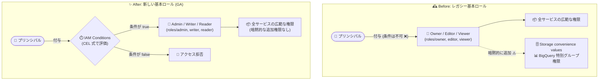

# Identity and Access Management: 新しい基本ロール Admin / Writer / Reader が GA

**リリース日**: 2026-10-29

**サービス**: Identity and Access Management (IAM)

**機能**: 基本ロール Admin (roles/admin)、Writer (roles/writer)、Reader (roles/reader) の一般提供 (GA)

**ステータス**: GA (一般提供)

📊 [このアップデートのインフォグラフィックを見る](https://takech9203.github.io/google-cloud-news-summary/20261029-iam-basic-roles-admin-writer-reader-ga.html)

## 概要

Google Cloud IAM の新しい基本ロール (Basic roles) である **Admin (`roles/admin`)**、**Writer (`roles/writer`)**、**Reader (`roles/reader`)** が一般提供 (GA) になりました。基本ロールは、すべての Google Cloud サービスにまたがる数千のパーミッションを含む、非常に広範な権限を付与するロールです。

従来の基本ロール (レガシー基本ロール) である **Owner (`roles/owner`)**、**Editor (`roles/editor`)**、**Viewer (`roles/viewer`)** は IAM の導入以前から存在するロール (旧称: プリミティブロール) で、現在も利用可能であり、積極的にメンテナンスされています。ただし Google Cloud は、基本ロールを付与する必要がある場合には、レガシー基本ロールではなく新しい Admin / Writer / Reader ロールの付与を推奨しています。新しいロールは **IAM Conditions (条件付きロールバインディング)** などの追加機能をサポートしているためです。

このアップデートは、検証環境やステージング環境などで広範な権限を手早く付与したい管理者や、レガシー基本ロールの「条件を付けられない」「Cloud Storage / BigQuery の特別な暗黙的権限が付与される」といった挙動を避けたい組織にとって重要な変更です。なお本番環境では、基本ロール自体の使用を避け、最小権限の事前定義ロールまたはカスタムロールを使用することが引き続きベストプラクティスです。

**アップデート前の課題**

- レガシー基本ロール (Owner / Editor / Viewer) のロールバインディングには IAM Conditions を追加できず、時間帯・リソース・IP などの属性ベースの条件付きアクセス制御が利用できなかった
- レガシー基本ロールを付与すると、ロール内のパーミッションに加えて、Cloud Storage の便宜的な値 (convenience values) や BigQuery の特別なグループメンバーシップによる暗黙的な権限も付与され、実効権限の把握が難しかった
- 広範な権限をまとめて付与したい場合、条件付きで制御できる基本ロールの選択肢が GA としては存在しなかった

**アップデート後の改善**

- Admin / Writer / Reader ロールが GA となり、本番利用レベルの SLA・サポート対象として基本ロールに IAM Conditions を適用できるようになった (例: 営業時間のみ、特定リソースのみ、期間限定のアクセス)
- 新しい基本ロールには Cloud Storage convenience values や BigQuery 特別グループによる暗黙的な権限付与がなく、権限の範囲がロール定義どおりで予測しやすくなった
- Privileged Access Manager (PAM) のエンタイトルメントとして新しい基本ロールを設定し、ジャストインタイムの昇格アクセスにも組み込めるようになった

## アーキテクチャ図



レガシー基本ロールでは条件を付与できず暗黙的な追加権限も発生していましたが、GA となった Admin / Writer / Reader ロールでは IAM Conditions による属性ベースのアクセス制御が可能になり、権限範囲もロール定義どおりに限定されます。

## サービスアップデートの詳細

### 主要機能

1. **新しい基本ロール 3 種の GA**
   - **Reader (`roles/reader`)**: 状態を変更しない読み取り専用アクション (既存リソースやデータの閲覧) のパーミッションを付与
   - **Writer (`roles/writer`)**: Reader のすべてのパーミッションに加え、状態を変更するアクション (リソースの作成・変更・削除など) のパーミッションを付与。ただしすべてのサービスの全アクションを含むわけではない
   - **Admin (`roles/admin`)**: Writer のすべてのパーミッションに加え、Compute Engine リソースのタグバインディング管理、プロジェクトとその配下リソースのロール/権限管理、プロジェクトの課金設定などの機密性の高い操作のパーミッションを付与

2. **IAM Conditions のサポート**
   - 新しい基本ロールのロールバインディングには条件 (CEL 式) を追加でき、日時・リソースタイプ・リソース名・タグなどの属性に基づくアクセス制御が可能
   - レガシー基本ロール (Owner / Editor / Viewer) では条件付きバインディングは利用不可 (従来どおり)

3. **暗黙的権限の排除**
   - Admin / Writer / Reader を付与されたプリンシパルには、Cloud Storage convenience values や BigQuery 特別グループメンバーシップによる追加権限は付与されない
   - レガシー基本ロールではこれらの暗黙的権限が付与されるため、新ロールの方が実効権限を把握しやすい

4. **レガシー基本ロールの継続提供**
   - Owner / Editor / Viewer は廃止されず、引き続き利用可能かつ積極的にメンテナンスされる
   - プロジェクト作成者に Owner ロールが自動付与されるなど、一部の自動化ワークフローでは引き続きレガシー基本ロールが使用される

## 技術仕様

### 新旧基本ロールの比較

| 項目 | 新しい基本ロール (Admin / Writer / Reader) | レガシー基本ロール (Owner / Editor / Viewer) |
|------|---------------------------------------------|-----------------------------------------------|
| 提供ステータス | GA | 提供継続 (積極的にメンテナンス) |
| IAM Conditions | ✅ 利用可能 | ❌ 利用不可 |
| Storage convenience values / BigQuery 特別グループの暗黙的権限 | 付与されない | 付与される |
| Google Cloud コンソールでの付与 | ❌ 不可 (API / gcloud CLI を使用) | ✅ 可能 (Owner は一部ケースでコンソール必須) |
| Privileged Access Manager (PAM) エンタイトルメント | ✅ 対応 | — |
| 自動化ワークフローでの使用 | — | プロジェクト作成時の Owner 自動付与など |

### ロール階層

| ロール | 含まれる権限 |
|--------|--------------|
| Reader (`roles/reader`) | 読み取り専用アクション (状態を変更しない閲覧系) |
| Writer (`roles/writer`) | Reader の全権限 + 状態を変更するアクション (多くのサービスでリソースの作成・削除が可能) |
| Admin (`roles/admin`) | Writer の全権限 + 機密性の高い操作 (タグバインディング管理、IAM 管理、課金設定など)。ただし Cloud Billing の支払い情報の変更や IAM Deny ポリシーの作成権限は含まれない |

### 条件付きロールバインディングの例

```json
{
  "bindings": [
    {
      "role": "roles/writer",
      "members": [
        "user:dev-user@example.com"
      ],
      "condition": {
        "title": "business-hours-only",
        "description": "営業時間 (ベルリン時間 9-17 時、平日) のみ許可",
        "expression": "request.time.getHours('Europe/Berlin') >= 9 && request.time.getHours('Europe/Berlin') <= 17 && request.time.getDayOfWeek('Europe/Berlin') >= 1 && request.time.getDayOfWeek('Europe/Berlin') <= 5"
      }
    }
  ]
}
```

## 設定方法

### 前提条件

1. 対象リソース (プロジェクトなど) に対する IAM ポリシーの設定権限 (`resourcemanager.projects.setIamPolicy` など) を持っていること
2. gcloud CLI または IAM API を利用できること (新しい基本ロールは Google Cloud コンソールからは付与できない)

### 手順

#### ステップ 1: 新しい基本ロールを付与する

```bash
# Writer ロールをユーザーに付与
gcloud projects add-iam-policy-binding PROJECT_ID \
  --member="user:dev-user@example.com" \
  --role="roles/writer"
```

Google Cloud コンソールでは Reader / Writer / Admin ロールを付与できないため、gcloud CLI または API を使用します。

#### ステップ 2: IAM Conditions を付けて付与する

```bash
# 期間限定で Reader ロールを付与 (2026 年末まで)
gcloud projects add-iam-policy-binding PROJECT_ID \
  --member="user:auditor@example.com" \
  --role="roles/reader" \
  --condition='title=expires-end-of-2026,expression=request.time < timestamp("2027-01-01T00:00:00Z")'
```

条件式は CEL (Common Expression Language) のサブセットで記述します。条件が `true` と評価された場合のみロールが有効になります。

## メリット

### ビジネス面

- **ガバナンスの強化**: 広範な権限に期間・時間帯・リソース範囲などの条件を付けられるため、監査やコンプライアンス要件 (最小権限・期限付きアクセス) への対応が容易になる
- **権限の透明性向上**: 暗黙的な追加権限が付与されないため、「誰が何にアクセスできるか」の棚卸しが正確になり、セキュリティレビューの工数を削減できる

### 技術面

- **条件付きアクセス制御**: レガシー基本ロールでは不可能だった IAM Conditions を基本ロールに適用でき、一時アクセスやリソース限定アクセスを宣言的に実装できる
- **PAM との統合**: Privileged Access Manager のエンタイトルメントとして新基本ロールを定義し、ジャストインタイムの権限昇格フローに組み込める
- **予測可能な権限セット**: Cloud Storage / BigQuery の特別な暗黙的権限が付与されないため、ロール定義に基づいた正確な権限設計ができる

## デメリット・制約事項

### 制限事項

- 新しい基本ロール (Reader / Writer / Admin) は Google Cloud コンソールからは付与できず、API または gcloud CLI (もしくは PAM エンタイトルメント) を使用する必要がある
- Admin ロールはすべての権限を含むわけではない (例: Cloud Billing の支払い情報の変更、IAM Deny ポリシーの作成は不可)
- IAM Conditions は `allUsers` / `allAuthenticatedUsers` への付与には使用できない
- 条件付きロールバインディングを受け付けないリソースタイプもある (その場合は組織・プロジェクトレベルで付与する)

### 考慮すべき点

- 本番環境では基本ロール自体の使用を避け、最小権限の事前定義ロールまたはカスタムロールを使用することが引き続き推奨される (基本ロールは代替がない場合のみ)
- レガシー基本ロールから移行する場合、Cloud Storage convenience values や BigQuery 特別グループによる暗黙的権限に依存したアクセスが失われないか事前に確認が必要
- プロジェクト作成時の Owner 自動付与など、自動化ワークフローでは引き続きレガシー基本ロールが使用される
- 1 つの許可ポリシーに追加する条件付きロールバインディングは 100 個以下に抑えることがベストプラクティス (ポリシーのサイズ上限超過を防ぐため)

## ユースケース

### ユースケース 1: 検証環境での期限付き広範アクセス

**シナリオ**: 開発チームが検証プロジェクトで短期間の PoC を実施するため、広範な権限を期間限定で付与したい。レガシー Editor ロールでは期限を設定できず、付与後の剥奪を手動管理する必要があった。

**実装例**:
```bash
gcloud projects add-iam-policy-binding poc-project \
  --member="group:poc-team@example.com" \
  --role="roles/writer" \
  --condition='title=poc-period,expression=request.time < timestamp("2026-12-31T23:59:59Z")'
```

**効果**: 期限が切れると自動的にアクセスが無効になり、権限剥奪の運用漏れによるセキュリティリスクを排除できる。

### ユースケース 2: レガシー基本ロールからの計画的な移行

**シナリオ**: 組織内のステージング環境で Editor / Viewer が広く付与されており、暗黙的な Storage / BigQuery 権限を含めた実効権限の把握が困難。セキュリティ監査で条件付きアクセスへの移行を求められている。

**効果**: Writer / Reader への置き換えにより、暗黙的権限のない予測可能な権限セットと IAM Conditions による属性ベース制御を実現し、監査要件を満たせる。移行時は Policy Analyzer などで既存アクセスの依存関係を確認してから切り替えることで安全に移行できる。

## 料金

IAM の基本ロールの利用に追加料金は発生しません。IAM Conditions の利用にも追加料金はかかりません。

## 利用可能リージョン

IAM はグローバルサービスであり、新しい基本ロールはすべての Google Cloud プロジェクトで利用できます。

## 関連サービス・機能

- **IAM Conditions**: 新しい基本ロールで利用可能になった属性ベースのアクセス制御。CEL 式で日時・リソース・タグなどの条件を定義する
- **Privileged Access Manager (PAM)**: 新しい基本ロールのエンタイトルメントを作成し、ジャストインタイムの権限昇格を実現できる
- **事前定義ロール / カスタムロール**: 本番環境で推奨されるロールタイプ。基本ロールは代替がない場合にのみ使用する
- **Cloud Storage / BigQuery のアクセス制御**: レガシー基本ロールに紐づく convenience values / 特別グループメンバーシップは新しい基本ロールには適用されないため、移行時に確認が必要

## 参考リンク

- 📊 [インフォグラフィック](https://takech9203.github.io/google-cloud-news-summary/20261029-iam-basic-roles-admin-writer-reader-ga.html)
- [公式リリースノート](https://cloud.google.com/release-notes#October_29_2026)
- [基本ロールのドキュメント (Roles overview - Basic roles)](https://docs.cloud.google.com/iam/docs/roles-overview#basic)
- [IAM Conditions の概要](https://docs.cloud.google.com/iam/docs/conditions-overview)
- [ロールの付与・変更・取り消し](https://docs.cloud.google.com/iam/docs/granting-changing-revoking-access)
- [条件付きロールバインディングを受け付けるリソースタイプ](https://docs.cloud.google.com/iam/docs/resource-types-with-conditional-roles)

## まとめ

IAM の新しい基本ロール Admin / Writer / Reader が GA となり、レガシー基本ロールでは不可能だった IAM Conditions による条件付きアクセス制御を、広範な権限セットに対しても適用できるようになりました。基本ロールを付与する必要がある場合は、今後は Owner / Editor / Viewer ではなく Admin / Writer / Reader を選択することが推奨されます。あわせて、本番環境では引き続き最小権限の事前定義ロール・カスタムロールの使用を原則とし、既存のレガシー基本ロールの付与箇所については暗黙的権限への依存を確認したうえで計画的な移行を検討してください。

---

**タグ**: #IAM #BasicRoles #IAMConditions #Security #AccessControl #GA #GoogleCloud
