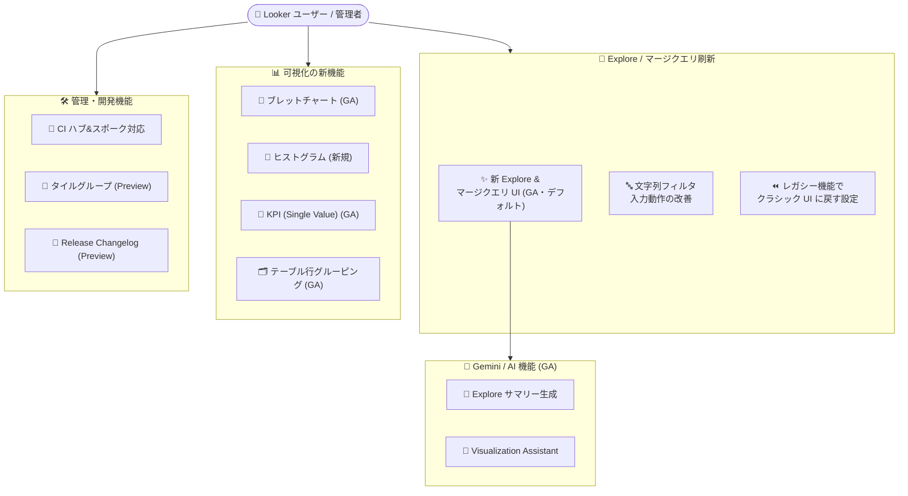

# Looker: 新 Explore エクスペリエンス GA をはじめとする大型機能アップデート (17 項目)

**リリース日**: 2026-10-29

**サービス**: Looker (original) / Looker (Google Cloud core)

**機能**: 新 Explore・マージクエリエクスペリエンス GA、Gemini 支援機能 GA、可視化タイプの追加・GA、管理機能強化、レガシー機能の整理

**ステータス**: GA (一部 Preview、Breaking change と Change を含む)

📊 [このアップデートのインフォグラフィックを見る](https://takech9203.github.io/google-cloud-news-summary/20261029-looker-feature-updates-ga.html)

## 概要

2026 年 10 月 29 日、Looker (original) および Looker (Google Cloud core) に関する 17 項目のアップデートがまとめて発表されました。中心となるのは、**新しい Explore・マージクエリエクスペリエンスの GA 化** (デフォルトインターフェース化) です。これに合わせて、Gemini in Looker による **Explore サマリー生成**と **Visualization Assistant** が GA となり、**ブレットチャート**、**ヒストグラム**、**KPI (Single Value) チャート**、**テーブル行グルーピング**といった可視化機能も GA または新規追加されました。

管理・開発面では、**Looker CI のハブ & スポークプロジェクト対応**、**ダッシュボードタイルグループ (Preview)**、**Release Changelog (Preview)**、Looker (Google Cloud core) 向けの **Legacy features ページ**が追加されています。一方で、**Conversational Analytics System Activity ダッシュボードの要素名変更 (Breaking change)** と、**レガシー DB 接続ワークフローの削除 (Change)** が含まれており、既存環境への影響確認が必要です。

また、Looker 26.20 を実行するインスタンスでは、**2026 年 10 月 26 日以降これらの新機能が自動的に有効化される**とアナウンスされており、管理者は事前に影響範囲を把握しておくことが推奨されます。対象ユーザーは、Looker を利用するデータアナリスト、LookML 開発者、Looker 管理者です。

**アップデート前の課題**

- 新しい Explore・マージクエリエクスペリエンスは Preview 機能であり、利用には管理者による Preview Features ページでの有効化が必要だった (Looker 26.6 以降)
- Gemini による Explore サマリー生成や Visualization Assistant は Preview 段階で、Trusted Tester Features の有効化が必要であり、サポートも限定的だった
- ブレットチャートやヒストグラムに相当する可視化は標準チャートタイプとして提供されておらず、カスタム可視化などで代替する必要があった
- Looker CI はハブ & スポーク構成 (ローカルプロジェクトインポート) の下流プロジェクトを自動テストできず、上流 LookML の変更による下流 Explore の破壊を事前検知しにくかった
- ダッシュボード上の関連タイルをまとめて移動・複製・削除する手段がなく、タイル単位での操作が必要だった
- インスタンスに展開された機能・変更・バグ修正をリアルタイムに確認する手段がなく、リリースノートを別途参照する必要があった
- Looker (Google Cloud core) には Admin パネルにレガシー機能の管理ページがなかった

**アップデート後の改善**

- 新 Explore・マージクエリエクスペリエンスが GA となり、Explore とマージクエリのデフォルトインターフェースになった
- Gemini 支援の Explore サマリー生成と Visualization Assistant が GA となり、本番利用可能になった
- ブレットチャート、ヒストグラム、KPI (Single Value) チャート、テーブル行グルーピング (Grouping メニュー) が標準機能として利用可能になった
- Looker CI がハブプロジェクトの Pull Request 作成・更新時に下流スポークプロジェクトを自動テストし、マージ前に破壊的変更を検出できるようになった
- Dashboard Tile Groups (Preview) により、関連タイルを折りたたみ可能なコンテナにまとめ、一括で移動・複製・削除できるようになった (LookML でのプログラム管理にも対応)
- Release Changelog (Preview) により、インスタンスで利用可能な機能・動作変更・バグ修正をリアルタイムに確認できるようになった
- 管理者はレガシー機能 (Use Legacy Explore and Merge Query Experience など) でクラシック UI へのフォールバックをインスタンス単位・埋め込みコンテキスト単位で制御できるようになった

## アーキテクチャ図



今回のアップデートは「Explore 体験の刷新」を中核に、Gemini/AI 機能、可視化、管理・開発機能の 4 つのテーマで構成され、新 Explore UI 上で Gemini 支援機能が動作する関係になっています。

## サービスアップデートの詳細

### テーマ 1: Explore / マージクエリエクスペリエンスの刷新

1. **新 Explore・マージクエリエクスペリエンスが GA (デフォルトインターフェース化)**
   - 再設計された Explore とマージクエリの UI が GA となり、Explore および複数クエリのデータ結合におけるデフォルトインターフェースになった
   - 直感的な操作で接続関係の発見やインサイト獲得を高速化することを目的に設計されている
   - Preview 期間中は Looker 26.6 以降で管理者による有効化が必要だったが、今後は標準の体験となる

2. **文字列フィルタの入力動作の改善**
   - ダッシュボード、Look、Explore の文字列フィルタで、「Done」クリックや入力フィールド外のクリックでは未確定テキストからフィルタチップが作成されなくなった
   - フィルタチップを作成するには、Enter キー、カンマ (`,`) の入力、または値の貼り付けを行う
   - 意図しないフィルタ条件の追加を防ぐ改善

3. **クラシック UI へのフォールバック用レガシー機能の追加**
   - 「Use Legacy Explore and Merge Query Experience」と「Use Legacy Explore and Merge Query Experience for Embed」の 2 つのレガシー機能が追加された
   - 管理者はインスタンス全体または埋め込みコンテキストで、Explore とマージクエリをクラシック UI でデフォルト表示するよう構成できる
   - 移行期間中の段階的な切り替えに活用できる

### テーマ 2: Gemini / AI 機能の GA

1. **Gemini 支援による Explore サマリー生成 (GA)**
   - LookML で `description` が定義されていない Explore に対し、Gemini in Looker が Explore の目的やクエリで使用されるデータの種類を含むサマリーを自動生成する
   - Configure パネル (新 UI) または Explore 名の横 (クラシック UI) の情報アイコンから閲覧できる
   - Preview 時に必要だった Trusted Tester Features の有効化は、GA 版のドキュメントでは要件から除かれている

2. **Visualization Assistant (GA)**
   - 自然言語プロンプトから Highcharts JSON 形式のフォーマットオプションを生成し、可視化のカスタマイズに適用できる
   - 縦棒・横棒・折れ線など Highcharts API を使用するほとんどの Cartesian チャートに対応
   - 生成された JSON は Chart Config エディタで手動編集も可能で、複雑なカスタマイズの雛形作成に活用できる

### テーマ 3: 可視化の新機能・GA

1. **ブレットチャート (GA)**
   - 単一の主要指標のパフォーマンスをバーで表し、目標値をターゲットラインで表示
   - 「poor」「satisfactory」「good」などのパフォーマンスしきい値を背景の網掛けレンジとして重ねられる

2. **ヒストグラムチャート (新規追加)**
   - 属性のデータ分布をグラフィカルに表現する新しい可視化オプション
   - 区間 (ビン) を作成し、各ビンに含まれる値の件数をカウントして表示する

3. **KPI (Single Value) チャート (GA)**
   - 従来の Single Value チャートタイプを置き換える新しいチャートタイプ
   - KPI 表示に特化した単一値の可視化

4. **テーブル行グルーピングと Grouping メニュー (GA)**
   - テーブルチャートのデータを階層的なグループで表示し、外観をカスタマイズできる

### テーマ 4: 管理・開発機能の強化

1. **Looker CI のハブ & スポークプロジェクト対応**
   - 同一インスタンス上のハブプロジェクトからローカルプロジェクトインポートでファイルを取り込む構成で、下流スポークプロジェクトの自動テストが可能になった
   - ハブプロジェクトで Pull Request が作成・更新されるたびにテストが実行される
   - 上流 LookML の変更がマージされる前に、下流の Explore・コンテンツ・データテストの破壊的変更を検出できる

2. **Dashboard Tile Groups (Preview)**
   - 関連タイルを折りたたみ可能なコンテナにまとめて視覚的に整理できる
   - newspaper レイアウトのダッシュボードで複数タイルを 1 つの単位として移動・複製・削除可能
   - LookML によるタイルグループのプログラム管理にも対応

3. **Release Changelog (Preview)**
   - インスタンスで利用可能な機能・動作変更・バグ修正をユーザーと管理者がリアルタイムに確認できる

4. **Looker (Google Cloud core) の Legacy features ページ**
   - Admin パネルに Legacy features ページが追加された
   - 表示されるレガシー機能は Looker (original) インスタンスと異なる場合がある

5. **リリースチャネルの展開状況**
   - Rapid チャネル: Looker 26.22 の展開開始
   - No Channel チャネル: Looker 26.22 の展開開始
   - Regular チャネル: Looker 26.18 のまま

### テーマ 5: 破壊的変更・レガシー機能の削除

1. **Breaking change: Conversational Analytics System Activity ダッシュボードの要素名変更**
   - Token usage タブの Feature 列および Feature Name フィルタの値「Conversational Analytics API」が「**Looker API**」に名称変更された (Looker API の Conversational Analytics メソッドを指す)
   - 旧名称の Feature 列・Feature Name フィルタ値を参照するカスタムダッシュボードを構築している場合、破壊的変更となる可能性がある
   - ダッシュボードのレイアウトと機能自体に変更はない

2. **Change: レガシー DB 接続ワークフローの削除**
   - 「Use Legacy Connections Page」レガシー機能とレガシーデータベース接続ワークフローが削除された
   - すべてのデータベース接続は、現行の接続ワークフロー ([Connecting Looker to your database](https://docs.cloud.google.com/looker/docs/connecting-to-your-db)) を使用する

3. **Announcement: 2026 年 10 月 26 日からの自動有効化**
   - Looker 26.20 を実行する Looker (original) / Looker (Google Cloud core) インスタンスでは、2026 年 10 月 26 日以降、今回発表された機能群が自動的に有効化される

## 技術仕様

### 主要機能の要件

| 機能 | 要件 |
|------|------|
| 新 Explore・マージクエリエクスペリエンス | Looker 26.6 以降 (Looker (original) は Looker ホスト型)。Explore の閲覧・作成・編集には `explore` 権限、開発者向け機能 (フィールドの LookML 情報表示など) には `develop` または `see_lookml` 権限が必要 |
| Gemini Explore サマリー | Gemini in Looker の有効化 (Looker (original) は 25.2 以降で Admin 設定、Looker (Google Cloud core) は Google Cloud コンソールで設定)。LookML プロジェクト内の少なくとも 1 つのモデルに対する `develop` 権限と Looker の Gemini ロールが必要 |
| Visualization Assistant | Gemini in Looker の有効化。`gemini_in_looker` および `can_override_vis_config` 権限を含むロールが必要。Highcharts API を使用する可視化 (Cartesian チャートなど) で利用可能 |
| Looker CI ハブ & スポーク | ローカルプロジェクトインポートで同一インスタンス上のハブプロジェクトからファイルをインポートする構成 |
| Dashboard Tile Groups (Preview) | newspaper レイアウトのダッシュボード |

### 自動有効化のタイムライン

| 日付 | 内容 |
|------|------|
| 2026-10-29 | 17 項目のアップデートを発表 (新 Explore エクスペリエンス GA など) |
| 2026-10-26 以降 | Looker 26.20 を実行するインスタンスで対象機能が自動的に有効化 |
| 展開中 | Rapid / No Channel チャネルで Looker 26.22 の展開開始 (Regular は 26.18) |

## 設定方法

### 前提条件

1. Looker (original) または Looker (Google Cloud core) インスタンスが対象バージョン (新 Explore エクスペリエンスは 26.6 以降、自動有効化は 26.20) を実行していること
2. Gemini 機能を使用する場合、Gemini in Looker がインスタンスで有効化されていること

### 手順

#### ステップ 1: クラシック UI に戻す場合 (必要な場合のみ)

新 Explore エクスペリエンスをデフォルトにしたくない場合、管理者は Admin パネルの Legacy Features ページで以下を有効化します。

```text
Admin > General > Legacy Features
  - Use Legacy Explore and Merge Query Experience          (インスタンス全体)
  - Use Legacy Explore and Merge Query Experience for Embed (埋め込みコンテキスト)
```

#### ステップ 2: Gemini 機能の有効化と権限付与

```text
# Looker (original)
Admin > Platform > Gemini in Looker で機能を有効化

# Looker (Google Cloud core)
Google Cloud コンソールからインスタンスの Gemini in Looker を有効化

# 権限付与
- Explore サマリー: develop 権限 + Gemini ロール
- Visualization Assistant: gemini_in_looker + can_override_vis_config 権限
```

#### ステップ 3: Breaking change への対応確認

Conversational Analytics System Activity を参照するカスタムダッシュボードがある場合、Feature 列 / Feature Name フィルタの値「Conversational Analytics API」への参照を「Looker API」に更新します。

## メリット

### ビジネス面

- **分析の民主化**: Gemini による Explore サマリーと Visualization Assistant の GA により、LookML や Highcharts JSON の知識がないビジネスユーザーでもデータ理解と可視化カスタマイズが容易になる
- **KPI モニタリングの強化**: ブレットチャートや KPI チャートの GA により、目標対比のパフォーマンス管理ダッシュボードを標準機能で構築できる
- **変更の可視性向上**: Release Changelog により、インスタンスに展開された変更をユーザー自身が確認でき、問い合わせ対応コストを削減できる

### 技術面

- **LookML 開発の品質向上**: CI のハブ & スポーク対応により、上流プロジェクトの変更が下流に与える影響をマージ前に自動検証できる
- **段階的な移行パス**: レガシー機能によるクラシック UI へのフォールバックが用意されており、新 UI への移行を組織のペースで進められる
- **ダッシュボード管理の効率化**: タイルグループの LookML サポートにより、ダッシュボード構成をコードとして管理できる

## デメリット・制約事項

### 制限事項

- Dashboard Tile Groups と Release Changelog は Preview 段階であり、Pre-GA 提供条件が適用される
- Dashboard Tile Groups は newspaper レイアウトのダッシュボードでのみ利用可能
- Visualization Assistant は Highcharts API を使用する可視化タイプに限定される
- Looker (Google Cloud core) の Legacy features ページに表示されるレガシー機能は Looker (original) と異なる場合がある

### 考慮すべき点

- **Breaking change**: Conversational Analytics System Activity の「Conversational Analytics API」から「Looker API」への名称変更により、旧名称を参照するカスタムダッシュボードは修正が必要
- レガシー DB 接続ワークフローは削除済みのため、接続管理の運用手順書が旧ワークフローを前提としている場合は更新が必要
- Looker 26.20 インスタンスでは 2026 年 10 月 26 日以降に機能が自動有効化されるため、エンドユーザーへの事前周知と教育を計画すべき
- 文字列フィルタのチップ作成動作が変わるため、従来の操作に慣れたユーザーには Enter / カンマ / 貼り付けでの確定を案内する必要がある

## ユースケース

### ユースケース 1: 営業 KPI ダッシュボードの刷新

**シナリオ**: 営業部門が四半期目標に対する達成状況をダッシュボードで管理したい。

**実装例**:
```text
1. KPI (Single Value) チャートで売上合計など主要指標を表示
2. ブレットチャートで目標値 (ターゲットライン) と達成度合い
   (poor / satisfactory / good の背景レンジ) を表現
3. 関連タイルを Dashboard Tile Groups (Preview) で「売上」「パイプライン」
   などのグループに整理
```

**効果**: 目標対比のパフォーマンスが一目で把握でき、ダッシュボードの視認性と保守性が向上する。

### ユースケース 2: ハブ & スポーク構成での LookML 品質ゲート

**シナリオ**: 共通ディメンション・メジャーをハブプロジェクトで管理し、部門ごとのスポークプロジェクトがローカルインポートで参照している。ハブ側の変更で部門ダッシュボードが壊れる事故を防ぎたい。

**効果**: ハブプロジェクトの Pull Request 作成・更新時に Looker CI が下流スポークプロジェクトの Explore・コンテンツ・データテストを自動実行し、破壊的変更をマージ前に検出できる。

### ユースケース 3: 新 Explore UI への段階的移行

**シナリオ**: 全社で新 Explore エクスペリエンスへ移行したいが、埋め込みダッシュボードを利用する外部顧客向けには当面クラシック UI を維持したい。

**効果**: 「Use Legacy Explore and Merge Query Experience for Embed」レガシー機能により、埋め込みコンテキストのみクラシック UI を維持しつつ、社内ユーザーは新 UI へ移行できる。

## 料金

今回のアップデートに伴う追加料金の発表はありません。Gemini in Looker を含む Looker の料金詳細は公式ページを参照してください。

- [Looker の料金](https://cloud.google.com/looker/pricing)

## 関連サービス・機能

- **Gemini for Google Cloud**: Gemini in Looker (Explore サマリー、Visualization Assistant、Conversational Analytics など) の基盤となる生成 AI ポートフォリオ
- **Conversational Analytics / Conversational Analytics API**: 自然言語でのデータ照会機能。System Activity ダッシュボードの名称変更 (Breaking change) の対象
- **Looker API**: Conversational Analytics メソッドを含む API。System Activity の Feature 値の新名称として使用される
- **BigQuery などのデータベース接続**: すべての接続が現行の接続ワークフローに統一された

## 参考リンク

- 📊 [インフォグラフィック](https://takech9203.github.io/google-cloud-news-summary/20261029-looker-feature-updates-ga.html)
- [公式リリースノート](https://cloud.google.com/release-notes)
- [新 Explore エクスペリエンスの概要](https://docs.cloud.google.com/looker/docs/new-explore-experience-overview)
- [Explore の作成と編集](https://docs.cloud.google.com/looker/docs/creating-and-editing-explores)
- [マージクエリ (Merged Results)](https://docs.cloud.google.com/looker/docs/merged-results)
- [Gemini による Explore サマリー生成](https://docs.cloud.google.com/looker/docs/explore-summary-gemini)
- [Visualization Assistant](https://docs.cloud.google.com/looker/docs/custom-looker-visualization-gemini)
- [ブレットチャートのオプション](https://docs.cloud.google.com/looker/docs/bullet-options)
- [ヒストグラムのオプション](https://docs.cloud.google.com/looker/docs/histogram-options)
- [KPI (Single Value) チャートのオプション](https://docs.cloud.google.com/looker/docs/kpi-single-value-options)
- [テーブルチャートの Grouping メニューオプション](https://docs.cloud.google.com/looker/docs/table-options#grouping-menu-options)
- [Continuous Integration スイートの作成](https://docs.cloud.google.com/looker/docs/ci-create-suite#imported-project-trigger)
- [Dashboard Tile Groups (Preview)](https://docs.cloud.google.com/looker/docs/admin-panel-general-preview-features#dashboard-tile-groups)
- [Release Changelog](https://docs.cloud.google.com/looker/docs/release-changelog)
- [レガシー機能スケジュール](https://docs.cloud.google.com/looker/docs/legacy-feature-schedule)
- [System Activity ダッシュボード (Conversational Analytics)](https://docs.cloud.google.com/looker/docs/system-activity-dashboards#conversational-analytics)
- [Looker とデータベースの接続](https://docs.cloud.google.com/looker/docs/connecting-to-your-db)
- [Looker (Google Cloud core) リリースチャネル](https://docs.cloud.google.com/looker/docs/looker-core-release-process#release_channels)

## まとめ

今回の 17 項目のアップデートは、新 Explore・マージクエリエクスペリエンスの GA を中心とした Looker の大規模な UI/機能刷新です。管理者は、Looker 26.20 以降での機能自動有効化 (2026 年 10 月 26 日以降) を踏まえてユーザーへの周知を進めるとともに、Conversational Analytics System Activity の名称変更 (Breaking change) とレガシー DB 接続ワークフローの削除による既存カスタムダッシュボード・運用手順への影響を確認することを推奨します。

---

**タグ**: Looker, Explore, マージクエリ, Gemini in Looker, Visualization Assistant, ブレットチャート, ヒストグラム, KPI, Looker CI, ダッシュボード, レガシー機能, Breaking Change, GA, Preview
