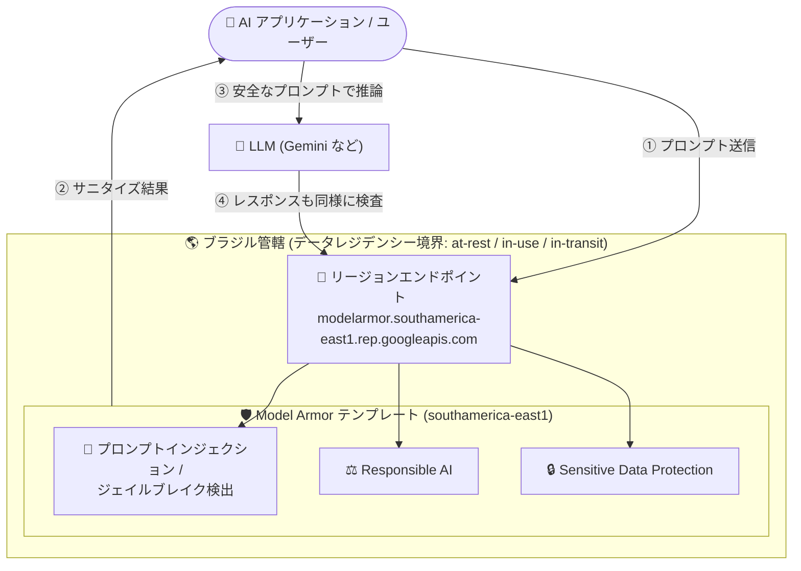

# Model Armor: ブラジル (southamerica-east1) リージョンで利用可能に

**リリース日**: 2026-10-29

**サービス**: Model Armor

**機能**: ブラジル (southamerica-east1) リージョンのサポート

**ステータス**: Feature (提供開始)

📊 [このアップデートのインフォグラフィックを見る](https://takech9203.github.io/google-cloud-news-summary/20261029-model-armor-southamerica-east1-region.html)

## 概要

AI アプリケーションのプロンプトとレスポンスをスクリーニングするセキュリティサービス Model Armor が、ブラジルのサンパウロ (southamerica-east1) リージョンで利用可能になりました。これにより、南米で初めて Model Armor のリージョンが提供され、ブラジル国内の管轄 (ブラジルデータバウンダリ) における保存時 (at-rest)、使用時 (in-use)、転送時 (in-transit) のデータレジデンシーコンプライアンスが確保されます。

southamerica-east1 は「限定機能サポート (limited feature support)」リージョンとして提供され、厳格なデータレジデンシーを維持するために利用可能なフィルタが絞られています。利用できるフィルタは、プロンプトインジェクション / ジェイルブレイク検出、Responsible AI、Sensitive Data Protection の 3 種類です。

ブラジルの LGPD (一般データ保護法) などの規制要件により、データを国内に留める必要がある金融、医療、公共部門の組織が、生成 AI アプリケーションに対するガードレールをデータレジデンシー要件を満たしながら適用できるようになります。

**アップデート前の課題**

- Model Armor は南米リージョンで提供されておらず、ブラジルのユーザーは us-east1 などの米国リージョンやその他の海外リージョンを使用する必要があった
- プロンプトやレスポンスの処理 (in-use) と転送 (in-transit) がブラジル国外で行われるため、データを国内に留める必要があるワークロードで Model Armor を採用しにくかった
- ブラジルのデータバウンダリを要件とする Assured Workloads 構成で、AI プロンプト / レスポンスのスクリーニングを管轄内で完結させる選択肢がなかった

**アップデート後の改善**

- southamerica-east1 に Model Armor テンプレートを作成し、リージョンエンドポイント経由でプロンプト / レスポンスをブラジル管轄内でサニタイズできるようになった
- 保存時・使用時・転送時のすべての状態でブラジル管轄内のデータレジデンシーが適用されるようになった
- プロンプトインジェクション / ジェイルブレイク検出、Responsible AI、Sensitive Data Protection の主要 3 フィルタが管轄内で利用可能になった

## アーキテクチャ図



southamerica-east1 の Model Armor は、プロンプトとレスポンスの検査処理をブラジル管轄内で完結させます。限定サポートリージョンのため、利用可能なフィルタは図中の 3 種類です。

## サービスアップデートの詳細

### 主要機能

1. **southamerica-east1 (サンパウロ) リージョンの追加**
   - Model Armor が利用できる南米初のリージョン
   - テンプレートの作成・管理とプロンプト / レスポンスのサニタイズをリージョンエンドポイント `modelarmor.southamerica-east1.rep.googleapis.com` 経由で実行

2. **ブラジル管轄でのデータレジデンシーコンプライアンス**
   - 保存時 (at-rest)、使用時 (in-use)、転送時 (in-transit) のすべてでブラジル管轄内にデータが留まることを保証
   - Model Armor はステートレスに動作し、プロンプト / レスポンスの内容を保存しない (Cloud Logging を明示的に有効化した場合を除く)

3. **限定サポートリージョンとして 3 フィルタを提供**
   - プロンプトインジェクション / ジェイルブレイク検出
   - Responsible AI (安全性カテゴリフィルタ)
   - Sensitive Data Protection (機密データ検出・匿名化)
   - 悪意のある URL 検出、CSAM 検出、多言語検出、アンチウイルススキャンは、管轄外でデータ処理が発生する可能性のある依存サービスを利用するため、データレジデンシー適用時は利用不可

4. **データレジデンシー適用の選択可能性**
   - 厳格なデータレジデンシーよりも包括的なフィルタリングを優先したい場合は、テンプレートで in-use / in-transit のデータレジデンシー適用を無効化し、フル機能を利用することも可能

## 技術仕様

### southamerica-east1 リージョンの仕様

| 項目 | 詳細 |
|------|------|
| リージョン | southamerica-east1 (サンパウロ、ブラジル) |
| 管轄 (Jurisdiction) | ブラジルデータバウンダリ |
| データレジデンシー | at-rest: Yes / in-use: Yes / in-transit: Yes |
| 機能サポート | 限定サポート (Limited support) |
| 利用可能フィルタ (テンプレート) | プロンプトインジェクション / ジェイルブレイク検出、Responsible AI、Sensitive Data Protection |
| リージョンエンドポイント | `modelarmor.southamerica-east1.rep.googleapis.com` |

### フィルタごとのトークン上限

| フィルタ | システム上限 |
|------|------|
| プロンプトインジェクション / ジェイルブレイク検出 | 65,536 トークン |
| Responsible AI | 65,536 トークン |
| Sensitive Data Protection | 130,000 トークン (0.5 MB) |

### 注意点 (floor settings 使用時)

Gemini Enterprise Agent Platform との統合で floor settings を使用する場合、southamerica-east1 では全フィルタが利用できる一方、データレジデンシーの適用は at-rest のみ (in-use / in-transit は適用外) となります。テンプレート利用時とはデータレジデンシーの適用範囲が異なる点に注意が必要です。

## 設定方法

### 前提条件

1. Model Armor API が有効化されたプロジェクト
2. `roles/modelarmor.admin` など適切な IAM ロール
3. VPC 内からリージョンエンドポイントにアクセスする場合は、Model Armor API への Private Service Connect エンドポイントの作成 (Private Google Access / VPC Service Controls 利用時の証明書エラー防止のため必須)

### 手順

#### ステップ 1: southamerica-east1 にテンプレートを作成

```bash
gcloud model-armor templates create brazil-template \
  --location=southamerica-east1 \
  --rai-settings-filters='[{"filterType": "HATE_SPEECH", "confidenceLevel": "MEDIUM_AND_ABOVE"}]' \
  --pi-and-jailbreak-filter-settings-enforcement=enabled \
  --pi-and-jailbreak-filter-settings-confidence-level=LOW_AND_ABOVE \
  --basic-config-filter-enforcement=enabled
```

テンプレートの場所と一致するリージョンエンドポイントを使用する必要があります。

#### ステップ 2: リージョンエンドポイント経由でプロンプトをサニタイズ

```bash
curl -X POST \
  -H "Authorization: Bearer $(gcloud auth print-access-token)" \
  -H "Content-Type: application/json" \
  -d '{"userPromptData": {"text": "ユーザーのプロンプト"}}' \
  "https://modelarmor.southamerica-east1.rep.googleapis.com/v1/projects/PROJECT_ID/locations/southamerica-east1/templates/brazil-template:sanitizeUserPrompt"
```

レスポンスのフィルタ結果 (`MATCH_FOUND` / `NO_MATCH_FOUND`) に基づいて、LLM へのリクエストを許可またはブロックします。

## メリット

### ビジネス面

- **規制コンプライアンス**: LGPD などブラジルのデータ保護規制に対応するため、AI セキュリティ処理を国内管轄で完結できる
- **南米市場での AI 活用促進**: データレジデンシー要件が理由で生成 AI のガードレール導入を見送っていた金融・医療・公共部門の組織が Model Armor を採用可能になる

### 技術面

- **レイテンシの改善**: 南米のワークロードから海外リージョンのエンドポイントを呼び出す必要がなくなり、スクリーニングの往復遅延を削減できる
- **Assured Workloads との整合**: ブラジルデータバウンダリを使用する構成で、AI プロンプト / レスポンスの検査を管轄内に収められる

## デメリット・制約事項

### 制限事項

- 限定サポートリージョンのため、悪意のある URL 検出、CSAM 検出、多言語検出、アンチウイルススキャンの各フィルタは、データレジデンシー適用時には利用できない
- リージョンエンドポイントは floor settings の管理をサポートしない (floor settings の管理はグローバルエンドポイント `modelarmor.googleapis.com` を使用)
- VPC 内からリージョンエンドポイントにアクセスするには Private Service Connect エンドポイントの作成が必要

### 考慮すべき点

- フル機能が必要な場合は、テンプレートでデータレジデンシー適用を無効化するか、フルサポートリージョン (us、eu など) の利用を検討する必要がある (その場合、in-use / in-transit データが管轄外で処理される可能性がある)
- floor settings 経由の Agent Platform 統合では、southamerica-east1 のデータレジデンシー適用は at-rest のみとなる

## ユースケース

### ユースケース 1: ブラジルの金融機関における顧客向け AI チャットボットの保護

**シナリオ**: ブラジルの銀行が顧客向けチャットボットを Gemini で構築しており、LGPD 対応のためプロンプト / レスポンスの処理をブラジル国内に留める必要がある。あわせて、プロンプトインジェクション攻撃や、CPF (個人納税者番号) などの機密情報の漏えいを防ぎたい。

**実装例**:
```bash
# Sensitive Data Protection とプロンプトインジェクション検出を有効にしたテンプレートを
# southamerica-east1 に作成し、チャットボットのバックエンドから
# modelarmor.southamerica-east1.rep.googleapis.com を呼び出す
```

**効果**: データレジデンシー要件を満たしながら、プロンプトインジェクション対策と機密データ保護を実現できる。

### ユースケース 2: 公共部門の生成 AI 導入におけるガードレール整備

**シナリオ**: ブラジルの政府機関が内部業務に生成 AI を導入する際、データを国内管轄に留めることが調達要件となっている。

**効果**: southamerica-east1 の Model Armor テンプレートにより、Responsible AI フィルタで不適切なコンテンツをブロックしつつ、調達要件のデータレジデンシー条件を満たせる。

## 料金

Model Armor はスタンドアロンまたは Security Command Center (SCC) の一部として利用でき、処理したトークン数に基づいて課金されます。リージョン追加による料金体系の変更はありません。

### 料金例

| プラン | 内容 |
|--------|-----------------|
| スタンドアロン / SCC Premium (従量課金) | 月 200 万トークンまで無料、超過分は 100 万トークンあたり $0.10 |
| SCC Premium / Enterprise (サブスクリプション) | 月 30 億トークンまで含む、超過分は 100 万トークンあたり $0.10 |

## 利用可能リージョン

今回の追加により、Model Armor は以下のリージョン / マルチリージョンで利用可能です (フィルタの利用可否はリージョンにより異なります)。

- **南米**: southamerica-east1 (サンパウロ) ← 今回追加 (限定サポート)
- **北米**: us-central1、us-east1、us-east4、us-west1 (フルサポート)、northamerica-northeast2 (限定サポート)
- **ヨーロッパ**: europe-southwest1、europe-west1、europe-west3、europe-west4、europe-west9 (フルサポート)、europe-west2 (限定サポート)
- **アジア太平洋**: asia-northeast1、asia-northeast3、asia-south1、asia-southeast1、australia-southeast2 (限定サポート)
- **マルチリージョン**: us、eu (フルサポート)

## 関連サービス・機能

- **Sensitive Data Protection**: Model Armor の機密データフィルタの基盤。プロンプト / レスポンス内の個人情報や機密情報を検出・匿名化する
- **Security Command Center**: Model Armor を統合的に利用できるセキュリティ管理基盤。サブスクリプションにはトークン枠が含まれる
- **Assured Workloads**: ブラジルデータバウンダリなど管轄別のコンプライアンス制御を提供。Model Armor のデータレジデンシーと組み合わせて利用
- **Private Service Connect**: VPC 内から Model Armor リージョンエンドポイントへアクセスする際に必要
- **Vertex AI / Gemini**: Model Armor が保護対象とする生成 AI プラットフォーム。Agent Platform 統合では floor settings による保護も可能

## 参考リンク

- 📊 [インフォグラフィック](https://takech9203.github.io/google-cloud-news-summary/20261029-model-armor-southamerica-east1-region.html)
- [公式リリースノート](https://docs.cloud.google.com/release-notes#October_29_2026)
- [Model Armor のロケーション](https://docs.cloud.google.com/model-armor/locations)
- [データレジデンシーとエンドポイント](https://docs.cloud.google.com/model-armor/data-residency)
- [リージョン別のサポート機能](https://docs.cloud.google.com/model-armor/feature-availability-by-region)
- [料金ページ](https://cloud.google.com/security/products/model-armor#pricing)

## まとめ

Model Armor のブラジル (southamerica-east1) リージョン対応により、南米のデータレジデンシー要件を持つ組織が、保存時・使用時・転送時のすべてで管轄内コンプライアンスを維持しながら生成 AI のガードレールを導入できるようになりました。限定サポートリージョンのため利用可能なフィルタは 3 種類に絞られますが、プロンプトインジェクション検出と機密データ保護という中核機能はカバーされています。ブラジルで AI ワークロードを運用する場合は、southamerica-east1 でのテンプレート作成とリージョンエンドポイントへの切り替えを検討してください。

---

**タグ**: #ModelArmor #AIセキュリティ #データレジデンシー #southamerica-east1 #ブラジル #SensitiveDataProtection #プロンプトインジェクション #コンプライアンス
