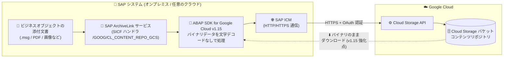

# SAP on Google Cloud: ABAP SDK for Google Cloud バージョン 1.15 (オンプレミスまたは任意のクラウド向けエディション) GA

**リリース日**: 2026-10-29

**サービス**: SAP on Google Cloud

**機能**: ABAP SDK for Google Cloud バージョン 1.15 — バイナリデータハンドリングの強化

**ステータス**: 一般提供 (GA)

📊 [このアップデートのインフォグラフィックを見る](https://takech9203.github.io/google-cloud-news-summary/20261029-sap-abap-sdk-v1-15-ga.html)

## 概要

ABAP SDK for Google Cloud のオンプレミスまたは任意のクラウド向けエディション (on-premises or any cloud edition) のバージョン 1.15 が一般提供 (GA) となりました。ABAP SDK for Google Cloud は、SAP システム (オンプレミス、Google Cloud、他クラウドのいずれで稼働していても) から ABAP コードで Google Cloud API をネイティブに呼び出せるようにする無料の SDK です。

バージョン 1.15 の中心となる強化点は、**バイナリデータハンドリングの改善**です。Cloud Storage を SAP のコンテンツリポジトリとして使用している場合に、アーカイブされた .msg ファイル (Outlook メールメッセージ) をはじめ、複雑なバイトシーケンスを含むその他のバイナリ形式のファイルを、ダウンロード時に文字デコードを適用せずに生のバイナリデータのまま取得できるようになりました。

SAP ArchiveLink 経由で請求書の添付ファイルやメールアーカイブなどを Cloud Storage に保管している企業にとって、バイナリファイルの取得時のデータ破損リスクを解消する、信頼性向上のアップデートです。

**アップデート前の課題**

- Cloud Storage を SAP のコンテンツリポジトリとして使用する際、ダウンロード処理で文字デコードが適用されるため、複雑なバイトシーケンスを含むバイナリファイルが正しく取得できない場合があった
- 特にアーカイブされた .msg ファイルなど、テキストとして解釈できないバイト列を含むファイル形式のダウンロードに影響があった

**アップデート後の改善**

- SDK がダウンロード時に文字デコードを適用せず、生のバイナリデータ (raw binary data) をそのまま処理するようになった
- アーカイブ済みの .msg ファイルや、複雑なバイトシーケンスを含むその他のバイナリ形式を、破損なくダウンロードできるようになった
- Cloud Storage コンテンツリポジトリの信頼性が向上し、ドキュメント保管・データアーカイブ用途での適用範囲が広がった

## アーキテクチャ図



SAP の文書・アーカイブデータは ArchiveLink サービスと ABAP SDK を経由して Cloud Storage バケットに保管されます。v1.15 では、Cloud Storage からのダウンロード時に SDK が文字デコードを適用せず生のバイナリデータとして処理するため、.msg ファイルなどのバイナリ形式も破損なく取得できます。

## サービスアップデートの詳細

### 主要機能

1. **バイナリデータハンドリングの強化 (v1.15 の新機能)**
   - Cloud Storage を SAP のコンテンツリポジトリとして使用する際、アーカイブされた .msg ファイルや複雑なバイトシーケンスを含むその他のバイナリ形式をダウンロード可能
   - SDK がダウンロード時に文字デコードを適用せず、生のバイナリデータのまま処理する

2. **Cloud Storage コンテンツリポジトリ機能 (継続提供)**
   - SAP ArchiveLink に対応した HTTP コンテンツサーバーとして Cloud Storage を利用可能
   - ビジネスオブジェクトに添付された文書の保管 (トランザクション OAC3) と、ビジネスデータのアーカイブ (トランザクション SARA) の両方に対応
   - 1 ファイルあたり最大 5 TB (Cloud Storage の単一アップロード上限) まで保管可能

3. **直近バージョンからの継続的な信頼性改善**
   - v1.14 では、アウトバウンドプロキシ環境での HTTP 401 (ICS:3009) 署名検証エラーを解消する強化が行われており、v1.15 のバイナリハンドリング改善はこれに続くコンテンツリポジトリ機能の品質向上

## 技術仕様

### 対象エディションと機能

| 項目 | 詳細 |
|------|------|
| 対象エディション | オンプレミスまたは任意のクラウド向けエディション (on-premises or any cloud edition) |
| バージョン | 1.15 (GA) |
| 強化対象機能 | Cloud Storage コンテンツリポジトリのダウンロード処理 |
| 対象ファイル形式 | .msg ファイルおよび複雑なバイトシーケンスを含むその他のバイナリ形式 |
| HTTP ハンドラクラス | `/GOOG/CL_CONTENT_REPO_GCS` (SICF) |
| 最大ファイルサイズ | 5 TB (Cloud Storage の単一アップロード上限) |
| セキュリティ | HTTPS (TLS) 暗号化 + OAuth ベース認証、保存時は Google 管理鍵または Cloud KMS による暗号化 |

### 必要な IAM ロール

クライアントキー構成で使用するサービスアカウントには、Cloud Storage バケットへの以下のロールが必要です。

| IAM ロール | 用途 |
|------|------|
| `roles/storage.objectCreator` (Storage Object Creator) | オブジェクトの作成 |
| `roles/storage.admin` (Storage Admin) | バケット・オブジェクトの管理 |

## 設定方法

### 前提条件

1. Google Cloud プロジェクトで Cloud Storage API が有効化されていること
2. SAP データ保管用の Cloud Storage バケットが作成されていること (ストレージクラスはデータ特性に応じて選択)
3. ABAP SDK for Google Cloud (オンプレミスまたは任意のクラウド向けエディション) の認証設定 (クライアントキー) が完了していること
4. サービスアカウントに必要な IAM ロールが付与されていること

### 手順

#### ステップ 1: SDK をバージョン 1.15 に更新

既存の SDK を使用している場合は、最新バージョンへ更新します。コンテンツリポジトリ実装用のサブパッケージは SDK のインストール時に含まれます。更新手順は [Update the ABAP SDK for Google Cloud](https://docs.cloud.google.com/sap/docs/abap-sdk/on-premises-or-any-cloud/latest/install-config#abap-sdk-update) を参照してください。

#### ステップ 2: バックグラウンドユーザーと SICF ノードの作成

```text
1. バックグラウンドユーザー ARCHIVEUSER を作成し、初期パスワードを設定
2. トランザクション SICF で ArchiveLink サービス用ノード (例: gcs_archivelink) を作成
3. Logon Data タブで ARCHIVEUSER を設定
4. Handler list タブに /GOOG/CL_CONTENT_REPO_GCS を登録
```

#### ステップ 3: コンテンツリポジトリ定義の作成 (OAC0)

```text
1. トランザクション OAC0 で New Entries を選択
2. Document area: ARCHIVELINK、Storage type: HTTP content server を選択
3. HTTP server / Port number に SAP システムのホスト名とポートを設定
4. HTTP Script に SICF ノードのパス (例: sap/bc/gcs_archivelink) を設定
```

#### ステップ 4: SDK 側のコンテンツリポジトリ構成

```text
1. トランザクション /GOOG/SDK_IMG を実行
2. ABAP SDK for Google Cloud > Basic Settings > Content Repository: Configuration
3. コンテンツリポジトリ名、Google Cloud クライアントキー名、
   Cloud Storage バケット名、データファイル命名規則を設定して保存
```

**注意**: リポジトリの使用開始後に Cloud Storage バケットやファイル命名規則を変更すると、既存データへのアクセスができなくなります。設定前に慎重に決定してください。

## メリット

### ビジネス面

- **アーカイブ基盤の信頼性向上**: メールアーカイブ (.msg) を含む多様なファイル形式を Cloud Storage に安心して保管でき、コンプライアンス要件に基づく文書保管の適用範囲が広がる
- **コスト効率**: SAP データベースから文書・アーカイブデータを Cloud Storage にオフロードすることで、高価な SAP ストレージの使用量を削減し、ストレージクラスの選択でコストを最適化できる
- **追加ライセンス不要**: ABAP SDK 自体は無料で、サードパーティのコンテンツサーバー製品を購入せずに SAP 標準の ArchiveLink シナリオを実現できる

### 技術面

- **データ整合性の保証**: ダウンロード時に文字デコードを適用しないため、複雑なバイトシーケンスを含むバイナリファイルが破損なく取得できる
- **SAP 標準ワークフローとの互換性**: ArchiveLink (OAC3) やアーカイブ管理 (SARA) といった SAP 標準のトランザクションをそのまま利用可能
- **セキュアな通信**: HTTPS (TLS) 暗号化と OAuth 認証による保護に加え、Cloud KMS による顧客管理の暗号鍵にも対応

## デメリット・制約事項

### 制限事項

- この機能はオンプレミスまたは任意のクラウド向けエディションのみで利用可能 (コンテンツリポジトリ機能自体は SAP BTP エディションにも別途提供されているが、本アップデートは on-premises or any cloud edition v1.15 が対象)
- 保管できるファイルサイズは最大 5 TB (Cloud Storage の単一アップロード上限)

### 考慮すべき点

- バイナリハンドリング強化の恩恵を受けるには SDK をバージョン 1.15 に更新する必要がある
- 使用開始後の Cloud Storage バケット名・ファイル命名規則の変更は、既存データへのアクセス喪失につながるため不可
- サービスアカウントへの IAM ロール付与は最小権限の原則に従い、必要な権限のみを付与する

## ユースケース

### ユースケース 1: メールアーカイブ (.msg) の長期保管と取り出し

**シナリオ**: 受発注や監査対応のために、Outlook メール (.msg) を SAP のビジネスオブジェクト (購買発注、請求書など) に添付して ArchiveLink 経由で Cloud Storage に保管している企業。従来はバイナリ形式のダウンロード時にデータが正しく取得できないケースがあった。

**実装例**:
```text
1. SDK を v1.15 に更新
2. OAC3 で対象ビジネスオブジェクトに Cloud Storage コンテンツリポジトリを割り当て
3. .msg ファイルを添付文書として保管
4. 必要時に SAP GUI から添付文書を開くと、文字デコードなしで
   生のバイナリデータとして正しくダウンロードされる
```

**効果**: 監査や紛争対応で過去のメールアーカイブを取り出す際に、ファイル破損の心配なく確実に原本を復元できる。

### ユースケース 2: SAP データベースのスリム化 (データアーカイビング)

**シナリオ**: SAP ERP のデータベース肥大化によりパフォーマンスとインフラコストが課題となっている企業が、SARA トランザクションで古いビジネスデータを Cloud Storage にアーカイブする。

**効果**: SAP データベースの容量を削減しつつ、Nearline / Coldline / Archive などのストレージクラスを活用して長期保管コストを大幅に最適化できる。アーカイブファイル (バイナリ) の取り出しも v1.15 で信頼性が向上。

## 料金

ABAP SDK for Google Cloud 自体は無料でインストール・利用できます。Cloud Storage をコンテンツリポジトリとして使用する場合、Cloud Storage に保管するデータ量などに応じた料金が発生します。

| 課金対象 | 内容 |
|--------|-----------------|
| ABAP SDK for Google Cloud | 無料 |
| Cloud Storage | 保存データ量、オペレーション、ネットワーク下り (egress) に応じて課金。ストレージクラス (Standard / Nearline / Coldline / Archive) により単価が異なる |

詳細は [Cloud Storage の料金ページ](https://cloud.google.com/storage/pricing) を参照してください。

## 利用可能リージョン

ABAP SDK は SAP システム側 (オンプレミスまたは任意のクラウド) にインストールして使用するため、リージョンの制約はありません。コンテンツリポジトリとして使用する Cloud Storage バケットは、任意の [Cloud Storage ロケーション](https://cloud.google.com/storage/docs/locations) に作成できます。

## 関連サービス・機能

- **Cloud Storage**: SAP の文書保管・データアーカイブ先となるオブジェクトストレージ。本アップデートの中心となるコンテンツリポジトリとして機能
- **Cloud KMS**: 保管データの暗号化に顧客管理の暗号鍵 (CMEK) を使用する場合に利用
- **IAM**: サービスアカウントへの最小権限付与によるバケットのアクセス制御
- **Secret Manager / Parameter Manager**: SDK が提供する他の Google Cloud API クライアントライブラリの例。認証情報や構成パラメータの一元管理に活用可能
- **BigQuery Toolkit for SAP**: 同 SDK に含まれる、SAP テーブルから BigQuery へのデータレプリケーション機能

## 参考リンク

- 📊 [インフォグラフィック](https://takech9203.github.io/google-cloud-news-summary/20261029-sap-abap-sdk-v1-15-ga.html)
- [公式リリースノート](https://docs.cloud.google.com/release-notes#October_29_2026)
- [What's new with the on-premises or any cloud edition of the ABAP SDK for Google Cloud](https://docs.cloud.google.com/sap/docs/abap-sdk/on-premises-or-any-cloud/whats-new)
- [Cloud Storage を SAP のコンテンツリポジトリとして実装する](https://docs.cloud.google.com/sap/docs/abap-sdk/on-premises-or-any-cloud/latest/implement-gcs-sap-content-repository)
- [SDK のインストールと構成](https://docs.cloud.google.com/sap/docs/abap-sdk/on-premises-or-any-cloud/latest/install-config)
- [料金ページ (Cloud Storage)](https://cloud.google.com/storage/pricing)

## まとめ

ABAP SDK for Google Cloud v1.15 は、Cloud Storage コンテンツリポジトリにおけるバイナリデータハンドリングを強化し、.msg ファイルなど複雑なバイトシーケンスを含むファイルを文字デコードなしで確実にダウンロードできるようにしました。Cloud Storage を SAP の文書保管・アーカイブ先として利用している、または検討している場合は、SDK を v1.15 に更新することを推奨します。

---

**タグ**: SAP on Google Cloud, ABAP SDK, Cloud Storage, ArchiveLink, コンテンツリポジトリ, GA, データアーカイブ
