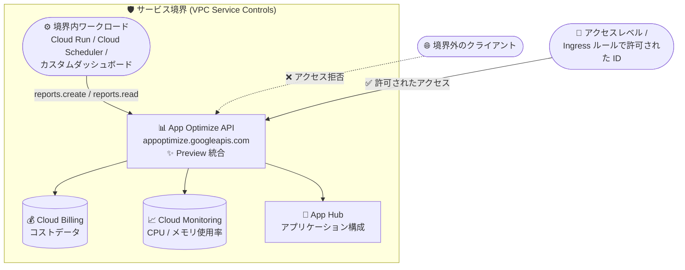

# VPC Service Controls: App Optimize API との統合を Preview でサポート

**リリース日**: 2026-10-29

**サービス**: VPC Service Controls

**機能**: App Optimize API 統合の Preview サポート

**ステータス**: Preview

📊 [このアップデートのインフォグラフィックを見る](https://takech9203.github.io/google-cloud-news-summary/20261029-vpc-service-controls-app-optimize-api.html)

## 概要

VPC Service Controls が App Optimize API (`appoptimize.googleapis.com`) との統合を Preview としてサポートしました。これにより、サービス境界 (Service Perimeter) の制限対象サービスに App Optimize API を追加し、境界による保護の対象にできるようになりました。統合は Preview 段階ですが、既知の制限事項はなく、境界内で App Optimize API を通常どおり利用できます。

App Optimize API は、Google Cloud リソースのコストと使用状況を把握・監視・最適化するためのプログラマティックな API です (API 自体も Preview)。プロジェクトや App Hub アプリケーション単位でコスト・使用率レポートを生成でき、金額コスト、CPU / メモリ使用率 (平均と 95 パーセンタイル)、リソース割り当てなどのデータを SQL クエリ結果に似た表形式で取得できます。カスタムダッシュボードの構築、BigQuery などの分析基盤への定期エクスポート、デプロイパイプラインへのコストチェックの組み込みといった FinOps ユースケースに利用されます。

コストデータは組織の支出状況を示す機密性の高い情報であり、データ境界による保護を必須とする金融・公共などの規制業種では、VPC Service Controls 対応が API 採用の前提条件になることが少なくありません。今回の統合により、サービス境界を運用する組織でも App Optimize API を境界内から安全に利用し、データ漏洩リスクを抑えながらコスト最適化ワークフローを構築できるようになりました。

**アップデート前の課題**

- App Optimize API は VPC Service Controls の統合対象外であり、サービス境界で保護するプロジェクトでは、Restricted VIP (`restricted.googleapis.com`) や Private Service Connect (`vpc-sc` バンドル) を使用する環境から App Optimize API へのアクセスがブロックされていた
- 境界内のプロジェクトでは Google Cloud コンソールからの Gemini Cloud Assist の有効化がエラーになる既知の制限があった。コンソールが App Optimize API の有効化を併せて要求する一方、同 API が VPC Service Controls 未サポートだったことが原因で、gcloud CLI での回避が必要だった
- コストと使用状況という機密性の高いデータを扱う API でありながら、境界によるデータ漏洩 (Exfiltration) 対策を適用できなかった

**アップデート後の改善**

- サービス境界の制限対象サービス (restricted services) に `appoptimize.googleapis.com` を追加し、境界による保護を構成できるようになった
- 境界内から App Optimize API を通常どおり利用できるようになり、コスト・使用率レポートの生成と読み取りをデータ境界の内側で完結できるようになった
- 統合に既知の制限事項 (Limitations) はなく、他の VPC Service Controls 対応サービスと同様に Ingress / Egress ルールやアクセスレベルによるきめ細かなアクセス制御を適用できる

## アーキテクチャ図



サービス境界に `appoptimize.googleapis.com` を追加すると、境界内のワークロードからのレポート生成・読み取りは通常どおり動作し、境界外からの未許可アクセスはブロックされます。境界外からのアクセスが必要な場合はアクセスレベルや Ingress ルールで明示的に許可します。

## サービスアップデートの詳細

### 主要機能

1. **サービス境界による App Optimize API の保護 (Preview)**
   - サービス境界の制限対象サービスに `appoptimize.googleapis.com` を指定可能になった
   - 境界で保護すると、境界外からの未許可のアクセスがブロックされ、コスト・使用率データの漏洩リスクを低減できる
   - 統合に既知の制限事項はなく、境界内では API を通常どおり利用できる

2. **保護対象となる App Optimize API の機能**
   - レポート生成 (`reports.create`): プロジェクト、個別リソース、SKU、期間、App Hub アプリケーション / サービス / ワークロードなどのディメンションで集計したコスト・使用率レポートを非同期生成
   - レポート読み取り (`reports.read`): 金額コスト、CPU / メモリ使用率 (平均・95 パーセンタイル)、CPU コア / メモリの使用量と割り当てを表形式で取得
   - CEL (Common Expression Language) によるフィルタリング、AI アプリケーション向けリモート MCP サーバーも提供

3. **VPC Service Controls の標準機能との組み合わせ**
   - Ingress / Egress ルールにより、境界をまたぐ App Optimize API へのアクセスを ID・送信元・メソッド単位で制御可能
   - Access Context Manager のアクセスレベル (IP サブネットワーク、地理的リージョン、デバイスポリシー) と組み合わせたコンテキストアウェアなアクセス制御が可能

## 技術仕様

### VPC Service Controls 統合の詳細

| 項目 | 詳細 |
|------|------|
| 統合ステータス | Preview (広範なテストと利用が可能だが、本番環境向けの完全サポートではない) |
| 境界による保護 | 可能 (制限対象サービスとして構成可能) |
| サービス名 | `appoptimize.googleapis.com` |
| 既知の制限事項 | なし |
| App Optimize API 自体のステータス | Preview (v1beta、Pre-GA Offerings Terms が適用) |

### App Optimize API の関連 IAM ロール

| ロール | 説明 |
|------|------|
| App Optimize Admin (`roles/appoptimize.admin`) | レポートとオペレーションに対する完全な制御 (作成・削除を含む) |
| App Optimize Viewer (`roles/appoptimize.viewer`) | レポートのメタデータ・データ・オペレーションの読み取り |

レポート作成には、上記に加えてスコープ対象プロジェクトへの `billing.resourceCosts.get` 権限、使用率メトリクス取得のための Monitoring Viewer (`roles/monitoring.viewer`)、App Hub アプリケーションをスコープにする場合は App Management Viewer (`roles/apphub.appManagementViewer`) が必要です。

## 設定方法

### 前提条件

1. 組織で Access Context Manager のアクセスポリシーが作成済みで、サービス境界を構成・更新する権限 (Access Context Manager Editor など) があること
2. 保護対象プロジェクトで App Optimize API が有効化されていること

### 手順

#### ステップ 1: App Optimize API を有効化する

```bash
gcloud services enable appoptimize.googleapis.com --project=PROJECT_ID
```

レポートを作成・管理するプロジェクトで App Optimize API を有効化します。

#### ステップ 2: サービス境界の制限対象サービスに追加する

```bash
gcloud access-context-manager perimeters update PERIMETER_NAME \
  --add-restricted-services=appoptimize.googleapis.com \
  --policy=POLICY_ID
```

既存のサービス境界の制限対象サービスに `appoptimize.googleapis.com` を追加します。適用前に Dry-run モードで影響を確認することを推奨します。

#### ステップ 3: 必要に応じて Ingress / Egress ルールを構成する

境界外のクライアント (社内ネットワークの FinOps ダッシュボードなど) から App Optimize API にアクセスする必要がある場合は、アクセスレベルや Ingress ルールで許可する ID と送信元を明示的に構成します。

## メリット

### ビジネス面

- **規制業種での採用障壁の解消**: データ境界による保護を必須とする組織でも、コスト最適化 API をコンプライアンス要件を満たしながら利用できる
- **コストデータの漏洩リスク低減**: 組織の支出状況や使用率という機密性の高いデータへのアクセスを境界で制御し、未許可の外部持ち出しを防止できる

### 技術面

- **境界内での FinOps ワークフロー完結**: Cloud Run + Cloud Scheduler による定期レポートエクスポートやカスタムダッシュボードを、サービス境界の内側で構築できる
- **制限事項なしの統合**: Preview ながら既知の制限事項がなく、他の対応サービスと同じ運用モデル (Ingress / Egress ルール、アクセスレベル) で管理できる
- **Gemini Cloud Assist との関係改善**: 境界内プロジェクトでのコンソールからの Gemini Cloud Assist 有効化が App Optimize API の VPC Service Controls 未サポートに起因してエラーになる既知の制限があったが、今回の統合はその前提条件を解消する方向のアップデートである

## デメリット・制約事項

### 制限事項

- 統合は Preview 段階であり、Pre-GA Offerings Terms が適用される。「現状のまま」提供され、本番環境向けの完全サポートではない
- App Optimize API 自体も Preview (v1beta) であり、API の仕様変更の可能性がある
- 生成されたレポートは 24 時間後に自動削除されるため、長期保存には外部へのエクスポートが必要 (エクスポート先も境界設計に含める必要がある)

### 考慮すべき点

- 制限対象サービスに追加すると、境界外からの既存のアクセス (例: 社外の分析ツールからの API 呼び出し) が拒否される。Dry-run モードで影響範囲を確認してから適用するべき
- App Optimize API は Cloud Billing、Cloud Monitoring、App Hub のデータを参照する。レポート生成の権限チェックやデータ取得が境界をまたがないよう、関連サービスと対象プロジェクトを同一境界内に収める設計が望ましい
- レポートデータを BigQuery などに取り込む場合は、取り込み先サービスも境界の制限対象・VPC accessible services の設計に含める必要がある

## ユースケース

### ユースケース 1: 境界内での定期コストレポートの自動エクスポート

**シナリオ**: 金融機関がサービス境界で保護された環境でワークロードを運用しており、プロジェクトごとのコストと CPU / メモリ使用率を日次で BigQuery にエクスポートして FinOps 分析を行いたい。

**実装例**:
```
1. 境界内プロジェクトで appoptimize.googleapis.com を有効化
2. サービス境界の制限対象サービスに appoptimize.googleapis.com と
   bigquery.googleapis.com を追加
3. Cloud Scheduler + Cloud Run で日次ジョブを構成し、
   reports.create → 完了待ち → reports.read → BigQuery 取り込みを実行
```

**効果**: コスト・使用率データの収集から分析までがデータ境界の内側で完結し、機密性の高い支出データを外部に露出させずに FinOps を運用できる。

### ユースケース 2: 未許可クライアントからのコストデータ取得のブロック

**シナリオ**: 組織のコストデータへのアクセスを社内ネットワークと特定のサービスアカウントに限定したい。境界外の端末や不正に取得された認証情報による API 呼び出しをブロックしたい。

**効果**: `appoptimize.googleapis.com` を制限対象サービスに追加することで、境界外からの呼び出しは IAM 権限があってもブロックされる。正当なアクセスは IP サブネットワークや地理的リージョンに基づくアクセスレベルと Ingress ルールで明示的に許可でき、認証情報漏洩時のコストデータ流出リスクを低減できる。

## 料金

VPC Service Controls でのサービス境界の構成に伴う App Optimize API 側の追加料金はありません。App Optimize API は Preview 期間中、レポートの作成・読み取り・メタデータ取得を含めて追加料金なしで利用できます。

ただし、App Optimize API にデータを提供する以下のサービスには、それぞれの料金が適用される場合があります。

- [Cloud Billing の料金](https://cloud.google.com/billing/v1/pricing)
- [App Hub の料金](https://cloud.google.com/app-hub/pricing)
- [Cloud Monitoring の料金](https://cloud.google.com/stackdriver/pricing#monitoring-costs)

## 関連サービス・機能

- **App Optimize API**: 今回 VPC Service Controls の保護対象に加わった、コスト・使用率レポート生成 API。プロジェクトと App Hub アプリケーション単位の分析が可能
- **Access Context Manager**: サービス境界とアクセスレベルを管理するサービス。境界外からの正当なアクセスを許可する際に使用
- **App Hub**: App Optimize API がアプリケーション単位のコスト集計に使用するアプリケーション管理サービス
- **Cloud Billing / Cloud Monitoring**: App Optimize API のコストデータと使用率メトリクスのデータソース
- **Gemini Cloud Assist**: コンソールからの有効化時に App Optimize API を要求するサービス。境界内プロジェクトでの有効化エラーの既知の制限と関係が深い

## 参考リンク

- 📊 [インフォグラフィック](https://takech9203.github.io/google-cloud-news-summary/20261029-vpc-service-controls-app-optimize-api.html)
- [公式リリースノート](https://docs.cloud.google.com/release-notes#October_29_2026)
- [VPC Service Controls でサポートされるプロダクト](https://docs.cloud.google.com/vpc-service-controls/docs/supported-products)
- [App Optimize API の概要](https://docs.cloud.google.com/app-optimize/overview)
- [App Optimize API の有効化](https://docs.cloud.google.com/app-optimize/enable-api)
- [App Optimize API のアクセス制御 (IAM)](https://docs.cloud.google.com/app-optimize/access-control)
- [サービス境界の作成と管理](https://docs.cloud.google.com/vpc-service-controls/docs/create-service-perimeters)

## まとめ

VPC Service Controls が App Optimize API を Preview でサポートしたことで、サービス境界を運用する組織でもコスト・使用率データをデータ境界の内側で安全に扱えるようになりました。既知の制限事項がない統合であり、FinOps ワークフローをセキュアに構築する土台が整います。サービス境界を利用中でコスト最適化の自動化を検討しているチームは、Dry-run モードで影響を確認しつつ、`appoptimize.googleapis.com` の制限対象サービスへの追加を試してみることをおすすめします。

---

**タグ**: #VPCServiceControls #AppOptimizeAPI #セキュリティ #FinOps #コスト最適化 #データ境界 #AppHub #Preview
