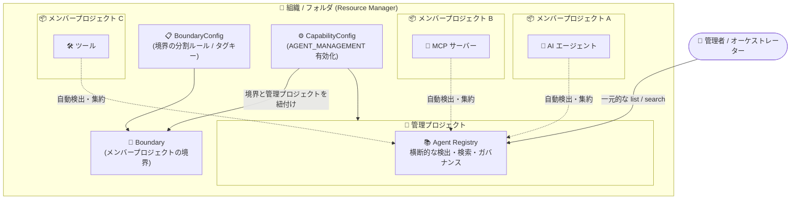

# Agent Registry: クロスプロジェクト管理境界 (Cross-project management boundaries)

**リリース日**: 2026-10-30

**サービス**: Agent Registry

**機能**: クロスプロジェクト管理境界 (Cross-project management boundaries)

**ステータス**: Preview

📊 [このアップデートのインフォグラフィックを見る](https://takech9203.github.io/google-cloud-news-summary/20261030-agent-registry-cross-project-boundaries.html)

## 概要

Agent Registry がクロスプロジェクト管理境界 (cross-project management boundaries) に対応しました (Preview)。中央の「管理プロジェクト (management project)」から、複数の Google Cloud プロジェクトにまたがる AI エージェント、Model Context Protocol (MCP) サーバー、ツールを一元的に検出・検索・ガバナンスできるようになります。

管理境界は、Resource Manager の `BoundaryConfig` / `Boundary` / `CapabilityConfig` リソースによって定義されます。管理プロジェクトと 1 つ以上の「メンバープロジェクト (member projects)」という 2 つのプロジェクトロールに管理ガバナンスとコンピュート実行を分離することで、マルチテナント分離を実現します。各チームはそれぞれのメンバープロジェクトでエージェントを構築・デプロイし、管理者やオーケストレーターは管理プロジェクトから境界全体の統一されたビジビリティを維持できます。

組織全体でエージェントや MCP サーバーの数が増えるなか、プロジェクト単位のサイロを超えてエージェント資産を統制したいプラットフォームチーム、セキュリティ管理者、AI エージェント基盤の設計者にとって重要なアップデートです。

**アップデート前の課題**

- Agent Registry はデフォルトで単一のガバナンスプロジェクト内でのみ動作し、検出・検索の範囲がそのプロジェクトに限定されていた
- 複数プロジェクトにデプロイされたエージェントや MCP サーバーを横断的に把握するには、プロジェクトごとに個別にクエリする必要があった
- 他のメンバープロジェクトの資産を確認するには、各プロジェクトに対する閲覧権限を個別に付与する必要があった

**アップデート後の改善**

- Resource Manager で管理境界を構成すると、中央の管理プロジェクトが境界内の全メンバープロジェクトのエージェント、MCP サーバー、ツールを集約 (ロールアップ) するようになった
- 管理プロジェクトに対する 1 回のリスト・検索リクエストで、境界内の全メンバープロジェクトの自動検出リソースを統合された結果セットとして取得できるようになった
- 管理プロジェクトで Viewer 権限を持つユーザーは、各メンバープロジェクトに個別の閲覧権限を付与することなく、境界全体のエージェントと MCP サーバーを検出・検索できるようになった
- API 有効化、クォータ、課金、アクセス制御を管理プロジェクトに一元化できるようになった

## アーキテクチャ図



Resource Manager の `BoundaryConfig` / `Boundary` / `CapabilityConfig` リソースがメンバープロジェクト群を中央の管理プロジェクトに接続し、各メンバープロジェクトにデプロイされたエージェント・MCP サーバー・ツールが管理プロジェクトの Agent Registry に自動的に集約される構成です。

## サービスアップデートの詳細

### 主要機能

1. **管理プロジェクトによる一元的な検出・検索**
   - 管理プロジェクトは、クロスプロジェクトの list / search リクエストのターゲットとして機能する
   - 管理プロジェクトのあるロケーションでエージェントや MCP サーバーをリスト・検索すると、同一ロケーションのリソースが管理プロジェクトと全メンバープロジェクトを横断して集約され、統合された結果セットとして返される
   - 単一プロジェクトの検出とクロスプロジェクトの検出は同一の API メソッドを使用し、対象プロジェクトがメンバープロジェクトか管理プロジェクトかによって検索スコープが決まる
   - 特定のメンバープロジェクトに結果を絞り込むには `--filter="project_id=MEMBER_PROJECT_ID"` を指定する

2. **自動検出リソースの境界横断ロールアップ**
   - メンバープロジェクトにデプロイされたサポート対象リソース (Agent Runtime の reasoning engine、Cloud Run サービス、GKE デプロイメントなど) は、デプロイ先のメンバープロジェクトで自動的に取り込まれ、管理プロジェクトに集約される
   - 手動登録した `Service` リソース (カスタムエージェント、外部 MCP サーバー、エンドポイント) と `Binding` リソースは作成したプロジェクトにスコープされる。境界全体で可視化したい場合は管理プロジェクトに、単一メンバープロジェクト内のみで可視化したい場合はメンバープロジェクトに作成する
   - スタンドアロンの `Skill` / `SkillRevision` / `Publisher` / `AiApplication` リソースは作成したプロジェクトにスコープされ、境界をまたいで集約されない (Google 管理のスタンドアロンスキルは任意のプロジェクトで自動的に検出可能)

3. **柔軟な境界定義 (タグベースのメンバーシップ)**
   - `BoundaryConfig` にタグキーを設定しない場合、組織・フォルダ配下の全子プロジェクトが単一の境界に含まれる
   - タグキー (例: `123456789012/env`) を設定すると、タグ値フィルタ (例: `env=prod`) により子プロジェクトを複数の境界に分割できる。該当するタグ値を継承または付与したプロジェクトは自動的に境界に参加する
   - 1 つのプロジェクトは、親フォルダ・組織ごとに最大 1 つの境界にのみ所属できる

4. **管理プロジェクトのプロビジョニング方式の選択**
   - セルフマネージド: `--management-project` フラグで既存プロジェクトを指定する。`CapabilityConfig` と同じ親フォルダ・組織の直下にある必要があり、他の `CapabilityConfig` の管理プロジェクトを兼任できない。`CapabilityConfig` を削除しても通常のプロジェクトとして保持される
   - Google マネージド: フラグを省略すると Resource Manager が親フォルダ・組織内に専用プロジェクトを自動作成する (プロジェクト ID プレフィックスは `google-mpf` または `google-mpo`)。`CapabilityConfig` を削除するとこのプロジェクトも削除される
   - いずれの場合も、`agent-management` 付きの `CapabilityConfig` 作成時に `agentregistry.googleapis.com` が管理プロジェクトで自動的に有効化される

## 技術仕様

### 管理境界を構成する Resource Manager リソース

| リソース | 役割 |
|------|------|
| `BoundaryConfig` | 組織・フォルダに設定し、境界の分割ルールを確立する。タグキー (単一) を指定するとタグフィルタベースの複数境界に分割可能 |
| `Boundary` | メンバープロジェクトの境界 (ペリメータ)。タグ値フィルタ (例: `env=prod`) でメンバーシップを動的に評価 |
| `CapabilityConfig` | 境界を管理プロジェクトに紐付け、有効化する管理機能を指定する。Agent Registry では `AGENT_MANAGEMENT` (gcloud では `agent-management`) を構成 |

### ロケーションごとのクエリロールアップ

| クエリ対象 | 集約動作 |
|------|------|
| 単一リージョン (例: `us-central1`, `europe-west1`) | 同一リージョンにデプロイされた自動検出リソースを管理プロジェクトと全メンバープロジェクト横断で集約。管理プロジェクト上の同リージョンの `Service` / `Binding` リソースも含む |
| マルチリージョン (例: `us`, `eu`) | 同一マルチリージョンにデプロイされたリソースを横断集約。単一リージョンのリソースは含まない |
| `global` | `global` にデプロイされたリソースを横断集約。マルチリージョン・単一リージョンのリソースは含まない |
| スタンドアロンプロジェクト / メンバープロジェクト | そのプロジェクト単体・そのロケーションのみ。クロスプロジェクトロールアップなし |

- 複数の境界が同一の `CapabilityConfig` にアタッチされている場合、全境界のメンバープロジェクトが同じ管理プロジェクトのレジストリに集約される。環境ごとに可視性を分離したい場合は、境界ごとに別の `CapabilityConfig` と管理プロジェクトを作成する

### IAM ロール (管理境界での権限付与)

| 付与レベル | 対象 |
|------|------|
| 管理プロジェクト | 境界横断でエージェントを検出・管理するユーザー・サービスに Agent Registry ロールを付与。管理プロジェクトの Viewer は、各メンバープロジェクトへの個別権限なしで境界全体を検索可能 |
| メンバープロジェクト | 特定プロジェクト内でエージェントやツールを構築・登録・保守する開発者にロールを付与 |
| 境界構成リソース | `BoundaryConfig` / `Boundary` / `CapabilityConfig` の作成・管理には、親フォルダ・組織に対する管理者ロールが必要 |

主な Agent Registry ロール:

- Agent Registry API Viewer (`roles/agentregistry.viewer`): エージェント、MCP サーバー、ツールなどの閲覧・検索
- Agent Registry API Editor (`roles/agentregistry.editor`): 登録・更新・削除を含む編集アクセス
- Agent Registry API Admin (`roles/agentregistry.admin`): バインディングやスキル IAM ポリシーを含む全操作
- Agent Registry User (`roles/agentregistry.user`): 閲覧に加え、スタンドアロンスキルとスキルリビジョンの作成・更新・削除

## 設定方法

### 前提条件

1. 構成コマンドを実行するプロジェクトで Resource Manager API (`cloudresourcemanager.googleapis.com`) を有効化する
2. 境界構成リソースの作成・管理に必要な管理者ロールを、対象のフォルダまたは組織に対して保有している
3. (既存プロジェクトを管理プロジェクトとして使う場合) そのプロジェクトが `CapabilityConfig` と同じ親の直下にあり、ACTIVE 状態で、他の `CapabilityConfig` の管理プロジェクトになっていないこと

### 手順

#### ステップ 1: Resource Manager API の有効化

```bash
gcloud services enable cloudresourcemanager.googleapis.com \
  --project=PROJECT_ID
```

管理境界の構成コマンドを実行するプロジェクトで Resource Manager API を有効化します。

#### ステップ 2: CapabilityConfig の作成 (境界と管理プロジェクトの紐付け)

```bash
gcloud resource-manager capability-configs create \
  CAPABILITY_CONFIG_ID \
  --folder=FOLDER_ID \
  --types=agent-management \
  --boundaries=folders/FOLDER_ID/boundaries/BOUNDARY_ID \
  --display-name="DISPLAY_NAME"
```

Agent Registry 用に `--types=agent-management` を指定して `CapabilityConfig` リソースを作成し、境界を管理プロジェクトに紐付けます。組織レベルで作成する場合は `--folder` の代わりに `--organization=ORGANIZATION_ID` を指定します。既存プロジェクトを管理プロジェクトにする場合は `--management-project=projects/PROJECT_NUMBER` を追加し、省略すると Google マネージドの管理プロジェクトが自動作成されます。作成時に `agentregistry.googleapis.com` が管理プロジェクトで自動的に有効化されます。

なお、レガシーの `app-management` (app-enabled folder) が有効なフォルダには、境界や `CapabilityConfig` を作成できません。

#### ステップ 3: メンバープロジェクトへのタグ付与 (タグベース境界の場合)

```bash
gcloud resource-manager tags bindings create \
  --tag-value=TAG_VALUE_NAME \
  --parent=//cloudresourcemanager.googleapis.com/projects/PROJECT_NUMBER
```

タグフィルタ付きの境界では、一致するタグ値 (例: `123456789012/env/prod`) をバインドしたプロジェクトが動的に境界へ参加します。タグフィルタなしのフォルダ・組織全体の境界では、配下の全プロジェクトが自動的に含まれるため、このステップは不要です。

#### ステップ 4: 権限付与と運用開始

境界の確立後、管理プロジェクト上で境界横断の検出・管理を行うユーザー・サービスアカウントに Agent Registry ロールを付与します。メンバープロジェクト内でローカル操作が必要な場合は、該当メンバープロジェクトで Agent Registry API を有効化します。

## メリット

### ビジネス面

- **エージェント資産の全社的なガバナンス**: 組織・フォルダ配下に分散する AI エージェント、MCP サーバー、ツールを単一の管理プロジェクトから統制でき、シャドー AI エージェントの把握やコンプライアンス対応が容易になる
- **チームの自律性と中央統制の両立**: 各チームは自分のメンバープロジェクトで自由にエージェントを構築・デプロイしつつ、管理者は境界全体の統一ビューを維持できる
- **運用コストの集約**: Agent Registry API の有効化、クォータ割り当て、課金を管理プロジェクトに一元化できる

### 技術面

- **マルチテナント分離**: 管理ガバナンス (管理プロジェクト) とコンピュート実行 (メンバープロジェクト) を分離した構造により、チーム間で他のメンバープロジェクトへの直接アクセスが不要
- **権限管理の簡素化**: 管理プロジェクトの Viewer 権限だけで境界内全プロジェクトの資産を検索でき、プロジェクトごとの権限付与が不要
- **API の一貫性**: 単一プロジェクト検出とクロスプロジェクト検出が同一の API メソッドで動作するため、クライアント実装を変えずにスコープを拡張できる
- **タグによる動的メンバーシップ**: プロジェクトへのタグ付与だけで境界への参加・離脱が自動反映され、環境別 (prod / dev など) の境界分割も可能

## デメリット・制約事項

### 制限事項

- Preview 段階の機能であり、Pre-GA Offerings Terms が適用される。サポートが限定される可能性がある
- 1 つのプロジェクトは、親フォルダ・組織ごとに最大 1 つの境界にのみ所属できる (`BoundaryConfig` のタグキーは単一で、プロジェクトの有効タグ値はタグキーごとに 1 つのため)
- クエリのロールアップは同一ロケーション内に限定される。異なるロケーション (単一リージョン / マルチリージョン / global) をまたぐ集約は行われない
- メンバープロジェクトで手動登録した `Service` / `Binding` リソースは管理プロジェクトにロールアップされない
- スタンドアロンの `Skill` / `SkillRevision` / `Publisher` / `AiApplication` リソースは境界をまたいで集約されない
- レガシーの `app-management` が有効なフォルダには境界・`CapabilityConfig` を作成できない
- Workforce Identity Federation のサポートは限定的 (コンソールでエラーが出る場合は Cloud Identity / Google Workspace 管理の標準 Google アカウントでアクセスする)

### 考慮すべき点

- 複数の境界を同一の `CapabilityConfig` にアタッチすると全境界が同じレジストリに集約されるため、環境ごとに可視性を分離したい場合は境界ごとに別の `CapabilityConfig` と管理プロジェクトを用意する
- `roles/agentregistry.admin` / `roles/agentregistry.editor` は信頼できる管理者のみに付与する。エージェント自身へ直接付与すると、ツールアノテーション (`readOnlyHint`、`destructiveHint` など) の改ざんや悪意ある外部エージェントの登録につながるリスクがある
- 中央登録を強制したい場合は、組織ポリシー `constraints/gcp.restrictServiceUsage` でメンバープロジェクトの `agentregistry.googleapis.com` をブロックする (自動検出には影響しない)、または IAM Deny ポリシーでメンバープロジェクトでの `services.*` / `bindings.*` の書き込み権限を拒否する方法がある
- Google マネージドの管理プロジェクトは `CapabilityConfig` の削除とともに削除される点に注意する

## ユースケース

### ユースケース 1: 全社 AI エージェントカタログの構築

**シナリオ**: 複数の事業部がそれぞれのプロジェクトで Agent Runtime (reasoning engine)、Cloud Run、GKE 上にエージェントや MCP サーバーをデプロイしている。プラットフォームチームは全社のエージェント資産を一元的に把握し、オーケストレーターから横断的に利用可能にしたい。

**実装例**:
```bash
# 組織レベルで境界と CapabilityConfig を構成
gcloud resource-manager capability-configs create org-agent-governance \
  --organization=ORGANIZATION_ID \
  --types=agent-management \
  --boundaries=organizations/ORGANIZATION_ID/boundaries/BOUNDARY_ID \
  --display-name="Org-wide Agent Governance"

# 管理プロジェクトで境界全体のエージェントを検索
# (特定メンバープロジェクトに絞る場合)
# --filter="project_id=MEMBER_PROJECT_ID"
```

**効果**: 各事業部のデプロイ済みエージェント・MCP サーバーが管理プロジェクトに自動集約され、オーケストレーターや開発者は単一のエンドポイントから全社の資産を検出・検索できる。

### ユースケース 2: 環境別 (prod / dev) のガバナンス分離

**シナリオ**: 本番環境と開発環境のプロジェクトが同一フォルダに混在しており、本番エージェントのカタログを開発環境とは分離して統制したい。

**効果**: `BoundaryConfig` にタグキー (例: `env`) を設定し、`env=prod` / `env=dev` のタグ値フィルタで境界を分割。境界ごとに別の `CapabilityConfig` と管理プロジェクトを割り当てることで、環境ごとに独立した可視性とガバナンスを実現できる。プロジェクトへのタグ付与だけで境界メンバーシップが自動反映される。

### ユースケース 3: 中央集権的なエージェント登録ポリシーの強制

**シナリオ**: セキュリティチームは、カスタムエージェントや外部 MCP サーバーの手動登録を管理プロジェクトのみに限定し、メンバープロジェクトでの野良登録を防ぎたい。

**効果**: 組織ポリシー `constraints/gcp.restrictServiceUsage` でメンバープロジェクトの `agentregistry.googleapis.com` を拒否 (管理プロジェクトでオーバーライド) するか、IAM Deny ポリシーでメンバープロジェクトの `Service` / `Binding` 書き込み権限を拒否することで、すべての手動登録を管理プロジェクトに集約できる。自動検出によるランタイムワークロードの取り込みは影響を受けない。

## 利用可能リージョン

管理プロジェクトでのクロスプロジェクトロールアップは、Agent Registry がサポートするすべてのロケーション (例: `us-central1`、`europe-west1`、`us`、`eu`、`global`) で利用できます。詳細は [Agent Registry locations](https://docs.cloud.google.com/agent-registry/locations) を参照してください。

## 関連サービス・機能

- **Resource Manager**: 管理境界の基盤。`BoundaryConfig` / `Boundary` / `CapabilityConfig` リソースと管理機能 (capabilities) の構成を担う
- **Agent Gateway**: Agent Registry と統合してポリシー適用を行うゲートウェイ。エージェントからの Egress トラフィックの認証・認可に Identity-Aware Proxy (IAP) API を使用する
- **Identity-Aware Proxy (IAP)**: 登録済みリソースへのエージェント通信制御に IAP Egress ポリシー (`roles/iap.egressor`) を使用
- **Vertex AI Agent Runtime / Cloud Run / GKE**: メンバープロジェクトにデプロイされたこれらのランタイム上のエージェント・MCP サーバーが自動検出の対象となる
- **Resource Manager タグ / 組織ポリシー / IAM Deny ポリシー**: 境界メンバーシップの動的管理と、登録ポリシーの強制に利用

## 参考リンク

- 📊 [インフォグラフィック](https://takech9203.github.io/google-cloud-news-summary/20261030-agent-registry-cross-project-boundaries.html)
- [公式リリースノート](https://docs.cloud.google.com/release-notes#October_30_2026)
- [Cross-project boundaries (境界とトポロジ)](https://docs.cloud.google.com/agent-registry/boundaries-and-topology)
- [Configure a management boundary for multiple projects (セットアップ)](https://docs.cloud.google.com/agent-registry/setup#configure-boundary)
- [Configure management boundaries (Resource Manager)](https://docs.cloud.google.com/resource-manager/docs/manage-capability-configs)
- [Management boundaries and capabilities overview (Resource Manager)](https://docs.cloud.google.com/resource-manager/docs/boundaries-and-capabilities-overview)
- [Agent Registry roles and permissions](https://docs.cloud.google.com/agent-registry/roles-permissions)

## まとめ

Agent Registry のクロスプロジェクト管理境界 (Preview) により、組織・フォルダ配下に分散する AI エージェント、MCP サーバー、ツールを中央の管理プロジェクトから一元的に検出・検索・統制できるようになりました。エージェントのマルチプロジェクト展開が進む組織では、Resource Manager の境界構成とタグ設計、管理プロジェクトへの権限集約、メンバープロジェクトでの登録制限ポリシーを含めたガバナンス設計を早期に検討することを推奨します。

---

**タグ**: #AgentRegistry #AIエージェント #MCP #ResourceManager #ガバナンス #マルチプロジェクト #Preview
