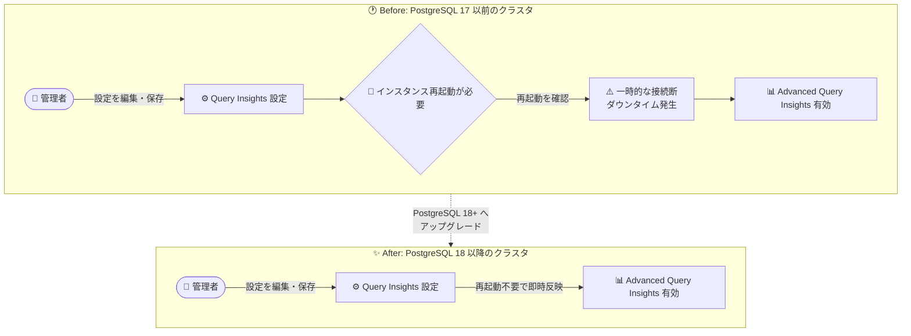

# AlloyDB for PostgreSQL: Advanced Query Insights 設定変更時のインスタンス再起動が不要に (PostgreSQL 18 以降)

**リリース日**: 2026-10-30

**サービス**: AlloyDB for PostgreSQL

**機能**: Advanced Query Insights 設定変更時の再起動不要化

**ステータス**: Fixed

📊 [このアップデートのインフォグラフィックを見る](https://takech9203.github.io/google-cloud-news-summary/20261030-alloydb-advanced-query-insights-no-restart.html)

## 概要

PostgreSQL 18 以降と互換性のある AlloyDB クラスタにおいて、Advanced Query Insights (高度なクエリインサイト) の設定を有効化・編集する際に、インスタンスの再起動が不要になりました。対象となる設定には、クエリ長 (query length) の変更やアクティブクエリ分析 (active query analysis) の有効化などが含まれます。

Advanced Query Insights は、標準の Query Insights に加えて、待機イベント分析、アクティブクエリ分析、クエリプランのサンプリング、インデックスアドバイザーなどの高度なクエリパフォーマンス診断機能を提供します。これまでは、これらの設定を変更して保存するとインスタンスの再起動が必要であり、可観測性の向上とサービス継続性の間でトレードオフが発生していました。今回の修正により、PostgreSQL 18 以降のクラスタではダウンタイムなしで可観測性機能を有効化・調整できるようになります。

なお、PostgreSQL 17 以前と互換性のあるクラスタでは、引き続き設定変更の保存時にインスタンスの再起動が必要です。

**アップデート前の課題**

- Advanced Query Insights を有効化、または設定 (クエリ長の変更、アクティブクエリ分析の有効化など) を編集して保存すると、インスタンスの再起動が必要だった
- 再起動に伴う接続断を避けるため、設定変更をメンテナンスウィンドウまで延期する運用が必要だった
- パフォーマンス問題の発生中に可観測性機能を有効化したくても、再起動による影響を考慮して躊躇するケースがあった

**アップデート後の改善**

- PostgreSQL 18 以降のクラスタでは、Advanced Query Insights の有効化・設定編集 (クエリ長の変更、アクティブクエリ分析の有効化を含む) が再起動なしで反映されるようになった
- サービス稼働中に、ダウンタイムを気にせず可観測性設定を調整できるようになった
- 障害調査の最中でも、アクティブクエリ分析などの診断機能を即座に有効化できるようになった

## アーキテクチャ図



PostgreSQL 17 以前のクラスタでは設定保存時に再起動 (接続断) が発生しますが、PostgreSQL 18 以降のクラスタでは設定が再起動なしで即時反映されます。

## サービスアップデートの詳細

### 主要機能

1. **再起動不要での Advanced Query Insights の有効化 (PostgreSQL 18 以降)**
   - Google Cloud コンソールの「クエリ分析情報 (Query insights)」から「Enable advanced query insights features for AlloyDB」を選択して保存しても、再起動は不要
   - 有効化時のデフォルト動作として、待機イベント分析とアクティブクエリ分析がオンになり、クエリ長が 4500 バイトから 100000 バイトに引き上げられる

2. **再起動不要でのクエリ長の変更 (PostgreSQL 18 以降)**
   - コンソールではクエリ長を 256 バイトから最大 100 KB まで変更可能 (gcloud では 1024〜100000 バイト、デフォルト 10240 バイト)
   - 従来はクエリ長の変更に再起動が必要だったが、PostgreSQL 18 以降では不要に

3. **再起動不要でのアクティブクエリ分析の有効化 (PostgreSQL 18 以降)**
   - アクティブクエリ分析を有効にすると、実行中のクエリをトランザクション開始時刻順に Query Insights ページで監視可能
   - 実行時間の長い上位 50 件のトランザクションの表示や、クエリ・トランザクションの終了 (terminate) 操作に対応

## 技術仕様

### PostgreSQL バージョン別の再起動要否

| 設定操作 | PostgreSQL 17 以前 | PostgreSQL 18 以降 |
|------|------|------|
| Advanced Query Insights の有効化 | 再起動が必要 | 再起動不要 |
| クエリ長の変更 | 再起動が必要 | 再起動不要 |
| アクティブクエリ分析の有効化 | 再起動が必要 | 再起動不要 |

### 主な設定項目 (Advanced Query Insights)

| 項目 | 詳細 |
|------|------|
| 待機イベント分析 | クエリ実行時の遅延要因 (待機イベント) を分析 |
| アクティブクエリ分析 | 実行中のクエリを追跡・監視 |
| クエリ長 | コンソール: 256 バイト〜100 KB / gcloud: 1024〜100000 バイト (デフォルト 10240 バイト) |
| クエリプランサンプリング | デフォルト 20 件/分、最大 200 件/分まで設定可能 |
| インデックスアドバイザー | インデックス作成の推奨事項を表示 |
| クエリコメント・アプリケーションタグの保存 | クエリのコンテキストや呼び出し元 API/ルートの把握に利用 |

### 必要な IAM ロール

| 操作 | 必要なロール / 権限 |
|------|------|
| Query Insights ダッシュボードの閲覧 | `roles/viewer` または `roles/databaseinsights.viewer` |
| Advanced Query Insights 設定の編集 | AlloyDB インスタンスの更新権限 |
| アクティブクエリの閲覧 | `roles/databaseinsights.monitoringViewer` または `databaseinsights.activeQueries.fetch` 権限 |
| クエリ / トランザクションの終了 | `roles/databaseinsights.operationsAdmin` |

## 設定方法

### 前提条件

1. Google Cloud プロジェクトで AlloyDB for PostgreSQL へのアクセスが有効であること
2. 再起動不要の恩恵を受けるには、クラスタが PostgreSQL 18 以降と互換性があること
3. 設定編集に必要な IAM 権限 (AlloyDB インスタンスの更新権限) を持っていること

### 手順

#### ステップ 1: コンソールから Advanced Query Insights を有効化

1. Google Cloud コンソールで「クラスタ」ページに移動
2. インスタンスを選択し、「Query insights」をクリック
3. 「Enable」または「Edit settings」をクリック
4. 「Enable advanced query insights features for AlloyDB」チェックボックスを選択し、必要に応じて「Active query analysis」やクエリ長を設定
5. 変更を保存 (PostgreSQL 18 以降は再起動不要。PostgreSQL 17 以前では「Confirm and restart」の確認が表示される)

#### ステップ 2: gcloud CLI で設定する場合

```bash
gcloud alloydb instances update INSTANCE \
  --cluster=CLUSTER \
  --project=PROJECT \
  --region=REGION \
  --observability-config-enabled \
  --observability-config-track-active-queries \
  --observability-config-max-query-string-length=QUERY_LENGTH
```

`--observability-config-enabled` で Advanced Query Insights を有効化し、`--observability-config-track-active-queries` でアクティブクエリの追跡を有効化します。`QUERY_LENGTH` は 1024〜100000 バイトの範囲で指定します (デフォルト 10240 バイト)。

#### ステップ 3: Terraform で設定する場合

```hcl
observability_config {
  enabled = true
}
```

Terraform では `observability_config` ブロックの `enabled` フィールドを `true` に設定します。

## メリット

### ビジネス面

- **ダウンタイムの排除**: PostgreSQL 18 以降では可観測性設定の変更にメンテナンスウィンドウの調整が不要になり、運用負荷が低減する
- **迅速なトラブルシューティング**: 本番環境で問題が発生した際、再起動の影響を懸念することなく診断機能を即座に有効化できる

### 技術面

- **可観測性の段階的な調整**: クエリ長やアクティブクエリ分析などの設定を、稼働中のワークロードに影響を与えずに試行・調整できる
- **アクティブクエリ監視の即時利用**: 有効化後すぐに、実行時間の長い上位 50 件のトランザクションの監視や接続の終了操作が可能

## デメリット・制約事項

### 制限事項

- PostgreSQL 17 以前と互換性のあるクラスタでは、引き続き設定変更の保存時にインスタンスの再起動が必要
- アクティブクエリの表示は、実行中のクエリが多い場合、データ収集のメモリ上限により一部のみ表示されることがある

### 考慮すべき点

- クエリ長を長くするとより多くのメモリが必要になる
- クエリプランのサンプリングレートを上げるとデータポイントは増えるが、パフォーマンスに悪影響を与える可能性がある
- Advanced Query Insights 有効化によるデータ保存量の増加は、追加料金が発生する可能性がある
- クエリコメントの保存を有効にする場合、コメントに機密情報が含まれるならユーザーアクセスに注意が必要

## ユースケース

### ユースケース 1: 本番障害発生中のアクティブクエリ分析の即時有効化

**シナリオ**: 本番の AlloyDB (PostgreSQL 18) でレイテンシの急上昇が発生。原因特定のためにアクティブクエリ分析を有効化したいが、従来は再起動が必要なため躊躇していた。

**実装例**:
```bash
gcloud alloydb instances update prod-instance \
  --cluster=prod-cluster \
  --project=my-project \
  --region=us-central1 \
  --observability-config-enabled \
  --observability-config-track-active-queries
```

**効果**: 再起動なしで即座にアクティブクエリ分析が有効になり、実行時間の長いトランザクションを特定して、必要に応じて問題のある接続を終了できる。

### ユースケース 2: 分析ワークロード向けのクエリ長の拡大

**シナリオ**: 長大な分析クエリを実行する環境で、デフォルトのクエリ長では SQL 全文が確認できない。PostgreSQL 18 のクラスタでクエリ長を 100 KB に拡大したい。

**効果**: 再起動によるサービス影響なしにクエリ長を変更でき、長い分析クエリの全文とクエリプランを確認して性能問題の根本原因を特定できる。

## 料金

本アップデート (再起動不要化) 自体に追加料金はありません。ただし、Advanced Query Insights の有効化によりデータ保存量が増加した場合、追加料金が発生する可能性があります。詳細は料金ページを参照してください。

- [AlloyDB for PostgreSQL の料金](https://cloud.google.com/alloydb/pricing)

## 利用可能リージョン

本アップデートはクラスタの互換性バージョン (PostgreSQL 18 以降) に基づく動作変更であり、リージョン固有の情報はリリースノートに記載されていません。AlloyDB の提供リージョンは[公式ドキュメント](https://docs.cloud.google.com/alloydb/docs/locations)を参照してください。

## 関連サービス・機能

- **Query Insights (標準)**: Advanced Query Insights は標準の Query Insights のすべての機能に加え、高度な診断機能を提供する
- **インデックスアドバイザー**: Advanced Query Insights の設定からインデックス作成の推奨事項を有効化できる
- **Gemini Cloud Assist**: AlloyDB リソースのモニタリングとトラブルシューティングを AI がアシストする機能と組み合わせて利用できる
- **Sqlcommenter**: ORM を自動インストルメント化し、性能問題の原因となるアプリケーションコードの特定を支援するオープンソースライブラリ

## 参考リンク

- 📊 [インフォグラフィック](https://takech9203.github.io/google-cloud-news-summary/20261030-alloydb-advanced-query-insights-no-restart.html)
- [公式リリースノート (2026 年 10 月 30 日)](https://docs.cloud.google.com/release-notes#October_30_2026)
- [Use Advanced Query Insights (公式ドキュメント)](https://docs.cloud.google.com/alloydb/docs/using-advanced-query-insights)
- [Monitor active queries (公式ドキュメント)](https://docs.cloud.google.com/alloydb/docs/monitor-active-queries)
- [Advanced Query Insights の概要](https://docs.cloud.google.com/alloydb/docs/advanced-query-insights-overview)
- [料金ページ](https://cloud.google.com/alloydb/pricing)

## まとめ

PostgreSQL 18 以降の AlloyDB クラスタでは、Advanced Query Insights の有効化や設定変更が再起動なしで反映されるようになり、可観測性とサービス継続性のトレードオフが解消されました。PostgreSQL 17 以前のクラスタでは依然として再起動が必要なため、この恩恵を受けたい場合は PostgreSQL 18 以降への移行を検討してください。まずは非本番環境で Advanced Query Insights を有効化し、アクティブクエリ分析や待機イベント分析の活用を試すことを推奨します。

---

**タグ**: AlloyDB, PostgreSQL, Query Insights, Observability, Database, Monitoring, Fixed
