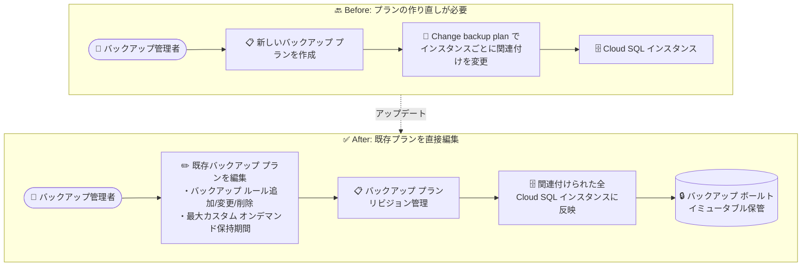

# Backup and DR: Cloud SQL インスタンス向けバックアップ プランの編集機能

**リリース日**: 2026-10-30

**サービス**: Backup and DR Service

**機能**: Cloud SQL インスタンス用バックアップ プランの編集 (バックアップ ルール / 最大カスタム オンデマンド保持期間の更新)

**ステータス**: Feature (GA)

📊 [このアップデートのインフォグラフィックを見る](https://takech9203.github.io/google-cloud-news-summary/20261030-backup-dr-cloud-sql-backup-plan-editing.html)

## 概要

Google Cloud Backup and DR Service で、Cloud SQL インスタンスに適用している既存のバックアップ プランを直接編集できるようになりました。バックアップ ルール (スケジュール、保持期間、バックアップ ウィンドウ) の追加・変更・削除や、最大カスタム オンデマンド保持期間 (maximum custom on-demand retention) の更新を、プランを作り直すことなく実行できます。

Backup and DR のバックアップ ボールト (backup vault) を使った Cloud SQL の拡張バックアップ (enhanced backups) では、イミュータブルかつ削除不可能なバックアップを一元管理できますが、これまで Cloud SQL 向けのバックアップ プランは設定を変更したい場合に柔軟性が不足していました。今回のアップデートにより、バックアップ運用ポリシーの変更 (保持期間の延長、バックアップ頻度の見直しなど) を既存プランへの編集として適用できるようになり、複数プロジェクトにまたがる多数の Cloud SQL インスタンスのバックアップ ガバナンスが大幅に簡素化されます。

対象ユーザーは、Cloud SQL (MySQL / PostgreSQL / SQL Server) の拡張バックアップをバックアップ ボールトで運用しているデータベース管理者、およびバックアップ ポリシーを集中管理するバックアップ管理者です。

**アップデート前の課題**

- Cloud SQL インスタンスに適用済みのバックアップ プランの設定 (バックアップ ルールや最大カスタム オンデマンド保持期間) を直接変更できず、設定を変えるには新しいバックアップ プランを作成して関連付けを切り替える (Change backup plan) 必要があった
- プランの切り替えには「同じバックアップ ボールト内」「Cloud SQL インスタンスと同じリージョン」という制約があり、プランが増えるほど管理が煩雑になった
- 最大カスタム オンデマンド保持期間の設定は、従来は Compute Engine インスタンスとディスクのワークロードを中心にサポートされており、Cloud SQL ワークロードでの柔軟な調整が制限されていた

**アップデート後の改善**

- 既存のバックアップ プランを編集して、バックアップ ルールの追加・変更・削除ができるようになった (プランの作り直しが不要)
- 最大カスタム オンデマンド保持期間を既存プランに対して更新できるようになり、オンデマンド バックアップの保持ポリシーを後から調整できるようになった
- プランの編集は関連付けられたすべての Cloud SQL インスタンスに反映されるため、多数のインスタンスのポリシー変更を 1 回の操作で完結できるようになった

## アーキテクチャ図



従来は設定変更のたびに新しいプランを作成して関連付けを切り替える必要がありましたが、今回のアップデートで既存プランの直接編集が可能になり、変更は関連付けられたすべての Cloud SQL インスタンスに反映されます。

## サービスアップデートの詳細

### 主要機能

1. **バックアップ ルールの編集**
   - 既存プランに対して、バックアップ ルールの追加 (Add Rule)、既存ルールの変更、ルールの削除が可能
   - ルールごとに名前、繰り返し頻度 (hourly / daily / weekly / monthly / yearly)、バックアップ ウィンドウ (タイムゾーン、開始・終了時刻)、保持期間 (日数) を設定
   - 保持期間はバックアップ ボールトの最小強制保持期間 (minimum enforced retention) 以上である必要がある

2. **最大カスタム オンデマンド保持期間の更新**
   - カスタム オンデマンド バックアップの保持期間の上限を既存プランで変更可能
   - 未指定の場合のデフォルトは「ボールトの最小強制保持期間 + 30 日」
   - 設定可能な最大値は 3,653 日 (10 年)

3. **プランの説明 (description) の編集とリビジョン管理**
   - バックアップ プランの説明文を更新可能
   - 編集履歴は gcloud CLI の `backup-plan-revisions list` でリビジョンとして確認可能
   - プラン更新ジョブは Google Cloud コンソールのシステム ジョブとして監視可能

## 技術仕様

### バックアップ プラン編集のパラメータ

| 項目 | 詳細 |
|------|------|
| 編集可能な項目 | 説明、バックアップ ルール (追加 / 変更 / 削除)、最大カスタム オンデマンド保持期間 |
| 繰り返し頻度 | hourly (最短 6 時間間隔)、daily、weekly、monthly、yearly |
| 保持期間の下限 | バックアップ ボールトの最小強制保持期間以上 |
| オンデマンド保持の上限 | 最大 3,653 日 (10 年)。未指定時はボールトの最小強制保持期間 + 30 日 |
| 編集手段 | Google Cloud コンソール (Backup plans ページ)、gcloud CLI |
| 対象ワークロード | Cloud SQL (MySQL / PostgreSQL / SQL Server)。Compute Engine インスタンス / ディスクは対応済み |

### gcloud CLI によるバックアップ プランの更新

```bash
gcloud backup-dr backup-plans update BACKUP_PLAN_NAME \
  --project=PROJECT_ID \
  --location=REGION \
  --description=DESCRIPTION \
  --backup-rule=BACKUP_RULE \
  --add-backup-rule=ADD_BACKUP_RULE \
  --remove-backup-rule=REMOVE_BACKUP_RULE \
  --max-custom-on-demand-retention-days=MAX_ONDEMAND_RETENTION
```

バックアップ ルールの定義例 (6 時間ごとのバックアップを 30 日間保持、10:00〜20:00 UTC のウィンドウで実行):

```text
rule-id=sample-hourly-rule,retention-days=30,recurrence=HOURLY,hourly-frequency=6,time-zone=UTC,backup-window-start=10,backup-window-end=20
```

複数ルールを YAML / JSON ファイルで一括上書きすることも可能です (`--backup-rules-from-file`。`--add-backup-rule` 等とは排他)。

```yaml
backup-rules:
  - rule-id: weekly-rule
    retention-days: 7
    recurrence: WEEKLY
    backup-window-start: 0
    backup-window-end: 23
    days-of-week: [MONDAY, TUESDAY]
    time-zone: UTC
  - rule-id: daily-rule
    retention-days: 1
    recurrence: DAILY
    backup-window-start: 1
    backup-window-end: 24
    time-zone: UTC
```

## 設定方法

### 前提条件

1. Backup and DR Service のバックアップ ボールトとバックアップ プランが作成済みであること (プランとボールトは同一プロジェクトに存在する必要がある)
2. Cloud SQL インスタンスが拡張バックアップ (Enhanced backup tier) でバックアップ プランに関連付けられていること
3. バックアップ プランを管理する Backup and DR Admin 相当の権限があること

### 手順

#### ステップ 1: コンソールでバックアップ プランを編集

1. Google Cloud コンソールで **Backup and DR** の **Backup plans** ページに移動
2. 編集するバックアップ プランを選択し、**Edit** をクリック
3. 必要に応じて以下を変更:
   - **Backup plan description**: プランの説明
   - **Add Rule**: 新しいバックアップ ルールを追加 (名前、繰り返し、ウィンドウ、保持期間)
   - 既存ルール行末のアイコンからルールの編集・削除
   - **Maximum retention**: 最大カスタム オンデマンド保持期間 (日数)
4. **Save Changes** をクリック

#### ステップ 2: gcloud CLI でルールを追加・削除する例

```bash
# バックアップ ルールを追加
gcloud backup-dr backup-plans update sample-backup-plan \
  --project=sample-project --location=us-central1 \
  --add-backup-rule=rule-id=sample-daily-rule,retention-days=7,recurrence=DAILY,backup-window-start=1,backup-window-end=14

# バックアップ ルールを削除
gcloud backup-dr backup-plans update sample-backup-plan \
  --project=sample-project --location=us-central1 \
  --remove-backup-rule=sample-daily-rule
```

#### ステップ 3: 編集履歴 (リビジョン) の確認

```bash
gcloud alpha backup-dr backup-plan-revisions list \
  --backup-plan=sample-backup-plan --location=us-central1
```

プランの編集はリビジョンとして記録され、監査やトラブルシューティングに利用できます。

## メリット

### ビジネス面

- **運用コストの削減**: バックアップ ポリシー変更のたびにプランを作り直してインスタンスごとに付け替える作業が不要になり、運用工数を削減できる
- **ガバナンスの強化**: コンプライアンス要件の変更 (保持期間の延長など) を既存プランの編集 1 回で全対象インスタンスに展開でき、ポリシーの一貫性を維持しやすい
- **変更の追跡性**: プランのリビジョン管理により、いつどのような設定変更が行われたかを監査できる

### 技術面

- **プラン数の抑制**: 設定変更用の派生プランを量産する必要がなくなり、バックアップ プランの構成がシンプルに保てる
- **柔軟な保持ポリシー**: 最大カスタム オンデマンド保持期間を後から調整でき、オンデマンド バックアップの運用 (最大 10 年保持) に柔軟に対応できる
- **CLI / コンソール両対応**: gcloud CLI でのルール追加・削除・一括上書き (YAML/JSON) により、IaC や自動化パイプラインへの組み込みが容易

## デメリット・制約事項

### 制限事項

- バックアップ ルールの保持期間は、バックアップ ボールトの最小強制保持期間以上に設定する必要がある
- 最大カスタム オンデマンド保持期間の上限は 3,653 日 (10 年)
- Cloud SQL インスタンスが関連付けられるバックアップ ボールトは、最小強制保持期間が 10 年 (3,653 日) 以下のものに限られる
- バックアップ プランのリビジョン確認は gcloud CLI のみで可能 (コンソール非対応)

### 考慮すべき点

- プランの編集は関連付けられたすべてのインスタンスに影響するため、変更前に対象インスタンスの範囲を確認する必要がある
- 保持期間を延長するとバックアップ ボールトの保存容量が増加し、ストレージ コストが増える可能性がある
- 30 日間の無料トライアル参加中の場合、トライアル終了後も保持されるバックアップには課金が発生する
- プランの編集ではなく「別プランへの切り替え」を行う場合は、従来どおり同一ボールト内・同一リージョンのプランである必要がある

## ユースケース

### ユースケース 1: コンプライアンス要件変更に伴う保持期間の一括延長

**シナリオ**: 金融系システムで監査要件が変更され、Cloud SQL (PostgreSQL) の日次バックアップ保持期間を 30 日から 90 日に延長する必要がある。対象インスタンスは複数プロジェクトに 50 台存在し、すべて同一のバックアップ プランに関連付けられている。

**実装例**:
```bash
gcloud backup-dr backup-plans update finance-sql-plan \
  --project=central-backup-project --location=asia-northeast1 \
  --backup-rule=rule-id=daily-rule,retention-days=90,recurrence=DAILY,backup-window-start=1,backup-window-end=6,time-zone=Asia/Tokyo
```

**効果**: 既存プランの編集 1 回で全 50 インスタンスの保持ポリシーが更新され、新プラン作成とインスタンスごとの付け替え作業 (従来方式) が不要になる。

### ユースケース 2: リリース前の長期保持オンデマンド バックアップの許可

**シナリオ**: 大規模なスキーマ変更のリリース前に、ロールバック用として通常より長い保持期間 (180 日) のオンデマンド バックアップを取得したいが、現在のプランの最大カスタム オンデマンド保持期間がデフォルト (ボールト最小強制保持 + 30 日) のままで不足している。

**効果**: 既存プランの最大カスタム オンデマンド保持期間を 180 日に引き上げるだけで、プランを作り直さずに長期保持のオンデマンド バックアップが取得可能になる。

## 料金

バックアップ プランの編集機能自体に追加料金はありません。Cloud SQL の拡張バックアップでは、バックアップ ボールトに保存されたバックアップの合計サイズに基づいて Backup and DR の料金が課金されます。保持期間を延長すると保存されるバックアップ データ量が増加するため、コストへの影響を考慮してください。

詳細は [Backup and DR の料金ページ](https://cloud.google.com/backup-disaster-recovery/pricing) を参照してください。

## 利用可能リージョン

バックアップ プランは Backup and DR がサポートするリージョンで更新できます。バックアップ ボールトと Cloud SQL インスタンスのロケーション互換性については、[バックアップ ボールトのサポート ロケーション](https://docs.cloud.google.com/backup-disaster-recovery/docs/concepts/backup-vault) を参照してください。

## 関連サービス・機能

- **Cloud SQL (MySQL / PostgreSQL / SQL Server)**: 本アップデートの対象ワークロード。拡張バックアップ (Enhanced backup tier) でバックアップ プランと関連付ける
- **バックアップ ボールト (Backup Vault)**: バックアップの保存先となる Google 管理のセキュアで分離されたストレージ。イミュータブルかつ削除不可能なバックアップを提供し、最小強制保持期間を定義する
- **Compute Engine**: バックアップ プラン編集 (最大カスタム オンデマンド保持期間を含む) をすでにサポートしているワークロード。インスタンスとディスクのバックアップに対応
- **Cloud Monitoring / システム ジョブ**: バックアップ プラン更新ジョブはコンソールのシステム ジョブとして監視可能

## 参考リンク

- 📊 [インフォグラフィック](https://takech9203.github.io/google-cloud-news-summary/20261030-backup-dr-cloud-sql-backup-plan-editing.html)
- [公式リリースノート](https://cloud.google.com/release-notes#October_30_2026)
- [ドキュメント: Back up Cloud SQL instances to a backup vault](https://docs.cloud.google.com/backup-disaster-recovery/docs/cloud-console/sql/csql-backup)
- [ドキュメント: Edit a backup plan for vaulted backups](https://docs.cloud.google.com/backup-disaster-recovery/docs/cloud-console/backup-plan-edit)
- [ドキュメント: Cloud SQL backup options (Enhanced backups)](https://docs.cloud.google.com/sql/docs/mysql/backup-recovery/backup-options)
- [料金ページ](https://cloud.google.com/backup-disaster-recovery/pricing)

## まとめ

Cloud SQL インスタンス向けバックアップ プランの編集機能により、バックアップ ルールや最大カスタム オンデマンド保持期間の変更が既存プランへの操作 1 回で完結するようになり、プラン作り直しと付け替えの運用負担が解消されました。バックアップ ボールトで Cloud SQL の拡張バックアップを運用しているチームは、保持ポリシーの見直しプロセスを本機能ベースに更新し、プランのリビジョン管理を監査フローに組み込むことを推奨します。

---

**タグ**: Backup and DR, Cloud SQL, バックアップ プラン, バックアップ ボールト, 拡張バックアップ, データ保護, Feature
