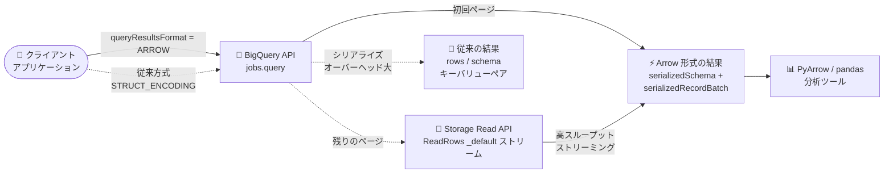

# BigQuery: Apache Arrow 形式でのクエリ結果取得 (Preview)

**リリース日**: 2026-10-30

**サービス**: BigQuery

**機能**: Apache Arrow 形式でのクエリ結果取得

**ステータス**: Preview

📊 [このアップデートのインフォグラフィックを見る](https://takech9203.github.io/google-cloud-news-summary/20261030-bigquery-apache-arrow-query-results.html)

## 概要

BigQuery のクエリ結果を Apache Arrow 形式で直接取得できる機能が Preview として発表されました。従来のキーバリューペアエンコーディング (`STRUCT_ENCODING`) と比較して、シリアライズ効率と取得速度が向上します。

この機能は 2 つの方法で利用できます。1 つは `jobs.query` メソッドの実行時に `queryResultsFormat` プロパティを `ARROW` に設定する方法、もう 1 つは BigQuery Storage Read API の `ReadRows` メソッドでクエリジョブの特別な `_default` ストリームから結果を直接ストリーミングする方法です。

Apache Arrow は列指向のインメモリデータフォーマットで、pandas や PyArrow などのデータ分析ツールと親和性が高く、大量のクエリ結果を分析基盤やアプリケーションに高速に取り込みたいデータエンジニアやデータサイエンティストにとって有用なアップデートです。

**アップデート前の課題**

- `jobs.query` のクエリ結果はキーバリューペアエンコーディング (`STRUCT_ENCODING`) で返却され、シリアライズ / デシリアライズのオーバーヘッドが大きかった
- Arrow 形式でデータを取得するには、Storage Read API で読み取りセッション (ReadSession) を作成してテーブルを読む必要があり、クエリジョブの結果を直接 Arrow で受け取る手段がなかった

**アップデート後の改善**

- `jobs.query` の `queryResultsFormat` を `ARROW` に設定するだけで、クエリ結果を IPC シリアライズされた Arrow スキーマ / RecordBatch として直接取得できるようになった
- クエリジョブの `_default` ストリームに対して Storage Read API の `ReadRows` を呼び出すことで、読み取りセッションを作成せずにクエリ結果を高スループットでストリーミングできるようになった
- `arrowSerializationOptions` で Arrow バッファの圧縮コーデック (`LZ4_FRAME` / `ZSTD`) を指定できるようになった

## アーキテクチャ図



`queryResultsFormat` を `ARROW` に設定すると、クエリ結果が Arrow 形式で返却されます。初回レスポンスに収まらない結果は、Storage Read API の `ReadRows` でジョブの `_default` ストリームからストリーミング取得します。

## サービスアップデートの詳細

### 主要機能

1. **jobs.query での Arrow サポート**
   - `QueryRequest` の `queryResultsFormat` プロパティを `ARROW` に設定すると、`QueryResponse` に IPC シリアライズされた Arrow スキーマ (`arrowSchema.serializedSchema`) と最初のページの RecordBatch (`arrowRecordBatch.serializedRecordBatch`) が返却される
   - 最初のページの行数は `pageRowCount` で返却される
   - `arrowSerializationOptions` オブジェクトの `bufferCompression` で圧縮コーデック (`COMPRESSION_UNSPECIFIED` / `LZ4_FRAME` / `ZSTD`) を指定可能

2. **ReadRows によるクエリ結果の直接ストリーミング**
   - クエリジョブの特別なストリーム `projects/{PROJECT_ID}/locations/{LOCATION}/jobs/{JOB_ID}/streams/_default` に対して Storage Read API の `ReadRows` を呼び出すことで、任意のクエリジョブの結果を直接ストリーミングできる
   - ジョブの `_default` ストリームの出力は、ジョブ作成時に Arrow 形式を明示的に指定したかどうかにかかわらず、常に Arrow 形式がデフォルトになる
   - クエリジョブが実行中の場合、Storage Read API はジョブの完了を自動的に待機してから結果をストリーミングする
   - `ReadRowsResponse` の `total_estimated_row_count` にクエリ結果の推定行数が設定される

3. **クライアントライブラリとの統合**
   - Python クライアントライブラリでは `query_and_wait()` に `query_results_format=enums.QueryResultsFormat.ARROW` と `compression_codec` を指定し、`to_arrow_iterable()` で `pyarrow.RecordBatch` のイテラブルとして結果を取得できる

## 技術仕様

### jobs.query で Arrow 形式を使用した場合の動作

| 項目 | 詳細 |
|------|------|
| リクエスト設定 | `QueryRequest.queryResultsFormat` を `ARROW` に設定 |
| 圧縮オプション | `arrowSerializationOptions.bufferCompression`: `COMPRESSION_UNSPECIFIED` / `LZ4_FRAME` / `ZSTD` |
| レスポンス (スキーマ) | `arrowSchema.serializedSchema` (IPC シリアライズされた Arrow スキーマ) |
| レスポンス (データ) | `arrowRecordBatch.serializedRecordBatch` (最初のページの IPC シリアライズされた RecordBatch) |
| レスポンス (行数) | `pageRowCount` (最初のページで返却された行数) |
| 標準フィールド | 従来の `rows` / `schema` フィールドは設定されない |
| 初回レスポンス | 結果が初回レスポンスに収まらない場合、空のシリアライズ済み Arrow データが返る場合がある |
| 後続ページの取得 | `jobs.getQueryResults` は Arrow 形式に非対応。残りの結果は Storage Read API の `ReadRows` でジョブの `_default` ストリームからストリーミングする |

### ReadRows の _default ストリーム名の形式

```
projects/PROJECT_ID/locations/LOCATION/jobs/JOB_ID/streams/_default
```

- `PROJECT_ID`: クエリジョブを実行したプロジェクト ID
- `LOCATION`: クエリジョブを実行したロケーション (例: `us`、`us-central1`)
- `JOB_ID`: BigQuery クエリジョブの ID

`ReadRowsRequest` の `arrow_serialization_options` フィールドで、圧縮などの Arrow シリアライズオプションをオーバーライドできます (ジョブの `_default` ストリームでサポート)。

## 設定方法

### 前提条件

1. BigQuery API を有効化したプロジェクト
2. クライアントライブラリ使用時は Application Default Credentials による認証設定

### 手順

#### ステップ 1: Python クライアントライブラリで Arrow 形式を指定してクエリを実行

```python
from typing import Iterable
import pyarrow
from google.cloud.bigquery import enums
from google.cloud import bigquery

def query_and_wait_arrow() -> Iterable[pyarrow.RecordBatch]:
    client = bigquery.Client()
    query = """
        SELECT name, number, state
        FROM `bigquery-public-data.usa_names.usa_1910_current`
        LIMIT 100000
    """
    # Arrow 形式 (LZ4_FRAME 圧縮) で結果を直接取得
    results = client.query_and_wait(
        query,
        query_results_format=enums.QueryResultsFormat.ARROW,
        compression_codec=enums.QueryResultsCompressionCodec.LZ4_FRAME,
    )
    # pyarrow.RecordBatch のイテラブルとして返却
    return results.to_arrow_iterable()
```

公式ドキュメントに掲載されている Python のサンプルです。`to_arrow_iterable()` で各バッチを Apache Arrow 形式のまま処理できます。

#### ステップ 2: REST API で直接指定する場合

```json
{
  "query": "SELECT name, number, state FROM `bigquery-public-data.usa_names.usa_1910_current` LIMIT 100000",
  "useLegacySql": false,
  "queryResultsFormat": "ARROW",
  "arrowSerializationOptions": {
    "bufferCompression": "LZ4_FRAME"
  }
}
```

`jobs.query` のリクエストボディに `queryResultsFormat` と `arrowSerializationOptions` を指定します。レスポンスの `jobComplete` が `true` の場合、`arrowSchema.serializedSchema` と `arrowRecordBatch.serializedRecordBatch` から結果を読み取ります。

## メリット

### ビジネス面

- **データ取得の高速化**: 従来のキーバリューペアエンコーディングと比較して取得速度が向上し、分析結果の提供までの時間を短縮できる
- **既存エコシステムの活用**: Apache Arrow は pandas / PyArrow などの主要なデータ分析ツールが対応する標準的なフォーマットであり、追加の変換コストなしに分析パイプラインへ組み込める

### 技術面

- **シリアライズ効率の向上**: 列指向の Arrow 形式により、`STRUCT_ENCODING` と比較してシリアライズ / デシリアライズのオーバーヘッドが削減される
- **読み取りセッション不要のストリーミング**: ジョブの `_default` ストリームを使うことで、ReadSession を作成せずにクエリ結果を高スループットでストリーミングできる
- **圧縮コーデックの選択**: `LZ4_FRAME` / `ZSTD` の圧縮を指定でき、ネットワーク転送量を削減できる
- **ジョブ完了の自動待機**: ジョブ実行中に `ReadRows` を呼び出した場合も、Storage Read API が完了を自動で待機するためポーリング処理が不要

## デメリット・制約事項

### 制限事項

- Preview 段階の機能であり、Pre-GA Offerings Terms が適用される (サポートが限定される場合がある)
- `jobs.getQueryResults` メソッドは Arrow 形式に対応していない。初回レスポンスに含まれない残りの結果は Storage Read API の `ReadRows` でストリーミングする必要がある
- `queryResultsFormat` を `ARROW` に設定した場合、`QueryResponse` の標準の `rows` / `schema` フィールドは設定されない
- 結果が初回レスポンスに収まらない場合、最初のページで空のシリアライズ済み Arrow データが返ることがある

### 考慮すべき点

- 既存のコードが `QueryResponse` の `rows` / `schema` フィールドに依存している場合は、Arrow データの読み取り処理への変更が必要
- フィードバックやサポートのリクエストは専用メールアドレス (bq-arrow-support-in-query-results-preview@google.com) 宛てに送付する

## ユースケース

### ユースケース 1: pandas / PyArrow を使ったデータ分析パイプラインの高速化

**シナリオ**: データサイエンティストが BigQuery 上の大規模データセットに対してクエリを実行し、結果を pandas DataFrame に取り込んで機械学習の特徴量エンジニアリングを行う。

**実装例**:
```python
results = client.query_and_wait(
    query,
    query_results_format=enums.QueryResultsFormat.ARROW,
    compression_codec=enums.QueryResultsCompressionCodec.LZ4_FRAME,
)
for batch in results.to_arrow_iterable():
    df = batch.to_pandas()  # Arrow からゼロコピーに近い変換
    # 特徴量エンジニアリング処理
```

**効果**: JSON ベースの行データを DataFrame に変換するオーバーヘッドが削減され、大量データの取り込み時間を短縮できる。

### ユースケース 2: クエリ結果の高スループットストリーミング

**シナリオ**: アプリケーションがクエリジョブを発行し、数百万行の結果を下流の処理系へ転送する。

**効果**: ジョブの `_default` ストリーム (`.../jobs/{JOB_ID}/streams/_default`) に対して `ReadRows` を呼び出すだけで、ReadSession の作成なしに結果を Arrow 形式で高スループットにストリーミングできる。ジョブ実行中でも API が完了を自動待機するため、ポーリングロジックの実装が不要になる。

## 料金

この機能固有の料金情報はリリースノートおよびドキュメントに記載されていません。BigQuery のクエリ料金および Storage Read API の料金については、公式の料金ページを参照してください。

- [BigQuery の料金](https://cloud.google.com/bigquery/pricing)

## 関連サービス・機能

- **BigQuery Storage Read API**: ジョブの `_default` ストリームに対する `ReadRows` でクエリ結果を Arrow 形式のままストリーミングでき、本機能の後続ページ取得にも使用する
- **BigQuery クライアントライブラリ (Python など)**: `query_and_wait()` の `query_results_format` オプションを通じて本機能を利用でき、`to_arrow_iterable()` で PyArrow の RecordBatch として結果を扱える
- **Apache Arrow / PyArrow / pandas**: 列指向インメモリフォーマットとそのエコシステム。Arrow 形式の結果をそのまま分析処理に利用できる

## 参考リンク

- 📊 [インフォグラフィック](https://takech9203.github.io/google-cloud-news-summary/20261030-bigquery-apache-arrow-query-results.html)
- [公式リリースノート](https://docs.cloud.google.com/release-notes#October_30_2026)
- [ドキュメント: Return query results in the Arrow format](https://docs.cloud.google.com/bigquery/docs/running-queries#arrow-format)
- [ドキュメント: Stream query results in the Arrow format (Storage Read API)](https://docs.cloud.google.com/bigquery/docs/reference/storage#stream-query-results)
- [jobs.query API リファレンス](https://docs.cloud.google.com/bigquery/docs/reference/rest/v2/jobs/query)
- [料金ページ](https://cloud.google.com/bigquery/pricing)

## まとめ

BigQuery のクエリ結果を Apache Arrow 形式で直接取得できるようになり、pandas / PyArrow ベースの分析パイプラインへのデータ取り込みが高速化・効率化されます。大量のクエリ結果をアプリケーションや分析基盤へ転送しているワークロードでは、Preview 段階のうちに `queryResultsFormat=ARROW` と `ReadRows` による直接ストリーミングを検証し、取得速度と転送コストの改善効果を確認することを推奨します。

---

**タグ**: BigQuery, Apache Arrow, Storage Read API, クエリ結果, Preview, データ分析, PyArrow
