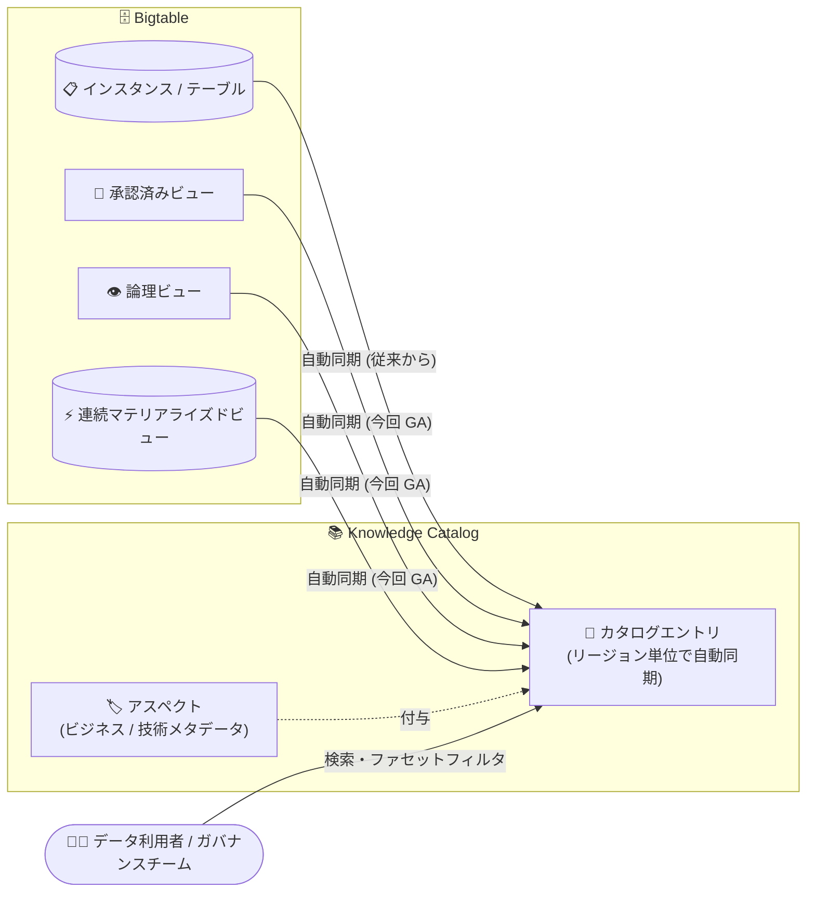

# Bigtable: Knowledge Catalog によるビュー (承認済み / 論理 / 連続マテリアライズド) の検出が GA

**リリース日**: 2026-10-30

**サービス**: Bigtable

**機能**: Knowledge Catalog によるビューの検出 (Authorized Views / Logical Views / Continuous Materialized Views)

**ステータス**: GA (一般提供)

📊 [このアップデートのインフォグラフィックを見る](https://takech9203.github.io/google-cloud-news-summary/20261030-bigtable-knowledge-catalog-views-ga.html)

## 概要

Bigtable と Knowledge Catalog (旧 Dataplex Universal Catalog) の統合が拡張され、**承認済みビュー (Authorized Views)、論理ビュー (Logical Views)、連続マテリアライズドビュー (Continuous Materialized Views) を Knowledge Catalog で検出できる機能が一般提供 (GA)** になりました。これにより、Bigtable のインスタンスやテーブルと並べて、より粒度の細かいデータアセットを横断的に検索できるようになります。

Knowledge Catalog はフルマネージドのメタデータ管理サービスで、技術メタデータとビジネスメタデータを統合的に閲覧・タグ付けできます。Bigtable のメタデータは Knowledge Catalog に自動的に同期されるため、ユーザーが個別にカタログ登録を行う必要はありません。今回の GA により、同期対象がインスタンス、クラスタ、テーブル (列ファミリーの詳細を含む) に加えて、3 種類のビューまで広がりました。

対象ユーザーは、組織内のデータアセットを一元的に把握したいデータガバナンスチーム、既存のビューを再利用して分析やアプリケーション開発を行いたいデータエンジニア・アナリストです。マルチテナント構成で承認済みビューを多数運用しているチームにとって、「どのビューが存在し、誰がアクセスできるのか」を可視化できる点が特に有用です。

**アップデート前の課題**

- Knowledge Catalog で検出できる Bigtable リソースはインスタンス、クラスタ、テーブルまでで、ビューは中央のカタログインベントリから検索できなかった
- 承認済みビューや論理ビューなどの粒度の細かいデータアセットの存在やアクセス状況を把握するには、Bigtable 側でインスタンスごとに個別に確認する必要があった
- ビューとテーブル・インスタンスの関係性 (どのテーブルから派生したビューか) をカタログ上で追跡できなかった

**アップデート後の改善**

- 承認済みビュー、論理ビュー、連続マテリアライズドビューを Knowledge Catalog の中央インベントリで検索・検出できるようになった
- どのビューが存在し、誰がアクセスできるかを可視化できるため、ガバナンスチームがポリシーやアクセス制御を適用しやすくなった
- 承認済みビューとテーブル、論理ビュー・連続マテリアライズドビューとインスタンスの関連をカタログ上で把握できるようになった
- ビューのエントリにアスペクト (カスタムのビジネス・技術メタデータ) を付与して、データエステート全体での発見性を高められるようになった

## アーキテクチャ図



Bigtable の各リソースのメタデータが Knowledge Catalog に自動同期され、今回の GA でインスタンス・テーブルに加えて 3 種類のビューも検索対象になりました。ビューのメタデータはインスタンスに割り当てられたリージョンに格納されます。

## サービスアップデートの詳細

### 主要機能

1. **3 種類のビューの自動カタログ化**
   - 承認済みビュー (Authorized Views)、論理ビュー (Logical Views)、連続マテリアライズドビュー (Continuous Materialized Views) のメタデータが Bigtable から Knowledge Catalog に自動同期される
   - 従来から同期対象だったインスタンス、クラスタ、テーブル (列ファミリーの詳細を含む) に加わる形で、カタログの網羅性が向上する

2. **検索述語 (predicate) によるビューの検索**
   - Knowledge Catalog の検索ページで、以下の述語を使ってビューを絞り込める
     - すべてのビュー: `VIEW`
     - 承認済みビュー: `type=cloud-bigtable-authorized-view`
     - 論理ビュー: `type=cloud-bigtable-logical-view`
     - 連続マテリアライズドビュー: `type=cloud-bigtable-materialized-view`
     - リージョンでの絞り込み: `location=us-central1` など
   - ファセット検索 (フィルタ適用) にも対応

3. **エントリ詳細でのシステムアスペクト表示**
   - ビューのエントリ詳細ページでは、概要情報に加えて SQL クエリ (論理ビュー / 連続マテリアライズドビュー) やスキーマ、サブセット定義 (承認済みビュー) などのシステムアスペクトを確認できる
   - カスタムアスペクトを付与してビジネスメタデータを追加し、組織内での発見性を高められる

## 技術仕様

### ビューメタデータのリージョン制約

| 項目 | 詳細 |
|------|------|
| カタログエントリの格納場所 | ビューはグローバルエントリを持たず、インスタンスに割り当てられたリージョン (`knowledgeCatalogRegion`) にのみ格納される |
| API アクセス時の location 指定 | Dataplex API / クライアントライブラリでビューのエントリを取得・管理する際は、リクエスト URL の location にインスタンスの Knowledge Catalog リージョンを指定する必要がある |
| `location=global` を指定した場合 | `NOT_FOUND` エラーが返る |
| リージョンの確認方法 | `gcloud bigtable instances describe` の出力に含まれる `knowledgeCatalogRegion` フィールドで確認 |

### カタログ化される Bigtable のビュー種別

| 種別 | 構造 | 定義方法 | 書き込み | 主な用途 |
|------|------|----------|----------|----------|
| 論理ビュー | SQL クエリ結果の仮想テーブル | SQL クエリ | 不可 | SQL によるデータ共有・再利用 |
| 連続マテリアライズドビュー | ソーステーブルと同期する読み取り専用テーブル | SQL クエリ | 不可 | 事前集計によるクエリ性能向上 |
| 承認済みビュー | テーブルのサブセット | JSON 定義ファイル | 可 | テナントごとのアクセス制御 |

## 設定方法

### 前提条件

1. Knowledge Catalog を初めて使う場合は Dataplex API を有効化する
2. Bigtable エントリにアクセスするプリンシパルに必要な IAM ロールを付与する (検索には Dataplex Catalog Viewer `roles/dataplex.catalogViewer` 以上のロールがリクエスト対象プロジェクトで必要)

### 手順

#### ステップ 1: インスタンスの Knowledge Catalog リージョンを確認する

```bash
gcloud bigtable instances describe INSTANCE_ID
```

出力に含まれる `knowledgeCatalogRegion` フィールド (例: `us-central1`) が、ビューのメタデータが格納されるリージョンです。Dataplex API でビューのエントリを扱う際はこの値を location に指定します。

```yaml
createTime: '2026-01-15T10:00:00.000000Z'
displayName: my-instance
edition: ENTERPRISE
knowledgeCatalogRegion: us-central1
name: projects/my-project/instances/my-instance
state: READY
type: PRODUCTION
```

#### ステップ 2: Knowledge Catalog でビューを検索する

1. Google Cloud コンソールで Knowledge Catalog の「検索」ページに移動する
2. 検索フィールドにビュー名・ID、または検索述語を入力する

```text
# 承認済みビューのみを検索
type=cloud-bigtable-authorized-view

# 特定リージョンの連続マテリアライズドビューを検索
type=cloud-bigtable-materialized-view location=us-central1
```

3. 検索結果からビュー名をクリックすると、エントリ詳細ページで SQL クエリ、スキーマ、サブセット定義などの属性を確認できます

## メリット

### ビジネス面

- **ガバナンスの強化**: どのビューが存在し誰がアクセスできるかを可視化できるため、ガバナンスチームがポリシーとアクセス制御を組織的に適用できる
- **データの再利用促進**: 既存のビューを中央インベントリから発見できるため、重複したビューの作成を避け、分析やアプリケーション開発での再利用が進む

### 技術面

- **自動同期によるカタログ鮮度の維持**: メタデータは Bigtable から Knowledge Catalog に自動同期されるため、手動でのカタログ登録・更新作業が不要
- **関係性の把握**: 承認済みビューとテーブル、論理ビュー・連続マテリアライズドビューとインスタンスのつながりをカタログ上で確認でき、データリネージ的なコンテキストが得られる
- **アスペクトによるメタデータ拡充**: カスタムのビジネス・技術メタデータをエントリに付与でき、ターゲットを絞った検索が可能になる

## デメリット・制約事項

### 制限事項

- ビューはグローバルカタログエントリを持たない。メタデータはインスタンスに割り当てられたリージョンにのみ格納されるため、API からのアクセス時は location にそのリージョンを指定する必要がある (`global` を指定すると `NOT_FOUND`)
- データアスペクトの内容を閲覧するには、エントリの閲覧権限に加えて、ソースアセットのデータ読み取り権限が必要 (権限がない場合、アスペクトの内容は非表示になる)

### 考慮すべき点

- Knowledge Catalog の検索 (`SearchEntries`) を実行するには、リクエストに使用するプロジェクトで Dataplex Catalog Admin / Editor / Viewer のいずれかのロールが必要
- Dataplex API には検索リクエストのクォータ (例: プロジェクトあたり毎分 1,200 件、組織あたり毎分 2,400 件) があるため、プログラムから大量に検索する場合は考慮が必要

## ユースケース

### ユースケース 1: マルチテナント環境での承認済みビューの棚卸し

**シナリオ**: SaaS 事業者が 1 つの Bigtable テーブルに複数顧客のデータを格納し、顧客ごとに承認済みビューでアクセスを分離している。ビューの数が増え、どの顧客向けにどのビューが存在するか把握しづらくなっている。

**実装例**:
```text
# Knowledge Catalog 検索で承認済みビューを一覧化
type=cloud-bigtable-authorized-view

# エントリ詳細でサブセット定義 (JSON) を確認し、
# カスタムアスペクトで「担当チーム」「顧客名」などを付与
```

**効果**: 承認済みビューの全体像を中央インベントリで把握でき、ガバナンスチームが不要なビューの削除やアクセス制御の見直しを計画的に実施できる。

### ユースケース 2: 分析チームによる既存ビューの発見と再利用

**シナリオ**: 分析チームが時系列データの集計クエリを作ろうとしているが、他チームがすでに同様の連続マテリアライズドビューを作成している可能性がある。

**効果**: Knowledge Catalog で `type=cloud-bigtable-materialized-view` を検索し、エントリ詳細で SQL クエリとスキーマを確認することで、既存ビューの再利用判断が即座にでき、重複するビューの作成 (= 追加のストレージ・処理コスト) を回避できる。

## 料金

Bigtable メタデータの Knowledge Catalog への自動同期そのものに追加の設定は不要です。Knowledge Catalog はメタデータストレージと API 呼び出しに対して従量課金が発生します。コンソールでの検索クエリと Search API 呼び出し、カタログメタモデルリソース (エントリ、エントリグループなど) の作成・管理は無料です。

### 料金例 (Knowledge Catalog メタデータ / API)

| 使用量 | 料金 (概算) |
|--------|-----------------|
| メタデータストレージ: 月平均 1 MiB まで | 無料 |
| メタデータストレージ: 1 MiB 超 | $2/GiB/月 から |
| API 呼び出し: 月 100 万回まで | 無料 |
| API 呼び出し: 100 万回超 | $10/10 万回 から |

最新の料金は [Knowledge Catalog の料金ページ](https://cloud.google.com/dataplex/pricing) を参照してください。

## 関連サービス・機能

- **Knowledge Catalog (Dataplex)**: フルマネージドのメタデータ管理サービス。本アップデートの統合先であり、検索・アスペクト管理・ガバナンス機能を提供する。なお、旧 Data Catalog は非推奨となっており、Knowledge Catalog への移行が推奨されている
- **Bigtable 承認済みビュー / 論理ビュー / 連続マテリアライズドビュー**: 今回カタログ化の対象となった Bigtable のビュー機能。アクセス制御、SQL による仮想テーブル、事前集計をそれぞれ担う
- **Datastream**: 同日 (2026-10-30) に Knowledge Catalog 統合が GA になっており、Google Cloud のデータサービス全体でカタログ統合が進んでいる
- **IAM (Dataplex Catalog ロール)**: カタログエントリの検索・閲覧には `roles/dataplex.catalogViewer` などの Dataplex Catalog ロールが必要

## 参考リンク

- 📊 [インフォグラフィック](https://takech9203.github.io/google-cloud-news-summary/20261030-bigtable-knowledge-catalog-views-ga.html)
- [公式リリースノート (Bigtable)](https://docs.cloud.google.com/bigtable/docs/release-notes)
- [ドキュメント: Manage data assets using Knowledge Catalog](https://docs.cloud.google.com/bigtable/docs/manage-data-assets-using-knowledge-catalog)
- [ドキュメント: Bigtable のテーブルとビュー](https://docs.cloud.google.com/bigtable/docs/tables-and-views)
- [ドキュメント: Knowledge Catalog の概要](https://docs.cloud.google.com/dataplex/docs/introduction)
- [料金ページ (Knowledge Catalog)](https://cloud.google.com/dataplex/pricing)

## まとめ

Bigtable のビュー 3 種 (承認済み / 論理 / 連続マテリアライズド) が Knowledge Catalog で検出可能になり GA を迎えたことで、Bigtable の粒度の細かいデータアセットまでを含めた一元的なメタデータ管理が実現しました。ビューを多用するマルチテナント構成や分析基盤を運用しているチームは、まず `gcloud bigtable instances describe` で `knowledgeCatalogRegion` を確認し、検索述語 (`type=cloud-bigtable-authorized-view` など) を使ってビューの棚卸しから始めることを推奨します。

---

**タグ**: #Bigtable #KnowledgeCatalog #Dataplex #データガバナンス #メタデータ管理 #GA
