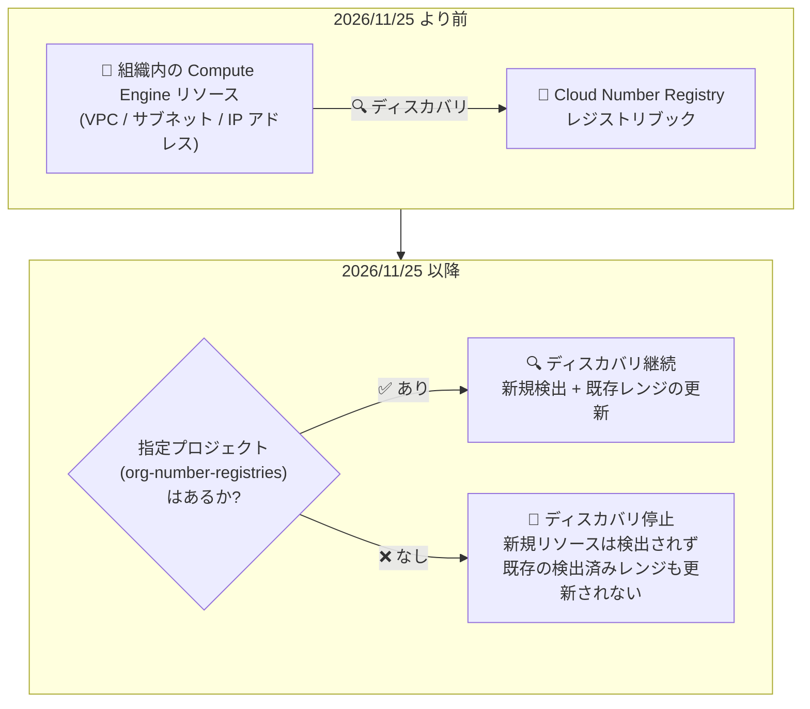

# Cloud Number Registry: プロジェクト指定 (Project Designation) の強制適用

**リリース日**: 2026-10-30

**サービス**: Cloud Number Registry

**機能**: プロジェクト指定の強制適用 (Project designation enforcement)

**ステータス**: Breaking change (サービス自体は Preview)

📊 [このアップデートのインフォグラフィックを見る](https://takech9203.github.io/google-cloud-news-summary/20261030-cloud-number-registry-project-designation-enforcement.html)

## 概要

Google Cloud の IP アドレス管理 (IPAM) サービスである Cloud Number Registry に、破壊的変更 (Breaking change) が発表されました。**2026 年 11 月 25 日以降、組織に対して「指定プロジェクト (designated project)」が構成されていない場合、Cloud Number Registry はリソースのディスカバリ (検出) を停止します。**

Cloud Number Registry は、組織全体の IP アドレス使用状況の表示・管理・計画を行うサービスで、セットアップすると読み取り専用のディスカバリプロセスが組織全体の IP アドレス情報をインポートします。今回の変更により、組織内で Cloud Number Registry を管理するプロジェクトを `org-number-registries` リソースとして明示的に指定することが、ディスカバリ継続の必須条件となります。

指定プロジェクトがない構成では、新しいリソースが検出されなくなるだけでなく、既存の検出済みリソースも更新されなくなります。たとえばサブネットを削除しても、対応する検出済みレンジは Cloud Number Registry 上に残り続け、実態と乖離した情報になります。Cloud Number Registry を利用中の組織管理者・ネットワーク管理者は、期限までに指定プロジェクトの確認・構成が必要です。

**アップデート前の課題**

- 以前は、指定プロジェクトを構成していなくても Cloud Number Registry のディスカバリが動作するケースがあり、組織の IP アドレス情報を含むプロジェクトの管理境界が曖昧になる可能性があった
- 組織全体の IP アドレス情報という機密性の高いデータへのアクセス制御が、専用の指定プロジェクトに基づいて一貫して強制されていなかった

**アップデート後の変更 (2026 年 11 月 25 日以降)**

- 指定プロジェクトがない構成では、新規リソースのディスカバリが停止する
- 既存の検出済みリソースは残るが更新されなくなる (例: サブネットを削除しても検出済みレンジは残存する)
- ディスカバリと更新を継続するには、組織に対する指定プロジェクトの確認または構成が必須になる

## アーキテクチャ図



2026 年 11 月 25 日を境に、指定プロジェクトの有無によって Cloud Number Registry のディスカバリ動作が変わります。指定プロジェクトがない場合、検出済み情報は残るものの更新されず、実際のネットワーク構成と乖離していきます。

## サービスアップデートの詳細

### 主要な変更点

1. **指定プロジェクトの強制適用**
   - 2026 年 11 月 25 日以降、指定プロジェクトがない構成ではリソースディスカバリが停止する
   - 既存の検出済みリソースは削除されないが、更新もされない (ソースリソースの変更が反映されなくなる)

2. **指定プロジェクトの仕組み**
   - 組織レベルで Cloud Number Registry IPAM Admin ロール (`roles/cloudnumberregistry.ipamAdmin`) を付与された IAM プリンシパルが、`org-number-registries` リソースを作成してプロジェクトを指定する
   - 1 つの組織で Cloud Number Registry を利用できるプロジェクトは 1 つのみ
   - 指定プロジェクトには組織全体の IP アドレスレンジ情報が格納されるため、Cloud Number Registry 専用の新規プロジェクトを作成し、IAM ポリシーでアクセスを制限することが強く推奨されている

3. **セットアップ時の前提条件化 (関連する変更)**
   - 同日のリリースノートでは、組織に対して Cloud Number Registry をセットアップする前に、管理用プロジェクトの指定が必須であることも案内されている

## 技術仕様

### 対応が必要かどうかの判断

| 状況 | 2026/11/25 以降の動作 | 必要なアクション |
|------|----------------------|-----------------|
| 指定プロジェクトを構成済み | ディスカバリは継続 | 不要 (指定内容の確認を推奨) |
| 指定プロジェクトが未構成で Cloud Number Registry を利用中 | ディスカバリ停止・既存検出レンジが未更新のまま残存 | 期限までにプロジェクトを指定する |
| Cloud Number Registry を未利用 | 影響なし | 新規セットアップ時はプロジェクト指定が前提条件 |

### 必要な IAM ロール

| ロール | 付与スコープ | 用途 |
|--------|-------------|------|
| Cloud Number Registry IPAM Admin (`roles/cloudnumberregistry.ipamAdmin`) | 組織 | プロジェクト指定 (`org-number-registries` の一覧表示・作成・削除) |
| Cloud Number Registry IPAM Admin (`roles/cloudnumberregistry.ipamAdmin`) | プロジェクト | IPAM 管理スコープの作成などのセットアップ・管理 |

## 設定方法

### 前提条件

1. 組織レベルで `roles/cloudnumberregistry.ipamAdmin` ロールが付与されていること
2. Cloud Number Registry 専用に使用するプロジェクトを用意していること (専用の新規プロジェクトの作成を強く推奨)
3. 対象プロジェクトで Cloud Number Registry API が有効化されていること

### 手順

#### ステップ 1: 既存のプロジェクト指定を確認する

```bash
gcloud alpha number-registry org-number-registries list \
    --organization=ORGANIZATION_ID \
    --location=global
```

組織に対して既にプロジェクトが指定されているかを確認します。Google Cloud コンソールでは、Cloud Number Registry ページの [Manage] タブにある [Manage designated project] パネルの [Admin project] フィールドでも確認できます。

#### ステップ 2: プロジェクトを指定する (未指定の場合)

```bash
gcloud alpha number-registry org-number-registries create ORG_NUMBER_REGISTRY \
    --admin-project=projects/PROJECT_ID \
    --target-scopes=organizations/ORGANIZATION_ID \
    --organization=ORGANIZATION_ID \
    --location=global
```

`org-number-registries` リソースを作成して、組織で Cloud Number Registry に使用するプロジェクトを指定します。コンソールでは [Manage designated project] パネルからプロジェクトを選択して [Designate project] をクリックします。

#### ステップ 3: (参考) Cloud Number Registry の構成状況を確認する

```bash
gcloud alpha number-registry ipam-admin-scopes check-availability \
    --scopes=organizations/ORGANIZATION_ID \
    --location=global
```

組織で Cloud Number Registry が既に構成済みの場合は `UNAVAILABLE`、未構成の場合は `AVAILABLE` が返ります。

## メリット

### ビジネス面

- **アクセス管理の明確化**: 組織全体の IP アドレス情報という機密性の高いデータの格納先が、明示的に指定された単一プロジェクトに限定され、ガバナンスが強化される
- **推奨構成への統一**: 専用プロジェクト + IAM ポリシーによるアクセス制限という推奨構成が、組織全体で強制される

### 技術面

- **管理境界の一元化**: 1 組織 1 プロジェクトの原則が強制され、IPAM 管理スコープの配置先が明確になる
- **セットアップフローの整合性**: セットアップ時に指定プロジェクトとの一致が検証されるため、意図しないプロジェクトでの構成を防げる

## デメリット・制約事項

### 制限事項

- 1 つの組織で Cloud Number Registry を利用できるプロジェクトは 1 つのみ
- 指定プロジェクトがない場合、2026 年 11 月 25 日以降は新規リソースが検出されず、既存の検出済みリソースも更新されない
- 既に Cloud Number Registry がプロジェクトにセットアップ済みの場合、プロジェクト指定を削除するには先に Cloud Number Registry の廃止 (decommission) が必要
- Cloud Number Registry は Preview 段階のサービスであり、Pre-GA Offerings Terms が適用される

### 考慮すべき点

- 対応期限 (2026 年 11 月 25 日) までに、組織のプロジェクト指定状況を確認する必要がある
- ディスカバリが停止すると、検出済みレンジが実際のネットワーク構成と乖離するため、IP アドレス利用状況や空きレンジ検索の結果が信頼できなくなる
- 指定プロジェクトには組織全体の IP アドレス情報が集約されるため、アクセス権の設計 (閲覧が必要なプリンシパルの限定) が重要

## ユースケース

### ユースケース 1: 既存利用組織の対応確認

**シナリオ**: Cloud Number Registry を既に利用して組織の IP アドレス利用状況を可視化しているが、プロジェクト指定が行われているか不明。

**実装例**:
```bash
# プロジェクト指定の有無を確認
gcloud alpha number-registry org-number-registries list \
    --organization=123456789 \
    --location=global

# 未指定であれば専用プロジェクトを指定
gcloud alpha number-registry org-number-registries create my-org-registry \
    --admin-project=projects/ipam-admin-project \
    --target-scopes=organizations/123456789 \
    --organization=123456789 \
    --location=global
```

**効果**: 2026 年 11 月 25 日以降もディスカバリと検出済みレンジの更新が継続され、IPAM 情報の鮮度が維持される。

### ユースケース 2: 新規セットアップ時のセキュアな構成

**シナリオ**: これから組織に Cloud Number Registry を導入する。組織全体の IP アドレス情報へのアクセスを限定したい。

**効果**: Cloud Number Registry 専用の新規プロジェクトを作成して指定し、そのプロジェクトへの IAM アクセスを必要最小限のプリンシパルに限定することで、組織全体の IP アドレスレンジ情報の閲覧範囲を制御できる。

## 利用可能リージョン

Cloud Number Registry のリソース (`org-number-registries`、IPAM 管理スコープ、レジストリブック) は `global` ロケーションで管理されます。

## 関連サービス・機能

- **Compute Engine / VPC**: ディスカバリプロセスは組織内の Compute Engine リソース (VPC ネットワーク、サブネットなど) の IP アドレス情報をインポートする。検出済みレンジを変更するには、ソースとなる Compute Engine リソース側を変更する
- **IAM (Identity and Access Management)**: プロジェクト指定には組織レベルの Cloud Number Registry IPAM Admin ロールが必要。指定プロジェクトへのアクセス制御にも IAM ポリシーを使用する
- **Resource Manager (組織)**: Cloud Number Registry は組織単位で動作し、指定プロジェクトは組織に属している必要がある
- **BYOIP (Bring Your Own IP)**: BYOIP の public advertised prefix も専用の realm (`byoip-ipv4` / `byoip-ipv6`) としてディスカバリの対象になる

## 参考リンク

- 📊 [インフォグラフィック](https://takech9203.github.io/google-cloud-news-summary/20261030-cloud-number-registry-project-designation-enforcement.html)
- [公式リリースノート (2026 年 10 月 30 日)](https://docs.cloud.google.com/release-notes#October_30_2026)
- [Cloud Number Registry overview (Project designation enforcement)](https://docs.cloud.google.com/number-registry/overview)
- [Designate a project to use for Cloud Number Registry](https://docs.cloud.google.com/number-registry/designate-project-cloud-number-registry)
- [Set up Cloud Number Registry](https://docs.cloud.google.com/number-registry/set-up-cloud-number-registry)

## まとめ

2026 年 11 月 25 日以降、指定プロジェクトのない Cloud Number Registry 構成ではリソースディスカバリが停止し、検出済み情報が実態と乖離していく破壊的変更です。Cloud Number Registry を利用中の組織は、`gcloud alpha number-registry org-number-registries list` でプロジェクト指定の有無を早急に確認し、未指定の場合は専用プロジェクトを作成して期限までに指定を完了することを推奨します。

---

**タグ**: #CloudNumberRegistry #IPAM #BreakingChange #ネットワーク #IPアドレス管理 #VPC
