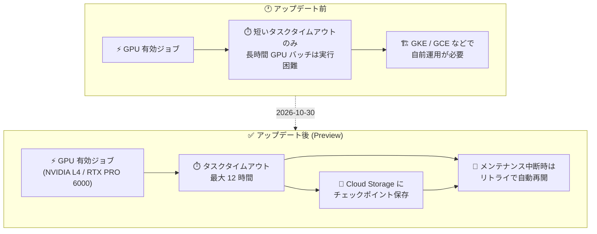

# Cloud Run: GPU 有効ジョブの最大 12 時間実行 (Preview)

**リリース日**: 2026-10-30

**サービス**: Cloud Run

**機能**: GPU を有効にした Cloud Run ジョブの最大 12 時間実行

**ステータス**: Preview

📊 [このアップデートのインフォグラフィックを見る](https://takech9203.github.io/google-cloud-news-summary/20261030-cloud-run-jobs-gpu-12-hours.html)

## 概要

Google Cloud は 2026 年 10 月 30 日、GPU を有効にした Cloud Run ジョブを最大 12 時間まで実行できる機能を Preview として発表しました。Cloud Run ジョブのタスクタイムアウトはデフォルトで 10 分、GPU を使用しないタスクでは最大 168 時間 (7 日間) まで設定できますが、GPU を使用するタスクでは今回の Preview により最大 12 時間のタイムアウトを設定できるようになりました。

この機能は、LLM のファインチューニング、バッチ/オフライン推論、動画処理やグラフィックスレンダリングなど、長時間の GPU 計算を必要とするバックグラウンドワークロードを、サーバーレスかつフルマネージドな環境で実行したいユーザーに適しています。Cloud Run の GPU はドライバーやライブラリの追加インストールが不要で、予約なしのオンデマンドで利用でき、GPU 付きインスタンスは約 5 秒で起動します。

なお、タスクタイムアウトは「タスクの試行 1 回あたりに許可される最大実行時間」であり、中断なしの実行を保証するものではない点に注意が必要です。GPU を使用するタスクはライブマイグレーションされないため、定期的なインフラメンテナンスによって終了される可能性があり、数時間規模のタイムアウトを設定したタスクは完了までに少なくとも 1 回は中断されることを想定した設計 (チェックポイントと再開) が公式に推奨されています。

**アップデート前の課題**

- GPU を有効にした Cloud Run ジョブでは、長時間のタスクタイムアウトを設定できず、LLM のファインチューニングや大規模なバッチ推論のような数時間単位の GPU ワークロードを 1 つのジョブタスクとして実行することが困難だった
- 長時間の GPU バッチ処理には GKE や Compute Engine など、より運用負荷の高い環境を選択する必要があった

**アップデート後の改善**

- GPU を有効にした Cloud Run ジョブのタスクタイムアウトを最大 12 時間まで設定できるようになった (Preview)
- LLM のファインチューニング、バッチ/オフライン推論、動画処理などの長時間 GPU ワークロードを、サーバーレスの Cloud Run ジョブで完結できるようになった
- チェックポイント + リトライ構成と組み合わせることで、メンテナンスによる中断に耐性のある長時間 GPU ジョブを設計できるようになった

## アーキテクチャ図



GPU を有効にした Cloud Run ジョブのタスクタイムアウトが最大 12 時間に拡張され、Cloud Storage へのチェックポイント保存とリトライ設定を組み合わせることで、中断に耐性のある長時間 GPU バッチ処理をサーバーレスで実行できます。

## サービスアップデートの詳細

### 主要機能

1. **GPU タスクの最大 12 時間実行 (Preview)**
   - GPU を使用するタスクのタスクタイムアウトを最大 12 時間まで設定可能
   - タスクタイムアウトはデフォルト 10 分。GPU を使用しないタスクは最大 168 時間 (7 日間) まで設定可能
   - タイムアウトはタスクの試行 1 回ごとに適用される (リトライ有効時は各試行に適用)

2. **中断を前提とした長時間実行の設計ガイド**
   - GPU タスクはライブマイグレーションされず、定期的なインフラメンテナンスで終了される
   - 終了の 10 秒前に SIGTERM シグナルが送信されるため、小さな状態の最終フラッシュに利用可能
   - 大きなモデルチェックポイントの書き込みには 10 秒では不十分なため、定期的なチェックポイント保存を主たる保護手段とすることが推奨される
   - 公式チュートリアル「Design resilient long-running GPU jobs」でチェックポイント + 再開パターンが提供されている

3. **リトライによる自動再開**
   - 1 時間を超えるタイムアウトの GPU ジョブでは、デフォルト構成の 3 リトライの設定が推奨される (0 リトライはメンテナンス時のサイレント失敗につながるため非推奨)
   - 合計の実行時間上限は「タイムアウト × (リトライ回数 + 1)」となる点に注意
   - メンテナンスによる中断時はシステムログに `INSTANCE_PREEMPTED` が記録され、タスクは自動的に再起動される

## 技術仕様

### Cloud Run ジョブの GPU 構成

| 項目 | 詳細 |
|------|------|
| GPU タスクの最大タイムアウト | 12 時間 (Preview) |
| GPU なしタスクの最大タイムアウト | 168 時間 (7 日間) |
| デフォルトのタスクタイムアウト | 10 分 |
| 対応 GPU | NVIDIA L4 (VRAM 24 GB)、NVIDIA RTX PRO 6000 Blackwell (VRAM 96 GB) |
| GPU 数 | インスタンスあたり 1 GPU |
| 最小リソース (L4) | 4 vCPU / 16 GiB メモリ |
| 最小リソース (RTX PRO 6000) | 20 vCPU / 80 GiB メモリ |
| ゾーン冗長性 | ジョブの GPU は非ゾーン冗長 (non-zonal redundancy) のみサポート |
| ドライバー | プリインストール済み (NVIDIA driver 580.x.x / CUDA 13.0)、追加設定不要 |
| 起動時間 | GPU 付きインスタンスは約 5 秒で起動 |
| クォータ | 初回デプロイ時に L4 は 3 GPU、RTX PRO 6000 は 3,000 milliGPU (= 3 GPU) がリージョンごとに自動付与 |

### メンテナンスイベントの挙動

| 項目 | 詳細 |
|------|------|
| GPU タスク | ライブマイグレーション不可。メンテナンス時は終了 (preemption) される |
| 事前通知 | 終了の 10 秒前に SIGTERM シグナルを送信 |
| 推奨対策 | 定期チェックポイント保存 + リトライ有効化 (推奨 3 回) |
| 課金 | GPU は各試行のインスタンスライフサイクル全体に対して課金 |

## 設定方法

### 前提条件

1. Cloud Run API が有効化されていること
2. IAM ロール: Cloud Run デベロッパー (`roles/run.developer`) とサービス アカウント ユーザー (`roles/iam.serviceAccountUser`)
3. 対象リージョンに十分な GPU クォータ (非ゾーン冗長) があること
4. 並列実行する場合は parallelism をプロジェクトの GPU クォータ未満に設定すること

### 手順

#### ステップ 1: GPU と長時間タイムアウトを有効にしたジョブをデプロイ

```bash
gcloud run jobs deploy my-gpu-job \
  --image=IMAGE_URL \
  --region=REGION \
  --gpu=1 \
  --gpu-type=nvidia-l4 \
  --no-gpu-zonal-redundancy \
  --task-timeout=12h \
  --max-retries=3 \
  --add-volume=name=checkpoint-volume,type=cloud-storage,bucket=CHECKPOINT_BUCKET \
  --add-volume-mount=volume=checkpoint-volume,mount-path=/checkpoints
```

ジョブで GPU を使用するには `--no-gpu-zonal-redundancy` の指定が必須です。`--task-timeout=12h` で GPU タスクの最大タイムアウトを設定し、Cloud Storage ボリュームマウントでチェックポイントを永続化します。L4 GPU では最低 4 vCPU / 16 GiB メモリが必要です。

#### ステップ 2: ジョブを実行して監視

```bash
gcloud run jobs execute my-gpu-job --region=REGION
```

実行後は Logs Explorer でログを監視します。メンテナンスイベントが発生すると、`INSTANCE_PREEMPTED` を理由とするシステムログが記録され、リトライ設定に従ってタスクが自動的に再起動されます。アプリケーション側ではチェックポイントからの再開処理を実装しておきます。

## メリット

### ビジネス面

- **インフラ運用コストの削減**: 長時間 GPU バッチのために GKE クラスタや GPU VM を構築・運用する必要がなく、サーバーレスで完結できる
- **オンデマンド利用**: 予約不要で GPU を利用でき、ジョブ実行中のみ課金されるため、散発的なバッチワークロードのコスト効率が高い

### 技術面

- **フルマネージドな GPU 環境**: NVIDIA ドライバーがプリインストール済みで、GPU 付きインスタンスが約 5 秒で起動する
- **長時間ワークロードへの対応**: ファインチューニングや大規模バッチ推論など、従来はジョブに収まらなかった数時間単位の処理を 1 タスクとして実行できる
- **回復性のある設計パターン**: SIGTERM ハンドリング、チェックポイント、リトライを組み合わせた公式のレジリエンス設計ガイドが提供されている

## デメリット・制約事項

### 制限事項

- Preview 機能であり、Pre-GA Offerings Terms が適用される (サポートが限定的な場合がある)
- GPU タスクの最大タイムアウトは 12 時間 (GPU なしタスクの 168 時間より短い)
- ジョブの GPU は非ゾーン冗長のみサポート (フェイルオーバーはベストエフォート)
- インスタンスあたり 1 GPU のみ。サイドカー使用時は GPU を 1 コンテナにのみアタッチ可能
- 利用可能リージョンが限定されている (下記「利用可能リージョン」参照)

### 考慮すべき点

- タスクタイムアウトは中断なし実行の保証ではない。GPU タスクはライブマイグレーションされないため、数時間のタスクは少なくとも 1 回の中断を想定して設計する必要がある
- SIGTERM 後の猶予は約 10 秒であり、大きなチェックポイントの書き込みには不十分。定期チェックポイントを主たる保護手段とする
- リトライ有効時の合計実行時間は「タイムアウト × (リトライ回数 + 1)」となり、GPU は各試行の全期間に課金されるため、コスト上限を見積もっておく
- 並列実行 (parallelism) は GPU クォータ未満に設定しないとデプロイが失敗する

## ユースケース

### ユースケース 1: オープンモデルのファインチューニング

**シナリオ**: 社内データを使って Gemma などのオープンモデルを定期的にファインチューニングしたい。処理には数時間かかるが、専用の GPU クラスタを常時運用したくない。

**実装例**:
```bash
gcloud run jobs deploy finetune-job \
  --source=. \
  --region=us-central1 \
  --gpu=1 --gpu-type=nvidia-l4 --no-gpu-zonal-redundancy \
  --task-timeout=12h --max-retries=3 \
  --add-volume=name=ckpt,type=cloud-storage,bucket=my-checkpoints \
  --add-volume-mount=volume=ckpt,mount-path=/checkpoints
```

**効果**: GPU クラスタの常時運用なしに、チェックポイントからの再開に対応した数時間規模のファインチューニングをサーバーレスで実行できる。

### ユースケース 2: LLM による大規模バッチ推論・メディア処理

**シナリオ**: 蓄積したドキュメントやメディアファイルに対して、夜間に LLM によるバッチ推論や動画のトランスコード/レンダリングをまとめて実行したい。

**効果**: Cloud Scheduler などと組み合わせて夜間に GPU ジョブを起動し、最大 12 時間のウィンドウで大量データを処理できる。処理中のみ課金されるためコスト効率が高い。

## 料金

ジョブの GPU は非ゾーン冗長 (non-zonal redundancy) 料金が適用されます。GPU はインスタンスのライフサイクル全体 (各試行の全期間) に対して課金され、CPU・メモリの料金が別途かかります。リトライ発生時は試行ごとに課金される点に注意してください。

### 料金例 (GPU 部分のみ、Tier 1 リージョン)

| 使用量 | 料金 (概算) |
|--------|-----------------|
| NVIDIA L4 (非ゾーン冗長) 1 秒 | $0.0001867 |
| NVIDIA L4 × 12 時間 (1 試行) | 約 $8.07 |
| NVIDIA RTX PRO 6000 (非ゾーン冗長) 1 秒 | $0.00036522 |
| NVIDIA RTX PRO 6000 × 12 時間 (1 試行) | 約 $15.78 |

上記は GPU 分のみの概算です。L4 では最低 4 vCPU / 16 GiB、RTX PRO 6000 では最低 20 vCPU / 80 GiB の CPU・メモリ料金が加算されます。最新の料金は [Cloud Run 料金ページ](https://cloud.google.com/run/pricing) を参照してください。

## 利用可能リージョン

Cloud Run の GPU は以下のリージョンで利用できます。

- **NVIDIA L4**: asia-southeast1 (シンガポール)、asia-south1 (ムンバイ、招待制)、europe-west1 (ベルギー)、europe-west4 (オランダ)、us-central1 (アイオワ)、us-east4 (北バージニア)
- **NVIDIA RTX PRO 6000 Blackwell**: asia-southeast1 (シンガポール)、asia-south2 (デリー)、europe-west4 (オランダ)、us-central1 (アイオワ)

## 関連サービス・機能

- **Cloud Storage**: チェックポイントの永続化先。ボリュームマウントでジョブのコンテナに直接マウントできる
- **Cloud Logging**: ジョブの実行ログや `INSTANCE_PREEMPTED` などのメンテナンスイベントの監視に使用
- **Cloud Build / Artifact Registry**: ジョブ用コンテナイメージのビルドと管理
- **Cloud Scheduler**: ジョブの定期実行 (夜間バッチなど) のトリガーに使用
- **GKE (Autopilot/Standard)**: 12 時間を超える GPU ワークロードや複数 GPU が必要な場合の代替手段

## 参考リンク

- 📊 [インフォグラフィック](https://takech9203.github.io/google-cloud-news-summary/20261030-cloud-run-jobs-gpu-12-hours.html)
- [公式リリースノート](https://docs.cloud.google.com/release-notes#October_30_2026)
- [ドキュメント: Cloud Run ジョブの GPU 構成](https://docs.cloud.google.com/run/docs/configuring/jobs/gpu)
- [ドキュメント: タスクタイムアウトの設定](https://docs.cloud.google.com/run/docs/configuring/task-timeout)
- [チュートリアル: 回復性のある長時間 GPU ジョブの設計](https://docs.cloud.google.com/run/docs/tutorials/long-running-gpu-jobs)
- [ベストプラクティス: GPU を使用する Cloud Run ジョブ](https://docs.cloud.google.com/run/docs/configuring/jobs/gpu-best-practices)
- [料金ページ](https://cloud.google.com/run/pricing)

## まとめ

GPU を有効にした Cloud Run ジョブが最大 12 時間まで実行できるようになり (Preview)、LLM のファインチューニングや大規模バッチ推論などの長時間 GPU ワークロードをサーバーレスで実行する選択肢が広がりました。GPU タスクはメンテナンスによる中断が前提となるため、導入時は公式チュートリアルに沿ってチェックポイント保存・SIGTERM ハンドリング・リトライ (推奨 3 回) を組み合わせた回復性のある設計を行うことを推奨します。

---

**タグ**: Cloud Run, GPU, Jobs, NVIDIA L4, RTX PRO 6000, サーバーレス, バッチ処理, AI/ML, Preview
