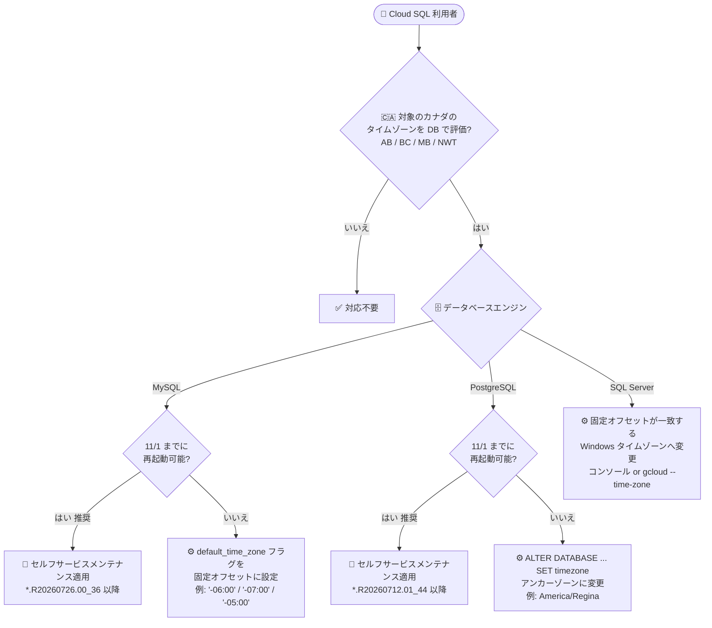

# Cloud SQL: カナダのタイムゾーン変更 (恒久サマータイム化) への対応 — MySQL / PostgreSQL / SQL Server

**リリース日**: 2026-10-30

**サービス**: Cloud SQL (MySQL / PostgreSQL / SQL Server)

**機能**: カナダの一部州・準州における恒久サマータイム (永続 DST) 移行に伴うタイムゾーン対応

**ステータス**: Announcement (対応が必要なアナウンス)

📊 [このアップデートのインフォグラフィックを見る](https://takech9203.github.io/google-cloud-news-summary/20261030-cloud-sql-canadian-timezone-changes.html)

## 概要

カナダのアルバータ州、ブリティッシュコロンビア州、マニトバ州、ノースウェスト準州の一部は、2026 年 11 月 1 日以降、秋の時刻の巻き戻し (fall back) を廃止し、恒久的なサマータイム (固定オフセット) に移行します。これに伴い Google Cloud は、**2026 年 11 月 1 日午前 2 時 (現地時間) 以降、未パッチの Cloud SQL インスタンスでこれらのカナダのタイムゾーンを評価すると、従来の巻き戻しスケジュールに従ってしまい時刻が 1 時間遅れる** ことをアナウンスしました。Cloud SQL for MySQL、Cloud SQL for PostgreSQL、Cloud SQL for SQL Server の 3 エンジンすべてが対象です。

重要な点として、**保存済みのタイムスタンプデータ自体は変更されません**。影響を受けるのは、データベース関数でこれらのタイムゾーンの時刻を計算・スケジュール・表示するワークロード (例: Calgary、Edmonton、Vancouver、Winnipeg のローカル時刻を扱うアプリケーション) です。

対応方法はエンジンごとに異なります。MySQL と PostgreSQL では、更新されたタイムゾーンルールを含むメンテナンスリリースの適用 (推奨) か、再起動を伴わないデータベース設定による暫定対応 (stopgap) のいずれかを選択できます。SQL Server では、Microsoft のガイダンスに従い、一致する固定オフセットを持つ Windows タイムゾーンへインスタンスのタイムゾーン設定を変更します。

**アップデート前の課題**

- 未パッチのインスタンスのタイムゾーンデータは、対象のカナダの州・準州が 2026 年 11 月 1 日に UTC-8/-7/-6 へ巻き戻る前提の古いルールを保持していた
- そのまま 11 月 1 日を迎えると、該当タイムゾーンを評価する時刻計算・スケジュール・表示が実際の現地時刻より 1 時間遅れる
- 対象ジュリスディクションの新ルール (恒久的な固定オフセット) を反映するには、ユーザー側でのアクションが必要

**アップデート後の改善**

- MySQL: メンテナンスリリース `*.R20260726.00_36` 以降で、アルバータ、ブリティッシュコロンビア、マニトバ、ノースウェスト準州の恒久オフセットを反映した新タイムゾーンルールがサポートされた
- PostgreSQL: メンテナンスリリース `*.R20260712.01_44` 以降で同様の新タイムゾーンルールがサポートされた
- 再起動 (メンテナンス適用) が難しい場合でも、MySQL は `default_time_zone` フラグ、PostgreSQL は `ALTER DATABASE ... SET timezone` によるダウンタイムなしの暫定対応が用意された
- SQL Server はコンソールまたは `gcloud sql instances patch --time-zone` で、固定オフセットが一致する Windows タイムゾーンへ変更する手順が示された

## アーキテクチャ図



対象のカナダのタイムゾーンを評価するワークロードの有無とデータベースエンジンの種類に応じて、2026 年 11 月 1 日までに実施すべき推奨対応を判断するフローです。

## サービスアップデートの詳細

### 背景: カナダのタイムゾーン変更 (tzdata 2026e)

2026 年 11 月 1 日、カナダの以下の州・準州は時刻を 1 時間巻き戻さず、恒久的なサマータイム (年間固定オフセット) に移行します。IANA Time Zone Database では tzdata 2026e でこの変更が反映されています。

| 地域 | 2026/11/1 以降の通年オフセット | 影響を受ける IANA タイムゾーン |
|------|-------------------------------|-------------------------------|
| マニトバ州 | UTC-5 (UTC-6 へ巻き戻さない) | America/Winnipeg、Canada/Central、America/Rainy_River |
| アルバータ州 | UTC-6 (UTC-7 へ巻き戻さない) | America/Edmonton、Canada/Mountain |
| ブリティッシュコロンビア州 | UTC-7 (UTC-8 へ巻き戻さない) | America/Vancouver、Canada/Pacific |
| ノースウェスト準州 (Inuvik) | UTC-6 (UTC-7 へ巻き戻さない) | America/Inuvik |

### 主要なアナウンス内容

1. **Cloud SQL for MySQL**
   - 推奨: セルフサービスメンテナンスでメンテナンスリリース `*.R20260726.00_36` 以降へ更新 (更新されたタイムゾーンルールを含む)
   - 暫定対応: 11 月 1 日までに再起動できない場合、`default_time_zone` フラグをターゲットの固定数値オフセットに設定 (インスタンスのダウンタイムなし)
     - 例: アルバータ `'-06:00'`、ブリティッシュコロンビア `'-07:00'`、マニトバ `'-05:00'`

2. **Cloud SQL for PostgreSQL**
   - 推奨: セルフサービスメンテナンスでメンテナンスリリース `*.R20260712.01_44` 以降へ更新
   - 暫定対応: `ALTER DATABASE database_name SET timezone TO 'anchor_zone';` で、恒久オフセットで動作するアンカーゾーンへ変更 (ダウンタイムなし)
     - 例: アルバータ / ノースウェスト準州 `'America/Regina'` (UTC-6)、ブリティッシュコロンビア `'America/Whitehorse'` (UTC-7)、マニトバ `'America/Coral_Harbour'` (UTC-5)

3. **Cloud SQL for SQL Server**
   - Microsoft が公開したガイダンスに従い、各対象インスタンスのタイムゾーンを、一致する固定オフセットを持つ Windows タイムゾーンへ更新する
   - 変更方法: Google Cloud コンソール (**インスタンスの編集 > フラグとパラメータ > タイムゾーン**) または `gcloud sql instances patch --time-zone`

### SQL Server の推奨タイムゾーン対応表

| ジュリスディクション | 現在のタイムゾーン | 推奨タイムゾーン | 固定オフセット |
|---------------------|-------------------|------------------|----------------|
| ブリティッシュコロンビア州 | Pacific Standard Time | Yukon Standard Time | UTC-07:00 |
| アルバータ州 / Inuvik (NWT) | Mountain Standard Time | Canada Central Standard Time | UTC-06:00 |
| マニトバ州 | Central Standard Time | Eastern Standard Time (Mexico) | UTC-05:00 |

## 技術仕様

### エンジン別の対応方法まとめ

| 項目 | MySQL | PostgreSQL | SQL Server |
|------|-------|------------|------------|
| 推奨対応 | メンテナンスリリース `*.R20260726.00_36` 以降を適用 | メンテナンスリリース `*.R20260712.01_44` 以降を適用 | 固定オフセットが一致する Windows タイムゾーンへ変更 |
| 暫定対応 (再起動なし) | `default_time_zone` フラグを固定オフセットに設定 | `ALTER DATABASE ... SET timezone TO 'anchor_zone'` | — (タイムゾーン変更自体が対応方法) |
| 対応期限 | 2026 年 11 月 1 日 午前 2 時 (現地時間) より前 | 同左 | 同左 |
| 保存済みデータへの影響 | なし (タイムスタンプデータは変更されない) | なし | なし |

### セルフサービスメンテナンスの注意点

- 一度最新のメンテナンスバージョンへ更新すると、以前のバージョンには戻せない
- 停止中のインスタンスにはメンテナンス更新を適用できない (先にインスタンスを起動する)
- プライマリインスタンスを指定して更新すると、リードレプリカが先に更新され、その後プライマリが更新される

## 設定方法

### 前提条件

1. 対象インスタンスがアルバータ、ブリティッシュコロンビア、マニトバ、ノースウェスト準州のタイムゾーンをデータベース関数で評価しているかを確認する
2. 2026 年 11 月 1 日より前にメンテナンス (再起動) ウィンドウを確保できるかを判断する

### 手順

#### ステップ 1 (MySQL / PostgreSQL 推奨): セルフサービスメンテナンスの適用

```bash
# 単一インスタンスを対象メンテナンスバージョンへ更新
gcloud sql instances patch INSTANCE_ID \
  --maintenance-version=MAINTENANCE_VERSION
```

MySQL は `*.R20260726.00_36` 以降、PostgreSQL は `*.R20260712.01_44` 以降のメンテナンスバージョンを指定します。Google Cloud コンソールからも適用できます。

#### ステップ 2 (MySQL 暫定対応): default_time_zone フラグの設定

```bash
# 例: アルバータ州向けに固定オフセット -06:00 を設定
gcloud sql instances patch INSTANCE_ID \
  --database-flags=default_time_zone='-06:00'
```

ブリティッシュコロンビアは `'-07:00'`、マニトバは `'-05:00'` を指定します。データベースセッションのタイムゾーンを変更するため、インスタンスのダウンタイムは発生しません。

#### ステップ 3 (PostgreSQL 暫定対応): データベースのタイムゾーン変更

```sql
-- 恒久オフセットで動作するアンカーゾーンを設定
ALTER DATABASE database_name SET timezone TO 'America/Regina';   -- アルバータ / NWT (UTC-6)
-- ブリティッシュコロンビア: 'America/Whitehorse' (UTC-7)
-- マニトバ: 'America/Coral_Harbour' (UTC-5)
```

ダウンタイムなしでデータベースセッションのタイムゾーンを変更できます。

#### ステップ 4 (SQL Server): インスタンスのタイムゾーン変更

```bash
# 例: ブリティッシュコロンビアのインスタンスを Yukon Standard Time (UTC-07:00) へ
gcloud sql instances patch INSTANCE_NAME \
  --project=PROJECT_ID \
  --time-zone="Yukon Standard Time"
```

Google Cloud コンソールの場合は、**インスタンスの編集 > フラグとパラメータ > タイムゾーン** から変更します。

## メリット

### ビジネス面

- **時刻ずれによる業務影響の回避**: スケジュール処理、レポートの時刻表示、SLA 計測などが 1 時間ずれる事態を未然に防げる
- **ダウンタイムなしの選択肢**: メンテナンスウィンドウを確保できない組織でも、フラグ設定や `ALTER DATABASE` による暫定対応で 11 月 1 日の期限に間に合わせられる

### 技術面

- **データ無変更**: 保存済みタイムスタンプデータは変更されないため、データ移行や変換作業は不要
- **エンジンごとに明確な手順**: MySQL / PostgreSQL / SQL Server それぞれに具体的なバージョン・フラグ・コマンドが提示されており、対応の判断がしやすい

## デメリット・制約事項

### 制限事項

- セルフサービスメンテナンスの適用後は、以前のメンテナンスバージョンへ戻せない
- メンテナンスの適用にはインスタンスの再起動を伴う (暫定対応はこれを回避するための手段)
- 停止中のインスタンスにはメンテナンス更新を適用できない

### 考慮すべき点

- 固定オフセットやアンカーゾーンによる暫定対応は、将来これらの地域のルールが再び変わった場合に再設定が必要になりうる (恒久対応はメンテナンスリリース適用)
- 対応期限は 2026 年 11 月 1 日午前 2 時 (現地時間) と非常に近いため、対象インスタンスの棚卸しを急ぐ必要がある
- タイムゾーン変更の影響は Cloud SQL だけでなく、アプリケーション層や他のサービス (例: Looker、Google Calendar) にも及ぶため、システム全体での確認が望ましい

## ユースケース

### ユースケース 1: バンクーバーのローカル時刻でバッチをスケジュールしている MySQL インスタンス

**シナリオ**: アプリケーションが `America/Vancouver` の時刻をデータベース関数で計算し、日次バッチの起動時刻を決定している。11 月 1 日以降、未対応のままだと起動時刻が 1 時間遅れる。

**実装例**:
```bash
gcloud sql instances patch my-mysql-instance \
  --maintenance-version=MYSQL_8_0_XX.R20260726.00_36
```

**効果**: 更新されたタイムゾーンルールが適用され、ブリティッシュコロンビアの恒久 UTC-7 を正しく評価できる。

### ユースケース 2: 再起動できない本番 PostgreSQL インスタンス

**シナリオ**: 11 月 1 日までにメンテナンスウィンドウを確保できない本番ワークロードで、ウィニペグ (マニトバ州) の時刻を扱っている。

**実装例**:
```sql
ALTER DATABASE orders_db SET timezone TO 'America/Coral_Harbour';
```

**効果**: ダウンタイムなしでマニトバの恒久 UTC-5 相当の動作となり、後日あらためてメンテナンスリリースを適用して恒久対応できる。

## 料金

このアナウンスは既存インスタンスのタイムゾーン対応に関するもので、追加料金は発生しません。セルフサービスメンテナンス、データベースフラグの設定、タイムゾーン変更はいずれも Cloud SQL の通常機能として提供されます。

- [Cloud SQL の料金](https://cloud.google.com/sql/pricing)

## 利用可能リージョン

インスタンスが稼働するリージョンにかかわらず、対象のカナダのタイムゾーン (アルバータ、ブリティッシュコロンビア、マニトバ、ノースウェスト準州) をデータベース関数で評価しているすべての Cloud SQL インスタンスが影響を受けます。

## 関連サービス・機能

- **Looker**: 同じカナダのタイムゾーン変更により、スケジュール配信やテーブル計算の `now()` が 1 時間ずれる影響があり、パッチ済みビルドへの更新や配信タイムゾーンの変更が案内されている
- **AlloyDB for PostgreSQL / 自己管理データベース**: tzdata 2026e 以降を含むかどうかの確認が同様に必要
- **Cloud Monitoring / Cloud Logging**: タイムゾーン対応後、時刻依存の処理が正しく動作しているかの検証に活用できる

## 参考リンク

- 📊 [インフォグラフィック](https://takech9203.github.io/google-cloud-news-summary/20261030-cloud-sql-canadian-timezone-changes.html)
- [公式リリースノート (2026-10-30)](https://docs.cloud.google.com/release-notes#October_30_2026)
- [Cloud SQL for MySQL: セルフサービスメンテナンスの実行](https://docs.cloud.google.com/sql/docs/mysql/self-service-maintenance)
- [Cloud SQL for PostgreSQL: セルフサービスメンテナンスの実行](https://docs.cloud.google.com/sql/docs/postgres/self-service-maintenance)
- [Cloud SQL for MySQL: データベースフラグの構成](https://docs.cloud.google.com/sql/docs/mysql/flags)
- [参考: Looker におけるカナダの恒久 DST 対応 (tzdata 2026e の背景情報)](https://docs.cloud.google.com/looker/docs/canada-permanent-dst-2026)
- [Cloud SQL の料金](https://cloud.google.com/sql/pricing)

## まとめ

2026 年 11 月 1 日午前 2 時 (現地時間) までに対応しないと、カナダの対象タイムゾーンを評価する Cloud SQL インスタンスの時刻計算が 1 時間ずれます。まず対象インスタンスを棚卸しし、MySQL / PostgreSQL は対象メンテナンスリリースの適用 (推奨)、再起動できない場合はフラグや `ALTER DATABASE` による暫定対応、SQL Server は固定オフセットが一致する Windows タイムゾーンへの変更を期限前に実施してください。

---

**タグ**: Cloud SQL, MySQL, PostgreSQL, SQL Server, タイムゾーン, カナダ, 恒久サマータイム, tzdata, メンテナンス, Announcement
