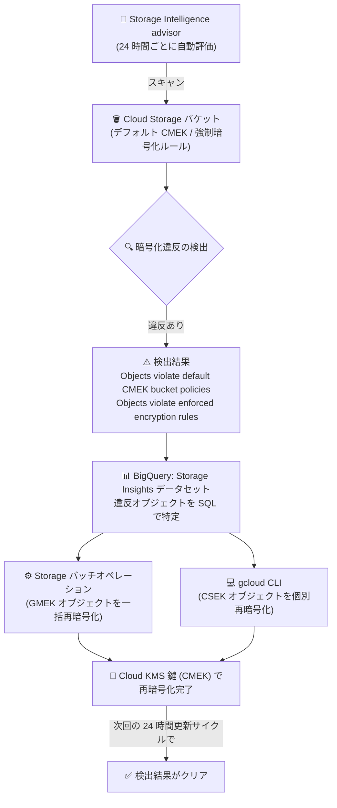

# Cloud Storage: Storage Intelligence advisor のセキュリティ・コンプライアンス検出結果 (Preview)

**リリース日**: 2026-10-30

**サービス**: Cloud Storage

**機能**: Storage Intelligence advisor セキュリティ・コンプライアンス検出結果

**ステータス**: Preview

📊 [このアップデートのインフォグラフィックを見る](https://takech9203.github.io/google-cloud-news-summary/20261030-cloud-storage-intelligence-advisor-security-findings.html)

## 概要

Storage Intelligence advisor に「セキュリティとコンプライアンス」カテゴリの検出結果 (Findings) が Preview として追加されました。これにより、デフォルトの顧客管理暗号鍵 (CMEK) ポリシーに違反するオブジェクトや、バケットで強制されている暗号化ルールに違反するオブジェクトを含むバケットを自動的に特定し、該当オブジェクトを再暗号化して是正できるようになります。

Storage Intelligence を有効化すると、Storage Intelligence advisor がバックグラウンドで自動的にセキュリティリスク評価を実行し、検出結果を 24 時間ごとに更新します。アラート量を抑えるため、オブジェクトレベルの暗号化違反はバケット単位に集約されてダッシュボードに表示されます。影響を受けるオブジェクトは BigQuery の Storage Insights データセットをクエリして特定し、Storage バッチオペレーションまたは gcloud CLI で再暗号化できます。

CMEK による暗号化を組織ポリシーやコンプライアンス要件として義務付けている企業のセキュリティ管理者・ストレージ管理者にとって、暗号化コンプライアンスの継続的な監視と是正を大幅に効率化するアップデートです。

**アップデート前の課題**

- バケットにデフォルトの Cloud KMS 鍵を設定しても、設定前にアップロードされた既存オブジェクトは自動的に再暗号化されず、元の暗号化方式 (Google デフォルト暗号化 (GMEK) や顧客指定の暗号鍵 (CSEK)) のまま残っていた
- CMEK ポリシーに違反するオブジェクトを特定するには、ユーザーが自前でオブジェクトメタデータを収集・分析する仕組みを構築する必要があった
- プロジェクト・フォルダ・組織全体にわたる暗号化コンプライアンスの状況を一元的に把握する手段がなかった

**アップデート後の改善**

- Storage Intelligence を有効化するだけで、バケットレベル・オブジェクトレベルの暗号化メタデータが自動評価され、違反を含むバケットが advisor ダッシュボードに表示されるようになった
- 「Objects violate default CMEK bucket policies」と「Objects violate enforced encryption rules」の 2 種類の検出結果により、違反の種類に応じた是正手順が明確になった
- Storage Insights データセットの参照 SQL クエリと Storage バッチオペレーションを組み合わせ、大規模な再暗号化を効率的に実行できるようになった

## アーキテクチャ図



Storage Intelligence advisor がバケットをスキャンして暗号化違反を検出し、Storage Insights データセットで影響オブジェクトを特定した後、Storage バッチオペレーションまたは gcloud CLI で CMEK に再暗号化するまでのフローです。

## サービスアップデートの詳細

### 主要機能

1. **「Objects violate default CMEK bucket policies」検出結果**
   - デフォルトの Cloud KMS 鍵が設定されたバケット (`encryption.defaultEncryptionType` が `CMEK`) に、CMEK で暗号化されていないオブジェクト (GMEK や CSEK) が 1 つ以上含まれる場合に検出される
   - 例: バケットにデフォルト Cloud KMS 鍵を設定する前にアップロードされたオブジェクトが該当
   - Storage Insights データセットで違反オブジェクトを特定し、バケットのデフォルト Cloud KMS 鍵で再暗号化して是正する

2. **「Objects violate enforced encryption rules」検出結果**
   - バケットの暗号化強制設定 (encryption enforcement configuration) で制限されている暗号化方式を使用するオブジェクトが含まれる場合に検出される
   - 例: GMEK や CSEK を制限する前にアップロードされた、それらの方式で暗号化されたオブジェクトが該当
   - 許可された暗号化方式でオブジェクトを再暗号化して是正する

3. **自動評価と検出結果の集約**
   - Storage Intelligence を有効化すると、プロジェクト・フォルダ・組織をまたいでバケットレベル・オブジェクトレベルの暗号化メタデータが自動評価される
   - 初回のベースライン検出結果は有効化から 48 時間以内に表示され、以降 24 時間ごとに更新される
   - オブジェクトレベルの違反はバケット単位に集約され、ダッシュボードのアラート量を抑制する

4. **検出結果の詳細ビュー**
   - Google Cloud コンソールの Storage Intelligence Advisor ページで、検出結果ごとにカテゴリ、最終更新時刻、共通要因、影響を受けるバケットを確認できる
   - バケット詳細パネルでは、バケットの暗号化構成、影響オブジェクトの件数と割合、Storage Insights データセットを対象とした参照 SQL クエリを確認できる

## 技術仕様

### 検出結果が生成される条件 (デフォルト CMEK ポリシー違反)

| 項目 | 詳細 |
|------|------|
| 条件 1 | バケットにデフォルト Cloud KMS 鍵が設定されている (`encryption.defaultKmsKeyName` が設定済みで `encryption.defaultEncryptionType` が `CMEK`) |
| 条件 2 | `encryptionType` メタデータが `CMEK` 以外 (`GMEK` や `CSEK`) のオブジェクトが 1 つ以上存在する |
| 初回検出 | Storage Intelligence 有効化から 48 時間以内 |
| 更新頻度 | 24 時間ごと |
| 集約単位 | バケット単位 (オブジェクトレベル違反を集約) |

### 再暗号化方式の選択

| シナリオ | 推奨される対応 |
|------|------|
| 影響オブジェクトが GMEK (標準暗号化) | BigQuery から CSV マニフェストをエクスポートし、Storage バッチオペレーションで一括再暗号化 |
| 影響オブジェクトが CSEK (顧客指定の暗号鍵) | Google Cloud は CSEK を保存しないため、バッチオペレーションでは復号不可。`gcloud storage objects update` に `--decryption-keys` と `--encryption-key` を指定して再暗号化 |

### 違反オブジェクトの特定クエリ例 (BigQuery)

```sql
SELECT bucket, name, encryptionType
FROM `DATASET_NAME.object_attributes_latest_snapshot_view`
WHERE bucket = 'BUCKET_NAME'
  AND encryptionType != 'CMEK'
  AND timeDeleted IS NULL
  AND softDeleteTime IS NULL;
```

## 設定方法

### 前提条件

1. Storage Intelligence が有効化されていること (設定・管理には `roles/storage.admin` などで `storage.intelligenceConfigs.update` 権限が必要)
2. 違反オブジェクトの一覧取得には Storage Insights のリンク済みデータセット (BigQuery) が構成されていること
3. Storage バッチオペレーションで再暗号化する場合、Storage batch operations サービスエージェントと Cloud Storage サービスエージェントの両方に、対象 Cloud KMS 鍵の Cloud KMS CryptoKey 暗号化 / 復号ロール (`roles/cloudkms.cryptoKeyEncrypterDecrypter`) が付与されていること

### 手順

#### ステップ 1: Storage Intelligence を有効化する

```bash
gcloud storage intelligence-configs enable --project=PROJECT_ID
```

プロジェクトのほか、`--sub-folder` や `--organization` フラグでフォルダ・組織レベルでも構成できます。有効化から 48 時間以内に初回のベースライン検出結果が表示されます。

#### ステップ 2: 検出結果を確認する

Google Cloud コンソールの Storage Intelligence Advisor ページでリソースを選択し、「Top findings」セクションから対象の検出結果の「View details」をクリックします。「Default CMEK buckets with non-CMEK encrypted objects」などのバケットテーブルで影響バケットを特定し、デフォルト KMS 鍵のリソース名を控えます。

#### ステップ 3: 違反オブジェクトのマニフェストをエクスポートする (GMEK の場合)

```sql
EXPORT DATA OPTIONS(
  uri='gs://DESTINATION_BUCKET/manifests/objects_violating_default_policies_*.csv',
  format='CSV', overwrite=true, header=true
) AS
SELECT bucket, name
FROM `DATASET_NAME.object_attributes_latest_snapshot_view`
WHERE bucket = 'BUCKET_NAME'
  AND encryptionType = 'GMEK'
  AND timeDeleted IS NULL
  AND softDeleteTime IS NULL;
```

BigQuery で `EXPORT DATA` クエリを実行し、再暗号化対象オブジェクトの CSV マニフェストを Cloud Storage に出力します。

#### ステップ 4: Storage バッチオペレーションで再暗号化する

```bash
gcloud storage batch-operations jobs create JOB_NAME \
  --bucket="BUCKET_NAME" \
  --manifest-location="gs://DESTINATION_BUCKET/manifests/objects_violating_default_policies_*.csv" \
  --rewrite-object="kms-key=DEFAULT_KMS_KEY"
```

オブジェクトを変更する前にジョブ構成を検証するには `--dry-run` フラグを付与します。CSEK オブジェクトは `gcloud storage objects update` に `--decryption-keys` と `--encryption-key` を指定して個別に再暗号化します。

## メリット

### ビジネス面

- **コンプライアンス監視の自動化**: CMEK 義務化などの暗号化要件に対する違反を自動検出し、カスタムのレポート基盤 (データ処理パイプラインや BigQuery スクリプトの自作・保守) なしで継続的な監査が可能になる
- **一元的な可視性**: プロジェクト・フォルダ・組織をまたいで Cloud Storage 環境全体の暗号化コンプライアンス状況を単一のインターフェースで把握できる

### 技術面

- **大規模な是正の効率化**: BigQuery のマニフェストエクスポートと Storage バッチオペレーションの組み合わせにより、大量の違反オブジェクトを一括で再暗号化できる
- **ノイズの少ないアラート**: オブジェクトレベルの違反がバケット単位に集約されるため、大量のオブジェクト違反があってもダッシュボードが煩雑にならない

## デメリット・制約事項

### 制限事項

- Preview 段階の機能であり、Pre-GA Offerings Terms が適用される。サポートが限定される可能性がある
- 初回のベースライン検出結果の表示までに最大 48 時間、以降の更新は 24 時間周期であり、リアルタイム検出ではない
- CSEK オブジェクトは Storage バッチオペレーションで復号できないため、gcloud CLI で復号鍵を指定した個別対応が必要

### 考慮すべき点

- オブジェクトバージョニングが有効な場合、再書き込み後も非 CMEK の非現行バージョンが残るため、非現行バージョンを削除するかライフサイクルの Delete ルールを構成するまで検出結果はクリアされない
- ソフト削除が有効な場合も、保持期間が終了するまで元の違反オブジェクトが残り、検出結果が継続する
- BigQuery でのクエリ実行とデータエクスポートには BigQuery の料金が発生する
- Storage Intelligence 自体が有料機能であり、管理対象データ量に応じたコストが発生する

## ユースケース

### ユースケース 1: CMEK 義務化環境での暗号化コンプライアンス監査

**シナリオ**: 金融機関が全社ポリシーとして Cloud Storage オブジェクトの CMEK 暗号化を義務付けているが、デフォルト KMS 鍵の設定前にアップロードされた既存オブジェクトが GMEK のまま残っていないか定期的に監査したい。

**実装例**:
```bash
# 組織レベルで Storage Intelligence を有効化
gcloud storage intelligence-configs enable --organization=ORGANIZATION_ID

# 検出結果はコンソールの Storage Intelligence Advisor ページで確認
# 違反オブジェクトは Storage Insights データセット (BigQuery) で特定
```

**効果**: 組織全体の暗号化違反が 24 時間ごとに自動評価され、手動監査の工数を削減しながらコンプライアンス違反の見落としを防止できる。

### ユースケース 2: 暗号化強制ルール導入後の既存オブジェクトの一括是正

**シナリオ**: バケットに GMEK / CSEK を制限する暗号化強制設定を導入したが、導入前にアップロードされた制限対象オブジェクトが大量に残っており、許可された暗号化方式へ効率的に移行したい。

**効果**: 「Objects violate enforced encryption rules」検出結果で影響バケットと参照 SQL クエリが提示され、Storage バッチオペレーションで大量オブジェクトを一括再暗号化できる。是正完了後は次回の 24 時間更新サイクルで検出結果が自動的にクリアされる。

## 料金

Storage Intelligence の料金は、使用する機能と管理対象のデータ量に依存します。30 日間の無料トライアル (TRIAL エディション) も提供されており、トライアル終了後は自動的に STANDARD エディションに移行します。

また、違反オブジェクトの特定に使用する BigQuery のクエリ・エクスポート、再暗号化に使用する Storage バッチオペレーションや Cloud KMS にもそれぞれ料金が発生します。

詳細は [Storage Intelligence の料金ページ](https://docs.cloud.google.com/storage/pricing#storage-intelligence) を参照してください。

## 利用可能リージョン

公式ドキュメントにリージョン制限の記載は確認できませんでした。詳細は [Storage Intelligence advisor のドキュメント](https://docs.cloud.google.com/storage/docs/storage-intelligence/advisor-overview) を参照してください。

## 関連サービス・機能

- **Storage Insights データセット**: 違反オブジェクトのオブジェクトレベル暗号化メタデータを BigQuery でクエリするために使用
- **Storage バッチオペレーション**: マニフェストに基づき大量の GMEK オブジェクトを Cloud KMS 鍵で一括再暗号化
- **Cloud KMS**: CMEK のデフォルト鍵の管理。再暗号化にはサービスエージェントへの CryptoKey 暗号化 / 復号ロールの付与が必要
- **BigQuery**: Storage Insights リンク済みデータセットへのクエリと CSV マニフェストのエクスポートに使用
- **オブジェクトライフサイクル管理 / ソフト削除**: 再暗号化後に残る非現行バージョン・ソフト削除済みバージョンの扱いに関係し、検出結果のクリア条件に影響

## 参考リンク

- 📊 [インフォグラフィック](https://takech9203.github.io/google-cloud-news-summary/20261030-cloud-storage-intelligence-advisor-security-findings.html)
- [公式リリースノート](https://docs.cloud.google.com/release-notes#October_30_2026)
- [About Storage Intelligence advisor](https://docs.cloud.google.com/storage/docs/storage-intelligence/advisor-overview)
- [Re-encrypt objects that violate default CMEK bucket policies](https://docs.cloud.google.com/storage/docs/storage-intelligence/findings/re-encrypt-objects-default-cmek-policies)
- [Re-encrypt objects that violate enforced encryption rules](https://docs.cloud.google.com/storage/docs/storage-intelligence/findings/re-encrypt-objects-enforced-encryption-rules)
- [Findings reference catalog](https://docs.cloud.google.com/storage/docs/storage-intelligence/findings/findings-reference-catalog)
- [View Storage Intelligence advisor](https://docs.cloud.google.com/storage/docs/storage-intelligence/view-advisor)
- [料金ページ](https://docs.cloud.google.com/storage/pricing#storage-intelligence)

## まとめ

Storage Intelligence advisor のセキュリティ・コンプライアンス検出結果により、CMEK ポリシーや暗号化強制ルールへの違反を自動検出し、Storage バッチオペレーションで効率的に是正できるようになりました。CMEK を義務付けている組織は、Storage Intelligence を有効化して暗号化コンプライアンスの継続的な監視を開始し、検出された違反オブジェクトの再暗号化フローを運用に組み込むことを推奨します。Preview 段階のため、本番運用に先立ち Pre-GA の提供条件を確認してください。

---

**タグ**: Cloud Storage, Storage Intelligence, CMEK, Cloud KMS, セキュリティ, コンプライアンス, 暗号化, Preview
