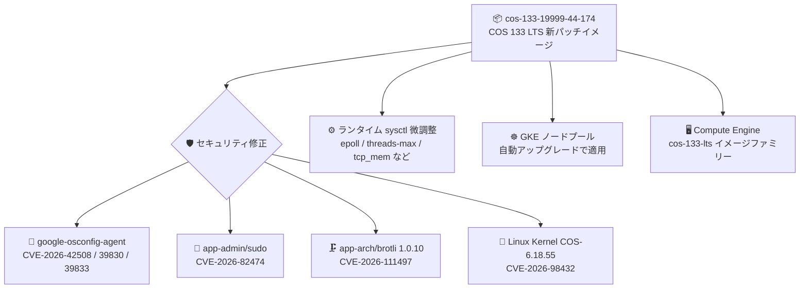

# Container-Optimized OS: cos-133-19999-44-174 セキュリティパッチリリース

**リリース日**: 2026-10-30

**サービス**: Container-Optimized OS

**機能**: cos-133-19999-44-174 (COS 133 LTS セキュリティパッチ)

**ステータス**: Change / Security (パッチリリース)

📊 [このアップデートのインフォグラフィックを見る](https://takech9203.github.io/google-cloud-news-summary/20261030-container-optimized-os-cos-133-patch.html)

## 概要

Container-Optimized OS (COS) の LTS マイルストーン 133 系の新しいパッチイメージ `cos-133-19999-44-174` がリリースされました。主要コンポーネントは Kernel COS-6.18.55、Docker v29.4.3、Containerd v2.4.1 で、前リリース (cos-133-19999-44-159、2026-10-22) から据え置きです。今回のリリースは複数の CVE 修正を中心としたセキュリティパッチです。

修正対象は、`google-osconfig-agent` の CVE-2026-42508 / CVE-2026-39830 / CVE-2026-39833、`app-admin/sudo` の CVE-2026-82474、`app-arch/brotli` 1.0.10 への更新による CVE-2026-111497 の解消、Linux カーネルの CVE-2026-98432 です。あわせて、`fs.epoll.max_user_watches` や `kernel.threads-max`、`net.ipv4.tcp_mem` などのランタイム sysctl 値の軽微な変更が含まれます。

COS は GKE ノードのデフォルト OS イメージであり、Compute Engine 上でコンテナを実行する際にも広く利用されています。GKE ノード自動アップグレードや自動更新を有効にしている環境では自然に適用されますが、イメージバージョンを固定している環境では、特に sudo やカーネルの CVE 修正を含むため、計画的な更新を推奨します。

**アップデート前の課題**

- 従来の COS 133 イメージ (cos-133-19999-44-159 以前) には、ゲスト管理エージェント `google-osconfig-agent` に CVE-2026-42508、CVE-2026-39830、CVE-2026-39833 の脆弱性が残っていた
- `app-admin/sudo` に CVE-2026-82474、`app-arch/brotli` (1.0.10 未満) に CVE-2026-111497、Linux カーネルに CVE-2026-98432 の脆弱性が存在していた

**アップデート後の改善**

- `google-osconfig-agent`、sudo、brotli、Linux カーネルの計 6 件の CVE が修正され、ノード OS のセキュリティ態勢が改善された
- `app-arch/brotli` が 1.0.10 に更新された
- ランタイム sysctl のデフォルト値 (epoll/inotify/fanotify のウォッチ上限、スレッド上限、TCP/UDP メモリ、各種 namespace 上限など) が微調整された

## アーキテクチャ図



新しいパッチイメージには 4 コンポーネントにわたる CVE 修正と sysctl の微調整が含まれ、GKE ノードプールや Compute Engine の `cos-133-lts` イメージファミリー経由で展開されます。

## サービスアップデートの詳細

### 主要機能

1. **google-osconfig-agent のセキュリティ修正**
   - CVE-2026-42508、CVE-2026-39830、CVE-2026-39833 を修正
   - OS Config エージェントはパッチ管理や OS インベントリ収集を担うゲストエージェントであり、全インスタンスに影響する修正

2. **sudo / brotli / カーネルの CVE 修正**
   - `app-admin/sudo` の CVE-2026-82474 を修正
   - `app-arch/brotli` を 1.0.10 に更新し、CVE-2026-111497 を解消
   - Linux カーネル (COS-6.18.55) の CVE-2026-98432 を修正

3. **ランタイム sysctl 値の変更**
   - `fs.epoll.max_user_watches`: 1807671 → 1807627
   - `kernel.threads-max`: 63445 → 63443
   - `net.ipv4.tcp_mem`: 93972 125298 187944 → 93969 125295 187938
   - そのほか `fs.inotify.max_user_watches`、`net.ipv4.udp_mem`、`user.max_*_namespaces` 系なども微減方向に変更

## 技術仕様

### コンポーネントバージョン

| コンポーネント | バージョン |
|------|------|
| イメージ | cos-133-19999-44-174 |
| Kernel | COS-6.18.55 |
| Docker | v29.4.3 |
| Containerd | v2.4.1 |
| イメージファミリー | cos-133-lts / cos-arm64-133-lts (プロジェクト: cos-cloud) |
| マイルストーン | COS 133 LTS (サポート終了: 2028 年 11 月) |

### 修正された CVE 一覧

| CVE | 対象コンポーネント |
|------|------|
| CVE-2026-42508 | google-osconfig-agent |
| CVE-2026-39830 | google-osconfig-agent |
| CVE-2026-39833 | google-osconfig-agent |
| CVE-2026-82474 | app-admin/sudo |
| CVE-2026-111497 | app-arch/brotli (1.0.10 に更新) |
| CVE-2026-98432 | Linux kernel |

## 設定方法

### 前提条件

1. Compute Engine で COS を使用している場合: イメージファミリー `cos-133-lts` (x86) または `cos-arm64-133-lts` (Arm) を参照していること
2. GKE の場合: ノードイメージに Container-Optimized OS (containerd) を使用していること

### 手順

#### ステップ 1: 最新イメージの確認 (Compute Engine)

```bash
gcloud compute images describe-from-family cos-133-lts \
    --project cos-cloud
```

イメージファミリーの最新イメージが `cos-133-19999-44-174` になっているかを確認します。

#### ステップ 2: GKE ノードプールのアップグレード

```bash
# 自動アップグレードが有効なら新バージョンのロールアウトを待つだけでよい
# 手動で適用する場合:
gcloud container clusters upgrade CLUSTER_NAME \
    --node-pool NODE_POOL_NAME \
    --zone ZONE
```

GKE ではノード自動アップグレードを有効にしておくことで、COS のセキュリティパッチが段階的に自動適用されます。

## メリット

### ビジネス面

- **セキュリティコンプライアンスの維持**: sudo やカーネルなど広く使われるコンポーネントの CVE が解消され、脆弱性スキャンの指摘事項を低減できる
- **運用負荷の軽減**: GKE ノード自動アップグレードを有効にしていれば追加作業なしでパッチが適用される

### 技術面

- **ゲストエージェントの堅牢化**: パッチ管理を担う google-osconfig-agent 自体の脆弱性が修正され、管理プレーン経由のリスクが低減
- **LTS の安定性**: Kernel / Docker / Containerd のメジャーバージョンは据え置きであり、互換性リスクを抑えつつセキュリティ修正のみを取り込める

## デメリット・制約事項

### 考慮すべき点

- イメージバージョンを固定 (ピン留め) している環境では自動適用されないため、手動での更新計画が必要
- ランタイム sysctl のデフォルト値が微減しているため、epoll/inotify のウォッチ数やスレッド数を上限近くまで使うワークロードでは、念のため実効値を確認するのが望ましい (変動幅はごくわずか)
- 本リリースは COS 133 LTS 系のパッチであり、他のマイルストーン (COS 121/125/129 LTS など) には別途それぞれのパッチが提供される

## ユースケース

### ユースケース 1: GKE ノードの定期セキュリティパッチ適用

**シナリオ**: GKE クラスタのノードイメージに COS を使用しており、セキュリティパッチを継続的に適用したい。

**実装例**:
```bash
# リリースチャンネル + ノード自動アップグレードを有効化しておく
gcloud container clusters describe CLUSTER_NAME \
    --zone ZONE \
    --format="value(releaseChannel.channel)"
```

**効果**: COS のセキュリティ修正がロールアウトに合わせて自動的にノードへ反映され、CVE 対応の運用負荷を最小化できる。

### ユースケース 2: Compute Engine 上のコンテナホストの脆弱性対応

**シナリオ**: Compute Engine インスタンスで COS を直接利用してコンテナを稼働させており、sudo / カーネルの CVE 指摘に対応する必要がある。

**効果**: インスタンステンプレートのイメージを `cos-133-lts` ファミリー参照にしておき、インスタンスを再作成 (ローリング更新) することで最新パッチ `cos-133-19999-44-174` を適用できる。

## 料金

Container-Optimized OS 自体の更新に伴う追加料金はありません。Compute Engine / GKE の通常の利用料金が適用されます。

- [Compute Engine 料金](https://cloud.google.com/compute/pricing)
- [GKE 料金](https://cloud.google.com/kubernetes-engine/pricing)

## 利用可能リージョン

COS イメージは `cos-cloud` プロジェクトのグローバルイメージとして提供され、Compute Engine が利用可能なすべてのリージョンで使用できます。

## 関連サービス・機能

- **Google Kubernetes Engine (GKE)**: COS はノードのデフォルト OS イメージ。ノード自動アップグレードで本パッチが適用される
- **Compute Engine**: `cos-133-lts` / `cos-arm64-133-lts` イメージファミリーからインスタンスを作成可能
- **OS Config (VM Manager)**: 今回修正された google-osconfig-agent が利用するパッチ管理・インベントリ機能

## 参考リンク

- 📊 [インフォグラフィック](https://takech9203.github.io/google-cloud-news-summary/20261030-container-optimized-os-cos-133-patch.html)
- [公式リリースノート](https://docs.cloud.google.com/release-notes#October_30_2026)
- [COS Milestone 133 リリースノート](https://docs.cloud.google.com/container-optimized-os/docs/release-notes/m133)
- [Container-Optimized OS ドキュメント](https://cloud.google.com/container-optimized-os/docs)

## まとめ

cos-133-19999-44-174 は、google-osconfig-agent、sudo、brotli、Linux カーネルの計 6 件の CVE を修正するセキュリティパッチリリースです。GKE ノード自動アップグレードを有効にしている環境は自動適用を待てばよく、イメージバージョンを固定している環境では sudo・カーネル脆弱性への対応として早めの更新を推奨します。

---

**タグ**: Container-Optimized OS, COS 133 LTS, セキュリティパッチ, CVE, GKE, Compute Engine
