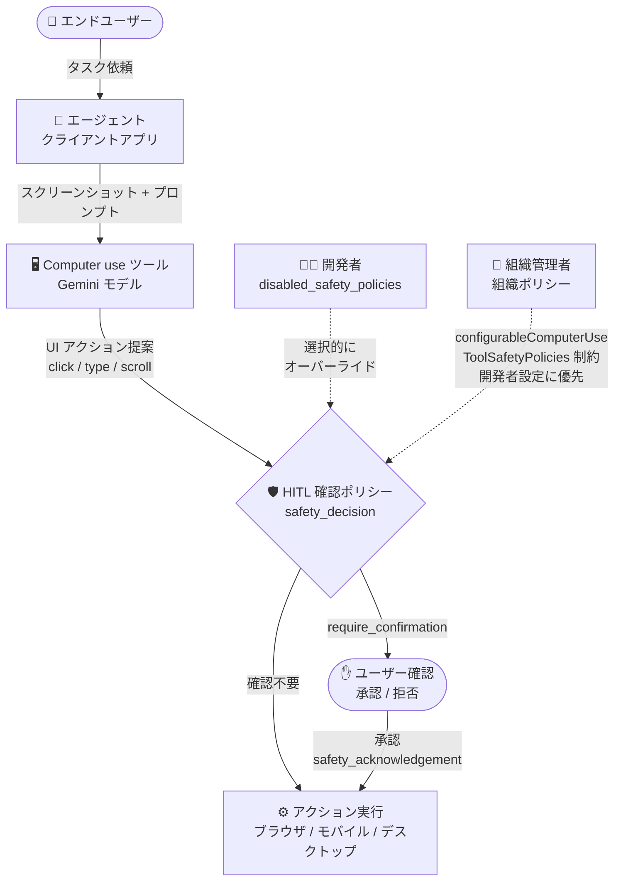

# Gemini Enterprise Agent Platform: Computer use ツールが GA に - HITL 安全ガバナンスを導入

**リリース日**: 2026-10-30

**サービス**: Gemini Enterprise Agent Platform

**機能**: Computer use ツール (GA) + Human-in-the-Loop (HITL) 安全ガバナンス

**ステータス**: GA (一般提供)

📊 [このアップデートのインフォグラフィックを見る](https://takech9203.github.io/google-cloud-news-summary/20261030-gemini-enterprise-agent-platform-computer-use-ga.html)

## 概要

Gemini Enterprise Agent Platform の Computer use ツールが一般提供 (GA) になりました。Computer use ツールは、Gemini モデルがスクリーンショットで画面を観察し、マウスクリック・スクロール・キーボード入力などの UI アクションを生成することで、ブラウザ・モバイル・デスクトップの GUI を操作するエージェントを構築できる機能です。フォーム入力の自動化、UI フローの自動テスト、Web サイトを横断した調査などのユースケースに対応します。

今回の GA リリースの目玉は、包括的な Human-in-the-Loop (HITL) 安全ガバナンスの導入です。HITL 確認とは、安全上の懸念からモデルが自律的に実行すべきでないアクション (金融取引の完了、機密データの変更など) について、実行前にエンドユーザーの確認を求める仕組みです。開発者はアプリケーションの特性に応じて特定の確認ポリシー (金融取引やデータ変更など) を選択的に設定・オーバーライドでき、同時に組織管理者は組織ポリシー制約 `vertexai.configurableComputerUseToolSafetyPolicies` を使って、開発者による無効化を禁止する組織全体のガードレールを強制できます。

開発者の柔軟性と組織のガバナンスを両立させる 2 層構造により、エンタープライズ環境で GUI 操作エージェントを安全に本番展開するための基盤が整いました。コンピュータ操作エージェントを企業で展開したいプラットフォームチーム、セキュリティ管理者、エージェント開発者が対象です。

**アップデート前の課題**

- GUI を自律操作するエージェントは、金融取引や機密データ変更などの高リスクアクションを含むため、組織として統制された形で本番利用することが難しかった
- HITL 確認の挙動を開発者がアプリケーション要件に合わせて細かく制御する公式な仕組みが限定的だった
- 開発者ごとの安全設定を組織レベルで統一的に強制するガバナンス手段がなかった

**アップデート後の改善**

- Computer use ツールが GA となり、本番ワークロードでの利用が正式にサポートされた
- 開発者は `disabled_safety_policies` フィールドで、7 種類のデフォルト HITL 確認ポリシーを個別に設定・オーバーライドできるようになった
- 組織管理者は組織ポリシー制約 `vertexai.configurableComputerUseToolSafetyPolicies` により、開発者設定に優先する組織全体のガードレールを強制できるようになった

## アーキテクチャ図



エージェントが Computer use ツールで UI アクションを生成すると、HITL 確認ポリシーが評価され、高リスクアクションにはユーザー確認が要求されます。開発者はポリシーを選択的にオーバーライドできますが、組織ポリシーのガードレールが常に優先されます。

## サービスアップデートの詳細

### 主要機能

1. **Computer use ツールの GA 化**
   - スクリーンショットによる画面観察と UI アクション (クリック、スクロール、キーボード入力など) の生成により、GUI 操作エージェントを構築
   - ブラウザ・モバイル・デスクトップのマルチ環境をサポート
   - 各アクションにはモデルの意図 (reasoning) を説明する `intent` フィールドが付与される

2. **開発者レベルの HITL 確認ポリシー設定**
   - Computer use 設定の `disabled_safety_policies` フィールドに対象ポリシーを列挙することで、デフォルトの HITL 確認を選択的に無効化可能
   - GenerateContent API と Interactions API の両方で設定可能
   - HITL 確認機能は Gemini 3.5 Flash 以降のモデルで利用可能

3. **組織レベルのガードレール (組織ポリシー制約)**
   - 制約 ID: `vertexai.configurableComputerUseToolSafetyPolicies`
   - 組織管理者が Organization Policy Service を使い、開発者による HITL 確認の無効化を組織・フォルダ・プロジェクト単位で禁止できる
   - 組織ポリシーは開発者レベルの設定に優先 (supersede) する
   - ポリシー変更の伝播には最大 1 時間かかる

4. **プロンプトインジェクション検出**
   - Gemini 3.5 Flash 以降でサポートされるオプトイン機能
   - スクリーンショットにプロンプトインジェクション攻撃の可能性がないかを検査 (デフォルトは無効)

## 技術仕様

### オーバーライド可能な HITL 確認ポリシー

| ポリシー | 対象アクション |
|------|------|
| `FINANCIAL_TRANSACTIONS` | 金融取引の最終ステップの完了 (支払い、送金、マネーオーダー、サブスクリプションの開始・変更、予約の完了など) |
| `SENSITIVE_DATA_MODIFICATION` | 医療・金融・行政記録などの機密情報の変更 |
| `COMMUNICATION_TOOL` | コミュニケーションツールへのアクセスや使用 (送信、共有、投稿など) |
| `ACCOUNT_CREATION` | ユーザー/サービスアカウントを作成・プロビジョニングする登録・サインアップフローの操作 |
| `DATA_MODIFICATION` | ブラウザデータやファイルの変更・管理・共有・保存・送信・削除 |
| `USER_CONSENT_MANAGEMENT` | ユーザー同意ダイアログやバナーでの意思決定 |
| `LEGAL_TERMS_AND_AGREEMENTS` | 利用規約の同意、プライバシーポリシーダイアログ、法的通知など法的拘束力のある同意画面の操作 |

### 開発者レベルの設定例 (Python / GenerateContent API)

```python
generate_content_config = genai.types.GenerateContentConfig(
    tools=[
        types.Tool(
            computer_use=types.ComputerUse(
                environment=types.Environment.ENVIRONMENT_MOBILE,
                disabled_safety_policies=[
                    types.SafetyPolicy.FINANCIAL_TRANSACTIONS,
                    types.SafetyPolicy.COMMUNICATION_TOOL,
                ]
            )
        ),
    ],
)
```

### HITL 確認フロー (safety_decision)

モデルの応答に含まれる `safety_decision` が `require_confirmation` の場合、クライアントはアクション実行前にエンドユーザーの確認を取得する必要があります。ユーザーが承認した場合は、`FunctionResponse` に `safety_acknowledgement: true` を含めて返します。

```json
{
  "function_call": {
    "name": "click_at",
    "args": {
      "x": 60,
      "y": 100,
      "safety_decision": {
        "explanation": "CAPTCHA チャレンジに遭遇しました。ユーザーによる操作が必要です。",
        "decision": "require_confirmation"
      }
    }
  }
}
```

### サポートモデル

Computer use は以下のモデルでサポートされます (公式ドキュメント記載):

- Gemini 4 Argon
- Gemini 3.8 / 3.7 / 3.6 Flash
- Gemini 3.5 Flash / 3.5 Flash-Lite
- Gemini 3 Flash (Preview)
- Gemini Robotics ER 2 (Preview)

なお、HITL 確認機能は Gemini 3.5 Flash 以降のモデルでのみ利用可能です。

## 設定方法

### 前提条件

1. Google Cloud プロジェクトで Gemini Enterprise Agent Platform を利用可能であること
2. 組織ポリシーを設定する場合は、組織管理者権限 (Organization Policy 管理ロール) が必要
3. クライアント側でアクション実行ロジック (Playwright などによる UI 操作) を実装すること

### 手順

#### ステップ 1: 開発者レベルで HITL 確認ポリシーを設定

Computer use 設定の `disabled_safety_policies` に、アプリケーション要件上オーバーライドしたいポリシーを列挙します (上記 Python 例を参照)。設定しないポリシーはデフォルトの HITL 確認が維持されます。

#### ステップ 2: 組織レベルのガードレールを設定 (管理者)

```bash
# Google Cloud CLI で組織ポリシー制約を設定
# 制約 ID: vertexai.configurableComputerUseToolSafetyPolicies
gcloud org-policies set-policy policy.yaml
```

Google Cloud コンソールまたは gcloud CLI で組織ポリシーを作成します。組織ポリシーの変更が伝播するまで最大 1 時間かかる点に注意してください。

#### ステップ 3: クライアントで safety_decision をハンドリング

`require_confirmation` を受け取った場合にエンドユーザーへ確認を求め、承認時には `FunctionResponse` に `safety_acknowledgement` を含めて返すループを実装します。

## メリット

### ビジネス面

- **本番利用への道が開けた**: GA 化により、GUI 操作エージェントをエンタープライズの本番ワークロードで正式に利用可能になった
- **ガバナンスとコンプライアンス**: 組織ポリシーによる一元的なガードレールで、金融取引や機密データ操作に対する統制を組織全体で担保できる
- **業務自動化の加速**: データ入力・フォーム記入・UI テスト・Web リサーチなど、API が存在しないレガシー UI を含む業務の自動化が可能

### 技術面

- **2 層の安全ガバナンス**: 開発者レベルの柔軟なポリシー設定と、それに優先する組織レベルの強制ガードレールを両立
- **きめ細かなポリシー制御**: 7 カテゴリの HITL 確認を個別にオーバーライド可能で、ユースケースに応じた UX とリスクのバランス調整ができる
- **多層防御**: HITL 確認に加え、プロンプトインジェクション検出 (オプトイン)、カスタム安全システム命令、Model Armor などと組み合わせた防御が可能

## デメリット・制約事項

### 制限事項

- HITL 確認機能は Gemini 3.5 Flash 以降のモデルでのみ利用可能
- 組織ポリシー変更の伝播には最大 1 時間かかる
- アクション実行ロジック (クリック、入力などの実装) はクライアント側で開発する必要がある (function calling と同様のモデル)
- プロンプトインジェクション検出はデフォルト無効のオプトイン機能

### 考慮すべき点

- HITL 確認を無効化する場合、金融取引や機密データ変更が自律実行されるリスクを十分に評価する必要がある
- エージェントはサンドボックス化された環境 (サンドボックス VM、コンテナ、権限を制限したブラウザプロファイルなど) で実行することが公式に推奨されている
- プロンプト、スクリーンショット、提案アクション、safety レスポンス、実行アクションの詳細ログを監査用に保持することが推奨される
- ナビゲーション先を制御するための許可リスト / ブロックリストの実装が推奨される

## ユースケース

### ユースケース 1: 金融系業務での統制されたエージェント展開

**シナリオ**: 金融機関がバックオフィス業務 (レガシー Web システムへのデータ入力) を Computer use エージェントで自動化したいが、支払い実行などの高リスク操作は必ず人間の承認を必須としたい。

**実装例**:
```
1. 組織管理者が vertexai.configurableComputerUseToolSafetyPolicies 制約で
   FINANCIAL_TRANSACTIONS と SENSITIVE_DATA_MODIFICATION の無効化を禁止
2. 開発者は他のポリシー (USER_CONSENT_MANAGEMENT など) のみ
   アプリ要件に応じてオーバーライド
3. クライアントは require_confirmation 受信時に承認 UI を表示
```

**効果**: 開発者の設定ミスや意図的な無効化があっても、組織ポリシーが優先されるため、金融取引には常に人間の確認が強制される。

### ユースケース 2: Web / モバイルアプリの UI 自動テスト

**シナリオ**: QA チームがブラウザ・モバイル環境のユーザーフロー (サインアップ、購入フローなど) の自動テストを構築する。テスト環境では確認ダイアログを省略してテストを高速化したい。

**効果**: テスト用プロジェクトでは `disabled_safety_policies` で確認を省略して回帰テストを無人実行しつつ、本番プロジェクトには組織ポリシーでガードレールを適用する、といった環境ごとの使い分けができる。

## 料金

Computer use は Gemini と同じレート・同じ SKU で課金されます。Computer use のコストを分離して把握したい場合は、カスタムメタデータラベルを使用してコストモニタリングを行えます。

詳細は [Gemini Enterprise Agent Platform の料金ページ](https://cloud.google.com/gemini-enterprise-agent-platform/generative-ai/pricing) を参照してください。

## 関連サービス・機能

- **Organization Policy Service**: `vertexai.configurableComputerUseToolSafetyPolicies` 制約による組織全体のガードレール強制に使用
- **Model Armor**: ユーザー入力・ツール入出力・エージェント応答に対するプロンプトインジェクション / ジェイルブレイク検出などのコンテンツガードレールとして併用が推奨される
- **Function Calling**: Computer use はクライアント側でアクション実行ロジックを実装する function calling と同様のアーキテクチャを採用
- **Agent Platform Workbench / Colab Enterprise**: 公式の入門ノートブック「Introduction to Computer Use with Gemini」を実行可能

## 参考リンク

- 📊 [インフォグラフィック](https://takech9203.github.io/google-cloud-news-summary/20261030-gemini-enterprise-agent-platform-computer-use-ga.html)
- [公式リリースノート](https://docs.cloud.google.com/release-notes#October_30_2026)
- [Computer use ツール ドキュメント](https://docs.cloud.google.com/gemini-enterprise-agent-platform/models/computer-use)
- [組織ポリシーの作成と管理](https://docs.cloud.google.com/organization-policy/create-organization-policies)
- [料金ページ](https://cloud.google.com/gemini-enterprise-agent-platform/generative-ai/pricing)

## まとめ

Computer use ツールの GA 化と HITL 安全ガバナンスの導入により、GUI 操作エージェントをエンタープライズ水準の統制のもとで本番展開できるようになりました。エージェント導入を検討している組織は、まず組織ポリシー制約 `vertexai.configurableComputerUseToolSafetyPolicies` で必須ガードレールを定義し、そのうえで開発者が `disabled_safety_policies` によりユースケースに応じた確認ポリシーを調整する運用を推奨します。

---

**タグ**: #GeminiEnterpriseAgentPlatform #ComputerUse #GA #HITL #AIエージェント #組織ポリシー #セキュリティ
