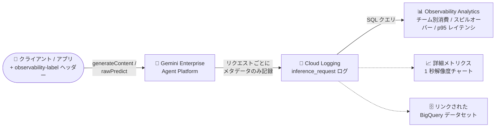

# Gemini Enterprise Agent Platform: 推論リクエストメタデータロギング (GA)

**リリース日**: 2026-10-30

**サービス**: Gemini Enterprise Agent Platform

**機能**: 推論リクエストメタデータロギング (Inference request metadata logging)

**ステータス**: GA (一般提供)

📊 [このアップデートのインフォグラフィックを見る](https://takech9203.github.io/google-cloud-news-summary/20261030-gemini-enterprise-agent-platform-inference-metadata-logging.html)

## 概要

Gemini Enterprise Agent Platform の推論リクエストメタデータロギングが GA (一般提供) になりました。プロジェクトが処理するすべての推論リクエストについて、Cloud Logging に 1 件ずつ構造化ログエントリを書き込めるようになります。各エントリには、モデル、リージョン、消費オプション (trafficType)、トークン数 (入力・出力・キャッシュ・思考トークンを含む)、Provisioned Throughput の消費量 (バーンダウン)、エンドツーエンドのレイテンシ、エラーコード、付与したカスタムラベルが記録されます。

重要な点として、エントリに記録されるのは**メタデータのみ**であり、プロンプトやレスポンスの内容は一切含まれません。プロンプトとレスポンスの内容が必要な場合は、別機能の request-response logging を使用します。ロギングは、generateContent / streamGenerateContent を使用する Gemini モデルと、rawPredict / streamRawPredict を使用する Claude モデルでサポートされ、Provisioned Throughput とすべての従量課金 (pay-as-you-go) オプションに対応します。

本機能は、集計メトリクスでは答えられない「どのチーム・アプリ・テナントがどれだけトークンを消費したか」「どのリクエストが Provisioned Throughput でなくオンデマンドにスピルオーバーしたか」「429 エラーが発生した正確な秒はいつか」といった問いに、Observability Analytics の SQL クエリで答えられるようにするもので、生成 AI ワークロードを運用するプラットフォームチーム・FinOps チームに特に有用です。

**アップデート前の課題**

- Provisioned Throughput や従量課金のトラフィックは 1 分単位の集計メトリクスでしか把握できず、1 分平均に隠れるバーストや、スピルオーバーが発生した個々の秒を特定できなかった
- トークン消費をチーム・アプリケーション・テナント単位で帰属させる標準的な仕組みがなく、コスト配賦が困難だった
- 個々のリクエストが Provisioned Throughput 枠で処理されたのか、オンデマンドにスピルオーバーしたのかをリクエスト単位で判別できなかった
- キャッシュの効き具合を集計値でしか測定できず、リクエスト単位での分析ができなかった

**アップデート後の改善**

- すべての推論リクエストのメタデータが Cloud Logging に記録され、Observability Analytics の SQL で集計・分析できるようになった
- `x-goog-agent-platform-observability-label-` プレフィックスのリクエストヘッダーで、チーム・アプリ・テナント単位の使用量帰属が可能になった
- コンソールで有効化すると詳細メトリクス (detailed metrics) も有効になり、Provisioned Throughput トラフィックを 1 秒解像度でチャート表示できるようになった。モデル可観測性ダッシュボードにも従量課金トラフィック向けの 1 秒解像度オプションが追加される
- trafficType と捕捉されたルーティングヘッダーから、スピルオーバーやダウングレードされたリクエストをログから識別できるようになった

## アーキテクチャ図



推論リクエストごとに Agent Platform がメタデータのみのログエントリを Cloud Logging の `aiplatform.googleapis.com/inference_request` ログに書き込み、Observability Analytics の SQL で集計分析、詳細メトリクスで 1 秒解像度の可視化、BigQuery 連携での分析が可能になります。

## サービスアップデートの詳細

### 主要機能

1. **リクエスト単位のメタデータログ**
   - 推論リクエスト 1 件につき 1 エントリを `projects/PROJECT_NUMBER/logs/aiplatform.googleapis.com%2Finference_request` に書き込む
   - モデル、リージョン、消費オプション (trafficType)、トークン数 (入力・出力・キャッシュ・思考)、Provisioned Throughput バーンダウン、エンドツーエンドレイテンシ (requestDuration)、エラーコード、カスタムラベルを記録
   - メタデータのみを記録し、プロンプト・レスポンスの内容は含まれない

2. **カスタムヘッダーラベルによる使用量の帰属**
   - `x-goog-agent-platform-observability-label-` プレフィックスのリクエストヘッダー (例: `x-goog-agent-platform-observability-label-team: payments`) を付与すると、エントリの `jsonPayload.httpHeaders` に記録される
   - Gemini / Claude の両モデル、Provisioned Throughput / 従量課金の両方で利用可能
   - Observability Analytics の SQL でラベル別のリクエスト数・トークン数を集計できる

3. **詳細メトリクス (1 秒解像度)**
   - コンソールでロギングを有効化すると詳細メトリクスも有効になり、Provisioned Throughput ダッシュボードが 1 分集計ではなくリクエスト単位ログから計算される
   - 1 秒解像度でトラフィックを表示でき、1 分平均では見えないバーストやスピルオーバーが発生した秒を特定できる
   - スループット、キャッシュヒット率、キャッシュトークン使用量のチャートが追加される
   - モデル可観測性ダッシュボードにも従量課金トラフィック向けの 1 秒解像度オプションが追加される

4. **スピルオーバー / ダウングレードの識別**
   - Provisioned Throughput の枠を使い切ってオンデマンドで処理された「スピルオーバー」リクエストを、trafficType と `X-Vertex-AI-LLM-Request-Type` ヘッダーの組み合わせから識別できる
   - 要求した従量課金オプション (priority / flex) と異なるオプションで処理された「ダウングレード」も trafficType の比較で検出できる

## 技術仕様

### 対応 API メソッドと制限

| 項目 | 詳細 |
|------|------|
| 対応 (Gemini) | `generateContent`、`streamGenerateContent` (これらのメソッド経由の画像生成を含む) |
| 対応 (Claude) | `rawPredict`、`streamRawPredict` (その他のパートナーモデルは非対応) |
| 消費オプション | Provisioned Throughput とすべての従量課金オプションに対応 |
| 非対応 | `chatCompletions`、`embedContent`、`predict`、`countTokens`、ファインチューニング済みモデル、チューニングジョブ、バッチ推論、自己デプロイのカスタムコンテナモデル |
| 注意 | クライアントが完了前にキャンセルしたリクエストはログエントリを生成しない |

### ログエントリの主なペイロードフィールド

| フィールド | 型 | 内容 |
|------|------|------|
| `method` | ENUM | `GENERATE_CONTENT`、`STREAM_GENERATE_CONTENT`、`RAW_PREDICT`、`STREAM_RAW_PREDICT` |
| `trafficType` | ENUM | `PROVISIONED_THROUGHPUT`、`ON_DEMAND`、`ON_DEMAND_FLEX`、`ON_DEMAND_PRIORITY` (失敗リクエストでは欠落) |
| `requestDuration` | STRING | エンドツーエンドのレイテンシ (例: `3.53s` の duration 文字列) |
| `generateContentDetails.usageMetadata` | JSON | Gemini のトークン数 (モダリティ別内訳を含む) |
| `rawPredictDetails.usageMetadata` | JSON | Claude など rawPredict 系のトークン数 |
| `provisionedThroughput` | JSON | `ptChargedInputTokenCount` / `ptChargedOutputTokenCount` / `accountingResource` (バーンダウン適用後の確定値) |
| `httpHeaders` | JSON | 捕捉されたリクエストヘッダー (カスタムラベルを含む) |
| `error` | JSON | severity が ERROR の場合のみ。gRPC ステータスコードと固定文字列の reason |

失敗したリクエストのエントリには trafficType と usageMetadata が含まれません。また `LogEntry.labels` の `gen_ai.operation.name` は OpenTelemetry GenAI セマンティック規約に準拠します。

## 設定方法

### 前提条件

1. IAM 権限: `aiplatform.endpoints.setPublisherModelConfig`、`aiplatform.endpoints.fetchPublisherModelConfig` (設定の変更・読み取り)、および `logging.buckets.get` / `logging.buckets.list` / `logging.buckets.update` / `logging.operations.get` (ログバケットのアップグレード)
2. SQL クエリや詳細メトリクスの利用には、`_Default` ログバケットの Observability Analytics へのアップグレードが必要 (数分かかり、元に戻せない。アップグレード前のエントリは SQL でクエリ不可)
3. Cloud Logging の取り込み・保存料金が発生することを確認しておく (デフォルトの保持期間は 30 日)

### 手順

#### ステップ 1: コンソールで有効化 (プロジェクト全体)

Google Cloud コンソールの **Provisioned Throughput** ページで、バナーの **Enable**、またはツールバーの **Metrics settings** から **Enable detailed metrics** を選択して保存します。プロジェクト内のすべての Gemini / Claude モデルでロギングが有効になり、必要に応じて `_Default` ログバケットのアップグレードもバックグラウンドで実行されます。

#### ステップ 2: REST API で有効化 (モデル・リージョン単位も可能)

特定のモデルやリージョンだけで有効化したい場合は REST API を使用します。無効化の例は次のとおりです (有効化は `state` を変更して同じリソースに設定)。

```bash
curl -X POST \
  -H "Authorization: Bearer $(gcloud auth print-access-token)" \
  -H "Content-Type: application/json" \
  "https://aiplatform.googleapis.com/v1beta1/projects/PROJECT_ID:setPublisherModelConfig" \
  -d '{
    "publisherModelConfig": {
      "inferenceEventLoggingConfig": {"state": "DISABLED"}
    },
    "updateMask": "inferenceEventLoggingConfig"
  }'
```

モデル単位の設定はプロジェクトのデフォルト設定より優先されます。設定の反映には数分かかることがあります。

#### ステップ 3: カスタムラベルを付与して SQL で分析

リクエストにヘッダーラベルを付与します。

```
x-goog-agent-platform-observability-label-team: payments
x-goog-agent-platform-observability-label-application: invoice-ocr
```

Observability Analytics でチーム別のトークン消費を集計する例は次のとおりです。

```sql
SELECT
  JSON_VALUE(json_payload.httpHeaders["x-goog-agent-platform-observability-label-team"].values[0]) AS team,
  COUNT(*) AS requests,
  SUM(CAST(JSON_VALUE(json_payload.generateContentDetails.usageMetadata.totalTokenCount) AS INT64)) AS total_tokens
FROM `PROJECT_ID.global._Default._Default`
WHERE log_id = "aiplatform.googleapis.com/inference_request"
  AND timestamp > TIMESTAMP_SUB(CURRENT_TIMESTAMP(), INTERVAL 7 DAY)
GROUP BY team
ORDER BY total_tokens DESC
```

ハイフンを含むヘッダー名にはブラケット記法が必要です (ドット記法は不可)。

## メリット

### ビジネス面

- **コスト帰属 (ショーバック / チャージバック)**: ヘッダーラベルでチーム・アプリ・テナント単位にトークン消費を帰属でき、生成 AI コストの配賦が標準の仕組みで実現できる
- **Provisioned Throughput 投資の可視化**: どのリクエストが購入済みスループットを消費し、どれがスピルオーバーしたかが分かり、コミットメントの適正サイズ判断に役立つ

### 技術面

- **秒レベルのトラブルシューティング**: 429 エラーやスピルオーバーが発生した正確な秒を特定でき、1 分平均では見えないバーストを把握できる
- **プライバシーに配慮した設計**: メタデータのみを記録し、プロンプト・レスポンス・ヘッダー値がエラー理由に含まれることもないため、コンテンツを保存せずに可観測性を得られる
- **標準の Cloud Logging 基盤**: Logs Explorer、Observability Analytics (SQL)、リンクされた BigQuery データセット、集約シンク (フォルダ / 組織単位の収集) といった既存のロギング機能をそのまま活用できる

## デメリット・制約事項

### 制限事項

- `chatCompletions`、`embedContent`、`predict`、`countTokens` は非対応。Imagen のように `predict` 経由で画像生成するモデルもログされない
- ファインチューニング済みモデル、チューニングジョブ、バッチ推論などの長時間実行オペレーション、自己デプロイのカスタムコンテナモデルは対象外
- Claude 以外のパートナーモデルはログされない
- クライアントが完了前にキャンセルしたリクエストはエントリを生成しない
- 失敗したリクエストのエントリには trafficType と usageMetadata が記録されない (失敗した事実とエラーコードのみ)

### 考慮すべき点

- SQL クエリと詳細メトリクスには `_Default` ログバケットの Observability Analytics へのアップグレードが必要で、**アップグレードは元に戻せない**。またアップグレード前に書き込まれたエントリは SQL でクエリできないため、分析したいトラフィックを送る前にアップグレードする
- Cloud Logging の取り込み・保存コストが発生する。エントリサイズはヘッダーラベル数などに依存するため、代表的なワークロードで 1 日有効化して取り込み量を測定し、月間コストを見積もることが推奨されている
- プロジェクトレベルで無効化しても、モデル単位で明示的に有効化した設定は優先されるため、個別に無効化が必要
- グローバルエンドポイント宛てのリクエストは location ラベルが `global` になるため、リージョン別に帰属させたい場合はリージョンエンドポイントに送信する
- エントリがクエリ可能になるまで通常 12 秒以内、最大 5 分程度かかる

## ユースケース

### ユースケース 1: マルチテナント SaaS でのトークン消費のテナント別配賦

**シナリオ**: 複数の顧客テナントにまたがって Gemini / Claude モデルを呼び出す SaaS で、テナントごとのトークン消費を把握して課金やキャパシティ計画に反映したい。

**実装例**:
```
# 各テナントのリクエストにラベルヘッダーを付与
x-goog-agent-platform-observability-label-tenant: customer-a
```
Observability Analytics でテナント別に requests / total_tokens を GROUP BY して集計する。

**効果**: アプリケーション側で独自の計測基盤を作り込まずに、テナント別のトークン消費・レイテンシ・エラー率を SQL で把握できる。

### ユースケース 2: Provisioned Throughput のスピルオーバー分析と 429 エラーの原因究明

**シナリオ**: Provisioned Throughput を購入しているが、ピーク時間帯に 429 エラーやオンデマンドへのスピルオーバーが発生しており、どの秒・どのモデルで枠が枯渇したのかを特定したい。

**効果**: 詳細メトリクスの 1 秒解像度チャートでバーストを可視化し、SQL で「スピルオーバー件数 / 分」「エラーコード 8 (RESOURCE_EXHAUSTED) の発生分布」「p95 レイテンシ」を集計することで、コミットメント増強やクライアント側リトライ設計の根拠を得られる。

## 料金

推論リクエストメタデータロギング自体は Cloud Logging への書き込みとして課金され、**Cloud Logging の取り込み・保存料金**が適用されます。Observability Analytics でのクエリは **Cloud Monitoring の使用量**として課金されます。BigQuery データセットをリンクしても BigQuery のストレージ料金は追加で発生しません。

エントリサイズはリクエスト内容 (ヘッダーラベル数など) に依存するため、公式ドキュメントでは、代表的なワークロードで 1 日ロギングを有効化し、Log volume analysis で取り込み量を測定したうえで Google Cloud 料金計算ツールで月間コストを見積もる方法が案内されています。

- [Cloud Logging 料金](https://cloud.google.com/stackdriver/pricing)

## 関連サービス・機能

- **Cloud Logging**: ログエントリの書き込み先。Logs Explorer での個別エントリの検索、ログバケットの保持期間管理、集約シンクによる組織横断収集を提供
- **Observability Analytics**: アップグレード済みログバケットに対する SQL クエリ基盤。チーム別消費、バーンダウン、スピルオーバー、p95 レイテンシなどの集計分析に使用
- **BigQuery**: リンクされたデータセット経由で同じログデータを BigQuery から読み取り可能
- **Provisioned Throughput**: 本ロギングのバーンダウンフィールド (`ptChargedInputTokenCount` など) がクォータ消費の確定値を提供。コンソールの有効化入口も Provisioned Throughput ページ
- **Request-Response Logging**: プロンプトとレスポンスの内容が必要な場合に使用する別機能 (本機能はメタデータのみ)

## 参考リンク

- 📊 [インフォグラフィック](https://takech9203.github.io/google-cloud-news-summary/20261030-gemini-enterprise-agent-platform-inference-metadata-logging.html)
- [公式リリースノート](https://docs.cloud.google.com/release-notes#October_30_2026)
- [ドキュメント: Log inference request metadata](https://docs.cloud.google.com/gemini-enterprise-agent-platform/models/capabilities/inference-metadata-logging)
- [ドキュメント: Use Provisioned Throughput (Detailed metrics)](https://docs.cloud.google.com/gemini-enterprise-agent-platform/models/provisioned-throughput/use-provisioned-throughput)
- [料金ページ (Cloud Logging)](https://cloud.google.com/stackdriver/pricing)

## まとめ

推論リクエストメタデータロギングの GA により、Gemini Enterprise Agent Platform 上の生成 AI トラフィックをリクエスト単位・秒単位で可観測化し、チーム / アプリ / テナントへのコスト帰属やスピルオーバー分析を標準機能として実現できるようになりました。Provisioned Throughput を利用中、またはマルチチームで生成 AI を運用している組織は、まず代表的なワークロードで 1 日有効化して取り込みコストを見積もり、`_Default` バケットのアップグレード (不可逆) を確認したうえで本番有効化とラベル設計を進めることを推奨します。

---

**タグ**: #GeminiEnterpriseAgentPlatform #CloudLogging #ObservabilityAnalytics #ProvisionedThroughput #FinOps #GA
