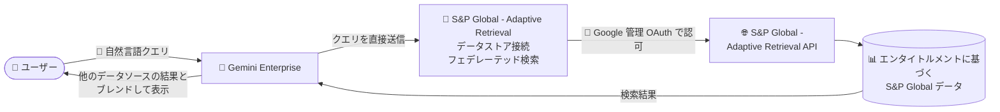

# Gemini Enterprise: S&P Global - Adaptive Retrieval データストア (Public Preview)

**リリース日**: 2026-10-30

**サービス**: Gemini Enterprise

**機能**: S&P Global - Adaptive Retrieval データストア

**ステータス**: Public Preview

📊 [このアップデートのインフォグラフィックを見る](https://takech9203.github.io/google-cloud-news-summary/20261030-gemini-enterprise-sp-global-adaptive-retrieval.html)

## 概要

Gemini Enterprise で **S&P Global - Adaptive Retrieval データストア**が Public Preview として利用可能になりました。このデータストアを利用すると、S&P Global アカウントでアクセス権 (エンタイトルメント) を持つ S&P Global のデータに対して、自然言語で質問できるようになります。

この機能はフェデレーテッド検索 (federated search) として提供されます。ユーザーが Gemini Enterprise に検索クエリを送信すると、クエリは S&P Global - Adaptive Retrieval API に直接送信され、Gemini Enterprise は返された結果を他の接続済みデータソースの結果とブレンドして、包括的な検索結果として表示します。データは Gemini Enterprise のインデックスにコピーされないため、データストレージを管理する必要がありません。

金融・市場データを扱うアナリストや、S&P Global のデータを日常的に参照する企業ユーザーが、社内データと外部の金融インテリジェンスを単一の対話型インターフェースから横断的に検索できるようになる点が主要な価値です。なお、フェデレーテッド検索機能は Pre-GA Offerings Terms が適用される Public Preview 段階であり、サポートが限定される場合があります。

**アップデート前の課題**

- Gemini Enterprise から S&P Global のデータに直接アクセスする手段がなく、S&P Global のデータを参照するには別のツールやインターフェースを使う必要があった
- 社内データソースの検索結果と S&P Global のデータを統合して確認するには、手動で情報を突き合わせる必要があった

**アップデート後の改善**

- Gemini Enterprise 上で自然言語を使って、自分の S&P Global アカウントがアクセス権を持つデータに質問できるようになった
- フェデレーテッド検索により、S&P Global の検索結果が他の接続済みデータソースの結果とブレンドされ、包括的な検索結果として表示されるようになった
- Google 管理の OAuth を使用するため、独自の OAuth アプリケーションの作成やクライアント ID / シークレットの提供が不要になった

## アーキテクチャ図

ユーザーの自然言語クエリは Gemini Enterprise から S&P Global - Adaptive Retrieval API に直接送信され、ユーザーの S&P Global アカウントがアクセス権を持つデータから検索結果が返されます。結果は他の接続済みデータソースの結果とブレンドされて表示されます。

## サービスアップデートの詳細

### 主要機能

1. **自然言語による S&P Global データの検索**
   - S&P Global アカウントがエンタイトルメントを持つデータに対して、自然言語で質問できる
   - 検索対象のエンティティとして「Agent」を選択する

2. **フェデレーテッド検索による結果のブレンド**
   - クエリは S&P Global - Adaptive Retrieval API に直接送信される
   - Gemini Enterprise は結果を他の接続済みデータソースの結果とブレンドし、包括的な検索結果として表示する
   - データは Gemini Enterprise のインデックスにコピーされないため、ストレージ管理が不要 (ただし、インデックスしないため検索品質はインデックス型より低くなる可能性がある)

3. **Google 管理 OAuth による認可**
   - 独自の OAuth アプリケーションの作成やクライアント ID / シークレットの提供は不要
   - アプリでコネクタを有効化する際に、自分の S&P Global アカウントでコネクタを認可する

## 技術仕様

### データストアの構成オプション

| 項目 | 詳細 |
|------|------|
| 接続方式 | データフェデレーション (インデックスへのコピーなし) |
| 検索対象エンティティ | Agent |
| 必要な IAM ロール | Discovery Engine Editor (`roles/discoveryengine.editor`) — データストア作成に必要 |
| 認可方式 | Google 管理 OAuth (独自の OAuth アプリ不要) |
| ロケーション | マルチリージョンから選択 |
| 暗号化 | us / eu を選択した場合、Google 管理の暗号鍵または Cloud KMS 鍵 (CMEK) を構成 |
| 静的 IP | Advanced options で Static IP Addresses を有効化可能 (ソースシステム側での許可リスト登録向け) |
| 課金 | General pricing または Configurable pricing を選択 |

### データハンドリング (プライバシー上の留意点)

フェデレーテッド検索の利用時には、以下のデータ取り扱いルールが適用されます。

- クエリ文字列はサードパーティの検索バックエンド (S&P Global - Adaptive Retrieval API) に送信される
- サードパーティはクエリをユーザーの ID と関連付ける可能性がある
- 複数のフェデレーテッド検索データソースが有効な場合、クエリがそれらすべてに送信される可能性がある
- サードパーティシステムに到達したデータは、そのシステムの利用規約とプライバシーポリシーに準拠する
- 精度向上のため、LLM がクエリを書き換えてから S&P Global - Adaptive Retrieval に送信する場合がある。書き換えられたクエリにはセッションのクエリ履歴の一部が含まれる可能性がある

## 設定方法

### 前提条件

1. データストアを作成するユーザーに **Discovery Engine Editor ロール** (`roles/discoveryengine.editor`) を付与する
2. アクセス対象データのエンタイトルメントを持つ S&P Global アカウントを用意する

### 手順

#### ステップ 1: データストアの作成

1. Google Cloud コンソールで **Gemini Enterprise** ページに移動し、プロジェクトを選択または作成する
2. ナビゲーションメニューで **Data stores** をクリックし、**Create data store** をクリックする
3. **Source** セクションで「S&P Global - Adaptive Retrieval」を検索して **Select** をクリックする
4. **Data > Entities to search** セクションで **Agent** を選択し、**Continue** をクリックする
5. (任意) **Advanced options** が表示される場合、**Enable Static IP Addresses** を選択できる
6. **Configuration** セクションでマルチリージョンとコネクタ名を設定する (us / eu の場合は暗号化設定も構成)
7. **Billing** セクションで **General pricing** または **Configurable pricing** を選択し、**Create** をクリックする

#### ステップ 2: アプリへの接続と認可

1. Data Stores ページでデータストアのステータスが **Creating** から **Active** に変わるのを確認する
2. 作成したデータストアを既存のアプリに接続するか、新規アプリを作成して接続する
3. クエリを実行する前に、Gemini Enterprise が S&P Global - Adaptive Retrieval にアクセスできるよう認可する

## メリット

### ビジネス面

- **金融データへのシームレスなアクセス**: S&P Global のデータを別ツールに切り替えることなく、Gemini Enterprise の対話型インターフェースから自然言語で参照できる
- **横断検索による洞察の統合**: 社内データソースと S&P Global のデータの検索結果がブレンドされ、包括的な検索体験を得られる

### 技術面

- **ストレージ管理が不要**: フェデレーション方式のためデータが Gemini Enterprise のインデックスにコピーされず、ストレージの管理・コストを考慮する必要がない
- **OAuth 設定の簡素化**: Google 管理 OAuth により、独自の OAuth アプリケーションやクライアント ID / シークレットの管理が不要
- **エンタープライズ要件への対応**: CMEK (Cloud KMS 鍵) や静的 IP エグレスなど、エンタープライズ向けのセキュリティオプションを利用できる

## デメリット・制約事項

### 制限事項

- Public Preview のため、Pre-GA Offerings Terms が適用され、サポートが限定される場合がある
- フェデレーション方式のためデータはインデックスされず、インデックス型のデータ取り込みと比べて検索品質が低くなる可能性がある
- アクセスできるのは S&P Global アカウントがエンタイトルメントを持つデータのみ

### 考慮すべき点

- クエリ文字列 (および LLM によるクエリ書き換えで含まれる可能性のあるセッション履歴の一部) が S&P Global のバックエンドに送信され、ユーザー ID と関連付けられる可能性がある
- サードパーティシステムに送信されたデータは、Google Cloud ではなくそのシステムの利用規約・プライバシーポリシーに準拠する
- 複数のフェデレーテッド検索データソースを有効にしている場合、クエリがすべてのバックエンドに送信される可能性がある

## ユースケース

### ユースケース 1: 金融アナリストによる市場データの対話的検索

**シナリオ**: 金融アナリストが、S&P Global のデータに基づく市場情報を日常的に参照している。従来は専用ツールで検索し、社内資料と手動で突き合わせていた。

**効果**: Gemini Enterprise 上で自然言語により S&P Global のデータへ直接質問でき、社内の接続済みデータソースの検索結果とブレンドされた包括的な回答を得られる。

### ユースケース 2: エンタープライズ検索基盤への外部金融データの統合

**シナリオ**: 企業が Gemini Enterprise を全社検索基盤として運用しており、外部の金融インテリジェンスも同じ入口から検索できるようにしたい。

**効果**: データストアを作成してアプリに接続するだけで、エンタイトルメントに基づく S&P Global データがフェデレーテッド検索の対象に加わる。データの複製が発生しないため、ストレージや同期パイプラインの運用負荷がない。

## 料金

データストア作成時の Billing セクションで **General pricing** または **Configurable pricing** を選択します。具体的な料金はエディションやライセンスによって異なるため、公式ドキュメントを参照してください。

- [Gemini Enterprise のライセンス](https://docs.cloud.google.com/gemini/enterprise/docs/licenses)

## 利用可能リージョン

データコネクタの作成時にマルチリージョン (us、eu など) を選択します。詳細は公式ドキュメントを参照してください。

- [データレジデンシーと ML リージョナル処理](https://docs.cloud.google.com/gemini/enterprise/docs/locations)

## 関連サービス・機能

- **Gemini Enterprise アプリ**: 作成したデータストアをアプリに接続することで、ユーザーがクエリを実行するインターフェースを提供する
- **Cloud KMS (CMEK)**: us / eu ロケーション選択時に、顧客管理の暗号鍵でデータストアを保護できる
- **静的 IP エグレス**: データストアからのアウトバウンドトラフィックを固定 IP セットから発信し、ソースシステム側で許可リスト登録できる
- **サードパーティデータストアのアラート**: データストアに対する定期的なアラートを構成できる
- **S&P Global - Deterministic Retrieval データストア**: 同じく S&P Global のデータに接続するデータストア (検索対象エンティティは Dataset)

## 参考リンク

- 📊 [インフォグラフィック](https://takech9203.github.io/google-cloud-news-summary/20261030-gemini-enterprise-sp-global-adaptive-retrieval.html)
- [公式リリースノート](https://docs.cloud.google.com/release-notes#October_30_2026)
- [S&P Global - Adaptive Retrieval データストアのセットアップ](https://docs.cloud.google.com/gemini/enterprise/docs/connectors/s_p_global_adaptive_retrieval/set-up-data-store)
- [サードパーティデータソースの接続](https://docs.cloud.google.com/gemini/enterprise/docs/connectors/connect-third-party-data-source)
- [コネクタとデータストアの概要](https://docs.cloud.google.com/gemini/enterprise/docs/connectors/introduction-to-connectors-and-data-stores)
- [Gemini Enterprise のライセンス](https://docs.cloud.google.com/gemini/enterprise/docs/licenses)

## まとめ

S&P Global - Adaptive Retrieval データストアの Public Preview により、Gemini Enterprise からエンタイトルメントに基づく S&P Global のデータを自然言語で検索できるようになりました。フェデレーテッド検索のためデータ複製や同期の運用負荷がなく、Google 管理 OAuth によりセットアップも簡素です。金融データを扱う組織は、クエリがサードパーティに送信されるというデータハンドリング特性を確認した上で、Preview 段階での評価を始めることを推奨します。

---

**タグ**: Gemini Enterprise, S&P Global, Adaptive Retrieval, データストア, フェデレーテッド検索, コネクタ, Public Preview
