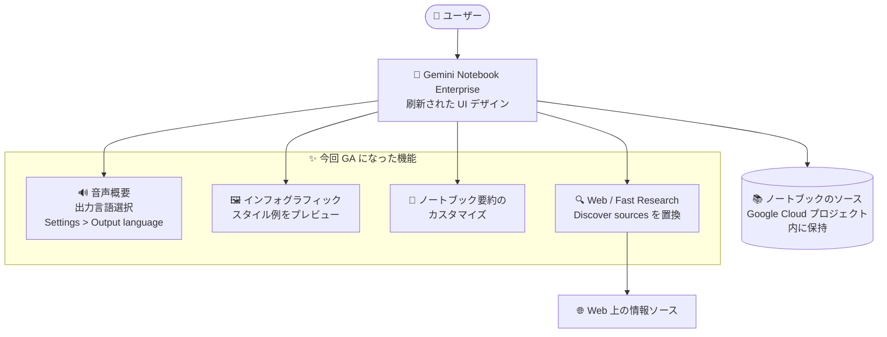

# Gemini Enterprise: Gemini Notebook Enterprise ビジュアルリフレッシュ (UI 刷新と新機能群が GA)

**リリース日**: 2026-10-30

**サービス**: Gemini Enterprise (Gemini Notebook Enterprise)

**機能**: Gemini Notebook Enterprise ビジュアルリフレッシュ (UI 刷新・音声概要の出力言語選択・Fast Research ほか)

**ステータス**: GA (一般提供)

📊 [このアップデートのインフォグラフィックを見る](https://takech9203.github.io/google-cloud-news-summary/20261030-gemini-notebook-enterprise-visual-refresh.html)

## 概要

Gemini Notebook Enterprise の UI と機能群を刷新する「Visual refresh」アップデートが GA (一般提供) になりました。Gemini Notebook Enterprise は、PDF、Google ドキュメント/スライド、Web サイト URL などのソースを「ノートブック」として集約し、AI がそれらのソースにグラウンディングした回答・要約・コンテンツ生成を行う、エンタープライズ向けの AI リサーチ/ライティングツールです。データは常に自社の Google Cloud プロジェクト内に保持され、VPC-SC、CMEK、データレジデンシーなどのコンプライアンス機能を備えています。

今回のアップデートでは、コンシューマー版および Google Workspace 版の Gemini Notebook と統一されたカラースキーム/スタイルへの UI 刷新に加え、音声概要 (Audio overview) の出力言語選択、インフォグラフィックのビジュアルスタイルのプレビュー、ノートブック要約のカスタマイズ、Web 上の高速リサーチ機能「Fast Research」など、6 つの変更・新機能がまとめて GA になりました。

コンシューマー版の Gemini Notebook (NotebookLM) に慣れたユーザーがエンタープライズ版でも同じ操作感で利用できるようになるため、組織内での利用定着を進めたい管理者や、多言語チームでノートブックを活用するユーザーにとって有益なアップデートです。

**アップデート前の課題**

- Gemini Notebook Enterprise の UI はコンシューマー版/Google Workspace 版の Gemini Notebook とデザインが異なり、両方を使うユーザーに操作感の差異があった
- 音声概要 (Audio overview) の出力言語をノートブックの言語と別に選択する設定が UI になかった
- インフォグラフィック生成時に、ビジュアルスタイルの実際の見た目を事前に確認せずに選択する必要があった
- ノートブックの要約は自動生成されたものを使う前提で、独自の要約に置き換える手段がなかった
- Web からのソース探索は「Discover sources」機能と「I'm feeling curious」ボタンによって提供されていた

**アップデート後の改善**

- UI のカラースキームとスタイルがコンシューマー版/Google Workspace 版の Gemini Notebook と統一され、一貫した利用体験が得られるようになった
- 「設定 > 出力言語 (Settings > Output language)」から音声概要の出力言語を選択でき、ノートブックの言語と異なる言語で音声を生成できるようになった
- インフォグラフィック作成時に、ビジュアルスタイルの例を事前に確認してから選択できるようになった
- 「その他のオプション (More options) > ノートブックをカスタマイズ (Customize notebook)」から、自動生成された要約を独自のカスタム要約に置き換えられるようになった
- Web 上の情報探索は「Web」と「Fast Research」に置き換えられ、より高速なリサーチが可能になった (「Discover sources」と「I'm feeling curious」ボタンは廃止)

## アーキテクチャ図



今回のアップデートで GA になった機能群のマップです。刷新された UI を起点に、音声概要の多言語出力、インフォグラフィックのスタイルプレビュー、要約カスタマイズ、Web 上の Fast Research が利用できます。ソースデータは従来どおり自社の Google Cloud プロジェクト内に保持されます。

## サービスアップデートの詳細

### 主要機能

1. **UI デザインの刷新 (Refreshed UI design)**
   - カラースキームとスタイルが更新され、コンシューマー版および Google Workspace 版の Gemini Notebook とデザインが統一された
   - 個人利用とエンタープライズ利用で一貫した操作体験を提供

2. **音声概要の出力言語選択 (Audio overview language selection)**
   - 音声概要の出力言語を選択できるようになった
   - ノートブックの言語と異なる言語で音声出力を生成可能
   - 設定場所: 「Settings > Output language」

3. **インフォグラフィックの更新 (Infographic update)**
   - インフォグラフィック生成前に、ビジュアルスタイルの例を確認してから選択できるようになった

4. **ノートブック要約のカスタマイズ (Customize the notebook summary)**
   - 自動生成されたノートブックの要約を、独自のカスタム要約に置き換え可能になった
   - 操作: 「More options (その他のオプション) > Customize notebook」を選択

5. **ノートブック共有の変更 (Sharing notebooks)**
   - ノートブック共有時の通知で、ウェルカムノート (welcome note) を書くオプションが廃止された

6. **Web 上の Fast Research (Fast Research on the web)**
   - 「Web」と「Fast Research」が従来の「Discover sources」を置き換えた
   - 「I'm feeling curious」ボタンは利用できなくなった

## 技術仕様

### Gemini Notebook Enterprise の基本仕様

| 項目 | 詳細 |
|------|------|
| ノートブック数 | ユーザーあたり 500 |
| ソース数 | ノートブックあたり 300 |
| ソースサイズ | ソースあたり 500 MB または 500,000 語 |
| クエリ | ユーザーあたり 1 日 500 |
| 音声概要 (Audio overviews) | ユーザーあたり 1 日 20 |
| インフォグラフィック | ユーザーあたり 1 日 15 |
| 対応ソース | Google ドキュメント/スライド、コピーテキスト、公開 URL、YouTube 動画、PDF、TXT、Markdown、音声ファイル、画像ファイル、DOCX、PPTX、XLSX |
| ユーザーインターフェース | `https://notebook.cloud.google.com/REGION/?project=PROJECT_NUMBER` (管理者がプロジェクト/リージョン固有の URL を配布) |
| 認証 | Cloud Identity、またはサードパーティ IdP (Microsoft Entra ID、Okta、Ping など OIDC / SAML 2.0) |
| コンプライアンス | VPC Service Controls、CMEK、データレジデンシー |

### 音声概要の API (参考)

音声概要は UI に加えて API (Preview) でも生成でき、`languageCode` パラメータで言語を指定できます。

```bash
curl -X POST \
  -H "Authorization: Bearer $(gcloud auth print-access-token)" \
  "https://ENDPOINT_LOCATION-discoveryengine.googleapis.com/v1alpha/projects/PROJECT_NUMBER/locations/LOCATION/notebooks/NOTEBOOK_ID/audioOverviews" \
  -d '{
    "sourceIds": [{ "id": "SOURCE_ID" }],
    "episodeFocus": "EPISODE_FOCUS",
    "languageCode": "LANGUAGE_CODE"
  }'
```

## 設定方法

### 前提条件

1. Gemini Notebook Enterprise のサブスクリプション (スタンドアロン、または Gemini Enterprise Standard / Plus に含まれる) とライセンスの割り当て
2. ユーザーに Cloud NotebookLM User (`roles/discoveryengine.notebookLmUser`) ロールが付与されていること

### 手順

#### 音声概要の出力言語を変更する

1. Gemini Notebook Enterprise のユーザーインターフェースでノートブックを開く
2. 「Settings > Output language」で希望の出力言語を選択する
3. 音声概要を生成すると、選択した言語で出力される

#### ノートブック要約をカスタマイズする

1. ノートブックの「More options (その他のオプション)」メニューを開く
2. 「Customize notebook」を選択する
3. 自動生成された要約を独自のカスタム要約に置き換える

今回の機能はすべて GA のユーザー向け UI 機能であり、管理者側での追加の有効化作業は Release Notes には記載されていません。

## メリット

### ビジネス面

- **利用定着の促進**: コンシューマー版 Gemini Notebook と統一された UI により、個人で使い慣れたユーザーがエンタープライズ版へスムーズに移行でき、社内教育コストを削減できる
- **多言語チームでの活用**: 音声概要の出力言語を選択できるため、英語ドキュメントのノートブックから日本語の音声概要を生成するなど、グローバルチームでの情報共有が容易になる

### 技術面

- **成果物品質の事前確認**: インフォグラフィックのビジュアルスタイル例を事前に確認できるため、生成のやり直しを減らせる
- **ナレッジの文脈付与**: 自動生成要約をカスタム要約に置き換えられるため、ノートブックの目的や注意事項をチームに正確に伝えられる
- **リサーチの高速化**: Web と Fast Research により、Web 上の情報ソース探索が従来の Discover sources より整理された形で利用できる

## デメリット・制約事項

### 制限事項

- ノートブック共有の通知時にウェルカムノートを書くオプションが廃止されたため、共有時のメッセージ添付はできなくなった
- 「Discover sources」と「I'm feeling curious」ボタンは廃止され、従来のソース探索フローに依存していた場合は新しい「Web / Fast Research」への移行が必要
- ノートブックの共有は同一 Google Cloud プロジェクト内のユーザーに限定され、パブリック共有はできない (従来からの仕様)

### 考慮すべき点

- UI の刷新により画面の配色・スタイルが変わるため、社内マニュアルやトレーニング資料のスクリーンショット更新が必要になる場合がある
- 音声概要などの生成系機能には 1 日あたりの利用上限 (音声概要 20 回/ユーザー、インフォグラフィック 15 回/ユーザーなど) がある

## ユースケース

### ユースケース 1: グローバルチーム向けの多言語音声ブリーフィング

**シナリオ**: 日本拠点のチームが、英語で書かれた製品仕様書や市場調査レポートをノートブックに集約している。通勤時間などに日本語で内容を把握したい。

**実装例**:
```
1. 英語ソースを集約したノートブックを開く
2. Settings > Output language で「日本語」を選択
3. 音声概要を生成し、日本語のポッドキャスト形式で内容を確認
```

**効果**: ノートブックの言語に縛られずメンバーの母国語で音声ブリーフィングを提供でき、多言語チームの情報格差を減らせる。

### ユースケース 2: 部門ナレッジベースの要約カスタマイズと共有

**シナリオ**: 社内規程やオンボーディング資料を集約したノートブックを新入社員に共有する際、ノートブックの使い方や問い合わせ先を要約に明記したい。

**効果**: More options > Customize notebook で自動生成要約を独自の案内文に置き換えることで、共有相手がノートブックの目的と使い方をすぐに理解できる。ウェルカムノート機能は廃止されたため、伝達事項はカスタム要約に集約するとよい。

## 料金

今回のアップデート自体に伴う追加料金はありません。Gemini Notebook Enterprise はサブスクリプション (ライセンス) ベースの課金で、スタンドアロン製品として、または Gemini Enterprise (Standard / Plus) の一部として購入できます。

- サブスクリプションは最小 15 ライセンスから最大 5,000 ライセンス (それ以上は営業担当に相談)
- 月額または年額のサブスクリプションを選択可能 (自動更新設定あり)
- 14 日間のフル機能の無料トライアル (5,000 ライセンス) あり

詳細は [Gemini Enterprise の料金ページ](https://cloud.google.com/gemini-enterprise) および [ライセンス設定ドキュメント](https://docs.cloud.google.com/gemini/enterprise/notebooklm-enterprise/docs/set-up-licensing) を参照してください。

## 利用可能リージョン

Gemini Notebook Enterprise のサブスクリプションはマルチリージョン単位 (`us`、`eu`、`global`) で提供されます。コンプライアンス上の要件がない場合は、可用性と低レイテンシの観点から `global` が推奨されています。詳細は [ロケーションのドキュメント](https://docs.cloud.google.com/gemini/enterprise/docs/locations) を参照してください。

## 関連サービス・機能

- **Gemini Enterprise**: Gemini Notebook Enterprise を包含する親製品。Standard / Plus エディションのサブスクリプションには Gemini Notebook Enterprise が含まれる。Gemini Enterprise のデータソースとして Notebook を検索対象にすることも可能 (Public Preview)
- **Gemini Notebook (コンシューマー版 / Google Workspace 版)**: 今回の UI 刷新で配色・スタイルが統一された個人/Workspace 向け製品 (旧 NotebookLM)
- **Cloud Identity / サードパーティ IdP**: Gemini Notebook Enterprise へのユーザー認証に使用 (Microsoft Entra ID、Okta、Ping など)
- **VPC Service Controls / CMEK**: エンタープライズ向けのセキュリティ・コンプライアンス統制に使用

## 参考リンク

- 📊 [インフォグラフィック](https://takech9203.github.io/google-cloud-news-summary/20261030-gemini-notebook-enterprise-visual-refresh.html)
- [公式リリースノート](https://docs.cloud.google.com/release-notes#October_30_2026)
- [Gemini Notebook Enterprise 概要](https://docs.cloud.google.com/gemini/enterprise/notebooklm-enterprise/docs/overview)
- [Gemini Notebook Enterprise と Gemini Enterprise の選択](https://docs.cloud.google.com/gemini/enterprise/docs/choose-product)
- [ライセンスとサブスクリプションの設定](https://docs.cloud.google.com/gemini/enterprise/notebooklm-enterprise/docs/set-up-licensing)
- [Gemini Enterprise リリースノート](https://docs.cloud.google.com/gemini/enterprise/docs/release-notes)

## まとめ

Gemini Notebook Enterprise の UI がコンシューマー版 Gemini Notebook と統一され、音声概要の出力言語選択や要約カスタマイズ、Web 上の Fast Research など実用的な機能群が GA になりました。すでに利用中の組織は追加設定なしで新 UI と新機能を利用できますが、「Discover sources」や共有時のウェルカムノートの廃止など運用に影響する変更もあるため、社内の利用ガイドやトレーニング資料の更新を推奨します。多言語チームでは音声概要の出力言語選択の活用をまず検討するとよいでしょう。

---

**タグ**: Gemini Enterprise, Gemini Notebook Enterprise, NotebookLM, GA, UI, Audio Overview, Fast Research, 生成 AI
