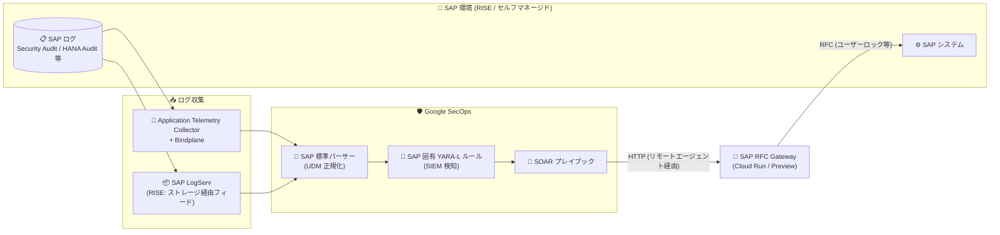

# SAP on Google Cloud: Google SecOps for SAP が一般提供 (GA) 開始

**リリース日**: 2026-10-30

**サービス**: SAP on Google Cloud / Google Security Operations (SecOps)

**機能**: Google SecOps for SAP

**ステータス**: GA (一般提供) ※自動脅威対応機能は Preview

📊 [このアップデートのインフォグラフィックを見る](https://takech9203.github.io/google-cloud-news-summary/20261030-google-secops-for-sap-ga.html)

## 概要

Google SecOps for SAP が一般提供 (GA) となりました。このソリューションは、ビジネスクリティカルな SAP のテレメトリ (インフラログ・アプリケーションログ) を Google Security Operations (Google SecOps) に統合し、SAP 環境に対する統一的な可視性、脅威検知、セキュリティ対応機能を提供します。これにより、SAP 環境とセキュリティ運用の間に存在していた「可視性のギャップ」を解消し、SecOps アナリストが SAP 固有の脅威を IT 環境全体の脅威と並べて検知・調査・対応できるようになります。

今回の GA リリースには、(1) SAP RISE およびセルフマネージド SAP 環境 (Google Cloud、オンプレミス、他クラウド) からのログ取り込み、(2) Google SecOps Detection Rules GitHub リポジトリで提供される SAP 固有の YARA-L 脅威検知ルール、(3) SAP RFC Gateway と SOAR プレイブックによる自動脅威対応・封じ込め機能 (Preview) が含まれます。

対象ユーザーは、SAP Basis 管理者 (ログ抽出の構成と接続の健全性管理)、SecOps チームとアナリスト (SAP 固有の脅威監視)、CISO およびコンプライアンスチーム (統一的な可視性によるセキュリティポスチャー監視と規制遵守) です。SAP の専門知識やカスタムログパイプラインを構築することなく、財務記録・顧客情報・知的財産などの重要データを不正アクセス、データ持ち出し、不正行為から守ることができます。

**アップデート前の課題**

- SAP のログ形式は独自性が高く、SIEM に取り込むにはカスタムのログパイプラインを構築・保守する必要があった
- SAP 環境とそれ以外の IT 環境でセキュリティ監視がサイロ化し、SecOps チームが SAP 固有の脅威 (不正な構成変更、権限昇格、RFC の悪用など) を検知するには深い SAP の専門知識が必要だった
- SAP システム内での脅威封じ込め (ユーザーロックなど) は手動対応が中心で、SIEM/SOAR の自動化ワークフローから直接実行する標準的な手段がなかった

**アップデート後の改善**

- SAP RISE とセルフマネージド環境 (Google Cloud / オンプレミス / 他クラウド) の両方に対応した標準のログ取り込みパスが GA として提供され、SAP 専用の標準パーサーが生ログを UDM (Unified Data Model) に自動正規化する
- Google のセキュリティ専門家がキュレーションした SAP 固有の YARA-L 検知ルールが GitHub リポジトリ (`rules/community/sap`) から入手でき、インポートするだけで不正な構成変更・権限昇格・RFC 悪用などを検知できる
- SAP RFC Gateway (Cloud Run 上で動作する HTTP-to-RFC ブリッジ) と SOAR プレイブックにより、ユーザーロックやセッション強制終了などの封じ込めアクションを SAP システム内で自動実行できる (Preview)

## アーキテクチャ図



SAP 環境からインフラ・アプリケーションログを収集して Google SecOps に取り込む「インバウンドパイプライン」と、検知した脅威に対して SOAR プレイブックから SAP RFC Gateway 経由で封じ込めアクションを SAP システムに実行する「アウトバウンドパイプライン」の 2 つのワークフローで構成されます。

## サービスアップデートの詳細

### 主要機能

1. **SAP ログ取り込み (GA)**
   - **SAP RISE 環境**: インフラログは SAP LogServ がクラウドストレージ (Cloud Storage / Amazon S3 / Azure Blob Storage) に書き出し、Google SecOps がフィード経由で取得。アプリケーションログは Application Telemetry Collector が RFC プロトコルで抽出し、Bindplane サーバー経由で転送
   - **セルフマネージド環境**: SAP ホストにインストールした Bindplane エージェントがインフラログを収集し、中央の Application Telemetry Collector がアプリケーションログを抽出。いずれも Bindplane サーバー経由で Google SecOps に転送
   - Google SecOps の SAP 専用標準パーサーが、複雑な SAP ログを構造化された UDM 形式に自動変換

2. **SAP 固有の YARA-L 脅威検知ルール (GA)**
   - [Google SecOps Detection Rules](https://github.com/chronicle/detection-rules) GitHub リポジトリの `rules/community/sap` ディレクトリで公式提供
   - 不正な構成変更、権限昇格、RFC 悪用などの脅威を検知
   - データテーブル (`SAP_ADMIN_USERS`、`production_systems`、`sensitive_abap_programs`、`sensitive_roles`、`sensitive_tables` など) を使って、自社の SAP ランドスケープに合わせたチューニングが可能
   - ルールの運用状態 (Detecting / Alerting / Risk scoring) を個別に設定可能

3. **自動脅威対応・封じ込め (Preview)**
   - SAP RFC Gateway: Cloud Run 上で動作するコンテナ化された HTTP-to-RFC ブリッジ。SAP の RFC 機能を Google SecOps が安全に呼び出せる REST エンドポイントとして公開
   - プレイブックはアラートの UDM フィールドから SAP ユーザー名やシステム ID を自動的に読み取るため、対応アクションごとのパラメータ手入力が不要
   - Gemini によるケースサマリー生成 (検知された脅威の説明、推奨調査手順、修復アクションの提案) も活用可能

## 技術仕様

### サポートされるログソース

| カテゴリ | SAP ログソース | Google SecOps ログタイプ |
|------|------|------|
| インフラ | SAP ICM ログ | `SAP_ICM` |
| インフラ | SAP Gateway ログ | `SAP_GATEWAY` |
| インフラ | SAP Web Dispatcher ログ | `SAP_WEBDISP` |
| インフラ | SAP HANA 監査ログ | `SAP_HANA_AUDIT` |
| アプリケーション | 変更ドキュメントログ | `SAP_CHANGE_DOCUMENT` |
| アプリケーション | セキュリティ監査ログ | `SAP_SECURITY_AUDIT` |

### 事前構築済みの SAP 緩和アクション (Preview)

| アクション | 内容 | 使用される SAP 機能モジュール |
|------|------|------|
| 侵害されたユーザーのロック | 不正アクセスの継続を防ぐため SAP ユーザーアカウントをロック | `BAPI_USER_LOCK` |
| セッションの強制終了 | 進行中の攻撃を止めるためアクティブな対話セッションを終了 | `TH_DELETE_USER` |
| 監査ログの有効化 | インシデント発生時に SAP Security Audit Log を有効化 | `/GOOG/ACTIVATE_SEC_AUDIT_LOG` (Google 提供のトランスポートに含まれる) |

### SAP RFC Gateway の構成例 (gateway_config.json 抜粋)

```json
{
  "systems": [
    {
      "instance_name": "sap-prd_PRD_00",
      "connection": {
        "host": "sap-prd.example.com",
        "client": "100",
        "system_number": "00"
      },
      "auth": {
        "basic": {
          "username_secret": "projects/SAP_PROJECT_ID/secrets/SAP_RFC_USER/versions/latest",
          "password_secret": "projects/SAP_PROJECT_ID/secrets/SAP_RFC_PASS/versions/latest"
        }
      }
    }
  ]
}
```

認証は Basic (ユーザー名/パスワード) と X.509 (SNC: Secure Network Communication) の 2 方式をサポートし、認証情報はすべて Secret Manager で管理します。

## 設定方法

### 前提条件

1. Google SecOps インスタンスのプロビジョニングとオンボーディングの完了
2. (RISE の場合) SAP ECS 担当者と SAP LogServ がプロビジョニング済みであることの確認
3. 中央 Bindplane サーバーのインストールと構成 (Application Telemetry Collector からのポート 4317 (gRPC) 受信を許可)
4. SAP 側の準備 (サービスユーザー、権限、SNC の構成)
5. (自動対応を使う場合) SOAR 構成済みの Google SecOps インスタンス、SAP アプリケーションサーバーに直接接続できる VPC、同一プロジェクト・VPC 内の Google SecOps リモートエージェント、SAP JCo / SAP Crypto ライブラリを格納した Cloud Storage バケット、Secret Manager に保存した SAP 認証情報

### 手順

#### ステップ 1: ログ取り込みの構成

環境 (RISE / セルフマネージド) に応じたパスでログ収集を構成し、Google SecOps フィードまたは Bindplane 経由で取り込みます。取り込み確認は UDM 検索で行います。

```
metadata.log_type = "SAP_SECURITY_AUDIT"
```

#### ステップ 2: 検知ルールのインポートと有効化

GitHub の `rules/community/sap` から YARA-L ルールファイル (`.yaral`) をダウンロードし、Google SecOps の **Detection > Rules and Detections > Rules Editor** に貼り付けて保存します。インポートされたルールはデフォルトで無効のため、各ルールの運用状態 (Detecting / Alerting / Risk scoring) を設定し、データテーブルに自社環境の値を投入します。

#### ステップ 3: 自動対応の構成 (Preview、オプション)

SAP RFC Gateway を Cloud Run にデプロイし、リモートエージェントのサービスアカウントに Cloud Run 起動元 (`roles/run.invoker`) ロールを付与します。

```bash
gcloud run deploy sap-rfc-gateway \
  --image=us-docker.pkg.dev/sap-core-eng-products/sap-rfc-gateway/google-cloud-sap-rfc-gateway:latest \
  --region=REGION \
  --service-account=SERVICE_ACCOUNT_EMAIL \
  --set-env-vars=GATEWAY_GCS_BUCKET=gs://BUCKET_NAME \
  --vpc-egress=all-traffic \
  --network=VPC_NETWORK_NAME \
  --subnet=VPC_SUBNET_NAME \
  --port=8080
```

その後、Google SecOps の **Response > Integrations Setup** で SAP ERP 統合インスタンスを作成し、Cloud Run サービス URL とリモートエージェントを指定します。

## メリット

### ビジネス面

- **エンタープライズ全体の統一的な可視性**: オンプレミス、クラウド、SAP RISE 環境を含む IT インフラ全体の脅威を一元監視でき、CISO やコンプライアンスチームのポスチャー管理・規制対応を支援
- **ビジネスクリティカルデータの保護**: Google の脅威インテリジェンスとキュレーション済み SAP 固有検知により、財務記録・顧客情報・知的財産を防御
- **運用効率の向上**: 複雑なカスタムログパイプラインの構築・保守が不要になり、既存の SecOps チームが SAP の深い専門知識なしで SAP 脅威にほぼリアルタイムで対応可能

### 技術面

- **標準パーサーによる UDM 正規化**: SAP 固有のログ形式を意識せず、他のログソースと同じ UDM 検索・集計・検知の仕組みで扱える
- **マルチクラウド/ハイブリッド対応**: Google Cloud 上の SAP だけでなく、オンプレミスや他クラウドで稼働するセルフマネージド SAP、SAP RISE (LogServ の Cloud Storage / S3 / Azure Blob 配信) にも対応
- **検知から封じ込めまでの自動化**: YARA-L 検知 → アラート → ケース生成 → SOAR プレイブック → RFC Gateway 経由の緩和アクションという一連のフローを自動化でき、Gemini によるケース要約で調査も加速

## デメリット・制約事項

### 制限事項

- 自動脅威対応・封じ込め機能 (SAP RFC Gateway と SOAR プレイブック) は Preview であり、Pre-GA 利用規約が適用され、サポートが限定される場合がある
- GitHub からインポートした YARA-L ルールはデフォルトで無効のため、各ルールの有効化とデータテーブルの投入 (本番システム ID、管理者ユーザー、機密 ABAP プログラムなど) が必要
- カスタム YARA-L ルールを書く場合、SAP インスタンス情報と対象ユーザー名をアラートの UDM フィールドにマッピングしないと、プレイブックが緩和コマンドを正しい SAP インスタンスにルーティングできない

### 考慮すべき点

- SAP RFC Gateway は SAP アプリケーションサーバーに直接接続できる VPC ネットワークが必要で、SAP JCo ライブラリと SAP Crypto ライブラリ (SAP からの入手が必要) を Cloud Storage に配置する必要がある
- Bindplane はサードパーティ製品であり、Bindplane 関連の問題はサードパーティベンダーのサポート対象となる
- RISE 環境では SAP LogServ のプロビジョニング状況を SAP ECS 担当者と確認する必要があり、SAP 側 (LogServ 含む) の問題は SAP サポートの管轄となる

## ユースケース

### ユースケース 1: SAP RISE 環境の統合セキュリティ監視

**シナリオ**: SAP RISE を利用している企業が、SAP 環境のセキュリティイベントを既存の Google SecOps ベースの SOC に統合し、IT 環境全体で一元的に脅威を監視したい。

**実装例**:
```
1. SAP LogServ がインフラログ (ICM / Gateway / Web Dispatcher / HANA Audit) をストレージに配信
2. Google SecOps フィード (Cloud Storage Event Driven 等) でログを取り込み
3. Application Telemetry Collector + Bindplane でセキュリティ監査ログ・変更ドキュメントを転送
4. GitHub の SAP YARA-L ルールをインポートして有効化
```

**効果**: SOC アナリストが SAP の専門知識なしに、UDM 検索と標準の検知ルールで SAP RISE 環境の脅威を他のログソースと同じ画面・同じ手順で監視できる。

### ユースケース 2: 侵害された SAP ユーザーの自動封じ込め

**シナリオ**: 権限昇格や RFC 悪用を示すアクティビティが検知された際に、担当者の手動対応を待たずに該当 SAP ユーザーを即座にロックして被害拡大を防ぎたい。

**効果**: YARA-L ルールの検知をトリガーに SOAR プレイブックが起動し、アラートの UDM フィールドからユーザー名とシステム ID を自動抽出して、SAP RFC Gateway 経由で `BAPI_USER_LOCK` によるユーザーロックや `TH_DELETE_USER` によるセッション強制終了をほぼリアルタイムで実行できる (Preview)。

## 料金

Google SecOps for SAP は Google SecOps の機能として提供されます。料金の詳細は Google SecOps の料金ページを参照してください。なお、SAP RFC Gateway を利用する場合は、Cloud Run、Cloud Storage、Secret Manager など関連する Google Cloud リソースの料金が別途発生します。

- [Google SecOps の料金](https://cloud.google.com/chronicle/docs/preview/pricing) / [Google Security Operations](https://cloud.google.com/security/products/security-operations)

## 利用可能リージョン

Google SecOps が利用可能なリージョンで使用できます。SAP RFC Gateway のコンテナイメージは `us-docker.pkg.dev`、`europe-docker.pkg.dev`、`asia-docker.pkg.dev` のマルチリージョン Artifact Registry から取得でき、任意の Cloud Run リージョンにデプロイ可能です。

## 関連サービス・機能

- **Google Security Operations (SecOps)**: 本ソリューションの基盤となる SIEM/SOAR プラットフォーム。UDM 正規化、YARA-L 検知、ケース管理を提供
- **Cloud Run**: SAP RFC Gateway (HTTP-to-RFC ブリッジ) の実行基盤
- **Secret Manager**: SAP 接続の認証情報 (RFC ユーザー、SNC 証明書、PSE ファイル) の安全な管理
- **Cloud Storage**: SAP LogServ からのログ配信先、および SAP JCo / Crypto ライブラリと gateway_config.json の格納先
- **Gemini in Google SecOps**: ケースサマリー生成、推奨調査手順の提示、自然言語による脅威ハンティングの高速化
- **Bindplane (サードパーティ)**: SAP ホストからのログ収集・転送エージェント/サーバー

## 参考リンク

- 📊 [インフォグラフィック](https://takech9203.github.io/google-cloud-news-summary/20261030-google-secops-for-sap-ga.html)
- [公式リリースノート](https://cloud.google.com/release-notes)
- [Secure SAP applications with Google SecOps (概要)](https://docs.cloud.google.com/sap/docs/secops/overview)
- [Plan for log ingestion](https://docs.cloud.google.com/sap/docs/secops/plan-log-ingestion)
- [Set up log ingestion for SAP RISE](https://docs.cloud.google.com/sap/docs/secops/ingest-sap-rise-logs)
- [Set up log ingestion for self-managed SAP systems](https://docs.cloud.google.com/sap/docs/secops/ingest-self-managed-sap-logs)
- [Detect and investigate threats in SAP logs](https://docs.cloud.google.com/sap/docs/secops/detect-sap-threats)
- [Configure the SAP response integration](https://docs.cloud.google.com/sap/docs/secops/configure-sap-response-integration)
- [Google SecOps Detection Rules (GitHub)](https://github.com/chronicle/detection-rules)
- [料金ページ (Google Security Operations)](https://cloud.google.com/security/products/security-operations)

## まとめ

Google SecOps for SAP の GA により、これまでサイロ化しがちだった SAP 環境のセキュリティ監視を、カスタムパイプラインの構築なしに Google SecOps へ統合できるようになりました。SAP RISE・セルフマネージドを問わず SAP を運用している組織は、まずログ取り込みと GitHub の YARA-L 検知ルールの導入から始め、Preview の自動対応機能 (SAP RFC Gateway + SOAR プレイブック) は非本番環境で評価することを推奨します。

---

**タグ**: #SAP #GoogleSecOps #SIEM #SOAR #セキュリティ #YARA-L #GA #CloudRun #脅威検知
