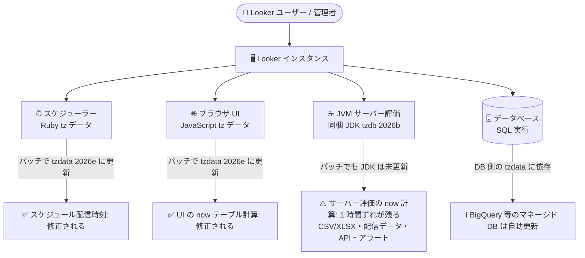

# Looker: 2026 年カナダのタイムゾーン変更への対応 (要対応)

**リリース日**: 2026-10-30

**サービス**: Looker

**機能**: 2026 年カナダのタイムゾーン変更 (恒久サマータイム移行) への対応

**ステータス**: Announcement (Action Required)

📊 [このアップデートのインフォグラフィックを見る](https://takech9203.github.io/google-cloud-news-summary/20261030-looker-canadian-timezone-changes.html)

## 概要

2026 年 11 月 1 日、カナダの複数の州・準州 (マニトバ州、アルバータ州、ブリティッシュコロンビア州、ノースウェスト準州の一部) が恒久的なサマータイム (DST) に移行、または夏時間の UTC オフセットを年間を通じて維持するようになります。IANA Time Zone Database (tzdata 2026e) ではこの変更が反映されており、`America/Winnipeg`、`Canada/Central`、`America/Rainy_River`、`America/Edmonton`、`Canada/Mountain`、`America/Vancouver`、`Canada/Pacific`、`America/Inuvik` の各タイムゾーンが影響を受けます。

パッチ未適用の Looker インスタンスでは、2026 年 11 月 1 日以降、影響を受けるカナダのタイムゾーンを使用している場合に、スケジュール配信の実行時刻や `now()` を使用するテーブル計算が 1 時間ずれます。パッチ適用済みの Looker ビルドではスケジューラー (Ruby) とブラウザ (JavaScript) のタイムゾーンデータが tzdata 2026e に更新されますが、サーバー側 (JVM) で評価される `now()` テーブル計算は同梱 JDK のタイムゾーンデータベース (tzdb 2026b) を使い続けるため、パッチ適用後も 1 時間のずれが残る点に注意が必要です。

影響を受けるタイムゾーンでスケジュール配信やテーブル計算を利用している Looker 管理者は、2026 年 11 月 1 日より前にパッチ適用済みビルドへのアップグレード、または代替の配信タイムゾーンの設定といった対応が必要です。

**アップデート前の課題**

- Looker のスケジューラー (Ruby)、ブラウザ (JavaScript)、JVM に同梱されたタイムゾーンデータが、カナダの 2026 年タイムゾーン変更 (tzdata 2026e) を反映していなかった
- パッチ未適用のインスタンスでは、2026 年 11 月 1 日以降、影響を受けるカナダのタイムゾーンでスケジュール配信の実行時刻が 1 時間ずれる
- UI およびサーバーで評価される `now()` を使用するテーブル計算も 1 時間ずれる

**アップデート後の改善**

- パッチ適用済みビルドにより、スケジューラー (Ruby) とブラウザ (JavaScript) のタイムゾーンデータが tzdata 2026e に更新され、スケジュール配信の実行時刻と UI のテーブル計算のずれが解消される
- パッチを適用できない場合の回避策として、スケジュールの配信タイムゾーンを DST を持たない同一オフセットのタイムゾーン (例: マニトバ → `America/Panama`、アルバータ → `America/Regina`、BC → `America/Phoenix`) に変更する手順が公式に案内された
- 対応手順を解説する公式ドキュメント「2026 Canadian time zone changes」が公開された

## アーキテクチャ図

Looker ではコンポーネントごとに異なるタイムゾーンデータベースが使われており、パッチ適用済みビルドで修正されるのはスケジューラー (Ruby) とブラウザ (JavaScript) のみで、JVM 上で評価される `now()` テーブル計算は修正されません。

## サービスアップデートの詳細

### 影響を受けるタイムゾーン

| 地域 | 2026 年 11 月 1 日以降の年間 UTC オフセット | 影響を受ける IANA タイムゾーン |
|------|---------------------------------------------|-------------------------------|
| マニトバ州 | UTC-5 (UTC-6 に戻らない) | `America/Winnipeg`, `Canada/Central`, `America/Rainy_River` |
| アルバータ州 | UTC-6 (UTC-7 に戻らない) | `America/Edmonton`, `Canada/Mountain` |
| ブリティッシュコロンビア州 | UTC-7 (UTC-8 に戻らない) | `America/Vancouver`, `Canada/Pacific` |
| ノースウェスト準州 (一部) | UTC-6 (UTC-7 に戻らない) | `America/Inuvik` |

### Looker 機能への影響

1. **SQL クエリ・フィルタ・カスタムディメンション**
   - Looker は設定された IANA タイムゾーン識別子をデータベースに渡して SQL を生成する
   - BigQuery などのマネージドクラウドデータベースは tzdata 2026e の更新を自動的に受け取る
   - 自己管理のデータベースを使用している場合は、データベースのタイムゾーンテーブルが tzdata 2026e 以降を含むことを確認する必要がある

2. **スケジュール配信の実行時刻**
   - Looker は同梱のスケジューラー (Ruby) タイムゾーンデータで cron スケジュールを評価する
   - パッチ未適用のインスタンスでは、2026 年 11 月 1 日以降、影響を受けるタイムゾーンの配信時刻が 1 時間ずれる
   - パッチ適用済みビルド、または配信タイムゾーンの変更 (回避策) のどちらでも解消できる

3. **UI でのテーブル計算 (`now()`)**
   - Explore やダッシュボードを UI で表示する際、`now()` を使用するテーブル計算はブラウザ (JavaScript) のタイムゾーンデータで評価される
   - パッチ未適用のインスタンスでは 1 時間ずれる。パッチ適用済みビルドで解消される

4. **サーバー側で評価されるテーブル計算 (`now()`)**
   - CSV / XLSX ダウンロード、スケジュール配信内のデータ、API クエリ、アラートでは、テーブル計算は JVM 上で評価される
   - JVM は同梱 JDK のタイムゾーンデータベース (tzdb 2026b) を使用しており、パッチでも更新されないため、**パッチ適用済みビルドでも 1 時間のずれが残る**

### 修正状況のまとめ

| 機能 | パッチ適用済みビルドで修正される? | 代替タイムゾーン回避策で対応可能? |
|------|----------------------------------|----------------------------------|
| スケジュール配信の実行時刻 | はい (スケジューラーの Ruby tz データを更新) | はい (配信タイムゾーンの変更は送信タイミングのみに影響) |
| UI のテーブル計算 `now()` (Explore / ダッシュボード) | はい (ブラウザの JavaScript tz データを更新) | 非推奨 (クエリレベルのタイムゾーン変更が必要となり、過去の冬時間データが SQL 結果で 1 時間ずれる) |
| サーバー評価のテーブル計算 `now()` (CSV/XLSX、配信データ、API、アラート) | いいえ — Looker (Google Cloud core) / Looker ホスト型では JVM の同梱 JDK が tzdb 2026b のまま | 非推奨 (同上) |

## 設定方法

### 対応方法 1: パッチ適用済み Looker ビルドへのアップグレード (推奨)

パッチ適用済みビルドは、Looker 26.0 を除くすべてのサポート対象バージョンで、スケジューラー (Ruby) とブラウザ (JavaScript) のタイムゾーンデータを tzdata 2026e に更新します。対象は Looker 25.18、26.0、26.6、26.12、26.16、26.18、26.20、26.22 および以降のリリースです。

**注意**: Looker は 2026 年 11 月 1 日までにすべてのインスタンスへこのパッチを自動展開しません。各自での対応が必要です。

- **Looker (Google Cloud core) / Looker ホスト型インスタンス**: パッチ適用済みビルドへのアップグレードを [Cloud Customer Care](https://cloud.google.com/support) に依頼する
- **顧客ホスト型インスタンス**: [Looker ダウンロードページ](https://download.looker.com/) からパッチ適用済み JAR ファイルを取得するか、Cloud Customer Care に連絡する
  - サーバー評価のテーブル計算は Java ランタイムのタイムゾーンデータを使用するため、Oracle の tzupdater ツールなどで Java ランタイムのタイムゾーンデータを更新する
  - サーバーのシステムタイムゾーンが影響対象のカナダのタイムゾーン (例: `America/Winnipeg`) の場合、System Activity のタイムスタンプも 1 時間ずれる点に注意

### 対応方法 2: 代替の配信タイムゾーンの設定 (回避策)

2026 年 11 月 1 日までにパッチを適用できない場合や Looker 26.0 を使用している場合は、各地域の UTC オフセットに一致する DST なしのタイムゾーンをスケジュールに設定します。配信タイムゾーンの変更は送信タイミングのみに影響し、クエリが返す時刻データには影響しないため安全です。

- **マニトバ州 (UTC-5)**: `America/Atikokan`、`America/Cancun`、`America/Panama`、`America/Bogota`、`America/Lima`、`America/Jamaica` など
- **アルバータ州・ノースウェスト準州 (UTC-6)**: `America/Regina`、`Canada/Saskatchewan`、`America/Guatemala`、`America/Costa_Rica`、`America/Belize` など
- **ブリティッシュコロンビア州 (UTC-7)**: `America/Phoenix`、`America/Dawson_Creek`、`America/Fort_Nelson`、`America/Creston`、`America/Whitehorse`、`America/Dawson` など

**設定箇所:**

1. **Application Time Zone**: Admin パネルの General Settings ページで新規スケジュールのデフォルトタイムゾーンを更新する (既存スケジュールは個別に保存されたタイムゾーンを持つため、個別の更新が必要)
2. **既存のスケジュール配信**: 影響を受ける各ダッシュボード / Look / Explore のスケジュールを開き、配信タイムゾーン設定を更新する

**警告**: ユーザータイムゾーン、データベース接続の Query Time Zone、LookML の `timezone` / `query_timezone` といったクエリレベルのタイムゾーン設定を DST なしのタイムゾーンに変更することは、原則として避けてください。DST なしのタイムゾーンには過去の DST 遷移情報がないため、過去の冬時間データが SQL 結果で 1 時間ずれ (例: 2025 年 1 月のタイムスタンプが UTC-6 ではなく UTC-5 で変換される)、時間別レポート、日付境界、「last month」などの相対日付フィルタに影響します。

## デメリット・制約事項

### 制限事項

- パッチ適用済みビルドでも、Looker (Google Cloud core) / Looker ホスト型インスタンスでは同梱 JDK のタイムゾーンデータベース (tzdb 2026b) が更新されないため、サーバー評価の `now()` テーブル計算 (CSV/XLSX ダウンロード、配信データ、API、アラート) は 1 時間ずれたままとなる
- Looker 26.0 にはパッチ適用済みビルドが提供されないため、代替タイムゾーンの回避策が必要
- パッチは 2026 年 11 月 1 日までに自動展開されないため、各自での申請・適用が必要

### 考慮すべき点

- 既存のスケジュールはそれぞれ独自のタイムゾーン設定を保持するため、Application Time Zone を変更しても個別の更新が必要
- 自己管理データベースを使用している場合、データベース側の tzdata が 2026e 以降であることの確認も必要
- 顧客ホスト型では、サーバーの Java ランタイムとシステムタイムゾーンの更新も検討が必要

## 関連サービス・機能

- **Cloud SQL**: 同日に Cloud SQL でも同様のカナダのタイムゾーン変更に関するアナウンスが行われている (本レポートは Looker のみを対象とする)
- **BigQuery などのマネージドデータベース**: tzdata 2026e の更新を自動的に受け取るため、Looker が生成する SQL クエリのタイムゾーン変換はデータベース側で正しく処理される
- **Cloud Customer Care**: Looker (Google Cloud core) / Looker ホスト型インスタンスのパッチ適用依頼窓口

## 参考リンク

- 📊 [インフォグラフィック](https://takech9203.github.io/google-cloud-news-summary/20261030-looker-canadian-timezone-changes.html)
- [公式リリースノート](https://docs.cloud.google.com/release-notes#October_30_2026)
- [2026 Canadian time zone changes (公式ドキュメント)](https://docs.cloud.google.com/looker/docs/canada-permanent-dst-2026)
- [Using time zone settings](https://docs.cloud.google.com/looker/docs/using-time-zone-settings)
- [Scheduling and sending dashboards](https://docs.cloud.google.com/looker/docs/scheduling-and-sending-dashboards)
- [Looker officially supported releases](https://docs.cloud.google.com/looker/docs/officially-supported-releases)

## まとめ

2026 年 11 月 1 日のカナダのタイムゾーン変更により、パッチ未適用の Looker インスタンスではスケジュール配信時刻と `now()` テーブル計算が 1 時間ずれます。影響を受けるタイムゾーンを使用している場合は、11 月 1 日より前にパッチ適用済みビルドへのアップグレードを依頼するか、スケジュールの配信タイムゾーンを DST なしの代替タイムゾーンに変更してください。パッチ適用後もサーバー評価の `now()` テーブル計算にはずれが残るため、CSV/XLSX ダウンロードや API 経由のテーブル計算結果には注意が必要です。

---

**タグ**: Looker, タイムゾーン, DST, スケジュール配信, テーブル計算, Action Required, tzdata 2026e
