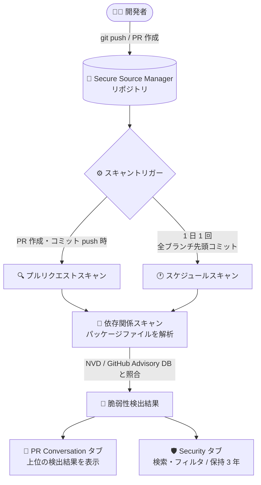

# Secure Source Manager: 依存関係の脆弱性スキャン

**リリース日**: 2026-10-30

**サービス**: Secure Source Manager

**機能**: 依存関係の脆弱性スキャン (Vulnerability Scanning)

**ステータス**: Preview

📊 [このアップデートのインフォグラフィックを見る](https://takech9203.github.io/google-cloud-news-summary/20261030-secure-source-manager-vulnerability-scanning.html)

## 概要

Google Cloud のシングルテナント型マネージド Git ソースコード管理サービスである Secure Source Manager で、脆弱性スキャン (Vulnerability Scanning) 機能が利用可能になりました。この機能を有効にすると、ソースコードの依存関係に含まれる既知の脆弱性を自動的に検出できます。プルリクエストへの新しいコミットごとにスキャンが実行されるほか、全ブランチの先頭コミットが 1 日 1 回定期的にスキャンされます。

検出された脆弱性は、プルリクエストのビューとリポジトリ全体の Security タブの両方に表示されます。脆弱性情報は National Vulnerability Database (NVD) や GitHub Advisory Database などの公開データベースに基づいており、CVE ID や外部データベースへのリンクも提供されます。

ソースコード管理の段階でサプライチェーンのリスクを早期に把握したい開発チームや、FedRAMP High / HIPAA 準拠環境で開発を行う組織にとって、CI/CD パイプラインのさらに手前 (コミット・レビュー段階) でセキュリティを強化できるアップデートです。

**アップデート前の課題**

- Secure Source Manager 自体には依存関係の脆弱性を検出する仕組みがなく、脆弱性検出は Artifact Registry へのイメージ push 後の Artifact Analysis など、ビルド以降の後工程に依存していた
- プルリクエストのレビュー時点では、変更が持ち込む依存関係の脆弱性をレビュアーが確認する標準的な手段がなかった
- 依存関係の脆弱性を検出するには、サードパーティのスキャンツールを別途組み込む必要があった

**アップデート後の改善**

- リポジトリ設定のトグルを有効にするだけで、依存関係の脆弱性スキャンが自動実行されるようになった
- プルリクエストの作成時と新規コミットの push 時に自動スキャンが行われ、検出結果が PR の Conversation タブに表示されるため、レビュー段階で脆弱性を把握できるようになった
- リポジトリの Security タブで、重大度・ブランチ・ファイル・日付などによるフィルタリングを使って脆弱性を横断的に検索できるようになった (保持期間 3 年)

## アーキテクチャ図

リポジトリへの push やプルリクエスト作成をトリガーに依存関係スキャンが実行され、公開脆弱性データベースと照合された検出結果がプルリクエストのビューと Security タブに表示されます。

## サービスアップデートの詳細

### 主要機能

1. **自動スキャンの実行**
   - スケジュールスキャン: 全ブランチの先頭コミットを 1 日 1 回スキャン
   - プルリクエストスキャン: PR 作成時に先頭コミットをスキャン、PR への新規コミット push 時にもスキャン
   - 既存の PR を再スキャンしたい場合は、先頭ブランチに新しいコミットを push する

2. **公開脆弱性データベースとの照合**
   - NVD (National Vulnerability Database) や GitHub Advisory Database などの公開データベースに掲載された脆弱性を検出
   - 検出結果には外部データベースへのリンクと、利用可能な場合は CVE ID が含まれる
   - 検出対象はコードの依存関係 (dependencies) に由来する脆弱性のみ

3. **Security タブでの横断検索**
   - 有効化するとリポジトリのナビゲーションバーに Security タブが追加される
   - 重大度 (CRITICAL / HIGH / MEDIUM / LOW)、検出ブランチ・タグ・コミット SHA、ファイルパス、脆弱性 ID・説明・パッケージ名、検出日 (From / To) でフィルタ可能
   - 検出結果の保持期間は 3 年 (ただし新しいコミットに影響し続ける脆弱性は保持期間外でも表示される)

4. **プルリクエストでの表示**
   - スキャン完了後、検出された脆弱性が PR の Conversation タブに表示される
   - PR には上位の検出結果の要約が表示され、Full Results リンクから Security タブで全件を確認できる
   - 脆弱性が検出されても PR のマージ自体はブロックされない

## 技術仕様

### 検出結果に含まれる情報

| 項目 | 詳細 |
|------|------|
| Severity | 公開脆弱性データベースによる重大度評価 |
| ID | CVE ID (利用可能な場合)、なければ GHSA ID などの識別子と外部リンク |
| Found In | スキャンされた Git コミット SHA と、それを先頭コミットとするブランチ・タグ・PR の一覧 |
| File | 脆弱な依存関係を含むソースファイルと行番号 (利用可能な場合) |
| Package | 脆弱性を含むパッケージ名とバージョン。判明している場合は修正済みバージョンも表示 |
| Description | 脆弱性の説明 (利用可能な場合) |
| Detected | 脆弱性を検出したスキャンの日付 |

### 対応言語

以下の言語のパッケージファイルが依存関係の脆弱性スキャン対象です。

| 言語 | 備考 |
|------|------|
| Go, Java, JavaScript, Node.js, Python, TypeScript | 行番号付きで検出 |
| PHP, Ruby, Rust, .NET | 検出結果に行番号が含まれない場合がある |

## 設定方法

### 前提条件

1. Secure Source Manager のインスタンスとリポジトリが作成済みであること
2. 対象リポジトリに対して **Secure Source Manager Repository Admin** (`roles/securesourcemanager.repoAdmin`) ロール、または `securesourcemanager.repositories.update` 権限を含むロールが付与されていること
3. リポジトリのサイズが 1 GB 以下であること (1 GB を超えるリポジトリではスキャン不可)

### 手順

#### ステップ 1: リポジトリ設定で脆弱性スキャンを有効化

Secure Source Manager の Web インターフェースで以下を実行します。

1. 脆弱性スキャンを有効にしたいリポジトリに移動する
2. Settings アイコンをクリックする
3. **Vulnerability Scanning** トグルを探し、On に切り替える
4. **Update Settings** ボタンをクリックする

#### ステップ 2: スキャン結果の確認

有効化後は自動的にスキャンが実行されます。

- プルリクエストの Conversation タブで PR スキャンの結果を確認する
- リポジトリの **Security** タブでフィルタを使って脆弱性を横断的に検索する
- デフォルトでは Security タブの Found In フィルタが直近に閲覧したブランチ (またはデフォルトブランチ) に設定されるため、他の脆弱性を見る場合はフィルタを調整・クリアする

## メリット

### ビジネス面

- **サプライチェーンリスクの早期発見**: ビルドやデプロイの前、ソースコード管理の段階で依存関係の既知の脆弱性を検出でき、修正コストを低減できる
- **追加ツール不要**: リポジトリ設定のトグルのみで有効化でき、サードパーティのスキャンツールを別途導入・運用する負担がない

### 技術面

- **レビューと一体化したセキュリティチェック**: PR 作成・コミット push のたびに自動スキャンされ、結果が PR 上に表示されるため、レビューフローの中で脆弱性を確認できる
- **3 年間の検索可能な履歴**: Security タブで重大度・ブランチ・ファイル・日付などによるフィルタリングが可能で、脆弱性対応の追跡に活用できる

## デメリット・制約事項

### 制限事項

- Preview 段階の機能であり、Pre-GA Offerings Terms が適用される (サポートが限定される可能性がある)
- 1 GB を超えるリポジトリでは脆弱性スキャンを利用できない
- 検出対象は依存関係に由来する脆弱性のみで、自作コード自体の脆弱性 (静的解析) は対象外
- PHP、Ruby、Rust、.NET の検出結果には行番号が含まれない場合がある

### 考慮すべき点

- 脆弱性が検出されても PR のマージはブロックされないため、マージ可否の判断はレビュープロセス側で運用する必要がある
- PR スキャンはリポジトリの全ファイルをチェックするため、PR で変更していないファイル由来の脆弱性も結果に含まれることがある
- Security タブはデフォルトで Found In フィルタが設定されるため、リポジトリ全体の脆弱性を見るにはフィルタのクリアが必要

## ユースケース

### ユースケース 1: プルリクエストレビューでの依存関係チェック

**シナリオ**: 開発チームが新しいライブラリを追加する PR を作成した際、そのライブラリに既知の脆弱性が含まれていないかをレビュー段階で確認したい。

**効果**: PR 作成時に自動でスキャンが実行され、検出結果が Conversation タブに表示されるため、レビュアーは追加ツールなしで依存関係のリスクを確認し、修正済みバージョンへの更新を依頼できる。

### ユースケース 2: 既存リポジトリの継続的な脆弱性モニタリング

**シナリオ**: 運用中のリポジトリで、新たに公開された CVE が既存の依存関係に影響しないかを継続的に監視したい。

**効果**: 全ブランチの先頭コミットが 1 日 1 回自動スキャンされるため、コード変更がなくても新規公開された脆弱性を検出できる。Security タブで重大度 CRITICAL / HIGH にフィルタして優先対応すべき脆弱性を特定できる。

## 料金

Secure Source Manager はインスタンス単位の課金で、1 インスタンスあたり月額 $1,000 です。脆弱性スキャン機能自体の追加料金に関する記載は、現時点の公式情報では確認できませんでした。詳細は料金ページを参照してください。

- [Secure Source Manager の料金](https://docs.cloud.google.com/products/secure-source-manager/pricing)

## 利用可能リージョン

Secure Source Manager インスタンスは南北アメリカ、EMEA、APAC の各リージョンにデプロイできます。最新のリージョン一覧は公式ドキュメントを参照してください。

- [Secure Source Manager のロケーション](https://docs.cloud.google.com/secure-source-manager/docs/locations)

## 関連サービス・機能

- **シークレットスキャン (Secret Scanning)**: Secure Source Manager の関連セキュリティ機能。コードに含まれる認証情報などの機密情報を検出する
- **ブランチ保護 (Branch Protection)**: ピアレビューやビルドステータスチェックの成功をマージ条件として強制でき、脆弱性スキャンと組み合わせてコード品質を担保できる
- **Artifact Analysis**: Artifact Registry に格納されたコンテナイメージの OS パッケージ脆弱性などをスキャンする。ソース段階 (Secure Source Manager) とアーティファクト段階 (Artifact Analysis) の両方でスキャンすることで多層防御を実現できる
- **Cloud Build**: Secure Source Manager とビルドトリガーで統合されており、セキュアな CI/CD パイプラインを構成できる

## 参考リンク

- 📊 [インフォグラフィック](https://takech9203.github.io/google-cloud-news-summary/20261030-secure-source-manager-vulnerability-scanning.html)
- [公式リリースノート](https://docs.cloud.google.com/release-notes#October_30_2026)
- [ドキュメント: Enable vulnerability scanning](https://docs.cloud.google.com/secure-source-manager/docs/enable-vulnerability-scanning)
- [Secure Source Manager 概要](https://docs.cloud.google.com/secure-source-manager/docs/overview)
- [料金ページ](https://docs.cloud.google.com/products/secure-source-manager/pricing)

## まとめ

Secure Source Manager に依存関係の脆弱性スキャンが追加されたことで、ビルドやデプロイより前のソースコード管理・レビュー段階でサプライチェーンのリスクを検出できるようになりました。リポジトリ設定のトグルひとつで有効化できるため、Secure Source Manager を利用中のチームはまず Preview 機能として有効化し、Security タブでの検出結果の運用フローを整備することを推奨します。

---

**タグ**: Secure Source Manager, 脆弱性スキャン, セキュリティ, サプライチェーンセキュリティ, DevSecOps, Preview
