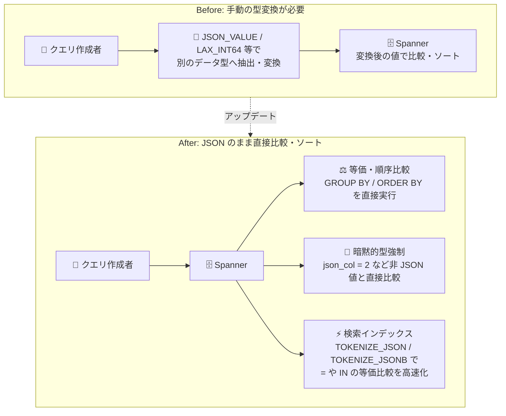

# Spanner: JSONB / JSON 値の比較・ソートと検索インデックスによる等価比較の高速化

**リリース日**: 2026-10-30

**サービス**: Spanner

**機能**: JSONB / JSON 値の等価・順序比較、GROUP BY / ORDER BY サポート、CAST AS JSON、JSON 検索インデックス

**ステータス**: 一般提供 (GA)

📊 [このアップデートのインフォグラフィックを見る](https://takech9203.github.io/google-cloud-news-summary/20261030-spanner-json-comparison-sorting.html)

## 概要

Spanner が JSONB (PostgreSQL ダイアレクト) および JSON (GoogleSQL ダイアレクト) 値に対する等価比較 (`=`, `!=`, `IN` など) と順序比較 (`<`, `<=`, `>`, `>=` など) をサポートしました。これにより、JSON / JSONB 値を他のデータ型へ変換することなく、そのまま `GROUP BY` 句や `ORDER BY` 句で使用できるようになりました。

さらに GoogleSQL では、`CAST(expression AS JSON)` により `INT64`、`STRING`、`BOOL`、`DATE`、`TIMESTAMP`、`ARRAY`、`STRUCT` など幅広いデータ型を JSON に変換できるほか、JSON 値と非 JSON 値を直接比較することも可能です。この場合、Spanner は非 JSON 値を暗黙的に JSON へ型強制 (coercion) して比較します。

加えて、検索インデックス (Search Index) を使用して、JSONB / JSON 列およびそのサブパスに対する `=` や `IN` などの等価比較を高速化できます。スキーマレスな半構造化データを Spanner で扱う開発者や、JSON ドキュメントに対する集計・ソート・フィルタリングを多用するアプリケーションの設計者にとって、SQL 記述の簡素化とクエリ性能の両面で価値のあるアップデートです。

**アップデート前の課題**

- JSON / JSONB 値を `GROUP BY` や `ORDER BY` で使用するには、`JSON_VALUE` や `LAX_INT64` などの関数で一度別のデータ型 (STRING、INT64 など) に抽出・変換する必要があった
- JSON 値と非 JSON 値 (数値リテラルや文字列リテラルなど) を比較する際、明示的な型変換をクエリ内に記述する必要があった
- JSON ドキュメントの等価条件によるフィルタリングを効率的に高速化する手段が限られていた

**アップデート後の改善**

- JSON / JSONB 値を型変換なしでそのまま等価・順序比較、`GROUP BY` / `ORDER BY` に使用できるようになった
- GoogleSQL の `CAST(expression AS JSON)` と暗黙的な型強制により、`json_col = 2` や `json_col BETWEEN 1 AND 10` のような非 JSON 値との直接比較が可能になった
- `TOKENIZE_JSON` / `TOKENIZE_JSONB` と検索インデックスにより、JSON / JSONB 列とサブパスに対する `=` / `IN` などの等価比較、JSON 包含判定、キー存在判定を高速化できるようになった

## アーキテクチャ図



従来は JSON 値を関数で別のデータ型へ変換してから比較・ソートする必要がありましたが、本アップデートにより JSON / JSONB のまま直接比較・集計・ソートでき、検索インデックスで等価比較を高速化できます。

## サービスアップデートの詳細

### 主要機能

1. **JSON / JSONB 値の等価・順序比較と GROUP BY / ORDER BY サポート**
   - JSON / JSONB 値同士を等価・順序で比較でき、`GROUP BY` / `ORDER BY` 句に直接使用可能
   - 異なる JSON 型間の順序は `Null (JSON null) < String < Number < Boolean < Array < Object` と定義される
   - 同一型内では、数値は数学的比較、文字列は辞書順比較、Boolean は `true > false`、配列・オブジェクトは要素/キー・値ペアごとの比較ルールに従う

2. **CAST AS JSON と非 JSON 値との比較における暗黙的型強制 (GoogleSQL)**
   - `CAST(expression AS JSON)` で `INT64`、`FLOAT32/64`、`NUMERIC`、`BOOL`、`STRING`、`BYTES`、`DATE`、`TIMESTAMP`、`INTERVAL`、`ARRAY`、`STRUCT`、`PROTO`、`ENUM`、`UUID`、`GRAPH_ELEMENT`、`GRAPH_PATH` を JSON に変換可能
   - 等価演算子 (`=`、`!=`、リスト形式の `IN`) では、Boolean、数値型、`DATE`、`TIMESTAMP`、`UUID`、`STRING`、`ENUM`、`BYTES`、および要素型がサポートされる `ARRAY` の暗黙的型強制をサポート
   - 順序演算子 (`<`、`<=`、`>`、`>=`、`BETWEEN`) では、Boolean、数値型、`DATE`、`TIMESTAMP`、`UUID`、`STRING`、`ARRAY` をサポート (`BYTES`、`RANGE`、`ENUM` は JSON へのキャストで順序が保持されないため非サポート)

3. **検索インデックスによる JSON / JSONB 等価比較の高速化**
   - GoogleSQL では `TOKENIZE_JSON`、PostgreSQL ダイアレクトでは `TOKENIZE_JSONB` でトークン化した列に `CREATE SEARCH INDEX` を作成
   - 等価比較 (`=`、`!=`、`<>`、`IN`、`NOT IN`)、JSON 包含判定 (`JSON_CONTAINS` / `@>`、`<@`)、キー存在判定 (`IS NOT NULL` / `?`、`?|`、`?&`) をインデックスで高速化
   - JSON 列全体だけでなく、`doc.sub.path[0].key = "value"` のようなサブパスに対する条件も高速化対象
   - `<`、`<=`、`>`、`>=` などの範囲比較は検索インデックスによる高速化の対象外

## 技術仕様

### JSON 型間の比較ルール (GoogleSQL)

| JSON 型 | 比較ルール |
|------|------|
| 型が異なる場合 | `NULL (JSON null) < STRING < NUMBER < BOOLEAN < ARRAY < OBJECT` |
| Object | キー・値ペアをキー順にペアワイズ比較 (キー → 値の順)。一方がもう一方のプレフィックスの場合、ペア数が多い方が大きい |
| Array | 先頭から要素ごとに比較。一方がもう一方のプレフィックスの場合、長い方が大きい |
| Boolean | `true` > `false` |
| Number | 数学的な数値比較 |
| String | 辞書順の文字列比較 |
| Null | JSON null 同士はすべて等しく、非 null の JSON 値より小さい |

JSONB (PostgreSQL ダイアレクト) では `Null < String < Number < Boolean < Array < Object` の順序が適用され、オブジェクトはペア数が多い方が大きいなど一部ルールが異なります。また、トップレベルの空配列 `[]` は JSONB null より小さいというエッジケースがあります (`'[]'::jsonb < 'null'::jsonb` は true)。

### CAST AS JSON の挙動 (TO_JSON との差分)

| 項目 | 挙動 |
|------|------|
| SQL `NULL` のキャスト | JSON null ではなく SQL `NULL` を返す (`STRUCT` / `ARRAY` 内にネストされた `NULL` は JSON null に変換) |
| `+/-inf`、`NaN` のキャスト | エラーを返す |
| `stringify_wide_numbers` パラメータ | 非サポート (常に無効として動作) |

## 設定方法

### 前提条件

1. Spanner データベース (GoogleSQL または PostgreSQL ダイアレクト) に JSON / JSONB 列が存在すること
2. 検索インデックスを使用する場合は、Spanner Enterprise エディションまたは Enterprise Plus エディションであること

### 手順

#### ステップ 1: JSON 値を直接比較・ソートするクエリを記述する (GoogleSQL)

```sql
-- JSON 値を非 JSON 値と直接比較 (暗黙的型強制)
SELECT a.AlbumId
FROM Albums a
WHERE a.Metadata.MultiDiscCount = 2;

-- JSON 値を ORDER BY / GROUP BY に直接使用
SELECT a.Metadata.Genre AS genre, COUNT(*) AS cnt
FROM Albums a
GROUP BY genre
ORDER BY genre;
```

型変換関数を使わずに、JSON のサブパスをそのままフィルタ・集計・ソートに使用できます。

#### ステップ 2: 検索インデックスを作成して等価比較を高速化する

```sql
-- TOKENIZE_JSON で JSON 列をトークン化し、検索インデックスを作成
CREATE TABLE Albums (
  SingerId INT64 NOT NULL,
  AlbumId INT64 NOT NULL,
  Metadata JSON,
  MetadataTokens TOKENLIST AS (TOKENIZE_JSON(Metadata)) HIDDEN
) PRIMARY KEY (SingerId, AlbumId);

CREATE SEARCH INDEX AlbumsIndex ON Albums(MetadataTokens);
```

作成後、クエリオプティマイザが `=`、`IN`、`JSON_CONTAINS`、キー存在条件などをインデックスで高速化します。クエリ実行プランに `Search index scan` ノードが表示されるかでインデックス使用を確認できます。

## メリット

### ビジネス面

- **開発生産性の向上**: JSON データの集計・ソートに型変換の定型コードが不要になり、クエリがシンプルかつ保守しやすくなる
- **スキーマレスデータ活用の促進**: 属性が可変な半構造化データ (商品カタログ、イベント属性など) をリレーショナルデータと同じ感覚で分析・集計できる

### 技術面

- **クエリ性能の向上**: 検索インデックスにより JSON / JSONB 列とサブパスへの等価比較・包含判定・キー存在判定がインデックススキャンで高速化される
- **一貫した比較セマンティクス**: JSON 型間・型内の比較ルールが明確に定義されており、`GROUP BY` / `ORDER BY` / `DISTINCT` の挙動が予測可能
- **Spanner Graph との相乗効果**: Spanner Graph の動的プロパティは JSON 型として扱われるため、プロパティフィルタや `GROUP BY` / `ORDER BY` / `RETURN DISTINCT` で本機能の比較セマンティクスがそのまま活用できる

## デメリット・制約事項

### 制限事項

- JSON 型の列はプライマリキーやセカンダリインデックスのキーには使用できない
- 検索インデックスは読み取り専用トランザクションでのみ使用される (読み書きトランザクションで強制使用するとエラー)
- 検索インデックスで高速化されるのは等価比較 (`=`、`!=`、`<>`、`IN`、`NOT IN`)、包含判定、キー存在判定のみで、`<`、`<=`、`>`、`>=` などの範囲比較や PostgreSQL の `->>` によるテキスト抽出述語は対象外
- 検索インデックスに格納する JSON ドキュメントのトークン出力サイズは 10 MB 未満である必要がある (超過時は too many search token bytes エラー)
- 検索インデックスは Enterprise / Enterprise Plus エディションで利用可能

### 考慮すべき点

- 順序比較の暗黙的型強制では `BYTES`、`RANGE`、`ENUM` がサポートされない (JSON へのキャストで順序が保持されないため)
- `IN` 演算子の暗黙的型強制はリスト形式 (`json_expression IN (expr1, expr2, ...)`) のみ対応し、最初のオペランドは JSON 式である必要がある
- 大きなドキュメント全体を検索可能にする必要がない場合は、生成列でサブセットを抽出してインデックス化することが推奨される
- JSONB のトップレベル空配列 `[]` が JSONB null より小さいなど、エッジケースの順序に注意する

## ユースケース

### ユースケース 1: 可変属性を持つ商品カタログの集計・ソート

**シナリオ**: EC サイトで商品ごとに属性 (ブランド、カラー、評価など) が異なるため JSON 列で管理している。属性ごとの集計や評価順のソートを行いたい。

**実装例**:
```sql
-- 評価 (JSON サブパス) で直接ソート
SELECT p.ProductId, p.Attributes.brand, p.Attributes.rating
FROM Products p
ORDER BY p.Attributes.rating DESC
LIMIT 10;

-- ブランドごとに集計
SELECT p.Attributes.brand AS brand, COUNT(*) AS cnt
FROM Products p
GROUP BY brand;
```

**効果**: `JSON_VALUE` などによる型変換が不要になり、クエリが簡潔になる。属性スキーマの変更にもテーブル定義の変更なしで対応できる。

### ユースケース 2: 検索インデックスによる JSON フィルタリングの高速化

**シナリオ**: 大量のイベントログを JSON 列で保持しており、`status = "active"` のような等価条件や特定キーの存在チェックで頻繁にフィルタリングする。

**実装例**:
```sql
-- サブパスへの等価比較 (検索インデックスで高速化)
SELECT e.EventId
FROM Events e
WHERE e.Payload.status IN ("active", "pending");

-- キー存在判定 (検索インデックスで高速化)
SELECT e.EventId
FROM Events e
WHERE e.Payload.error_code IS NOT NULL;
```

**効果**: フルスキャンを避け、検索インデックスのスキャンにより読み取り専用トランザクションでのフィルタリングを高速化できる。

## 料金

この機能自体に追加料金はなく、Spanner の通常の料金体系 (コンピュート容量、ストレージ、ネットワーク) が適用されます。なお、検索インデックスは Enterprise エディションおよび Enterprise Plus エディションで利用可能な機能であり、検索インデックスの保持には追加のストレージが消費されます。

詳細は [Spanner の料金ページ](https://cloud.google.com/spanner/pricing) を参照してください。

## 関連サービス・機能

- **Spanner 全文検索 (Full-Text Search)**: JSON 検索インデックスは全文検索の検索インデックス基盤を利用しており、テキスト検索と JSON 条件を単一のインデックススキャンに組み合わせられる
- **Spanner Graph**: 動的プロパティが JSON 型として扱われるため、本アップデートの比較・ソートセマンティクスがグラフクエリのフィルタ・集計・ソートにも適用される
- **BigQuery**: 同じ GoogleSQL 系の JSON 型を持つ分析基盤。Spanner でのトランザクショナルな JSON 処理と組み合わせた分析パイプラインを構成できる

## 参考リンク

- 📊 [インフォグラフィック](https://takech9203.github.io/google-cloud-news-summary/20261030-spanner-json-comparison-sorting.html)
- [公式リリースノート](https://docs.cloud.google.com/release-notes#October_30_2026)
- [JSON comparison and sorting](https://docs.cloud.google.com/spanner/docs/reference/standard-sql/data-types#comparison_and_sorting)
- [JSON comparison coercion](https://docs.cloud.google.com/spanner/docs/reference/standard-sql/conversion_rules#json_comparison_coercion)
- [CAST AS JSON](https://docs.cloud.google.com/spanner/docs/reference/standard-sql/conversion_functions#cast_as_json)
- [JSON search indexes](https://docs.cloud.google.com/spanner/docs/full-text-search/json-indexes)
- [Working with JSONB](https://docs.cloud.google.com/spanner/docs/working-with-jsonb)
- [Working with JSON](https://docs.cloud.google.com/spanner/docs/working-with-json)
- [料金ページ](https://cloud.google.com/spanner/pricing)

## まとめ

Spanner の JSON / JSONB 値が型変換なしで比較・集計・ソートできるようになり、半構造化データを扱うクエリの記述性と性能が大きく向上しました。JSON 列を多用しているワークロードでは、既存クエリの型変換処理の簡素化と、頻出する等価フィルタ条件への検索インデックス適用 (Enterprise エディション以上) を検討することを推奨します。

---

**タグ**: Spanner, JSON, JSONB, GoogleSQL, PostgreSQL, 検索インデックス, 全文検索, データベース
