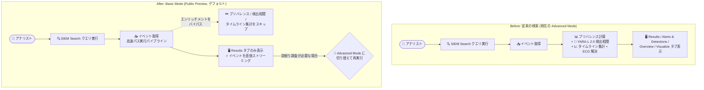

# Google SecOps: Basic Mode search (SIEM 検索の実行モード選択)

**リリース日**: 2026-10-31

**サービス**: Google SecOps

**機能**: Basic Mode search (検索実行モードの選択)

**ステータス**: Public Preview

📊 [このアップデートのインフォグラフィックを見る](https://takech9203.github.io/google-cloud-news-summary/20261031-google-secops-basic-mode-search.html)

## 概要

Google SecOps の SIEM Search ページに、2 つの検索実行モード (Basic Mode と Advanced Mode) が追加され、Public Preview として提供が開始されました。デフォルトとなる Basic Mode は、検索実行時にセカンダリエンリッチメント処理 (プリバレンス計算、検出相関、タイムライン集計など) をバイパスする高速パス実行パイプラインを使用し、データの完全性とクエリ構文の互換性を維持したまま、エンドツーエンドの検索待ち時間を短縮します。

Advanced Mode は従来の検索体験と同等で、タイムラインチャート、アクティビティヒートマップ、エンタープライズプリバレンススコア、YARA-L 2.0 検出相関などの包括的な多次元分析を提供します。Basic Mode で疑わしいイベントを特定した後、Advanced Mode に切り替えてクエリを再実行することで、詳細な調査に移行できます。

本機能は、大量のテレメトリ (AWS VPC Flow、ファイアウォール、プロキシ、Sysmon ログなど) を扱う脅威ハンターやセキュリティアナリストにとって、仮説検証やクエリの反復作業を高速化する重要なアップデートです。

**アップデート前の課題**

従来の SIEM 検索では、すべての検索でフルエンリッチメントが実行されていました。

- 検索のたびにエンタープライズ全体のインジケータプリバレンス (ドメイン、IP アドレス、ファイルハッシュの履歴的な出現頻度) が計算され、大量イベントストリームでは処理時間が最大 20 秒程度余分にかかっていた
- イベント取得時にルールエンジンに対するセカンダリルックアップ (検出相関) が常に実行されていた
- タイムラインヒストグラムのバケット集計が常に計算され、初期の脅威ハンティングやクエリのチューニングのような単純なイベント取得でも待ち時間が発生していた

**アップデート後の改善**

- Basic Mode (デフォルト) により、プリバレンス計算・検出エンリッチメント・タイムライン集計をバイパスし、マッチしたイベントをクライアントに直接ストリーミングすることで、検索待ち時間を最小化できるようになった
- データの完全性 (full data fidelity) とクエリ構文の互換性 (query syntax parity) は維持されるため、UDM 構文、正規表現、参照リスト、データテーブルフィルタをそのまま利用できる
- 選択したモードはブラウザのローカルストレージに保存され、URL クエリパラメータ (`&searchMode=FAST` / `&searchMode=ADVANCED`) でチーム間の共有も可能になった
- 検索履歴 (History) に実行モードが記録され、再実行時に当時のモードが自動復元されるようになった

## アーキテクチャ図



Before (従来 = Advanced Mode) では検索ごとにプリバレンス計算や検出相関などのセカンダリエンリッチメントが実行されていましたが、After の Basic Mode ではこれらをバイパスしてイベントを直接ストリーミングするため、待ち時間が大幅に短縮されます。必要に応じて Advanced Mode に切り替えてフル分析を実行できます。

## サービスアップデートの詳細

### 主要機能

1. **Basic Mode: 高速パスのバックエンド実行**
   - **プリバレンス計算のバイパス**: ドメイン、IP アドレス、ファイルハッシュなどのインジケータに対するエンタープライズ全体の履歴プリバレンス評価をスキップし、大量イベントストリームで最大 20 秒の処理時間を削減
   - **検出エンリッチメントの抑制**: 検出相関の上限を 0 に設定し、イベント取得中のルールエンジンに対するセカンダリルックアップを排除
   - **タイムライン集計の省略**: バケット化されたヒストグラム計算をスキップし、マッチしたイベントをクライアントに直接ストリーミング

2. **Basic Mode: 簡素化されたインターフェース**
   - **タブの絞り込み**: Results タブのみを表示し、Alerts & Detections、Overview、Visualize タブを非表示にしてタブ切り替えの待ち時間を排除
   - **チャートウィジェットの非表示**: Activity Over Time / Trend Over Time チャート、Prevalence タブ、Activity ヒートマップテーブルを自動的に非表示にし、Events パネルと Event Viewer の表示領域を最大化
   - **フィールド集計の維持**: Aggregations パネルは引き続き利用可能で、値の分布カウントの確認や Show only / Filter out フィルタの適用が Basic Mode のまま行える

3. **ワークフロー統合**
   - **ブラウザ設定の永続化**: 選択したモードはブラウザのローカルストレージ (`searchMode`) に保存され、リフレッシュ・タブ・セッションをまたいで維持される
   - **共有可能な URL 状態**: アクティブなモードが URL クエリパラメータ (`&searchMode=FAST` または `&searchMode=ADVANCED`) に反映され、共有された調査 URL のモードは受信者のブラウザ設定より優先される
   - **検索履歴への記録**: History ダイアログの各クエリに実行モードが記録され、再実行時に当時のモードが自動復元される

## 技術仕様

### Basic Mode と Advanced Mode の比較

| 項目 | Basic Mode | Advanced Mode |
|------|-----------|---------------|
| 表示される結果タブ | Results のみ | Results、Alerts & Detections、Overview、Visualize |
| タイムラインチャート | 非表示 (バケット集計をバイパス) | 表示 (Activity Over Time / Trend Over Time チャート、Prevalence タブ、Activity ヒートマップ) |
| プリバレンススコアリング | バイパス | 有効 (エンタープライズプリバレンスを計算) |
| 相関検出 | バイパス | 有効 (トリガーされた YARA-L 2.0 検出を相関) |
| Entity Context Graph (ECG) | バイパス | 有効 |
| レイテンシプロファイル | インタラクティブなフィードバック向けの最小待ち時間 | フルエンリッチメント計算のための標準的な待ち時間 |

### 推奨される使い分けシナリオ

| シナリオ | 推奨モード | 理由 |
|---------|-----------|------|
| 初期の脅威ハンティング・仮説検証 | Basic Mode | タイムラインヒストグラムを待たずに、広い時間範囲でインジケータ仮説を検証できる |
| 大量テレメトリのトリアージ | Basic Mode | AWS VPC Flow、ファイアウォール、プロキシ、Sysmon などの大量データソースを最小レイテンシでクエリできる |
| クエリ作成・フィルタチューニング | Basic Mode | 本格的な監査の前に UDM 構文、正規表現、参照リスト、データテーブルフィルタを反復的に調整できる |
| インシデントタイムラインの再構築 | Advanced Mode | ビジュアルなイベント分布タイムラインとアクティビティヒートマップで時間的なバーストを特定できる |
| インジケータの希少性・異常分析 | Advanced Mode | エンタープライズプリバレンススコアで、観測されたアーティファクトが一般的か外れ値かを評価できる |
| 検出の検証 | Advanced Mode | 特定のイベントが相関する YARA-L 2.0 アラートルールをトリガーしたかを確認できる |

## 設定方法

### 前提条件

1. Google SecOps の SIEM Search ページへのアクセス権限があること
2. 本機能は Pre-GA Offerings Terms (Google Security Operations Service Specific Terms) の対象。環境に表示されない場合は、プレビュー機能の管理設定を確認するか、システム管理者に問い合わせる

### 手順

#### ステップ 1: 検索実行モードを選択する

SIEM Search ページのクエリエディタで、Basic Mode (デフォルト) または Advanced Mode を選択する。選択したモードはブラウザのローカルストレージに保存され、以降の検索でも維持される。

#### ステップ 2: Basic Mode で検索し、必要に応じて Advanced Mode に切り替える

Basic Mode で検索を実行し、Results タブで疑わしいイベントを特定した場合は、Advanced Mode に切り替えてクエリを再実行することで、タイムラインチャート、アクティビティヒートマップ、プリバレンススコア、相関検出を確認できる。

```text
# 共有 URL でモードを指定する例 (URL クエリパラメータ)
...&searchMode=FAST      # Basic Mode
...&searchMode=ADVANCED  # Advanced Mode
```

## メリット

### ビジネス面

- **調査の初動を高速化**: 脅威ハンティングの仮説検証サイクルが短縮され、アナリストの生産性と MTTD (平均検知時間) の改善に寄与する
- **チーム連携の向上**: 実行モードを含む URL を共有でき、受信者側で同じモード・同じ検索状態を再現できる

### 技術面

- **最大 20 秒の処理時間削減**: 大量イベントストリームでのプリバレンス計算のバイパスにより、検索あたり最大 20 秒程度の処理時間を削減
- **クエリ互換性の完全維持**: Basic Mode でもデータの完全性と UDM クエリ構文の互換性が保たれ、クエリの書き換えは不要
- **計算リソースの最適化**: コンピュートリソースを生のイベント取得とフィールド集計に集中させ、インタラクティブな調査に最適化

## デメリット・制約事項

### 制限事項

- Public Preview (Pre-GA) 機能であり、Pre-GA Offerings Terms が適用される。サポートが限定される場合があり、他の Pre-GA バージョンとの互換性がない変更が行われる可能性がある
- Basic Mode では Alerts & Detections、Overview、Visualize タブ、タイムラインチャート、プリバレンススコア、相関検出、Entity Context Graph (ECG) が利用できない
- 環境によっては機能が表示されない場合があり、プレビュー機能の管理設定または管理者への確認が必要

### 考慮すべき点

- Basic Mode がデフォルトになるため、従来の検索体験 (フルエンリッチメント) を期待するアナリストは Advanced Mode への切り替えが必要
- 検出検証やインシデントタイムライン再構築など、エンリッチメント情報が必要なワークフローでは Advanced Mode での再実行が必要となり、ワークフローの使い分けをチーム内で standardize することが望ましい
- 共有 URL に含まれるモード指定は受信者のブラウザ設定より優先されるため、共有時には意図したモードになっているかを確認する

## ユースケース

### ユースケース 1: 大量テレメトリに対する初動トリアージ

**シナリオ**: インシデント対応チームが、侵害の疑いがある IP アドレスについて、AWS VPC Flow ログやファイアウォールログなどの大量テレメトリを広い時間範囲で横断検索し、仮説を素早く検証したい。

**実装例**:
```text
# Basic Mode (デフォルト) で UDM 検索を実行
target.ip = "203.0.113.10"
```

**効果**: タイムラインヒストグラムやプリバレンス計算を待たずにマッチイベントが直接ストリーミングされるため、仮説の検証・棄却のサイクルを高速に回せる。

### ユースケース 2: クエリチューニング後のフル分析への移行

**シナリオ**: アナリストが Basic Mode で UDM クエリの正規表現や参照リストフィルタを反復調整し、疑わしいイベント群を特定した。その後、イベントの時間的なバーストや相関する検出ルールを確認したい。

**効果**: Basic Mode で絞り込んだクエリをそのまま Advanced Mode で再実行するだけで (構文互換のため書き換え不要)、Activity Over Time チャート、プリバレンススコア、YARA-L 2.0 相関検出による多次元分析に移行できる。

## 関連サービス・機能

- **UDM Search (SIEM Search)**: 本機能の対象となる Google SecOps の検索基盤。UDM / RAW / JOIN / STATS などの検索タイプに対して結果タブの表示が変化する
- **YARA-L 2.0 ルールエンジン**: Advanced Mode では検索結果とトリガーされた検出ルールの相関が表示される (Basic Mode ではバイパス)
- **Entity Context Graph (ECG)**: Advanced Mode でのみ解決されるエンティティコンテキスト情報
- **検索履歴 (History) / 保存済み検索**: 各クエリに実行モードが記録され、再実行時にモードが自動復元される

## 参考リンク

- 📊 [インフォグラフィック](https://takech9203.github.io/google-cloud-news-summary/20261031-google-secops-basic-mode-search.html)
- [公式リリースノート](https://docs.cloud.google.com/release-notes#October_31_2026)
- [ドキュメント: UDM 検索 (検索実行モードの選択と理解)](https://docs.cloud.google.com/chronicle/docs/investigation/udm-search#search-execution-modes)
- [プレビュー機能の管理](https://docs.cloud.google.com/chronicle/docs/secops/preview-features-manage)

## まとめ

Google SecOps の SIEM Search に Basic Mode が追加され、エンリッチメント処理をバイパスした高速検索がデフォルトで利用可能になりました。初期の脅威ハンティングや大量テレメトリのトリアージは Basic Mode、タイムライン分析や検出検証は Advanced Mode という使い分けをチームで確立することを推奨します。Public Preview のため、Pre-GA 条件を確認のうえ利用環境で機能の有効性を評価してください。

---

**タグ**: Google SecOps, SIEM, UDM Search, Basic Mode, Advanced Mode, Public Preview, 脅威ハンティング, セキュリティ運用
