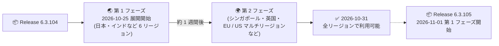

# Google SecOps SOAR: Release 6.3.104 が全リージョンで利用可能に

**リリース日**: 2026-10-31

**サービス**: Google SecOps SOAR

**機能**: Release 6.3.104 (内部および顧客向けバグ修正)

**ステータス**: Announcement (全リージョンで利用可能)

📊 [このアップデートのインフォグラフィックを見る](https://takech9203.github.io/google-cloud-news-summary/20261031-google-secops-soar-6-3-104-all-regions.html)

## 概要

Google SecOps SOAR の Release 6.3.104 が全リージョンで利用可能になりました。本リリースは 2026-10-25 に第 1 フェーズのリージョン (日本、インド、オーストラリア、カナダ、ドイツ、スイス) へのロールアウトが開始されており、今回の発表により第 2 フェーズのリージョン (シンガポール、英国、EU / US マルチリージョンなど) を含むすべてのリージョンへの展開が完了したことになります。

Release 6.3.104 は内部バグ修正および顧客から報告されたバグ修正を含むメンテナンスリリースであり、新機能の追加は含まれません。Google SecOps SOAR の週次リリースサイクル (第 1 フェーズ展開の約 1 週間後に全リージョン展開) が計画通りに完了した形です。なお、翌日の 2026-11-01 には次のバージョンである Release 6.3.105 の第 1 フェーズロールアウトが開始されており、リリースサイクルは継続しています。

**アップデート前の状況**

- Release 6.3.104 は第 1 フェーズのリージョンのみに展開されており、第 2 フェーズのリージョンでは前バージョン (6.3.103) が稼働していた

**アップデート後の改善**

- すべてのリージョンで Release 6.3.104 のバグ修正が適用され、リージョン間のバージョン差異が解消された
- 第 2 フェーズのリージョン利用者も本リリースに含まれるバグ修正の恩恵を受けられるようになった

## アーキテクチャ図

Release 6.3.104 の段階的ロールアウトが完了し、全リージョンで利用可能になった流れを示しています。翌日には次バージョン 6.3.105 の第 1 フェーズ展開が開始されています。

## サービスアップデートの詳細

### 主要内容

1. **全リージョンでの利用可能化**
   - 2026-10-25 に第 1 フェーズのリージョンで展開が開始された Release 6.3.104 が、全リージョンで利用可能になった
   - アップデートは毎週日曜日のメンテナンスウィンドウ (13:00〜17:00 GMT+2) 中に適用される

2. **リリース内容 (バグ修正)**
   - 内部バグ修正と顧客から報告されたバグ修正を含むメンテナンスリリース
   - 新機能や仕様変更は含まれない (個別の修正内容は公開されていない)

## 考慮すべき点

- バグ修正の個別の内容は公開されていないため、特定の既知の問題が修正されたかどうかはサポート経由で確認する必要がある
- 現在のプラットフォームバージョンは SOAR の設定画面 (Settings > License Management) で確認できる
- 次バージョンの Release 6.3.105 (同じくバグ修正リリース) の第 1 フェーズロールアウトが 2026-11-01 に開始されている

## 関連サービス・機能

- **Google SecOps (旧 Chronicle)**: 本リリースはスタンドアロンの SOAR プラットフォーム利用者と、Google SecOps 内の SOAR コンポーネント利用者の両方に適用される
- **Google Cloud Status Dashboard**: Google SecOps SOAR のステータスは [status.cloud.google.com/security](https://status.cloud.google.com/security/) で確認できる

## 参考リンク

- 📊 [インフォグラフィック](https://takech9203.github.io/google-cloud-news-summary/20261031-google-secops-soar-6-3-104-all-regions.html)
- [公式リリースノート](https://docs.cloud.google.com/release-notes#October_31_2026)
- [Google SecOps SOAR リリースノート](https://docs.cloud.google.com/chronicle/docs/soar/release-notes)
- [段階的リリースプラン (Release plan for Google SecOps)](https://docs.cloud.google.com/chronicle/docs/soar/overview-and-introduction/soar-gradual-release)
- [第 1 フェーズロールアウト時のレポート (2026-10-25)](./2026-10-25-google-secops-soar-6-3-104-rollout.md)

## まとめ

Release 6.3.104 の全リージョン展開が完了し、すべての Google SecOps SOAR 環境でバグ修正が適用された状態になりました。SOAR 管理者に特別な対応は不要ですが、メンテナンスウィンドウ後の動作確認と、未解決の既知の問題が本リリースで修正されたかのサポートへの確認を推奨します。

---

**タグ**: Google SecOps, SOAR, セキュリティ, バグ修正, 段階的リリース, メンテナンスリリース
