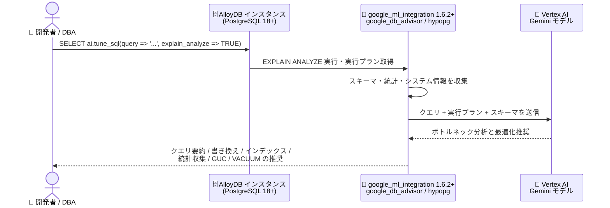

# AlloyDB for PostgreSQL: AI による SQL クエリチューニング (ai.tune_sql) (Preview)

**リリース日**: 2026-11-02

**サービス**: AlloyDB for PostgreSQL

**機能**: ai.tune_sql 関数による AI 支援 SQL クエリチューニング

**ステータス**: Preview

📊 [このアップデートのインフォグラフィックを見る](https://takech9203.github.io/google-cloud-news-summary/20261102-alloydb-ai-tune-sql-preview.html)

## 概要

AlloyDB for PostgreSQL で、AI を使って SQL クエリをチューニングできる `ai.tune_sql` 関数が Preview として利用可能になりました。`google_ml_integration` 拡張機能のバージョン 1.6.2 以降で提供され、LLM (大規模言語モデル) がクエリ実行プラン、スキーマ、ランタイム統計を分析して、クエリ最適化の推奨事項を提示します。

`ai.tune_sql` 関数はパフォーマンスのボトルネックを特定し、クエリの書き換え、インデックス、統計収集、GUC (Grand Unified Configuration) フラグ、テーブルの ANALYZE / VACUUM 操作に関する推奨事項を提供します。推奨されるインデックスには、式インデックス、GIN (Generalized Inverted Index) インデックス、ScaNN (Scalable Nearest Neighbors) インデックスといった種類が含まれます。

SQL チューニングの専門知識がないアプリケーション開発者や、多数のクエリを効率的に最適化したい DBA にとって、SELECT 文を 1 つ実行するだけで専門家レベルの包括的なチューニング分析を得られる点が大きな価値となります。

**アップデート前の課題**

- クエリのパフォーマンス問題を解決するには、`EXPLAIN ANALYZE` の出力を人間が読み解き、ボトルネックを手動で特定する必要があった
- インデックス設計、統計収集、GUC フラグ調整、VACUUM 戦略など、複数の観点にまたがる最適化には PostgreSQL の深い専門知識が必要だった
- 既存の Index Advisor はインデックス推奨が中心で、クエリ書き換えやパラメータチューニングまで含む包括的な推奨は得られなかった

**アップデート後の改善**

- `SELECT ai.tune_sql(...)` を実行するだけで、LLM が実行プラン・スキーマ・ランタイム統計を分析し、ボトルネックの要約と最適化推奨を自動生成できるようになった
- クエリ書き換え、インデックス (式 / GIN / ScaNN)、統計収集 (ANALYZE)、GUC フラグ、VACUUM 操作まで、複数領域の推奨を一度に取得できるようになった
- `hypopg` 拡張機能を利用した仮想インデックス評価により、実際にインデックスを作成せずに推奨の妥当性を評価できるようになった

## アーキテクチャ図



`ai.tune_sql` を呼び出すと、AlloyDB がクエリの実行プランと関連スキーマを収集して Vertex AI に登録した Gemini モデルへ送信し、LLM が生成したボトルネック分析と最適化推奨を返します。

## サービスアップデートの詳細

### 主要機能

1. **クエリ要約 (Query summary)**
   - クエリのパフォーマンスボトルネックを分析し、原因を自然言語で要約
   - 例: 相関サブクエリ (NOT IN) によるネステッドループが主要なボトルネックであることを特定し、アンチ結合 (NOT EXISTS) への変換を提案

2. **クエリ書き換え (Query rewrite)**
   - 元のクエリと等価で、より効率的なクエリへの書き換え手法を提案

3. **インデックス推奨 (Index recommendations)**
   - 式インデックス、GIN インデックス、ScaNN インデックスなどのインデックスタイプを推奨
   - `hypopg` 拡張機能を使用して、インデックス推奨の評価と生成を実施

4. **統計収集の推奨 (Statistics collection recommendations)**
   - クエリ実行プランに基づき、テーブルの `ANALYZE` と複数列に対する統計収集を推奨

5. **GUC フラグチューニング**
   - 実行プランと、メモリ・バッファの使用量やサイズなどのシステム情報を分析し、新しい GUC 値を推奨

6. **ANALYZE / VACUUM の推奨**
   - ANALYZE / VACUUM の履歴と、ライブタプル・デッドタプル数に基づいて、テーブルへの `ANALYZE` および `VACUUM` の実行を推奨

## 技術仕様

### 要件

| 項目 | 詳細 |
|------|------|
| AlloyDB バージョン | PostgreSQL 18 以降のインスタンス |
| 拡張機能 | `google_ml_integration` 1.6.2 以降、`google_db_advisor`、`hypopg` |
| Vertex AI 連携 | 有効化が必要 (Gemini モデルのエンドポイント登録) |
| 実行パラメータ | `explain_analyze` (デフォルト: TRUE。TRUE で EXPLAIN ANALYZE を実行、FALSE で EXPLAIN のみ) |
| 推奨生成時間 | 2〜4 分程度 |
| 提供ステータス | Preview (Pre-GA Offerings Terms が適用) |

### 関連データベースフラグ

| フラグ | 用途 |
|--------|------|
| `google_db_advisor.llm_model_id` | SQL クエリチューニングに使用する登録済みモデル ID を指定 |
| `google_db_advisor.enable_ai_tune_sql` | SQL クエリチューニングの有効化 (セッション単位の SET、または ALTER DATABASE / インスタンスのデータベースフラグで永続化) |

## 設定方法

### 前提条件

1. PostgreSQL 18 以降で稼働する AlloyDB インスタンス
2. psql クライアント接続、または AlloyDB Studio へのアクセス
3. Vertex AI 連携の有効化
4. `google_ml_integration` 拡張機能 1.6.2 以降のインストール、および `google_db_advisor` と `hypopg` 拡張機能の有効化 (`CREATE EXTENSION IF NOT EXISTS hypopg;`)

### 手順

#### ステップ 1: Gemini モデルのエンドポイントを登録

```sql
-- グローバルモデルエンドポイントの登録例 (gemini-3.5-flash)
CALL google_ml.create_model(
  model_id => 'gemini-3.5-flash-global',
  model_request_url => 'https://aiplatform.googleapis.com/v1/projects/PROJECT_ID/locations/global/publishers/google/models/gemini-3.5-flash:generateContent',
  model_qualified_name => 'gemini-3.5-flash',
  model_provider => 'google',
  model_type => 'llm',
  model_auth_type => 'alloydb_service_agent_iam');
```

インスタンスのリージョンでモデルが利用可能な場合は、リージョナルモデルエンドポイント (例: `gemini-2.5-pro`) も登録できます。

#### ステップ 2: SQL チューニングを有効化

```sql
SET google_db_advisor.llm_model_id = 'gemini-3.5-flash-global';
SET google_db_advisor.enable_ai_tune_sql = on;
```

`SET` は現在のデータベースセッションにのみ適用されます。セッションをまたいで永続化するには、`ALTER DATABASE データベース名 SET フラグ名 = 値;` を両方のフラグに対して実行するか、インスタンスのデータベースフラグとして構成します。

#### ステップ 3: ai.tune_sql を実行

```sql
SELECT ai.tune_sql(query => 'SQL_QUERY', explain_analyze => TRUE);
```

関数はクエリ関連のスキーマを取得し、クエリとともに LLM に送信してパフォーマンス分析を行います。出力には、標準のクエリプランに続いて、クエリ要約、書き換え提案、統計収集・GUC フラグ・VACUUM に関する AI 生成の推奨事項が表示されます。

## メリット

### ビジネス面

- **チューニング工数の削減**: 専門家が手動で行っていた実行プラン分析と最適化検討を自動化し、パフォーマンス問題の解決までの時間を短縮できる
- **専門知識の民主化**: PostgreSQL チューニングの深い知識がない開発者でも、専門家レベルの推奨事項を得られる

### 技術面

- **多面的な推奨**: クエリ書き換え、インデックス、統計、GUC フラグ、VACUUM と、単一のツールで複数領域をカバー
- **実行プランに基づく精度**: `explain_analyze => TRUE` で実際にクエリを実行して実行プランを取得するため、より正確で有用なチューニング推奨が得られる
- **AI 向けインデックスにも対応**: ScaNN インデックスの推奨により、ベクトル検索ワークロードの最適化にも活用できる

## デメリット・制約事項

### 制限事項

- **プリペアド / パラメータ化ステートメント**: クエリ書き換えの推奨は提供されない (その他のチューニング推奨は提供される)。Query Insights や `pg_stat_statements` からコピーした `$1` などのプレースホルダーを含むクエリで書き換え推奨を得るには、代表的なリテラル値に置き換えてから実行する必要がある
- **explain_analyze が TRUE の場合は読み取り専用 SELECT のみ**: 単一の読み取り専用 SELECT 文のみサポート。`INSERT`、`UPDATE`、`DELETE`、`SELECT INTO`、`SELECT FOR UPDATE` などで実行するとエラーになる
- **Preview ステータス**: Pre-GA Offerings Terms が適用され、サポートが限定される場合がある

### 考慮すべき点

- 推奨事項は LLM の支援により生成されるため、不正確な内容が含まれる可能性があり、適用前に独立した検証が必要 (出力にもその旨の注記が表示される)
- 推奨の生成には 2〜4 分程度かかる
- `explain_analyze => TRUE` (デフォルト) ではクエリが実際に実行されるため、重いクエリの分析は実行コストに注意が必要 (FALSE にすると EXPLAIN のみで実行されない)

## ユースケース

### ユースケース 1: スロークエリのボトルネック特定と書き換え

**シナリオ**: Query Insights で特定したスロークエリ (相関サブクエリを含む NOT IN 条件) の原因を調査し、最適化したい。

**実装例**:
```sql
SELECT ai.tune_sql(
  'SELECT * FROM store_sales
   WHERE ss_customer_sk NOT IN (
     SELECT sr_customer_sk FROM store_returns
     WHERE sr_item_sk = ss_item_sk)');
```

**効果**: 公式ドキュメントの例では、約 288 万回のインデックススキャンを伴うネステッドループ実行 (103 秒超) がボトルネックと特定され、NOT EXISTS (アンチ結合) への変換により Hash Anti Join を使って大幅に実行時間を削減できるという推奨が得られる。

### ユースケース 2: インデックス・統計・VACUUM を含む包括的なチューニング

**シナリオ**: 複雑な分析クエリに対して、インデックス追加だけでなく統計収集やテーブルメンテナンスまで含めた最適化方針を検討したい。

**効果**: 単一の `ai.tune_sql` 呼び出しで、式 / GIN / ScaNN インデックスの推奨、複数列統計の ANALYZE 推奨、GUC フラグの調整案、ライブ / デッドタプル数に基づく VACUUM 推奨を一括で取得でき、チューニング方針の検討を効率化できる。

## 料金

この機能自体の個別料金は Release Notes およびドキュメントに記載されていません。AlloyDB の料金と Vertex AI (Gemini モデル) の料金については、各料金ページを参照してください。

- [AlloyDB の料金](https://cloud.google.com/alloydb/pricing)
- [Vertex AI の料金](https://cloud.google.com/vertex-ai/pricing)

## 関連サービス・機能

- **Vertex AI**: `ai.tune_sql` が分析に使用する Gemini モデルのエンドポイントを提供。AlloyDB の Vertex AI 連携の有効化が前提
- **google_ml_integration 拡張機能**: AlloyDB から Vertex AI のモデルを呼び出すための拡張機能。バージョン 1.6.2 以降で `ai.tune_sql` を提供
- **AlloyDB Index Advisor (google_db_advisor)**: 既存のインデックス推奨機能。`ai.tune_sql` は同じ `google_db_advisor` 拡張機能群と関連フラグを利用する
- **hypopg 拡張機能**: 仮想 (hypothetical) インデックスの評価に使用され、インデックス推奨の評価・生成を支える
- **Query Insights / pg_stat_statements**: チューニング対象のクエリを特定するために併用。プレースホルダー付きクエリはリテラル値に置換してから `ai.tune_sql` に渡す
- **AlloyDB Studio**: psql クライアントの代わりに、ブラウザから `ai.tune_sql` を実行可能

## 参考リンク

- 📊 [インフォグラフィック](https://takech9203.github.io/google-cloud-news-summary/20261102-alloydb-ai-tune-sql-preview.html)
- [公式リリースノート](https://cloud.google.com/release-notes)
- [ドキュメント: Tune SQL queries by using AI](https://cloud.google.com/alloydb/docs/tune-sql-queries-ai)
- [ドキュメント: Database advisor flags](https://cloud.google.com/alloydb/docs/reference/database-advisor-flags)
- [料金ページ (AlloyDB)](https://cloud.google.com/alloydb/pricing)

## まとめ

AlloyDB の `ai.tune_sql` は、LLM を活用してクエリ書き換えからインデックス、統計、GUC フラグ、VACUUM まで包括的なチューニング推奨を提供する Preview 機能です。PostgreSQL 18 以降のインスタンスと Vertex AI 連携を準備し、スロークエリに対してまず試してみることを推奨します。ただし推奨事項は LLM 生成のため、適用前に必ず内容を検証してください。

---

**タグ**: AlloyDB, PostgreSQL, AI, SQL チューニング, クエリ最適化, Gemini, Vertex AI, Preview
