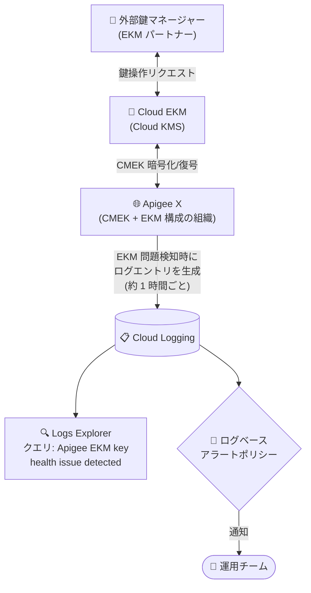

# Apigee X: EKM ヘルスモニタリング

**リリース日**: 2026-11-02

**サービス**: Apigee X

**機能**: EKM ヘルスモニタリング (EKM health monitoring)

**ステータス**: Feature (新機能)

📊 [このアップデートのインフォグラフィックを見る](https://takech9203.github.io/google-cloud-news-summary/20261102-apigee-x-ekm-health-monitoring.html)

## 概要

2026 年 11 月 2 日、Apigee の新バージョンがリリースされ、**Cloud External Key Manager (Cloud EKM) のヘルスモニタリング機能**が追加されました。Apigee で CMEK (顧客管理暗号鍵) に Cloud EKM を利用している場合に、EKM の健全性を Cloud Logging で監視し、EKM 関連の問題に対するアラートを構成できるようになります。

Apigee は CMEK の鍵保管先として Cloud EKM (外部鍵管理) をサポートしています。外部鍵マネージャーがネットワーク障害で到達不能になったり、鍵が無効化・アクセス拒否されたりすると、暗号化に依存する Apigee のサービス (プロキシのデプロイ、分析処理など) が影響を受けます。今回の機能により、こうした EKM 起因の障害を Cloud Logging のログエントリとして検知し、ログベースのアラートで運用チームに通知できるようになりました。

対象ユーザーは、規制・コンプライアンス要件により外部鍵管理 (EKM) を使った CMEK 構成で Apigee を運用している組織です。なお、本リリースのロールアウトは 2026 年 11 月 2 日に開始され、全ゾーンへの展開完了までに 4 営業日以上かかる場合があります。

**アップデート前の課題**

- Cloud EKM の鍵が到達不能・無効化された場合でも、Apigee 側から EKM の健全性を直接監視する仕組みがなかった
- EKM 起因の問題は、プロキシのデプロイ失敗など暗号化に依存する操作が失敗して初めて気付くことが多く、原因の切り分けに時間がかかった
- EKM 関連の障害を検知してアラート通知する標準的な方法が用意されていなかった

**アップデート後の改善**

- Apigee が EKM の問題 (アクセス拒否への状態変化、鍵の無効化、課金無効化、鍵への到達不能) を検知すると、Cloud Logging にログエントリが自動生成されるようになった
- Logs Explorer で `Apigee EKM key health issue detected` というクエリにより、EKM 関連のログエントリを簡単に検索できるようになった
- ログベースのアラートポリシーを構成することで、EKM 関連の問題を事前に (プロアクティブに) 検知・通知できるようになった

## アーキテクチャ図



Apigee が Cloud EKM の問題 (鍵の無効化、到達不能など) を検知すると Cloud Logging にログエントリを生成し、ログベースのアラートポリシー経由で運用チームに通知されるフローを示しています。

## サービスアップデートの詳細

### 主要機能

1. **Cloud Logging への EKM 問題のログ出力**
   - Apigee が Cloud EKM の問題を検知すると、Cloud Logging にログエントリを自動生成する
   - 検知対象: 鍵の状態が「拒否 (denied)」に変化、鍵の無効化、課金の無効化、鍵への到達不能
   - ログエントリには問題が発生している組織とインスタンスの詳細が含まれるが、セキュリティ上の理由から鍵の名前は含まれない

2. **Logs Explorer での EKM ログ検索**
   - Google Cloud コンソールの Logs Explorer で、クエリ `Apigee EKM key health issue detected` を実行することで EKM 関連ログを検索できる
   - EKM の問題が発生している場合、イベントの詳細を示すログエントリが結果に表示される

3. **ログベースのアラート構成**
   - 上記のクエリフィルタを使ってログベースのアラートポリシーを作成し、EKM 関連エラー発生時に通知を受け取れる
   - Cloud Logging の「ログベースのアラートポリシーの構成」手順に従って設定する

## 技術仕様

### 検知対象となる EKM の問題

| 検知対象 | 説明 |
|------|------|
| 状態変化 (denied) | 鍵へのアクセスが拒否状態に変化した場合 |
| 鍵の無効化 | Cloud EKM の鍵が無効化された場合 |
| 課金の無効化 | 課金が無効化され鍵が利用できない場合 |
| 鍵への到達不能 | ネットワーク問題などで外部鍵マネージャーに到達できない場合 |

### アラートの動作仕様

| 項目 | 詳細 |
|------|------|
| ログ生成頻度 | 鍵が到達不能な間、約 1 時間に 1 回ログエントリを生成 (問題解消までアラート通知が繰り返される) |
| 復旧通知 | なし。EKM が再度到達可能になってもログエントリや通知は生成されない |
| アラートの自動解決 | エラーログの生成が止まると、アラートポリシーの自動クローズ設定に基づきアラートが自動的に解決される |
| 復旧確認方法 | API プロキシのデプロイなど、鍵を必要とする操作を実行して成功することを確認する |
| ログ内容 | 組織・インスタンスの詳細を含む。鍵名はセキュリティ上の理由で含まれない |

## 設定方法

### 前提条件

1. Apigee 組織が、**組織の作成時に** CMEK + Cloud EKM を使用するよう構成されていること (既存組織での有効化は不可)
2. Cloud Logging の Logs Explorer およびアラートポリシーを操作できる権限があること

### 手順

#### ステップ 1: Logs Explorer で EKM 関連ログを確認する

```text
Apigee EKM key health issue detected
```

Google Cloud コンソールで Logs Explorer を開き、上記のクエリをクエリエディタに入力して実行します。Cloud EKM の問題が発生している場合、イベントの詳細を示すログエントリが表示されます。

#### ステップ 2: ログベースのアラートを作成する

ステップ 1 と同じクエリフィルタを使用して、Cloud Logging のログベースのアラートポリシーを作成します。Cloud Logging ドキュメントの [ログベースのアラートポリシーの構成](https://docs.cloud.google.com/logging/docs/alerting/log-based-alerts) の手順に従い、通知チャンネル (メール、PagerDuty など) を設定します。

#### ステップ 3: 復旧の確認

復旧時のログエントリは生成されないため、問題解消後は API プロキシのデプロイなど鍵を必要とする操作を実行し、成功することを確認して Cloud EKM が再度到達可能になったことを検証します。

## メリット

### ビジネス面

- **障害の早期検知によるダウンタイム削減**: EKM 起因の問題をプロアクティブに検知できるため、API 基盤の停止時間を最小化し、エンドユーザーへの影響を抑えられる
- **コンプライアンス要件と運用性の両立**: 規制要件で外部鍵管理 (EKM) が必須の組織でも、鍵管理起因の障害に対する監視体制を標準機能で整備できる

### 技術面

- **原因切り分けの迅速化**: 「Apigee の障害」なのか「外部鍵マネージャーの問題」なのかをログから即座に判別でき、トラブルシューティングが効率化される
- **既存の監視基盤との統合**: Cloud Logging のログベースアラートという標準的な仕組みを使うため、既存の通知チャンネルやインシデント管理フローにそのまま組み込める

## デメリット・制約事項

### 制限事項

- EKM モニタリング機能は、**組織の作成時に CMEK + EKM を使用するよう構成された Apigee 組織でのみ利用可能**。既存組織での有効化はできない (EKM を使いたい場合は新規組織を作成してリソースを移行する必要がある)
- Apigee hybrid は対象外 (Apigee X のみ)
- 復旧時の通知は生成されないため、復旧確認は手動で行う必要がある

### 考慮すべき点

- 鍵が到達不能な間は約 1 時間ごとにログが生成され、アラートも同じ頻度で通知されるため、通知チャンネルのノイズを考慮したアラートポリシー設計 (自動クローズ設定など) が必要
- Apigee のログは EKM 接続や鍵の状態に問題があることを示すのみで、**EKM 自体の詳細なトラブルシューティング** (ネットワーク接続の診断、外部鍵マネージャー側の問題) は Apigee モニタリングの範囲外。アラートを受けたら Cloud EKM サービス側の健全性と構成を調査する必要がある
- ロールアウトには 4 営業日以上かかる場合があり、完了までは機能が利用できないインスタンスがある

## ユースケース

### ユースケース 1: 金融機関での EKM 障害の即時検知

**シナリオ**: 規制要件により外部鍵マネージャー (Thales、Fortanix など) で鍵を管理している金融機関が、Apigee X で API 基盤を運用している。外部鍵マネージャーへのネットワーク経路に障害が発生した場合、即座にインシデント対応を開始したい。

**実装例**:
```text
# Logs Explorer のクエリでログベースアラートを作成
Apigee EKM key health issue detected
# 通知チャンネル: PagerDuty / メール
```

**効果**: 鍵への到達不能を約 1 時間以内に検知し、プロキシのデプロイ失敗や分析処理の停止が広がる前にネットワーク経路や EKM 側の調査を開始できる。

### ユースケース 2: 鍵の誤操作 (無効化・アクセス拒否) の検出

**シナリオ**: 鍵管理チームと API 運用チームが分かれている組織で、鍵管理チームが誤って Apigee 用の鍵を無効化したり、IAM 変更でアクセスが拒否状態になったりするリスクに備えたい。

**効果**: 鍵の無効化や「拒否」への状態変化がログとして記録され、アラート経由で API 運用チームが即座に把握できる。暗号化に依存する Apigee 操作の失敗を未然に察知し、チーム間の連携で迅速に復旧できる。

## 料金

EKM ヘルスモニタリング機能自体の追加料金に関する記載はリリースノートにありません。関連コストとして以下を考慮してください。

- **Cloud Logging**: ログの取り込み・保持に応じた料金が発生する場合があります ([Cloud Logging 料金](https://cloud.google.com/stackdriver/pricing))
- **アラート**: Cloud Monitoring のドキュメントによると、2026 年 5 月 1 日以降、アラートに対する課金が開始されています ([アラートの料金](https://cloud.google.com/stackdriver/pricing#pricing-alerting))
- **Cloud EKM / Cloud KMS**: 鍵の操作に応じた料金 ([Cloud KMS 料金](https://cloud.google.com/kms/pricing))

## 利用可能リージョン

リージョン固有の制限はリリースノートに記載されていません。ロールアウトは 2026 年 11 月 2 日に開始され、全 Google Cloud ゾーンへの展開完了までに 4 営業日以上かかる場合があります。なお、Cloud EKM 自体は一部のロケーション (`global`、`nam-eur-asia1` など) では利用できません。詳細は [Cloud KMS ロケーション](https://docs.cloud.google.com/kms/docs/locations) を参照してください。

## 関連サービス・機能

- **Cloud Logging**: EKM 問題のログエントリの保存先。Logs Explorer での検索とログベースアラートの基盤
- **Cloud EKM (Cloud External Key Manager)**: Google Cloud 外部の鍵マネージャーで管理する鍵を CMEK として利用するサービス。本機能の監視対象
- **Cloud KMS**: CMEK の鍵管理基盤。鍵の使用状況トラッキング (Usage tracking) で Apigee リソースと鍵の対応も確認できる
- **Cloud Monitoring**: ログベースアラートの通知・インシデント管理。2026 年 10 月に GA となった Apigee API Health & Availability ダッシュボードと組み合わせることで、API の健全性と鍵の健全性を統合的に監視できる

## 参考リンク

- 📊 [インフォグラフィック](https://takech9203.github.io/google-cloud-news-summary/20261102-apigee-x-ekm-health-monitoring.html)
- [公式リリースノート](https://docs.cloud.google.com/release-notes#November_02_2026)
- [EKM health monitoring (公式ドキュメント)](https://docs.cloud.google.com/apigee/docs/api-platform/security/ekm-monitoring)
- [Apigee CMEK の概念 (EKM サポート)](https://docs.cloud.google.com/apigee/docs/api-platform/get-started/cmek-concepts)
- [Cloud External Key Manager](https://docs.cloud.google.com/kms/docs/ekm)
- [ログベースのアラートポリシーの構成](https://docs.cloud.google.com/logging/docs/alerting/log-based-alerts)

## まとめ

Apigee X で Cloud EKM を利用する CMEK 構成において、これまで検知が難しかった外部鍵マネージャー起因の障害 (鍵の無効化・到達不能など) を Cloud Logging で監視し、アラート通知できるようになりました。EKM を利用している組織は、クエリ `Apigee EKM key health issue detected` を使ったログベースアラートを早期に設定し、復旧通知が生成されない点を踏まえた運用手順 (鍵を使う操作による復旧確認) を整備することを推奨します。

---

**タグ**: Apigee X, Cloud EKM, CMEK, Cloud Logging, Cloud KMS, セキュリティ, モニタリング, アラート
