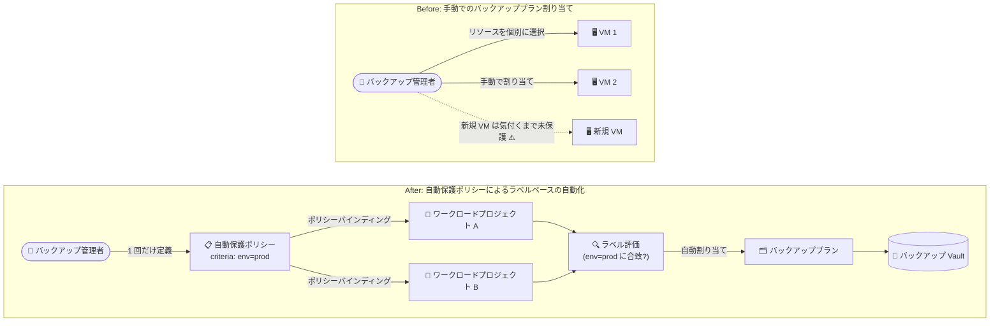

# Backup and DR: 自動保護ポリシーによる Compute Engine リソース保護の自動化が GA

**リリース日**: 2026-11-02

**サービス**: Backup and DR

**機能**: 自動保護ポリシー (Auto-protection policies) による Compute Engine インスタンス・ディスクの大規模リソース保護の自動化

**ステータス**: GA (一般提供)

📊 [このアップデートのインフォグラフィックを見る](https://takech9203.github.io/google-cloud-news-summary/20261102-backup-and-dr-auto-protection-ga.html)

## 概要

Backup and DR Service において、Compute Engine インスタンスおよびディスクのリソース保護を大規模に自動化する機能が一般提供 (GA) になりました。自動保護ポリシー (Auto-protection policies) とリソースラベルを使用することで、ユーザー定義のラベル (例: `env=prod`) に基づいて複数プロジェクトにまたがる対象リソースを自動的に識別し、指定したバックアッププランを自動割り当てできます。

従来、バックアッププランの適用はリソースを個別に選択して手動で行う必要があり、VM やディスクが多数存在する大規模環境や、リソースが頻繁に作成・削除される動的な環境では、保護漏れのリスクと運用負荷が課題でした。本機能により、ラベルを付与するだけで新規リソースも自動的にバックアップ保護の対象となり、「ポリシーベース」のデータ保護ガバナンスを組織全体で実現できます。

バックアップ管理者 (バックアップ Vault プロジェクト側) とワークロード管理者 (保護対象プロジェクト側) の双方に専用のビューが提供され、マッチしたリソース数、保護済みリソース数、保護に失敗したリソース数を一元的に監視できます。

**アップデート前の課題**

- バックアッププランの割り当てはリソース単位で手動選択する必要があり、数百〜数千台規模の VM フリートでは運用負荷が大きかった
- 新規作成されたインスタンスやディスクは、管理者が気付いて手動でバックアッププランを関連付けるまで保護されず、保護漏れが発生するリスクがあった
- 複数プロジェクトにまたがるリソースを一貫したルールで保護する仕組みがなく、プロジェクトごとに個別の運用が必要だった

**アップデート後の改善**

- リソースラベル (キーと値のペア) を条件とした自動保護ポリシーを定義することで、条件に合致するリソースへバックアッププランが自動的に割り当てられるようになった
- 同一組織内の複数のワークロードプロジェクトをポリシーバインディングで追加でき、プロジェクト横断の保護を一元管理できるようになった
- ラベルが付与された新規リソースはポリシーが自動検出して保護するため、保護漏れを構造的に防止できるようになった
- Google Cloud コンソール、gcloud CLI、API からポリシーの作成・編集・監視が可能になり、マッチ/保護/失敗リソース数を可視化できるようになった

## アーキテクチャ図



アップデート前はリソースごとに手動でバックアッププランを割り当てる必要がありましたが、アップデート後は自動保護ポリシーがラベルに基づいて複数プロジェクトのリソースを自動検出し、バックアッププランを割り当ててバックアップ Vault に保存します。

## サービスアップデートの詳細

### 主要機能

1. **ラベルベースの自動保護ポリシー**
   - ユーザー定義のリソースラベル (例: `env=prod`) を条件 (criteria) として、合致する Compute Engine インスタンスまたはディスクに指定のバックアッププランを自動割り当て
   - ポリシー作成後、マッチするリソースの識別とバックアッププラン関連付けのスケジューリングが自動実行される (初回の構成と保護スケジューリングは通常最大 2 時間、場合によっては最大 8 時間)

2. **プロジェクト横断の保護 (ポリシーバインディング)**
   - バックアップ Vault プロジェクトで作成したポリシーに、同一組織内の複数のワークロードプロジェクトをバインディングとして追加可能
   - ワークロードリソースがバックアップ Vault プロジェクトと異なるプロジェクトにある場合は、バックアップ Vault サービスエージェントにオペレーターロールを付与することでクロスプロジェクト保護を実現

3. **管理者ロールごとの可視化ビュー**
   - バックアップ管理者: バックアップ Vault プロジェクトでポリシー一覧・詳細・保護対象リソース (マッチ数 / 保護済み数 / 失敗数) を確認可能
   - ワークロード管理者: ワークロードプロジェクト側で「このプロジェクトに適用されたポリシー」タブから、適用ポリシー・条件ラベル・バックアッププラン・ステータスを確認可能

4. **複数の管理インターフェース**
   - Google Cloud コンソール、gcloud CLI (`gcloud beta backup-dr auto-protection-policies` など)、API でポリシーの作成・更新・削除・閲覧が可能

## 技術仕様

### 自動保護ポリシーの構成要素

| 項目 | 詳細 |
|------|------|
| 対象リソースタイプ | `compute.googleapis.com/Instance` (Compute Engine インスタンス)、`compute.googleapis.com/Disk` (ディスク) |
| マッチング条件 | リソースラベル (キーと値のペア、例: `env=prod`) |
| スコープ | ポリシーバインディングで追加した同一組織内のワークロードプロジェクト |
| リージョン | 1 つのポリシーは単一リージョンのリソースを保護 (複数リージョンはリージョンごとにポリシーを作成) |
| 適用されるアクション | 指定したバックアッププランの自動割り当て |
| 初回保護までの時間 | 通常最大 2 時間 (場合によっては最大 8 時間) |
| 管理インターフェース | Google Cloud コンソール、gcloud CLI、API |

### 必要な IAM ロール

| 操作 | 必要なロール | 対象プロジェクト |
|------|-------------|----------------|
| ポリシー・バインディングの作成/編集/削除 | Backup and DR 管理者 (`roles/backupdr.admin`) または Backup and DR 編集者 (`roles/backupdr.editor`) | バックアップ Vault プロジェクト |
| ポリシーの適用の承認とバインディング管理 | Backup and DR 管理者 または Backup and DR 編集者 | ワークロードプロジェクト |
| ポリシー・マッチングリソースの閲覧 | Backup and DR 閲覧者 (`roles/backupdr.viewer`) | 両プロジェクト |
| クロスプロジェクト保護 (インスタンス) | Backup and DR Compute Engine オペレーター (`roles/backupdr.computeEngineOperator`) をサービスエージェントに付与 | ワークロードプロジェクト |
| クロスプロジェクト保護 (ディスク) | Backup and DR ディスクオペレーター (`roles/backupdr.diskOperator`) をサービスエージェントに付与 | ワークロードプロジェクト |

カスタムロールを使用する場合は、`backupdr.autoProtectionPolicies.create` や `backupdr.autoProtectionPolicyBindings.create`、`backupdr.appliedAutoProtectionPolicies.authorize` などの詳細な権限が必要です。

## 設定方法

### 前提条件

1. バックアップ Vault プロジェクト (バックアップ Vault、バックアッププラン、自動保護ポリシーを格納) とワークロードプロジェクト (保護対象の Compute Engine リソースを格納) を用意し、課金を有効化する
2. 両プロジェクトで Backup and DR API と Compute Engine API を有効化する
3. バックアップ Vault プロジェクトにバックアップ Vault と、保護対象のリソースタイプ・リージョンに対応するバックアッププランを作成する
4. 必要な IAM ロールを付与する

### 手順

#### ステップ 1: 保護対象リソースにラベルを付与する

```bash
# Compute Engine インスタンスにラベルを付与
gcloud compute instances add-labels INSTANCE_NAME \
  --labels=env=prod \
  --zone=ZONE

# ディスクにラベルを付与
gcloud compute disks add-labels DISK_NAME \
  --labels=env=prod \
  --zone=ZONE
```

保護したいリソースに、ポリシーの条件として使用するキーと値のペア (例: `env=prod`) を付与します。

#### ステップ 2: 自動保護ポリシーを作成する

```bash
gcloud beta backup-dr auto-protection-policies create POLICY_NAME \
  --location=LOCATION \
  --criteria=key=env,values=prod \
  --backup-plan-details="resource-type=compute.googleapis.com/Instance,backup-plan=projects/BACKUP_VAULT_PROJECT/locations/LOCATION/backupPlans/BACKUP_PLAN" \
  --description="Production VM auto-protection"
```

ラベル条件、リソースタイプ、適用するバックアッププランを指定してポリシーを作成します。

#### ステップ 3: ワークロードプロジェクトをポリシーにバインドする

```bash
gcloud beta backup-dr auto-protection-bindings create BINDING_NAME \
  --auto-protection-policy=POLICY_NAME \
  --location=LOCATION \
  --scope=projects/WORKLOAD_PROJECT_ID
```

保護したいワークロードプロジェクトごとにこのステップを繰り返します。作成後、ポリシーが自動的にマッチするリソースを識別し、バックアッププランの関連付けをスケジュールします。

#### ステップ 4: 保護状況を確認する

```bash
# ポリシーの一覧表示
gcloud beta backup-dr auto-protection-policies list --location=LOCATION

# ポリシーにマッチしたリソースの一覧表示
gcloud beta backup-dr binding-matching-resources list \
  --auto-protection-policy-binding=BINDING_NAME \
  --auto-protection-policy=POLICY_NAME \
  --location=LOCATION
```

マッチ数・保護済み数・保護失敗数をコンソールまたは CLI で確認できます。

## メリット

### ビジネス面

- **データ保護ガバナンスの強化**: ラベル運用ルールと組み合わせることで、組織全体で「本番リソースは必ずバックアップされる」状態をポリシーとして担保でき、コンプライアンス要件への対応が容易になる
- **運用コストの削減**: リソース単位の手動割り当て作業が不要になり、大規模フリートのバックアップ運用工数を大幅に削減できる
- **保護漏れリスクの低減**: 新規作成リソースも自動的に保護対象となるため、ヒューマンエラーによるバックアップ未設定を構造的に防止できる

### 技術面

- **宣言的なデータ保護**: ラベルという既存のリソース管理メカニズムをそのまま保護条件に流用でき、IaC やオートスケール環境と親和性が高い
- **クロスプロジェクト対応**: バックアップ Vault プロジェクトに管理を集約しつつ、同一組織内の複数ワークロードプロジェクトを一元的に保護できる
- **ロール分離に対応した可視性**: バックアップ管理者とワークロード管理者がそれぞれの視点で適用状況 (マッチ / 保護済み / 失敗) を監視できる

## デメリット・制約事項

### 制限事項

- 対応リソースは Compute Engine インスタンスとディスクのみ (Cloud SQL などその他のワークロードは対象外)
- 1 つのポリシーは単一リージョンのリソースのみを保護する。複数リージョンのリソースを保護するには、リージョンごとに個別のポリシーを作成する必要がある
- 同一プロジェクトに複数の自動保護ポリシーを適用する場合、すべてのポリシーで同じラベルキーを使用する必要がある (例: `env=prod` と `env=test` は可、`env=prod` と `tier=gold` の併用は不可。ただし別プロジェクトであれば異なるラベルキーを使用可能)
- ドキュメント上、Terraform でのポリシー管理は今後のリリースで対応予定とされている

### 考慮すべき点

- 初回のポリシー構成と保護スケジューリングには通常最大 2 時間 (場合によっては最大 8 時間) かかるため、ポリシー作成直後は即時に保護されない点に注意
- ポリシーバインディングはワークロードプロジェクトごとに作成が必要であり、新規プロジェクト追加時の運用フローに組み込む必要がある
- 保護の前提となるラベル付与の規律 (命名規則、付与の徹底) が自動化の実効性を左右するため、組織のラベリング標準を事前に整備することが重要
- クロスプロジェクト構成ではサービスエージェントへのオペレーターロール付与が必要で、IAM 設計の考慮が必要

## ユースケース

### ユースケース 1: 本番環境 VM フリートの保護の標準化

**シナリオ**: 複数のプロジェクトに数百台の本番 VM が存在し、チームごとに VM が随時作成される。全本番 VM に対して日次バックアップ (Vault 保存) を確実に適用したい。

**実装例**:
```bash
# 本番 VM 向けポリシーを作成し、ワークロードプロジェクトをバインド
gcloud beta backup-dr auto-protection-policies create prod-vm-protection \
  --location=asia-northeast1 \
  --criteria=key=env,values=prod \
  --backup-plan-details="resource-type=compute.googleapis.com/Instance,backup-plan=projects/backup-admin-prj/locations/asia-northeast1/backupPlans/daily-vault-plan"

gcloud beta backup-dr auto-protection-bindings create team-a-binding \
  --auto-protection-policy=prod-vm-protection \
  --location=asia-northeast1 \
  --scope=projects/team-a-prod
```

**効果**: `env=prod` ラベルを付けて作成された VM は自動的に日次バックアップの対象となり、チームごとの設定漏れがなくなる。

### ユースケース 2: オートスケール・IaC 環境での保護の自動追従

**シナリオ**: Terraform で VM とディスクを頻繁に作成・破棄する環境で、作成のたびにバックアップ設定を人手で追加するのが追いつかない。

**効果**: IaC テンプレートでラベルを付与しておけば、プロビジョニングされたリソースが自動的にポリシーにマッチして保護される。バックアップ設定をデプロイパイプラインから分離でき、保護の追従が自動化される。

### ユースケース 3: バックアップ管理の集約とロール分離

**シナリオ**: 情報システム部門がバックアップ Vault プロジェクトを一元管理し、各事業部のワークロードプロジェクトに保護ポリシーを適用したい。事業部側でも自分たちのリソースの保護状況を確認したい。

**効果**: 情シスはバックアップ Vault プロジェクトでポリシーと保護状況 (マッチ / 保護済み / 失敗) を一元監視し、各事業部はワークロードプロジェクトの「適用されたポリシー」ビューで自部門のリソース保護状況を確認できる。責任分界を保ちつつガバナンスを効かせられる。

## 料金

自動保護ポリシー自体の追加料金に関する個別の記載は確認できませんでした。Backup and DR Service は月次の使用量ベースで課金され、バックアップ管理料金とバックアップ Vault のストレージ料金などが発生します。自動保護ポリシーで保護されたリソースには、通常のバックアッププラン適用時と同様に Backup and DR および Compute Engine (インスタンス・ディスク) の料金が適用されます。

詳細は料金ページを参照してください。

- [Backup and DR の料金](https://cloud.google.com/backup-disaster-recovery/pricing)

なお、Backup and DR には 30 日間の無料トライアル (プロジェクトごとに 1 回、バックアップ Vault あたり 50 TiB まで) が用意されており、評価に利用できます。

## 利用可能リージョン

公式ドキュメントにリージョン一覧の個別記載は確認できませんでした。ポリシー作成時にリソースが存在するリージョンを選択する方式であり、1 ポリシーは単一リージョンを対象とします。最新のリージョン対応状況は [Backup and DR ドキュメント](https://docs.cloud.google.com/backup-disaster-recovery/docs/protect/automate-protection) を参照してください。

## 関連サービス・機能

- **Compute Engine**: 保護対象となるインスタンスとディスク。リソースラベルがポリシーのマッチング条件として使用される
- **バックアップ Vault (Backup and DR)**: 自動割り当てされたバックアッププランのバックアップデータを、イミュータブル (変更不可)・インデリブル (削除不可) な形で保存する
- **バックアッププラン (Backup and DR)**: スケジュール、保存先、保持期間を定義する。自動保護ポリシーはこのプランをマッチしたリソースに割り当てる
- **IAM**: ポリシー管理・適用承認・クロスプロジェクト保護に必要なロール (`roles/backupdr.admin`、`roles/backupdr.computeEngineOperator` など) を制御する
- **Resource Manager (ラベル)**: リソースラベルの運用標準が本機能の実効性の基盤となる

## 参考リンク

- 📊 [インフォグラフィック](https://takech9203.github.io/google-cloud-news-summary/20261102-backup-and-dr-auto-protection-ga.html)
- [公式リリースノート](https://docs.cloud.google.com/release-notes#November_02_2026)
- [ドキュメント: Automate resource protection](https://docs.cloud.google.com/backup-disaster-recovery/docs/protect/automate-protection)
- [Backup and DR 製品ページ](https://cloud.google.com/backup-disaster-recovery)
- [料金ページ](https://cloud.google.com/backup-disaster-recovery/pricing)

## まとめ

自動保護ポリシーの GA により、Compute Engine インスタンスとディスクのバックアップ保護を「リソース単位の手動作業」から「ラベルベースのポリシー駆動」へ転換できるようになりました。大規模・マルチプロジェクト環境でバックアップの保護漏れに課題を持つ組織は、まずラベリング標準を整備した上で、本番環境向けの自動保護ポリシーの導入を検討することを推奨します。

---

**タグ**: #BackupAndDR #ComputeEngine #AutoProtection #バックアップ #GA #データ保護 #DR
