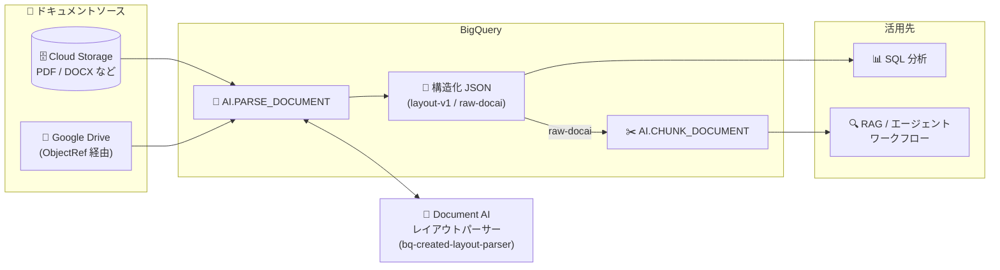

# BigQuery: AI.PARSE_DOCUMENT 関数が一般提供 (GA) に

**リリース日**: 2026-11-02

**サービス**: BigQuery

**機能**: AI.PARSE_DOCUMENT 関数 (非構造化ドキュメントの構造化 JSON 変換)

**ステータス**: GA (一般提供)

📊 [このアップデートのインフォグラフィックを見る](https://takech9203.github.io/google-cloud-news-summary/20261102-bigquery-ai-parse-document-ga.html)

## 概要

BigQuery の `AI.PARSE_DOCUMENT` 関数が一般提供 (GA) になりました。この関数は、Document AI のレイアウトパーサーを使用して、非構造化ドキュメント (PDF など) からタイトル、見出し、段落、リスト、テーブル、画像といったレイアウト要素を抽出し、構造化された JSON データに変換するスカラー関数です。SQL クエリ 1 つでドキュメントの解析が完結するため、別途 Document AI のパイプラインを構築する必要がありません。

BigQuery がプロジェクト内に Document AI レイアウトパーサーのプロセッサ (`bq-created-layout-parser`) を自動的にプロビジョニング・管理するため、ユーザーはモデルの作成やトレーニングを行う必要がありません。解析結果の構造化 JSON は、エージェントワークフローへの入力、SQL 分析、`AI.CHUNK_DOCUMENT` 関数による後続のチャンク化処理などに活用できます。

データウェアハウス上で RAG パイプラインやドキュメント分析基盤を構築するデータエンジニア、データアナリスト、AI アプリケーション開発者にとって、非構造化データの前処理を BigQuery 内で完結できる重要なアップデートです。

**アップデート前の課題**

- 非構造化ドキュメントを構造化データに変換するには、BigQuery の外部で Document AI のプロセッサを手動で作成・管理し、パイプラインを構築する必要があった
- クエリごとにプロセッサが冗長にプロビジョニングされるのを防ぐ仕組みを自前で用意する必要があった
- ドキュメント解析結果を BigQuery に取り込むための ETL 処理が別途必要だった

**アップデート後の改善**

- SQL 関数 1 つで Cloud Storage や ObjectRef (Google Drive ファイルを含む) 上のドキュメントを構造化 JSON に変換できるようになった
- BigQuery がプロジェクトごとに単一のレイアウトパーサープロセッサを自動作成・再利用するため、プロビジョニング管理が不要になった
- `raw-docai` スキーマの出力を `AI.CHUNK_DOCUMENT` に直接渡せるため、「1 回解析して、その後チャンク化する」というドキュメント処理パイプラインを SQL のみで構成できるようになった

## アーキテクチャ図



Cloud Storage や Google Drive 上の非構造化ドキュメントを `AI.PARSE_DOCUMENT` が Document AI レイアウトパーサー (BigQuery が自動管理) で解析し、構造化 JSON として返します。`raw-docai` スキーマの出力は `AI.CHUNK_DOCUMENT` に直接渡して RAG 用のチャンク化まで SQL で完結できます。

## サービスアップデートの詳細

### 主要機能

1. **レイアウト要素の抽出と構造化 JSON 出力**
   - タイトル、見出し、段落、リスト、テーブル、画像などのレイアウト要素を抽出
   - テーブルは HTML (`<table>...</table>`) 形式で返却され、各ブロックにはページ番号と正規化された位置情報 (bbox) が付与される

2. **プロセッサの自動プロビジョニング**
   - 初回実行時に `bq-created-layout-parser` という名前の Document AI レイアウトパーサープロセッサをプロジェクトに自動作成
   - プロジェクトごとに単一のプロセッサを再利用するため、クエリ間での冗長なプロビジョニングを防止
   - プロセッサを削除しても次回実行時に自動再作成される

3. **2 種類の出力スキーマ**
   - `layout-v1` (デフォルト): 読み取り順に並んだフラットなブロックのリスト。SQL クエリやエージェントワークフローへの入力に最適化されたコンパクトな形式
   - `raw-docai`: Document AI のネストされたレイアウトツリー全体。セクションと子要素の階層関係を保持し、`AI.CHUNK_DOCUMENT` への入力に使用

4. **柔軟な入力ソースと認証**
   - Cloud Storage URI (STRING) または ObjectRef 値 (`OBJ.MAKE_REF`、`OBJ.LIST`、オブジェクトテーブル) を入力として受け付け
   - Google Drive のファイルも ObjectRef 経由でサポート (エンドユーザー認証情報を使用)
   - エンドユーザー認証情報 (EUC) または Cloud リソース接続のいずれかで認証可能

## 技術仕様

### 関数シグネチャと出力

| 項目 | 詳細 |
|------|------|
| 構文 | `AI.PARSE_DOCUMENT([document =>] DOCUMENT [, connection_id => 'CONNECTION_ID'] [, options => OPTIONS])` |
| 入力 | Cloud Storage URI (STRING) または ObjectRef 値 |
| オプション | `schema`: `'layout-v1'` (デフォルト) または `'raw-docai'` |
| 出力 | JSON (`metadata.schema`、`blocks` 配列、失敗時のみ `errors` 配列) |
| ブロックタイプ (layout-v1) | `title`, `heading`, `text`, `table`, `image`, `list_item`, `page_header`, `page_footer` |
| 前提 API | Document AI API (`documentai.googleapis.com`) の有効化が必要 |

### layout-v1 スキーマの出力例

```json
{
  "metadata": { "schema": "layout-v1" },
  "blocks": [
    {
      "id": 0,
      "type": "title",
      "content": "Q4 Financial Summary",
      "page_number": 1,
      "bbox": [0.05, 0.10, 0.12, 0.40]
    },
    {
      "id": 1,
      "type": "table",
      "content": "<table><tr><td>Revenue</td><td>$10M</td></tr></table>",
      "page_number": 1,
      "bbox": [0.15, 0.10, 0.45, 0.90]
    }
  ]
}
```

### 必要な IAM ロール

| 認証方式 | 必要なロール |
|----------|--------------|
| EUC (エンドユーザー認証) | Document AI Editor (`roles/documentai.editor`、プロセッサ作成時) / Document AI Viewer (既存プロセッサ利用時)、Storage Object Viewer (`roles/storage.objectViewer`) |
| Cloud リソース接続 | 接続のサービスアカウントに Document AI Editor または Viewer、Storage Object Viewer。ユーザーには BigQuery Connection User (`roles/bigquery.connectionUser`) |

## 設定方法

### 前提条件

1. プロジェクトで Document AI API (`documentai.googleapis.com`) を有効化する
2. 上記の IAM ロール (Document AI Editor/Viewer、Storage Object Viewer など) を付与する

### 手順

#### ステップ 1: 単一ドキュメントの解析

```sql
SELECT AI.PARSE_DOCUMENT(
  'gs://cloud-samples-data/documentai/SampleDocuments/OCR_PROCESSOR/Winnie_the_Pooh_3_Pages.pdf'
) AS parsed_doc;
```

Cloud Storage 上の PDF をデフォルトの `layout-v1` スキーマで解析します。初回実行時にプロセッサが自動作成されます。

#### ステップ 2: フォルダ内の全ドキュメントを一括解析

```sql
SELECT
  uri,
  AI.PARSE_DOCUMENT(ref) AS parsed_doc
FROM OBJ.LIST('gs://my-bucket/documents/*.pdf');
```

`OBJ.LIST` テーブル関数と組み合わせて、プレフィックス配下のすべての PDF を解析します。

#### ステップ 3: ブロックを行に展開して SQL 分析

```sql
SELECT
  INT64(block.id) AS block_id,
  JSON_VALUE(block.type) AS block_type,
  INT64(block.page_number) AS page_number,
  JSON_VALUE(block.content) AS content
FROM UNNEST(
  JSON_QUERY_ARRAY(
    AI.PARSE_DOCUMENT('gs://my-bucket/documents/manual.pdf').blocks
  )
) AS block;
```

解析結果の各レイアウト要素を 1 行ずつに展開し、通常のテーブルとして分析できます。

#### ステップ 4: AI.CHUNK_DOCUMENT と連携したチャンク化

```sql
SELECT uri, chunk_id, start_page, end_page, content
FROM AI.CHUNK_DOCUMENT((
  SELECT
    uri,
    AI.PARSE_DOCUMENT(
      ref,
      options => JSON '{"schema": "raw-docai"}'
    ) AS parsed_document
  FROM OBJ.LIST('gs://my-bucket/documents/*.pdf')
));
```

`raw-docai` スキーマで解析した結果を `AI.CHUNK_DOCUMENT` に渡し、セマンティックチャンクを生成します。

## メリット

### ビジネス面

- **ドキュメント処理基盤の構築コスト削減**: Document AI パイプラインを別途構築・運用することなく、SQL だけで非構造化ドキュメントの構造化が可能
- **GA による本番利用の安心感**: 一般提供となったことで、SLA の対象として本番ワークロードに組み込める

### 技術面

- **プロビジョニングの自動化**: プロセッサの作成・管理を BigQuery が代行し、プロジェクトごとに単一プロセッサを再利用するため冗長なリソースが発生しない
- **パイプラインの SQL 完結**: `OBJ.LIST` による一括処理、`AI.CHUNK_DOCUMENT` によるチャンク化まで、解析から RAG 前処理までを BigQuery 内で完結できる
- **用途別の 2 スキーマ**: SQL 分析向けのフラットな `layout-v1` と、階層構造を保持する `raw-docai` を使い分けられる

## デメリット・制約事項

### 制限事項

- 最大ドキュメント長は 130 ページ。特定のページ範囲の指定はサポートされない
- Google Drive のファイルは ObjectRef 値として渡す場合のみサポート。Drive URI を STRING として直接渡すことはできない
- `AI.CHUNK_DOCUMENT` との連携は `raw-docai` スキーマのみサポート (`layout-v1` は不可)
- Document AI レイアウトパーサー自体の制限事項 (対応ファイル形式など) にも従う

### 考慮すべき点

- Document AI API の有効化が前提となるため、組織ポリシーで API 利用が制限されている環境では事前調整が必要
- 認証方式 (EUC か Cloud リソース接続か) により必要な IAM ロールが異なるため、設計時に認証パターンを決めておく必要がある
- `raw-docai` スキーマの出力は冗長なため、SQL 分析用途にはデフォルトの `layout-v1` が推奨される

## ユースケース

### ユースケース 1: BigQuery 上での RAG パイプライン構築

**シナリオ**: 社内マニュアルや契約書などの PDF を Cloud Storage に蓄積しており、これらを検索可能なナレッジベースとして生成 AI アプリケーションから利用したい。

**実装例**:
```sql
SELECT uri, chunk_id, start_page, end_page, content
FROM AI.CHUNK_DOCUMENT((
  SELECT uri,
    AI.PARSE_DOCUMENT(ref, options => JSON '{"schema": "raw-docai"}') AS parsed_document
  FROM OBJ.LIST('gs://knowledge-base/docs/*.pdf')
));
```

**効果**: 解析とチャンク化を SQL のみで実行でき、生成したチャンクに埋め込みを付与してベクトル検索に利用するまでの RAG 前処理を BigQuery 内で完結できる。

### ユースケース 2: 帳票・レポートのテーブルデータ抽出と SQL 分析

**シナリオ**: 財務レポートや調査資料の PDF に含まれるテーブルデータを抽出し、BigQuery で集計・分析したい。

**効果**: `layout-v1` スキーマではテーブルが HTML 形式で抽出され、ブロックタイプ・ページ番号付きで行に展開できるため、非構造化ドキュメント内の表データをそのまま SQL 分析の対象にできる。

## 料金

`AI.PARSE_DOCUMENT` によるドキュメント処理は Document AI Layout Parser API を使用し、標準の Document AI 料金に基づいて処理ページ数単位で課金されます。プロセッサの維持に対するアイドル料金は発生しません。BigQuery のクエリスロット使用量は通常どおり課金されます。

### 料金例

| 項目 | 料金 |
|------|------|
| Document AI Layout Parser (初期チャンク化を含む) | $10 / 1,000 ページ (月間 1 〜 1,000,000 ページ) |
| プロセッサのアイドル維持費 | なし |
| BigQuery クエリ | 通常のスロット課金 |

詳細は [Document AI 料金ページ](https://cloud.google.com/document-ai/pricing) を参照してください。

## 利用可能リージョン

US および EU のマルチリージョン、ならびに US・EU 内のすべてのシングルリージョンでサポートされます (ただし `europe-west2` と `europe-west6` を除く)。

## 関連サービス・機能

- **Document AI**: 本関数のバックエンドとなるレイアウトパーサーを提供。BigQuery が `bq-created-layout-parser` プロセッサを自動管理する
- **AI.CHUNK_DOCUMENT 関数**: `raw-docai` スキーマの解析結果を受け取り、RAG 向けのセマンティックチャンクを生成する BigQuery 関数
- **ObjectRef / オブジェクトテーブル**: Cloud Storage や Google Drive 上の非構造化データを BigQuery から参照する仕組み。`OBJ.MAKE_REF` や `OBJ.LIST` と組み合わせて一括処理が可能
- **Cloud Storage**: 解析対象ドキュメントの主要な格納先

## 参考リンク

- 📊 [インフォグラフィック](https://takech9203.github.io/google-cloud-news-summary/20261102-bigquery-ai-parse-document-ga.html)
- [公式リリースノート](https://cloud.google.com/release-notes#November_02_2026)
- [AI.PARSE_DOCUMENT 関数ドキュメント](https://cloud.google.com/bigquery/docs/reference/standard-sql/bigqueryml-syntax-ai-parse-document)
- [AI.CHUNK_DOCUMENT 関数ドキュメント](https://cloud.google.com/bigquery/docs/reference/standard-sql/bigqueryml-syntax-ai-chunk-document)
- [Document AI レイアウトパーサー](https://cloud.google.com/document-ai/docs/layout-parse-chunk)
- [料金ページ (Document AI)](https://cloud.google.com/document-ai/pricing)

## まとめ

`AI.PARSE_DOCUMENT` 関数の GA により、PDF などの非構造化ドキュメントを SQL 関数 1 つで構造化 JSON に変換し、分析や RAG パイプラインに組み込めるようになりました。Document AI プロセッサの管理が不要になり、`AI.CHUNK_DOCUMENT` との連携でチャンク化まで BigQuery 内で完結します。Cloud Storage にドキュメント資産を持つ組織は、まずサンプル PDF での解析を試し、`layout-v1` / `raw-docai` スキーマの使い分けを検証することを推奨します。

---

**タグ**: #BigQuery #DocumentAI #AIPARSEDOCUMENT #GA #RAG #非構造化データ #GoogleCloud
