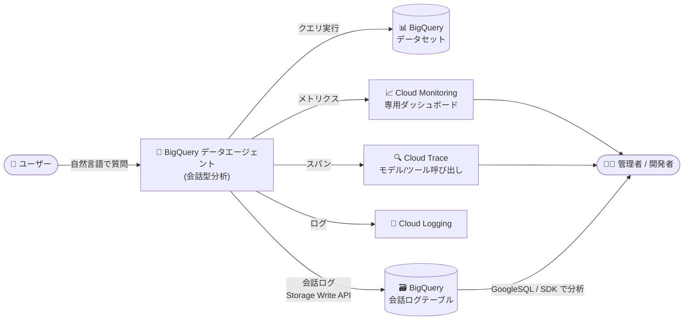

# BigQuery: データエージェントの可観測性 (Google Cloud Observability 統合) が GA

**リリース日**: 2026-11-02

**サービス**: BigQuery

**機能**: データエージェントと会話のパフォーマンス・利用状況・レイテンシ・コストのモニタリング

**ステータス**: GA (一般提供)

📊 [このアップデートのインフォグラフィックを見る](https://takech9203.github.io/google-cloud-news-summary/20261102-bigquery-data-agent-observability-ga.html)

## 概要

BigQuery のデータエージェント (会話型分析エージェント) とその会話について、Google Cloud Observability を使用してパフォーマンス、採用状況 (アダプション)、レイテンシ、コストをモニタリングできる機能が一般提供 (GA) になりました。本機能は 2026 年 8 月 24 日に Preview として公開されており、約 2 か月で GA に昇格しました。

可観測性を有効にすると、会話で使用されたエージェント数、質問したユーザー数、作成された会話数、最も多く回答したエージェント、最もよく使われたナレッジソース、ユーザーエンゲージメント、予測トークン使用量、時間別の回答レイテンシといったメトリクスを確認できます。メトリクスは BigQuery の「エージェント」ページの Monitoring タブ、または Cloud Monitoring の専用ダッシュボード「BigQuery Conversational Analytics」で可視化され、Cloud Trace によるモデル呼び出し・ツール呼び出しのスパン分析も可能です。

自然言語でデータ分析を行うデータエージェントを組織に展開するデータプラットフォーム管理者やエージェント開発者にとって、エージェントの品質・コスト・利用状況を定量的に把握し、運用を本番レベルで管理するための基盤が整ったアップデートです。

**アップデート前の課題**

- データエージェントの利用状況 (誰が・どのエージェントに・どれだけ質問しているか) を定量的に把握する標準的な手段がなかった
- 回答レイテンシやトークン使用量 (コスト) をエージェント横断で可視化する仕組みがなく、品質・コスト管理が困難だった
- 会話ターン内のモデル呼び出しやツール呼び出しの内訳が見えず、エラーや遅延のトラブルシューティングに手間がかかった
- Preview 期間中は Pre-GA の提供条件が適用され、本番ワークロードでの利用にはサポート面の制約があった

**アップデート後の改善**

- エージェントの利用数・ユーザー数・会話数・人気ナレッジソースなどの採用状況メトリクスを標準で収集・可視化できるようになった
- 予測トークン使用量や時間別回答レイテンシにより、コストとパフォーマンスを継続的にトラッキングできるようになった
- Cloud Trace のスパンで会話ターン内のモデル呼び出し・ツール呼び出しのシーケンスを可視化し、エラーや遅延の原因を特定できるようになった
- GA となり、本番環境での利用に適した正式サポート対象の機能になった

## アーキテクチャ図



データエージェントのテレメトリーが Cloud Monitoring (メトリクス)、Cloud Trace (スパン)、Cloud Logging (ログ) に送信され、さらにエージェント単位の会話ログを BigQuery テーブルに書き込んで SQL や SDK で分析できます。

## サービスアップデートの詳細

### 主要機能

1. **プロジェクトレベルの可観測性メトリクス**
   - 会話で使用されたエージェント数、質問したユーザー数、作成された会話数を可視化
   - 最も多く質問に回答したエージェント、最もよく使われたナレッジソースを特定
   - ユーザーエンゲージメント、予測トークン使用量、時間別回答レイテンシをトラッキング
   - エージェントメトリクスには、エージェント使用状況、モデル呼び出し、ツール使用、ヘルス、レイテンシ、トークン使用量が含まれる

2. **専用ダッシュボードと Metrics Explorer**
   - BigQuery の「エージェント」ページの Monitoring タブでメトリクスを直接確認可能
   - Cloud Monitoring に専用ダッシュボード「BigQuery Conversational Analytics」が提供される
   - Metrics Explorer で個別メトリクスを確認したり、カスタムダッシュボードを作成したりできる

3. **Cloud Trace によるモデル呼び出しのデバッグ**
   - 会話ターン内のモデル呼び出し・ツール呼び出しなどの処理シーケンスをスパンとして可視化
   - Trace エクスプローラでスパンの詳細を確認し、エラーやレイテンシの原因を調査できる
   - トレースデータはオブザーバビリティデータセットに 30 日間保存され、リンクされたデータセット経由で BigQuery に長期保存することも可能

4. **会話ログの BigQuery への記録と分析 (補完機能)**
   - エージェント単位の会話ロギングを有効にすると、各会話ターン (ユーザーの質問、エージェントの回答、レイテンシ、モデルトークン使用量) が BigQuery テーブルに書き込まれる
   - 記録されたイベントは GoogleSQL、Colab ノートブック、BigQuery agent analytics Python SDK で分析・評価できる

## 技術仕様

### 前提となる API と設定

| 項目 | 詳細 |
|------|------|
| 必要な API | Cloud Trace API、Cloud Monitoring API、Cloud Logging API |
| デフォルト状態 | 可観測性は無効 (管理者がプロジェクトまたは組織単位で有効化) |
| 設定リソース | `gibqObservabilitySettings` (location は `global`) |
| メトリクス収集 | 有効化後に収集開始 (過去データのバックフィルなし) |
| トレース保持期間 | オブザーバビリティデータセットに 30 日間 (BigQuery 連携で長期保存可) |

### 必要なロール (メトリクス・トレース・ログの閲覧)

| 目的 | ロール |
|------|------|
| モニタリングデータの閲覧 | Monitoring Viewer (`roles/monitoring.viewer`) |
| トレースの閲覧 | Cloud Trace User (`roles/cloudtrace.user`) |
| ログの閲覧 | Logs Viewer (`roles/logging.viewer`) |
| データセットの閲覧 | BigQuery Data Viewer (`roles/bigquery.dataViewer`) |
| 管理者設定の閲覧 | Gemini for Google Cloud User (`roles/cloudaicompanion.user`) |

有効化には `cloudaicompanion.gibqObservabilitySettings.*`、`cloudaicompanion.settingBindings.*`、`observability.traceScopes.create`、`serviceusage.services.enable` などの権限が必要です。

## 設定方法

### 前提条件

1. Cloud Trace、Cloud Monitoring、Cloud Logging の各 API を有効化していること
2. 可観測性の有効化に必要な権限 (上記「技術仕様」参照) を持っていること

### 手順

#### ステップ 1: 可観測性設定の作成 (gcloud)

```bash
gcloud gemini gibq-observability-settings create SETTING_NAME \
  --conversational-analytics-setting-metrics-enabled \
  --conversational-analytics-setting-traces-enabled \
  --project=PROJECT_ID \
  --location=global
```

メトリクスとトレースを有効にした可観測性設定を作成します。Google Cloud コンソールの場合は、BigQuery の「エージェント」ページ > Monitoring タブから有効化できます (コンソール経由の場合、設定名は `default`)。

#### ステップ 2: 設定をプロジェクトにバインド

```bash
gcloud gemini gibq-observability-settings setting-bindings create BINDING_NAME \
  --gibq-observability-setting=SETTING_NAME \
  --target=projects/PROJECT_ID \
  --location=global \
  --project=PROJECT_ID
```

バインディング名には `binding-PROJECT_ID` の形式が推奨されています。

#### ステップ 3: メトリクスとトレースの確認

```bash
# Cloud Monitoring のダッシュボード「BigQuery Conversational Analytics」を確認
# または BigQuery の「エージェント」ページ > Monitoring タブを確認
```

Cloud Monitoring の「My Dashboards」で「BigQuery Conversational Analytics」ダッシュボードを開き、エージェント使用状況・レイテンシ・トークン使用量を確認します。デバッグには Trace エクスプローラでスパンを確認します。

#### (参考) 可観測性の無効化

```bash
gcloud gemini gibq-observability-settings update SETTING_NAME \
  --no-conversational-analytics-setting-metrics-enabled \
  --no-conversational-analytics-setting-traces-enabled \
  --project=PROJECT_ID \
  --location=global
```

## メリット

### ビジネス面

- **エージェント導入効果の定量化**: 質問したユーザー数・会話数・エージェント別の回答数により、データエージェントの社内浸透度 (アダプション) を定量的に評価できる
- **コストの可視化と予測**: 予測トークン使用量によりエージェント運用コストを把握し、予算管理やコスト最適化の判断材料にできる
- **本番運用への移行**: GA により正式サポート対象となり、エンタープライズの本番ワークロードで安心して利用できる

### 技術面

- **標準的な Observability スタックとの統合**: Cloud Monitoring / Trace / Logging という既存の運用基盤でエージェントを監視でき、アラートやカスタムダッシュボードなど既存のノウハウを活用できる
- **トラブルシューティングの効率化**: Trace のスパンで会話ターン内のモデル呼び出し・ツール呼び出しを可視化し、遅延やエラーの原因箇所を特定できる
- **SQL ベースの詳細分析**: 会話ロギングと組み合わせることで、会話ターン単位の生データを BigQuery で分析し、エージェントの回答品質評価やプロンプト最適化につなげられる

## デメリット・制約事項

### 制限事項

- 可観測性はデフォルトで無効であり、管理者による有効化が必要
- メトリクスは有効化後から収集され、過去データはバックフィルされない
- トレースデータの標準保持期間は 30 日間 (長期保存には BigQuery へのリンクデータセット構成が必要)

### 考慮すべき点

- 有効化には複数の細かい IAM 権限が必要なため、組織のロール設計を事前に確認する必要がある
- Cloud Monitoring / Trace / Logging の利用には各サービスの料金体系が適用されるため、テレメトリー量に応じたコストを考慮する
- エージェント単位の会話ロギングを使う場合、Conversational Analytics API サービスエージェントへのログデータセットに対する `roles/bigquery.dataEditor` 付与が必要

## ユースケース

### ユースケース 1: 全社展開したデータエージェントの採用状況ダッシュボード

**シナリオ**: データプラットフォームチームが複数部門にデータエージェントを展開しており、経営層に利用状況とROIを報告したい。

**実装例**:
```bash
# 可観測性を有効化した後、Cloud Monitoring で
# 「BigQuery Conversational Analytics」ダッシュボードを確認し、
# 必要に応じてカスタムダッシュボードを作成
```

**効果**: エージェント数・ユーザー数・会話数・人気ナレッジソースを定期レポート化し、活用が進んでいない部門や改善が必要なエージェントをデータドリブンに特定できる。

### ユースケース 2: 回答が遅いエージェントのボトルネック調査

**シナリオ**: 特定のエージェントで回答レイテンシが高いという報告があり、原因がモデル呼び出しなのかツール (クエリ) 実行なのかを切り分けたい。

**効果**: 時間別回答レイテンシのメトリクスで傾向を把握し、Trace エクスプローラで該当会話ターンのスパンを確認することで、遅延が発生している処理ステップを特定し、ナレッジソースやエージェント設定の改善につなげられる。

### ユースケース 3: 会話ログを使った回答品質の継続評価

**シナリオ**: エージェントの回答品質を定期的に評価し、プロンプト (エージェント指示) を改善したい。

**効果**: エージェント単位の会話ロギングで質問・回答・レイテンシ・トークン使用量を BigQuery テーブルに蓄積し、GoogleSQL や BigQuery agent analytics Python SDK で評価パイプラインを構築できる。

## 料金

この機能自体の追加料金は Release Notes には記載されていませんが、メトリクス・トレース・ログの収集には Google Cloud Observability (Cloud Monitoring、Cloud Trace、Cloud Logging) の料金体系が適用されます。また、会話ロギングを有効にした場合は BigQuery のストレージ・クエリ料金が発生します。詳細は以下の料金ページを参照してください。

- [Google Cloud Observability の料金](https://cloud.google.com/stackdriver/pricing)
- [BigQuery の料金](https://cloud.google.com/bigquery/pricing)

## 利用可能リージョン

可観測性設定 (`gibqObservabilitySettings`) は `global` ロケーションで作成します。データエージェント自体の利用可能リージョンについては[公式ドキュメント](https://docs.cloud.google.com/bigquery/docs/create-data-agents)を参照してください。

## 関連サービス・機能

- **Cloud Monitoring**: エージェントメトリクスの収集・可視化。専用ダッシュボード「BigQuery Conversational Analytics」を提供
- **Cloud Trace**: 会話ターン内のモデル呼び出し・ツール呼び出しのスパン可視化とデバッグ
- **Cloud Logging**: エージェント関連ログの収集・閲覧
- **Conversational Analytics API (Gemini Data Analytics)**: データエージェントの作成・管理・チャットを担う基盤 API
- **BigQuery agent analytics**: ADK や LangGraph のエージェント対話データを Storage Write API 経由で BigQuery にストリーミングし、SQL や SDK で分析するオープンソースソリューション
- **Gemini Enterprise / Data Studio**: 公開したデータエージェントをビジネスユーザーが利用するためのインターフェース

## 参考リンク

- 📊 [インフォグラフィック](https://takech9203.github.io/google-cloud-news-summary/20261102-bigquery-data-agent-observability-ga.html)
- [公式リリースノート](https://docs.cloud.google.com/release-notes#November_02_2026)
- [ドキュメント: エージェントと会話のモニタリング](https://docs.cloud.google.com/bigquery/docs/create-data-agents#monitor_agents_and_conversations)
- [ドキュメント: BigQuery agent analytics](https://docs.cloud.google.com/bigquery/docs/bigquery-agent-analytics)
- [ドキュメント: 会話ロギングの概要](https://docs.cloud.google.com/bigquery/docs/conversation-logging-overview)
- [Google Cloud Observability の料金ページ](https://cloud.google.com/stackdriver/pricing)

## まとめ

BigQuery データエージェントの可観測性が GA となり、自然言語データ分析エージェントを本番運用するための監視基盤 (メトリクス・トレース・ログ) が正式に利用可能になりました。データエージェントを展開中・展開予定の組織は、まず管理者が可観測性を有効化し、Cloud Monitoring の専用ダッシュボードで採用状況・レイテンシ・トークン使用量の継続的なトラッキングを始めることを推奨します。

---

**タグ**: BigQuery, データエージェント, 会話型分析, Google Cloud Observability, Cloud Monitoring, Cloud Trace, Cloud Logging, GA, 生成AI
